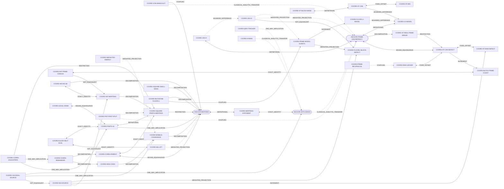

# Coordinate atlas: one phenomenon, many coordinates

**Read this before treating an object in this repository as new.** RH_Lean describes one phenomenon — the square-root-scale fluctuation of the primes (π − Li₂) and of the Möbius function (M), both governed by the nontrivial zeros of ζ — in dozens of coordinate systems: canonical VF defects, floor-Li event streams, #915 first-bad sources, Johnston integrals, square-endpoint Mertens values, Co/Div covariances, Hecke quotient buckets, q² daughters, Euler self-dual bilinears, Newton lifts, ideal-labelled OpenAI sources and Nyman distances. Different files name the same quantity differently, and the same letter means different quantities in different files.

This page is generated from [coordinate-atlas.json](coordinate-atlas.json) by [`scripts/coordinate_atlas.py`](../scripts/coordinate_atlas.py). It records, for each coordinate, its definition, Lean names, notation and search aliases, and the **typed crosswalks** between coordinates, each with its evidence status. A crosswalk path is navigation, not a proof: only the cited declarations (with their hypotheses) establish anything, non-invertible steps cannot be run backwards, and `NOT_EQUIVALENT` edges are barriers. Open mathematical status lives in the [proof-dependency DAG](PROOF_DEPENDENCY_DAG.md).

## How to use it

| Question | Without running code | With Python |
| --- | --- | --- |
| What does `D_R` (or `C_R`, `E_R`, `K`, `Q`, …) mean here? | §4 notation collisions | `python3 scripts/coordinate_atlas.py lookup D_R` |
| How is coordinate A related to coordinate B? | §3 chains to the anchors; §2 crosswalk table | `python3 scripts/coordinate_atlas.py path "rough correlation" ANCHOR-PRIME-DISCREPANCY [--lean-only]` |
| Which proved theorems rewrite this quantity in other coordinates? | §6, or the per-coordinate pages in [search/coordinates/](search/INDEX.md) | `python3 scripts/coordinate_atlas.py lookup lowOwnerPhysicalAmplitudeRemainder` |
| Which files use this coordinate under any of its names? | [search/INDEX.md](search/INDEX.md) | `python3 scripts/proofq.py repo-search "q2 daughter" --expand` |
| Which aliases should I grep for? | the coordinate's page lists them | `git grep -n -E "$(python3 scripts/coordinate_atlas.py expand 'floor-Li' --grep)"` |

**Relations.** `DEFINITIONAL`, `EXACT_IDENTITY`, `FIXED_OFFSET` and `BOUND_EQUIVALENCE` are invertible (the last with changed existential constants). `BOUNDED_DIFFERENCE`, `INCREMENT`, `RESTRICTION`, `DECOMPOSITION`, `COUPLING` (a bilinear identity mixing two coordinates), `WEIGHTED_PROJECTION` (loses information), `ONE_WAY_IMPLICATION` and `CLASSICAL_ANALYTIC_TRANSFER` (literature) are not. **Statuses.** `LEAN_ON_MAIN` (declaration checked to exist on main), `DEFINITIONAL`, `LITERATURE`, `PAPER`, `EXTERNAL`, `AUDIT` (barriers only).

**A Lean-only bridge between the two faces.** `python3 scripts/coordinate_atlas.py path COORD-VF-CAN-DEFECT ANCHOR-MERTENS --lean-only` finds a chain in which every step is a declaration on main. It runs from the canonical VF defect through the von Koch bound equivalence to π − Li₂, then through the floor-Li rounding and the η event stream to the Buchstab coupling of prime/floor-Li mismatches with Mertens prefixes, and ends at M. The Buchstab step is a bilinear coupling, not an equivalence, so no bound transfers along the chain. It shows where the two faces of the phenomenon already meet inside Lean.

## 1. Coordinates

<!-- BEGIN GENERATED: coordinates -->
| Family | Coordinate | Notation | Definition | Index | Lean | Routes | DAG nodes |
| --- | --- | --- | --- | --- | --- | --- | --- |
| anchor | `ANCHOR-PRIME-DISCREPANCY`<br/>Prime-counting discrepancy pi - Li_2 | Δ(x), Delta(t) | Delta(x) = pi(x) - Li_2(x), Li_2(x) = int_2^x dt/log t (repository normalization). | real x >= 4 (pi evaluated at floor x) | [`vfMidPrimeLiError`](../research/VF_MID_VON_KOCH_BRIDGE.lean)<br/>[`vfMidLogarithmicIntegralFromTwo`](../research/VF_MID_VON_KOCH_BRIDGE.lean)<br/>[`PrimeLiVonKochBoundedStatement`](../research/VF_MID_VON_KOCH_BRIDGE.lean) | VF-LOW, JOH, SAT | `PROP-PRIME-LI-VONKOCH`, `HISTORICAL-VONKOCH-1901` |
| anchor | `ANCHOR-MERTENS`<br/>Mertens function M | M(x), M(X), M(n) | M(x) = sum_{n<=x} mu(n); energy form \|M(x)\|^2 <= C (x+1)^(1+eps). | integer x >= 0 (M(0) = 0) | [`mertensSummatory`](../RHLean/Analysis/SquarePrefixMertensBridge.lean)<br/>[`MertensEnergyBoundedStatement`](../RHLean/Analysis/SquarePrefixMertensBridge.lean)<br/>[`mertensSummatoryInt`](../RHLean/Proof/SquareRootAncestryRoot.lean) | CODIV, OAI-NNS, FINITE-AC, CORR4, MU-LIFT | `PROP-MERTENS-ENERGY` |
| anchor | `ANCHOR-ZETA-ZEROS`<br/>Nontrivial zeta zeros / rightmost real part | Θ, ρ | Theta = sup { Re rho : zeta(rho) = 0, 0 < Re rho < 1 }; RH <=> Theta = 1/2. | complex s | [`zetaRightmostRealPart`](../research/MERTENS_EXPONENT_DIAGNOSTICS.lean) | CODIV, OAI-NNS, NYMAN, VF-LOW | `RH`, `MILESTONE-MERTENS-CONVERSE`, `IMPORTED-OAI-7-8` |
| prime-side | `COORD-VF-REAL-PRIME-ERROR`<br/>pi - VF on the real line | — | pi(x) - VF_can(x) (canonical) or pi(x) - vfMid(x) (legacy). | real x >= 4 | [`vfCanonicalPrimeError`](../research/VF_CANONICAL_SQRT_TWO.lean)<br/>[`vfMidPrimeError`](../research/VF_MID_VON_KOCH_BRIDGE.lean) | VF-LOW | `PROP-VF-CAN-REAL-VONKOCH`, `PROP-VF-MID-REAL-VONKOCH` |
| prime-side | `COORD-VF-CAN-DEFECT`<br/>Canonical square-endpoint defect D_R^can | D_R^can, D_can(R), D_R | D_can(R) = pi(R^2) - F_R - sqrt 2 = pi(R^2) - VF_can(R^2). | integer R >= 2 | [`vfCanonicalSquareDefect`](../research/VF_CANONICAL_SQRT_TWO.lean)<br/>[`VFCanonicalSquareVonKochStatement`](../research/VF_CANONICAL_SQRT_TWO_VON_KOCH.lean) | VF-LOW | `OPEN-VF-ACTUAL-PRIME`, `MILESTONE-VONKOCH-VF-LEAN` |
| prime-side | `COORD-VF-RAW-DEFECT`<br/>Legacy raw square-endpoint defect D_raw | D_raw(R) | D_raw(R) = pi(R^2) - F_R. | integer R >= 2 | [`vfMidDirectSquareEndpointError`](../research/VF_MID_DIRECT_SIGNED_DYNAMICS.lean)<br/>[`vfMidActualPrimeEndpointDefect`](../research/VF_MID_OWNER_ADMISSIBLE_ESCAPE_CLASS.lean) | VF-LOW | `PROP-VF-MID-SQUARE-VONKOCH` |
| prime-side | `COORD-BLOCK-PRIME-COUNT`<br/>Actual primes per square block P_R | P_R | P_R = pi((R+1)^2) - pi(R^2). | integer R >= 2 | [`vfMidDirectPrimeBandCount`](../research/VF_MID_DIRECT_SIGNED_DYNAMICS.lean)<br/>[`vfMidDirectBandError`](../research/VF_MID_DIRECT_SIGNED_DYNAMICS.lean)<br/>[`vfMidIntegerBlockPrimeSupply`](../research/VF_MID_SQUARE_WHEEL_BACKLOG.lean) | VF-LOW, SAT | — |
| prime-side | `COORD-PRIME-MODEL-EVENTS`<br/>Prime vs floor-Li event stream eta | η(k), eta(k) | eta(k) = 1_prime(k) - (Q(k) - Q(k-1)) in {-1,0,1}. | integer k >= 3 | [`vfMidFloorLiPrimitiveMismatch`](../research/VF_MID_FLOOR_LI_SIGNED_POPULATION_BALANCE.lean)<br/>[`vfMidFloorLiSignedPopulationBalance`](../research/VF_MID_FLOOR_LI_SIGNED_POPULATION_BALANCE.lean) | JOH, VF-LOW, SAT | `CARRIER-PRIME-MODEL-EVENTS` |
| prime-side | `COORD-FLOORLI-BLOCK-DEFECT`<br/>Floor-Li block prime defect D_r (zeroth moment) | D_r | D_r = Q((r+1)^2) - Q(r^2) - (pi((r+1)^2) - pi(r^2)). | integer r >= 2 | [`vfMidFloorLiBlockPrimeDefect`](../research/VF_MID_FLOOR_LI_DISCRETE_BACKLOG.lean)<br/>[`vfMid915HistoricalMovingOwnerCorrection`](../research/VF_MID_915_FLOOR_LI_TRANSPORT_BOUNDARY.lean) | VF-LOW, JOH | `CARRIER-915-ZEROTH-MOMENT`, `MILESTONE-915-MOVING-OWNER` |
| prime-side | `COORD-JOH-G`<br/>Johnston cumulative statistic G and displacement J_r | G(N), J_r, B(n) | G(N) = sum_{2<=n<N} (pi(n) - Q(n) - 1) = A(N) - T(N) - L(N); J_r = sum_{r^2<k<(r+1)^2} ((r+1)^2 - k) eta(k). | integer N >= 3; blocks r | — | JOH, SAT | `OPEN-JOH-SIGN`, `CARRIER-JOH-FIRST-MOMENT`, `CLAIM-20261024-OWNER-1` |
| prime-side | `COORD-JOH-H`<br/>Johnston integral H(X) | H(X) | H(X) = int_2^X (pi(t) - li(t)) dt (classical li). | real X > 2 | — | JOH | `LIT-JOHNSTON-2022` |
| prime-side | `COORD-915-SOURCE`<br/>Original #915 first-bad weighted source | Source(R), TotalMass(R), beta_R | Source(R) = D_raw(R+1) = D_raw(R) + P_R - m_R; TotalMass(R) = (\|D_raw(R)\| + beta_R)^2, beta_R = m_R + (1 - 2 w_R) P_R; native VF weights, masks, clipping, anchors, NNS denominators. | integer R >= 8 (first-bad successor R+1 at K = 2) | [`vfMidFirstBadDecompressedHistoricalSource`](../research/VF_MID_FIRST_BAD_SOURCE_TO_SECTOR_SIX_INLET.lean)<br/>[`vfMidFirstBadZeroTargetTotalMass`](../research/VF_MID_FIRST_BAD_NORMALIZED_PARTIAL_MOMENT.lean)<br/>[`VFMid915FirstBadSourcePaymentStatement`](../research/VF_MID_FIRST_BAD_EXACT_BUDGET_CLOSE.lean) | VF-LOW | `OPEN-915-SOURCE-PAYMENT`, `CARRIER-915-WEIGHTED-SOURCE` |
| prime-side | `COORD-RAW-LEDGER`<br/>Raw odd-seat factor-depth ledger L_R = T_R + H_R | L_R, T_R, H_R, c(r,n) | c(r,n) = w_r - 1_prime(n) on odd seats r^2 < n < (r+1)^2; L_R = sum c = T_R (prime tags) + H_R (positive composite seats). | integer R >= 3 | — | VF-LOW, SAT | — |
| prime-side | `COORD-SAT-PRIME-CENSUS`<br/>Least-prime owner census P_R = R - C_R | C_R, P_R = R - C_R | For the R odd interior seats of (R^2,(R+1)^2): P_R = R - C_R with C_R the seats removed by their unique least prime owner. | integer R | — | SAT | `MECH-SAT-OWNER-REMOVAL` |
| prime-side | `COORD-VON-MANGOLDT`<br/>von Mangoldt / Chebyshev psi | Λ(n), psi(x) | Lambda(n) = log p on prime powers; psi(x) = sum_{n<=x} Lambda(n). | integer x >= 1 | [`pntFirst_landau_vonMangoldt_mertens`](../research/PNT_FIRST_LAMBDA_HYPERBOLA_ANCHOR_20261018.lean) | SAT, CODIV | — |
| prime-side | `COORD-PRIME-RECIPROCAL`<br/>Mertens prime-reciprocal error E_prime | E_prime(y) | E_prime(y) = sum_{p<=y} 1/p - log log y - M_Meissel. | real y >= 2 | — | VF-LOW | — |
| mobius-side | `COORD-SQUARE-PREFIX-MERTENS`<br/>Mertens at square endpoints | X_R | X_R = R^2 - 1 (squareRootEndpoint R); squarePrefixMertens n = M((n+1)^2 - 1). | integer R >= 2 | [`squarePrefixMertens`](../RHLean/Analysis/SquarePrefixMertensBridge.lean)<br/>[`squarePrefixEndpoint`](../RHLean/Analysis/SquarePrefixMertensBridge.lean)<br/>[`squareRootEndpoint`](../RHLean/Analysis/TwoABPrimeDilation.lean) | FINITE-AC, CORR4, SAT, CODIV | — |
| mobius-side | `COORD-SQUARE-SHELL-MASS`<br/>Square-shell Mobius mass | δ_r, delta_r | delta_R = sum of mu over the shell [R^2, (R+1)^2) (vf919SquareShellSum, half-open) or (r^2, (r+1)^2) (strict, energy notes). | integer R | [`vf919SquareShellSum`](../research/VF_919_SEVEN_EIGHTHS_SQUARE_SHELL_BRIDGE_20261019.lean) | CODIV, OAI-NNS, SAT | — |
| mobius-side | `COORD-SAT-MERTENS`<br/>Signed smooth-minus-transport S = A - T | A_R, T_R, A_mu(R), T_mu(R) | M(R^2-1) = A_mu(R) - T_mu(R), A_mu(R) = sum_{m<=X, P+(m)<=R} mu(m), T_mu(R) = sum_{R<q<=X prime} M(floor(X/q)). | integer R >= 4 | [`squarePrefixMertens_eq_squareRootSmooth_sub_transport`](../RHLean/Analysis/TwoABScaleTransfer.lean) | SAT, CODIV | `MILESTONE-1019-BIRTH-TRANSPORT` |
| mobius-side | `COORD-HECKE-A6`<br/>Excluded-six Hecke coefficient a6 and quotient kernel K | a6(n), C6(z), K(t), P0, P1, B_X(t), D_X(t), V_low | a6 = 1_{gcd(n,6)=1} (mu * (chi_{-3} mu)); M(X) = sum_m a6(m) K(floor(X/m)) with a period-36 kernel K; at y = floor(sqrt X), M = P0 - 2 P1. | integer X >= 12 | [`vf919FiniteSixExcludedHecke`](../research/VF_MID_919_OAI_EXCLUDED_SIX_SIGNED_KERNEL.lean)<br/>[`vf919SixExcludedSharpQuotientKernel`](../research/VF_MID_919_OAI_EXCLUDED_SIX_SIGNED_KERNEL.lean)<br/>[`vf919QuotientKernelPrimitive36`](../research/VF_MID_919_QUOTIENT_SIGNED_RETURN.lean) | CODIV, OAI-NNS | `MECH-SIGNED-QUOTIENT-VARIATION` |
| mobius-side | `COORD-FINITE-AC`<br/>Finite A/C historical envelope | K_R, Q_R | K_R = max_{0<=y<R} (M(y)-1)^2/(y+1); Q_R = 2M(R-1) - M(R^2-1); finite A: (M(R^2-1)-1)^2 <= A R^2 K_R. | integer R >= 2 | [`LowerMertensCriticalEnvelope`](../RHLean/Proof/SquareRootLegalAncestryGramReduction.lean)<br/>[`SquareRootMertensEndpointAmplificationStatement`](../RHLean/Proof/SquareRootMertensEndpointAmplification.lean) | FINITE-AC, CORR4 | `OPEN-FINITE-AC` |
| mobius-side | `COORD-EULER-SELF-DUAL`<br/>Euler self-dual bilinear / Newton-lift double sum | Q_N(X), q_R(n) | Q_{R-1}(R^2-1) = sum_{a,b<R} mu(a) mu(b) floor((R^2-1)/(ab)) = sum_{n<=X} (P_R*P_R*zeta)(n) = 2M(R-1) - M(R^2-1). | integer R >= 2 | [`eulerSelfDualBilinear`](../research/EULER_HYBRID_ABEL_GRAM_20261027.lean)<br/>[`eulerSelfDualConvolutionCoefficient`](../research/EULER_SELF_DUAL_POINTWISE_20261027.lean)<br/>[`newtonLift_prefix_exact`](../research/MERTENS_FINITE_PREFIX_EXTENSION.lean) | FINITE-AC, MU-LIFT | `OPEN-FINITE-AC`, `OPEN-MU-LIFT` |
| mobius-side | `COORD-CORR4-PARENT`<br/>CORR-4 rough correlation C_R | C_R | C_R = squareRootCanonicalRoughCorrelation R = M(R-1) - M(R^2-1). | integer R >= 2 | [`squareRootCanonicalRoughCorrelation`](../RHLean/Analysis/SquareRootCanonicalRoughCovariance.lean) | CORR4 | `OPEN-CORR4` |
| mobius-side | `COORD-CORR4-DAUGHTERS`<br/>CORR-4 low q^2 daughters (E_R, U_R) | E_R, U_R, Y_q | Y_q = floor(X_R/q^2), q odd prime with q^2 < R; E_R = sum M(Y_q)^2; U_R = sum M(Y_q)/q. | integer R >= 56 | [`canonicalRoughLowQ2DaughterEnergy`](../research/CANONICAL_ROUGH_Q2_TAIL_REDUCTION.lean)<br/>[`farFourOddQ2DaughterEnergy`](../RHLean/Proof/FarSurvivorRenewal_is_LowerMertens.lean)<br/>[`lowOwnerCriticalMertensSynthesis`](../research/LOW_OWNER_PHYSICAL_AMPLITUDE_TRANSPORT.lean) | CORR4 | `OPEN-CORR4`, `PR1023-FRAME-B7` |
| mobius-side | `COORD-PNT-FIRST-SPLIT`<br/>PNT-first cofactor split M = S - L - E | S_R, L_R, E_R, N_R(c) | M(X) = S_R - L_R - E_R, S_R = sum_{P+(n)<R} mu(n), L_R = sum_{c<R} mu(c)(Li_2(t_c) - Li_2(R-1)), E_R = sum_{c<R} mu(c)(Delta(t_c) - Delta(R-1)), t_c = floor(X/c). | integer R >= 3, X = R^2 - 1 | — | SAT, CODIV | — |
| mobius-side | `COORD-BUCHSTAB-FLOOR-LI`<br/>Buchstab floor-Li brackets | — | M(x) = smooth bracket + innovation bracket, the innovation being sum_{y<q<=x} (prime-minus-floor-Li weight)(q) * M(floor(x/q)). | integer x >= 1, y = floor(sqrt x) | [`buchstabFloorLiSmoothBracket`](../research/VF_MID_FLOOR_LI_BUCHSTAB_EXACT_BRACKETS_20261022.lean)<br/>[`buchstabFloorLiInnovationBracket`](../research/VF_MID_FLOOR_LI_BUCHSTAB_EXACT_BRACKETS_20261022.lean) | SAT, JOH, CODIV | — |
| mobius-side | `COORD-MU-LIFT`<br/>Full-prefix amplitude E(B) and Newton/Heath-Brown lift | E(B), G(B), K1, K2, K3 | E(B) = max_{1<=n<B} \|M(n)\|/sqrt(n); M(X) = 2M(N) + K1 - K2 + K3 for N = B - 1, B <= X < B^2. | integer B >= 2 | [`heathBrownLift`](../research/MERTENS_HEATH_BROWN_SIGNED.lean)<br/>[`heathBrownLift_agrees_below_power`](../research/MERTENS_HEATH_BROWN_SIGNED.lean) | MU-LIFT | `OPEN-MU-LIFT`, `MILESTONE-MERTENS-SIGNED-LIFT` |
| covariance-statistic | `COORD-MOBIUS-COVARIANCE`<br/>Diagonal + signed pair covariance of mu | D(N), C(N) | D(N) = sum_{n<=N} mu(n)^2, C(N) = sum_{a<b<=N} mu(a) mu(b); M(N)^2 = D(N) + 2 C(N). | integer N | [`realMertensDiagonal`](../RHLean/Analysis/DeterministicTGreenKuboComparison.lean)<br/>[`realMertensPositiveLagPairSum`](../RHLean/Analysis/DeterministicTGreenKuboComparison.lean) | CODIV, OAI-NNS | `MILESTONE-COVARIANCE-IDENTITY` |
| covariance-statistic | `COORD-WEIGHTED-ENERGY`<br/>Weighted Mertens energy E_eps(T) | E_eps(T), C_eps(T) | E_eps(T) = sum_{n<=T} M(n)^2/n^(2+2eps) = D_eps(T) + 2 C_eps(T). | real T, eps > 0 | — | CODIV | — |
| covariance-statistic | `COORD-NNS-CODIV`<br/>Zero-target NNS co-partial moments (Co/Div) | CUPM, CLPM, DUPM, DLPM | For a pair (x, y): x*y = CUPM + CLPM - DLPM - DUPM about target 0 (Co = CUPM + CLPM, Div = DUPM + DLPM). | real pairs | [`zeroTargetCUPM`](../research/ZERO_TARGET_PARTIAL_MOMENT_COVARIANCE.lean)<br/>[`zeroTargetCLPM`](../research/ZERO_TARGET_PARTIAL_MOMENT_COVARIANCE.lean)<br/>[`zeroTargetDLPM`](../research/ZERO_TARGET_PARTIAL_MOMENT_COVARIANCE.lean)<br/>[`zeroTargetDUPM`](../research/ZERO_TARGET_PARTIAL_MOMENT_COVARIANCE.lean) | OAI-NNS, CODIV, VF-LOW | — |
| covariance-statistic | `COORD-LEGAL-GRAM`<br/>Legal live-packet ancestry Gram | Γ_R, Gamma_R | M(X_R)^2 = L_R + 2 Gamma_R over legal live odd packets. | integer R >= 2 | [`squareRootLegalAncestryGramDefect`](../RHLean/Proof/SquareRootLegalAncestryGramReduction.lean)<br/>[`SquareRootLegalAncestryGramAmplificationStatement`](../RHLean/Proof/SquareRootLegalAncestryGramReduction.lean) | FINITE-AC, CODIV | `PROP-LEGAL-ANCESTRY-GRAM` |
| covariance-statistic | `COORD-CORR4-REMAINDER`<br/>CORR-4 physical remainder B_R and first-owner Gram | B_R, Γ_R, D_R | B_R = C_R - U_R; \|B_R\|^2 = D_R + 2 Gamma_R with D_R the weighted Mobius diagonal and Gamma_R the first-owner Gram. | integer R >= 56 | [`lowOwnerPhysicalAmplitudeRemainder`](../research/LOW_OWNER_PHYSICAL_AMPLITUDE_TRANSPORT.lean)<br/>[`lowOwnerZeroFrequencyFirstOwnerGram`](../research/GLOBAL_RETURNED_CORE_FIRST_OWNER_GRAM.lean)<br/>[`lowOwnerZeroFrequencyMobiusDiagonal`](../research/GLOBAL_RETURNED_CORE_FIRST_OWNER_GRAM.lean) | CORR4 | `OPEN-CORR4-RELAXED-REMAINDER`, `NOGO-CORR4-FRAME-ONLY`, `MECH-CORR4-SIGNED-FIRST-OWNER-GRAM` |
| deterministic-model | `COORD-LI2-MODEL`<br/>Logarithmic integral model Li_2 | Li_2(x) | Li_2(x) = int_2^x dt/log t. | real x >= 2 | [`vfMidLogarithmicIntegralFromTwo`](../research/VF_MID_VON_KOCH_BRIDGE.lean) | VF-LOW, JOH | — |
| deterministic-model | `COORD-VF-MID`<br/>Legacy midpoint VF (vfMid) | VF_mid(x), VF_raw | vfMid(x) = sum_{r=2}^{R-1} (2r+1)/log(r^2+r+1/2) + (x-R^2)/log((R^2+x)/2), R = floor(sqrt x). | real x >= 4 | [`vfMid`](../research/VF_MID_VON_KOCH_BRIDGE.lean)<br/>[`vfMidFinishedMass`](../research/VF_MID_VON_KOCH_BRIDGE.lean)<br/>[`vfMidBandMass`](../research/VF_MID_VON_KOCH_BRIDGE.lean) | VF-LOW | — |
| deterministic-model | `COORD-VF-CAN`<br/>Canonical VF (vfCanonical) | VF_can(x), VF(x) | VF_can(x) = vfMid(x) + sqrt 2; VF_can(R^2) = F_R + sqrt 2. | real x >= 4 | [`vfCanonical`](../research/VF_CANONICAL_SQRT_TWO.lean)<br/>[`vfCanonicalFinishedMass`](../research/VF_CANONICAL_SQRT_TWO.lean)<br/>[`vfCanonicalPhase`](../research/VF_CANONICAL_SQRT_TWO.lean) | VF-LOW | `MILESTONE-VF-CANONICAL`, `MILESTONE-VF-LI-O1` |
| deterministic-model | `COORD-VF-BLOCK-MASS`<br/>VF finished mass and block mass | F_R, V_r, m_R | F_R = sum_{2<=r<R} V_r, V_r = m_r = (2r+1)/log(r^2+r+1/2); w_R = m_R/R. | integer R >= 2 | [`vfMidFinishedMass`](../research/VF_MID_VON_KOCH_BRIDGE.lean)<br/>[`vfMidBandMass`](../research/VF_MID_VON_KOCH_BRIDGE.lean) | VF-LOW | — |
| deterministic-model | `COORD-FLOOR-LI-MODEL`<br/>Floor-Li integer model Q(n) | Q(n) | Q(n) = floor(Li_2(n)); integer potential of the floor-Li staircase. | integer n >= 2 | [`vfMidFloorLiIntegerPotential`](../research/VF_MID_FLOOR_LI_SIGNED_POPULATION_BALANCE.lean) | JOH, VF-LOW | — |
| analytic | `COORD-MERTENS-EXPONENT`<br/>Mertens growth exponent | λ_M, lambda_M | lambda_M = limsup log\|M(n)\| / log n. | real | [`mertensGrowthExponent`](../research/MERTENS_EXPONENT_ENVELOPES.lean) | CODIV, OAI-NNS, MU-LIFT | `MILESTONE-MERTENS-CONVERSE`, `OPEN-MERTENS-EXPONENT-BELOW-7-8` |
| analytic | `COORD-OAI-IDEAL-SOURCE`<br/>Original OpenAI compensated ideal-labelled source | τ_S, D_cond | Ideal-labelled Gaussian/Hecke source with marked-minus-rescaled compensation, split/inert labels and sextic detector (research/oai_434). | Eisenstein ideals, height Z | [`rhleanActualEisensteinIdealNormFiber`](../research/oai_434/RHLeanActualEisensteinIdealSharpSquareBlock.lean)<br/>[`rhleanActualIdealSharpNormTerm`](../research/oai_434/RHLeanActualEisensteinIdealSharpSquareBlock.lean) | OAI-NNS | `IMPORTED-OAI-7-8`, `MECH-OAI-NNS-COMPLETE-LEDGER`, `CARRIER-OAI-IDEAL-SOURCE` |
| analytic | `COORD-QRH-TRACKER`<br/>Quasi-Riemann Tracker all-Dirichlet boundary | — | External tracker-certified zero-free boundary for all Dirichlet L-functions (0.8746075 at the 2026-10-26 note), a benchmark beside the imported 7/8. | exponent in (1/2, 1) | — | OAI-NNS, CODIV | — |
| hilbert | `COORD-NYMAN`<br/>Nyman-Beurling distance d_N | d_N, d_(N,a) | d_N = distance in L^2 from 1 to the span of integer-dilation fractional-part functions up to N. | integer N | — | NYMAN | `OPEN-NYMAN-DENSITY`, `LIT-BAEZ-DUARTE`, `LIT-BURNOL-2002` |
<!-- END GENERATED: coordinates -->

## 2. Crosswalks

<!-- BEGIN GENERATED: crosswalks -->
| From | Relation | To | Formula | Status | Evidence | Caveat |
| --- | --- | --- | --- | --- | --- | --- |
| `ANCHOR-PRIME-DISCREPANCY` | DEFINITIONAL | `COORD-LI2-MODEL` | Delta(x) = pi(x) - Li_2(x) | LEAN_ON_MAIN | [`vfMidPrimeLiError`](../research/VF_MID_VON_KOCH_BRIDGE.lean) |  |
| `COORD-VF-CAN` | FIXED_OFFSET | `COORD-VF-MID` | VF_can(x) = vfMid(x) + sqrt 2 | LEAN_ON_MAIN | [`vfCanonical_eq_legacy_plus_sqrt_two`](../research/VF_CANONICAL_SQRT_TWO.lean) |  |
| `COORD-VF-CAN` | BOUNDED_DIFFERENCE | `COORD-LI2-MODEL` | \|VF_can(x) - Li_2(x)\| <= C for every real x >= 4 | LEAN_ON_MAIN | [`abs_vfCanonicalLiError_le_uniform_allReal`](../research/VF_CANONICAL_SQRT_TWO.lean) | Deterministic; says nothing about pi. |
| `ANCHOR-PRIME-DISCREPANCY` | DECOMPOSITION | `COORD-VF-REAL-PRIME-ERROR` | pi - Li_2 = (pi - VF_can) + (VF_can - Li_2) at every real x | LEAN_ON_MAIN | [`vfCanonicalPrimeLiError_eq_primeError_add_quadrature`](../research/VF_CANONICAL_SQRT_TWO.lean) |  |
| `COORD-VF-REAL-PRIME-ERROR` | RESTRICTION | `COORD-VF-CAN-DEFECT` | pi(x) - VF_can(x) at x = R^2 equals D_can(R) | LEAN_ON_MAIN | [`vfCanonicalPrimeError_sq_eq_squareDefect`](../research/VF_CANONICAL_SQRT_TWO.lean) |  |
| `COORD-VF-CAN-DEFECT` | BOUND_EQUIVALENCE | `ANCHOR-PRIME-DISCREPANCY` | (exists C, \|D_can(R)\| <= C R log R) <=> (exists C', \|Delta(x)\| <= C' sqrt(x) log x) | LEAN_ON_MAIN | [`vfCanonicalSquareVonKoch_iff_primeLiVonKoch`](../research/VF_CANONICAL_SQRT_TWO_VON_KOCH.lean) | Existential constants change; fixed-constant statements are not preserved. |
| `COORD-VF-CAN-DEFECT` | FIXED_OFFSET | `COORD-VF-RAW-DEFECT` | D_can(R) = D_raw(R) - sqrt 2 | LEAN_ON_MAIN | [`vfCanonicalSquareDefect_eq_legacy_sub_phase`](../research/VF_CANONICAL_SQRT_TWO.lean) | Squares carry -2 sqrt2 D_raw + 2; fixed-K first-bad energies are not phase invariant. |
| `COORD-VF-CAN-DEFECT` | INCREMENT | `COORD-BLOCK-PRIME-COUNT` | D_can(R+1) = D_can(R) + (P_R - V_R) | LEAN_ON_MAIN | [`vfCanonicalSquareDefect_succ_primeWheel`](../research/VF_CANONICAL_SQRT_TWO.lean) |  |
| `COORD-VF-BLOCK-MASS` | DEFINITIONAL | `COORD-VF-CAN` | VF_can(R^2) = F_R + sqrt 2 | LEAN_ON_MAIN | [`vfMidFinishedMass`](../research/VF_MID_VON_KOCH_BRIDGE.lean) |  |
| `COORD-FLOOR-LI-MODEL` | BOUNDED_DIFFERENCE | `COORD-LI2-MODEL` | 0 <= Li_2(n) - Q(n) < 1 | DEFINITIONAL | [LI_FAN_ONE_SIDED_WEIGHTED_COMPOSITE_RH_CONTRACT_20261022.md](../research/LI_FAN_ONE_SIDED_WEIGHTED_COMPOSITE_RH_CONTRACT_20261022.md) | Rounding of the model, not prime-counting control. |
| `COORD-PRIME-MODEL-EVENTS` | INCREMENT | `COORD-FLOOR-LI-MODEL` | eta(k) = 1_prime(k) - (Q(k) - Q(k-1)) | LEAN_ON_MAIN | [`vfMidFloorLiPrimitiveMismatch`](../research/VF_MID_FLOOR_LI_SIGNED_POPULATION_BALANCE.lean) |  |
| `COORD-PRIME-MODEL-EVENTS` | WEIGHTED_PROJECTION | `COORD-FLOORLI-BLOCK-DEFECT` | signed mismatch mass on [A^2, B^2) = -(dyadic prime defect) | LEAN_ON_MAIN | [`vfMidFloorLiSignedMismatchMass_sq_eq_neg_dyadicPrimeDefect`](../research/VF_MID_FLOOR_LI_SIGNED_POPULATION_BALANCE.lean) | Zeroth moment: within-block arrival locations are lost. |
| `COORD-915-SOURCE` | WEIGHTED_PROJECTION | `COORD-FLOORLI-BLOCK-DEFECT` | historical moving-owner correction on [A,B) = -(signed floor-Li population balance on [A^2,B^2)) | LEAN_ON_MAIN | [`vfMid915HistoricalMovingOwner_eq_signedMismatch`](../research/VF_MID_915_FLOOR_LI_TRANSPORT_BOUNDARY.lean) | Aggregate only; native weights, masks, clipping, anchors and NNS terms are not carried. |
| `COORD-915-SOURCE` | INCREMENT | `COORD-VF-RAW-DEFECT` | Source(R) = D_raw(R+1) = D_raw(R) + P_R - m_R | LEAN_ON_MAIN | [`vfMidActualPrimeEndpointDefect_succ_eq_add_blockSupply`](../research/VF_MID_915_SOURCE_PAYMENT_CONTENT_AUDIT.lean) |  |
| `COORD-JOH-G` | WEIGHTED_PROJECTION | `COORD-PRIME-MODEL-EVENTS` | G(B^2) - G(A^2) = (B^2-A^2)(P_A-1) - sum_j (B^2-(j+1)^2) D_j + sum_r J_r | PAPER | [LI_FAN_ONE_SIDED_WEIGHTED_COMPOSITE_RH_CONTRACT_20261022.md](../research/LI_FAN_ONE_SIDED_WEIGHTED_COMPOSITE_RH_CONTRACT_20261022.md) | Claim 20261024-owner-1 (agent-reports); first moment, review pending. |
| `COORD-JOH-G` | WEIGHTED_PROJECTION | `ANCHOR-PRIME-DISCREPANCY` | G(N) = sum_{n<N} Delta(n) + O(N) | PAPER | [RH_PROOF_OVERLAP_AND_SEVEN_EIGHTHS_AUDIT_20261024.md](../docs/RH_PROOF_OVERLAP_AND_SEVEN_EIGHTHS_AUDIT_20261024.md) | Cesaro projection; not pointwise-invertible. |
| `COORD-JOH-H` | BOUNDED_DIFFERENCE | `COORD-JOH-G` | H(X) - G(floor X) = O(X) (li vs Li_2 and the -1 centering) | PAPER | [LI_FAN_ONE_SIDED_WEIGHTED_COMPOSITE_RH_CONTRACT_20261022.md](../research/LI_FAN_ONE_SIDED_WEIGHTED_COMPOSITE_RH_CONTRACT_20261022.md) |  |
| `COORD-JOH-H` | DEFINITIONAL | `ANCHOR-PRIME-DISCREPANCY` | H(X) = int_2^X (pi - li) = int_2^X Delta - li(2)(X - 2) | LITERATURE | [LI_FAN_ONE_SIDED_WEIGHTED_COMPOSITE_RH_CONTRACT_20261022.md](../research/LI_FAN_ONE_SIDED_WEIGHTED_COMPOSITE_RH_CONTRACT_20261022.md) |  |
| `COORD-RAW-LEDGER` | FIXED_OFFSET | `COORD-VF-CAN-DEFECT` | D_can(R) = 2 - sqrt 2 - L_R | PAPER | [CURRENT_PROOF_CONTRACT.md](../CURRENT_PROOF_CONTRACT.md) | Paper-level telescoping under the stated endpoint conventions; not compiled. |
| `COORD-PRIME-RECIPROCAL` | COUPLING | `COORD-RAW-LEDGER` | T_R - M_R^band = F_R (E_prime(2R-1) - E_prime(R-1)) + rho_R, rho_R = O(R/log^2 R) | PAPER | [CURRENT_PROOF_CONTRACT.md](../CURRENT_PROOF_CONTRACT.md) | Self-audited paper claim; band relative to its prime-free model only. |
| `COORD-SAT-PRIME-CENSUS` | EXACT_IDENTITY | `COORD-BLOCK-PRIME-COUNT` | primes among the R odd interior seats = R - C_R (least-prime owner removal) | PAPER | [CROSS_COORDINATE_LOW_QUOTIENT_RESEARCH_2026_10_17.md](../docs/CROSS_COORDINATE_LOW_QUOTIENT_RESEARCH_2026_10_17.md) | Unsigned population accounting. |
| `ANCHOR-ZETA-ZEROS` | CLASSICAL_ANALYTIC_TRANSFER | `ANCHOR-PRIME-DISCREPANCY` | Delta(x) = O(x^(Theta+eps)) and Delta(x) = Omega_+-(x^(Theta-eps)); RH <=> Delta = O(sqrt x log x) (von Koch 1901) | LITERATURE | [FORMALIZATION_MILESTONES.md](../docs/FORMALIZATION_MILESTONES.md)<br/>[VF_MID_LOWER_CHANNEL_ALONE_RH_AND_FIRST_BAD_GATE.md](../research/VF_MID_LOWER_CHANNEL_ALONE_RH_AND_FIRST_BAD_GATE.md) | In Lean only through the explicit ClassicalVonKochRHCriterion interface. |
| `ANCHOR-MERTENS` | DEFINITIONAL | `COORD-MERTENS-EXPONENT` | lambda_M = limsup log\|M(n)\|/log n | LEAN_ON_MAIN | [`logLimsup_eq_rightmost`](../research/MERTENS_CONVERSE_IDENTIFICATION.lean) |  |
| `COORD-MERTENS-EXPONENT` | EXACT_IDENTITY | `ANCHOR-ZETA-ZEROS` | lambda_M = Theta | LEAN_ON_MAIN | [`growthExponent_eq_rightmost`](../research/MERTENS_CONVERSE_IDENTIFICATION.lean)<br/>[`growthAtMost_iff_strip`](../research/MERTENS_CONVERSE_IDENTIFICATION.lean) | Identifies boundaries; supplies no numerical value. |
| `COORD-VON-MANGOLDT` | COUPLING | `ANCHOR-MERTENS` | sum_{d<=X} Lambda(d) M(floor(X/d)) = -sum_{n<=X} mu(n) log n | LEAN_ON_MAIN | [`pntFirst_landau_vonMangoldt_mertens`](../research/PNT_FIRST_LAMBDA_HYPERBOLA_ANCHOR_20261018.lean)<br/>[`pntFirst_lambdaError_hyperbola_total`](../research/PNT_FIRST_LAMBDA_HYPERBOLA_ANCHOR_20261018.lean) |  |
| `COORD-VON-MANGOLDT` | CLASSICAL_ANALYTIC_TRANSFER | `ANCHOR-PRIME-DISCREPANCY` | partial summation: psi(x) - x = O(x^a log^2 x) <=> Delta(x) = O(x^a log x) for a >= 1/2 | LITERATURE | [PNT_FIRST_SIGNED_COFACTOR_SEAM_2026_10_18.md](../docs/PNT_FIRST_SIGNED_COFACTOR_SEAM_2026_10_18.md) |  |
| `COORD-BUCHSTAB-FLOOR-LI` | DECOMPOSITION | `ANCHOR-MERTENS` | M(x) = smooth bracket + innovation bracket at y = floor(sqrt x), exact for x >= 1 | LEAN_ON_MAIN | [`buchstab_mertens_eq_floorLi_smooth_add_innovation_at_root`](../research/VF_MID_FLOOR_LI_BUCHSTAB_EXACT_BRACKETS_20261022.lean) |  |
| `COORD-BUCHSTAB-FLOOR-LI` | COUPLING | `COORD-PRIME-MODEL-EVENTS` | actual prime tail = floor-Li reference + sum_q (prime-minus-floor-Li weight)(q) M(floor(x/q)) | LEAN_ON_MAIN | [`buchstab_actualPrimeTail_eq_floorLi_add_mismatch`](../research/VF_MID_FLOOR_LI_BUCHSTAB_EXACT_BRACKETS_20261022.lean) | Bilinear in (mismatch, Mertens prefix); no norm taken. |
| `COORD-SQUARE-PREFIX-MERTENS` | RESTRICTION | `ANCHOR-MERTENS` | squarePrefixMertens n = M((n+1)^2 - 1) | LEAN_ON_MAIN | [`squarePrefixMertens`](../RHLean/Analysis/SquarePrefixMertensBridge.lean) |  |
| `COORD-SAT-MERTENS` | DECOMPOSITION | `COORD-SQUARE-PREFIX-MERTENS` | M(R^2 - 1) = A_mu(R) - T_mu(R) | LEAN_ON_MAIN | [`squarePrefixMertens_eq_squareRootSmooth_sub_transport`](../RHLean/Analysis/TwoABScaleTransfer.lean) |  |
| `COORD-MOBIUS-COVARIANCE` | DECOMPOSITION | `ANCHOR-MERTENS` | M(N)^2 = D(N) + 2 C(N) | LEAN_ON_MAIN | [`realMertensPositiveLagPairSum_eq_norm_sq_sub_diagonal`](../RHLean/Analysis/MertensCovarianceDescent.lean) |  |
| `COORD-NNS-CODIV` | DECOMPOSITION | `COORD-MOBIUS-COVARIANCE` | each pair product mu(a) mu(b) = CUPM + CLPM - DLPM - DUPM at target 0 | LEAN_ON_MAIN | [`zeroTargetPartialMoment_reassembly`](../research/ZERO_TARGET_PARTIAL_MOMENT_COVARIANCE.lean) | The #915 NNS statistic is weighted and normalized differently; this is only the pairwise sign split. |
| `COORD-WEIGHTED-ENERGY` | WEIGHTED_PROJECTION | `COORD-MOBIUS-COVARIANCE` | E_eps(T) = sum M(n)^2/n^(2+2eps) = D_eps(T) + 2 C_eps(T) | PAPER | [SIGNED_MOBIUS_COVARIANCE_RH_SEAM_2026_10_17.md](../docs/SIGNED_MOBIUS_COVARIANCE_RH_SEAM_2026_10_17.md) |  |
| `COORD-SQUARE-SHELL-MASS` | DECOMPOSITION | `ANCHOR-MERTENS` | sum over shells R < K of the shell source = realMertensLength(K^2), the true Mertens prefix of length K^2 | LEAN_ON_MAIN | [`vf919OAIGlobalSquareBlockSource_eq_trueMertens`](../research/VF_919_OAI_GLOBAL_SQUARE_BLOCK_ALL_PAIR_COVARIANCE_20261019.lean) |  |
| `COORD-HECKE-A6` | DECOMPOSITION | `ANCHOR-MERTENS` | M(X) = exact signed quotient buckets of a6 against the period-36 kernel | LEAN_ON_MAIN | [`vf919Mertens_eq_exact_quotient_buckets`](../research/VF_MID_919_QUOTIENT_SIGNED_RETURN.lean)<br/>[`vf919Mertens_eq_exact_signed_quotient_return`](../research/VF_MID_919_QUOTIENT_SIGNED_RETURN.lean) |  |
| `COORD-HECKE-A6` | EXACT_IDENTITY | `COORD-SAT-MERTENS` | P0(X;R-1) = A_R + H_R - I_R + 1_{R prime}(1 + chi_{-3}(R)) M(R-1) | PAPER | [CROSS_COORDINATE_LOW_QUOTIENT_RESEARCH_2026_10_17.md](../docs/CROSS_COORDINATE_LOW_QUOTIENT_RESEARCH_2026_10_17.md) | Scalar crosswalk, integer-verified; root cutoff R-1 vs historical q > R (CONV-ROOT-CUTOFF). |
| `COORD-FINITE-AC` | DEFINITIONAL | `COORD-SQUARE-PREFIX-MERTENS` | Q_R = 2M(R-1) - M(R^2-1); numerator (M(R^2-1) - 1)^2; K_R from M(y), y < R | LEAN_ON_MAIN | [`SquareRootMertensEndpointAmplificationStatement`](../RHLean/Proof/SquareRootMertensEndpointAmplification.lean) |  |
| `COORD-EULER-SELF-DUAL` | EXACT_IDENTITY | `COORD-FINITE-AC` | sum_{a,b<R} mu(a) mu(b) floor((R^2-1)/(ab)) = 2M(R-1) - M(R^2-1) = Q_R | LEAN_ON_MAIN | [`eulerSelfDualBilinear_eq_two_mertens_sub_endpoint`](../research/EULER_SELF_DUAL_ENDPOINT_GATE_20261027.lean) |  |
| `COORD-EULER-SELF-DUAL` | EXACT_IDENTITY | `COORD-MU-LIFT` | (P_R * P_R * zeta)(n) = mu(n) for n < R, -mu(n) for R <= n < R^2 (Newton lift 2P - P*P*zeta = mu below R^2) | LEAN_ON_MAIN | [`newtonLift_prefix_exact`](../research/MERTENS_FINITE_PREFIX_EXTENSION.lean)<br/>[`eulerSelfDualConvolutionCoefficient_eq_signed_moebius`](../research/EULER_SELF_DUAL_POINTWISE_20261027.lean) | Support statement on coefficients, not a sign or norm estimate. |
| `COORD-LEGAL-GRAM` | BOUND_EQUIVALENCE | `COORD-FINITE-AC` | Gamma_R <= B R^2 K_R (some B) <=> finite A (some A) | LEAN_ON_MAIN | [`squareRootMertensEndpointAmplification_iff_legalAncestryGram`](../RHLean/Proof/SquareRootMertensEndpointAmplification.lean) | Existential equivalence on this normalized carrier only. |
| `COORD-FINITE-AC` | ONE_WAY_IMPLICATION | `ANCHOR-MERTENS` | finite A => \|M(x)\|^2 <= C (x+1)^(1+eps) | LEAN_ON_MAIN | [`mertensEnergyBounded_of_squareRootEndpointAmplification`](../RHLean/Proof/SquareRootAmplificationClosure.lean) | Converse not proved; finite A may be stronger than RH. |
| `COORD-CORR4-PARENT` | EXACT_IDENTITY | `COORD-SQUARE-PREFIX-MERTENS` | C_R = M(R-1) - M(R^2-1) | LEAN_ON_MAIN | [`squareRootCanonicalRoughCorrelation_eq_mertens_pred_sub_endpoint`](../RHLean/Analysis/SquareRootCanonicalRoughCovariance.lean) |  |
| `COORD-CORR4-PARENT` | BOUND_EQUIVALENCE | `ANCHOR-MERTENS` | bounded normalized rough correlation <=> Mertens energy statement | LEAN_ON_MAIN | [`squareRootCanonicalRoughCorrelationBounded_iff_mertensEnergyBounded`](../RHLean/Analysis/SquareRootCanonicalRoughCovariance.lean) |  |
| `COORD-CORR4-DAUGHTERS` | RESTRICTION | `COORD-SQUARE-PREFIX-MERTENS` | daughters are M(floor(X_R/q^2)) for odd primes q^2 < R | LEAN_ON_MAIN | [`lowOwnerRawMertensAmplitude`](../research/LOW_OWNER_PHYSICAL_AMPLITUDE_TRANSPORT.lean)<br/>[`lowOwnerCriticalMertensSynthesis`](../research/LOW_OWNER_PHYSICAL_AMPLITUDE_TRANSPORT.lean) |  |
| `COORD-CORR4-DAUGHTERS` | ONE_WAY_IMPLICATION | `COORD-CORR4-REMAINDER` | \|U_R\|^2 <= b_7 E_R, b_7 = 1565172113/7214407200 (unsigned frame) | LEAN_ON_MAIN | [`stableFarCriticalQ2OddPrimeSynthesis_energy_le_compositeGap`](../research/ODD_PRIME_COMPOSITE_GAP_BASEL_20261025.lean) | Frame-only arguments rehouse a finite-A excursion (claim 20261025-coordinator-1). |
| `COORD-CORR4-REMAINDER` | DECOMPOSITION | `COORD-CORR4-PARENT` | B_R = rough correlation - reciprocal column (one of >= 12 Lean rewrites of B_R) | LEAN_ON_MAIN | [`lowOwnerPhysicalAmplitudeRemainder_zero_eq_correlation_sub_reciprocalColumn`](../research/LOW_OWNER_AMPLITUDE_MELLIN_LEDGER_SPLICE.lean) |  |
| `COORD-CORR4-REMAINDER` | DECOMPOSITION | `COORD-NNS-CODIV` | \|B_R\|^2 = D_R + 2 * (first-owner Gram) | LEAN_ON_MAIN | [`norm_sq_lowOwnerPhysicalAmplitudeRemainder_zero_eq_diagonal_add_firstOwners`](../research/GLOBAL_RETURNED_CORE_FIRST_OWNER_GRAM.lean) | A first-owner diagonal/off-diagonal split, the same shape as M^2 = D + 2C on a different carrier. |
| `COORD-CORR4-DAUGHTERS` | ONE_WAY_IMPLICATION | `COORD-FINITE-AC` | CORR-4 (coefficient 4 on q^2 daughter energy) => finite A | LEAN_ON_MAIN | [`correlationFour_implies_rawQ2_10201_over_2500`](../research/CORRELATION_FOUR_TERMINAL_BRIDGE.lean)<br/>[`squareEndpointRawOddQ2EnergyStepWith_implies_endpointAmplification`](../RHLean/Proof/PhysicalQ2ExceptionalTerminalSynthesis.lean) |  |
| `COORD-PNT-FIRST-SPLIT` | DECOMPOSITION | `COORD-SQUARE-PREFIX-MERTENS` | M(X) = S_R - L_R - E_R, X = R^2 - 1 | PAPER | [PNT_FIRST_SIGNED_COFACTOR_SEAM_2026_10_18.md](../docs/PNT_FIRST_SIGNED_COFACTOR_SEAM_2026_10_18.md) | Exact identity, not an estimate. |
| `COORD-PNT-FIRST-SPLIT` | COUPLING | `ANCHOR-PRIME-DISCREPANCY` | E_R = sum_{c<R} mu(c) (Delta(t_c) - Delta(R-1)) | PAPER | [PNT_FIRST_SIGNED_COFACTOR_SEAM_2026_10_18.md](../docs/PNT_FIRST_SIGNED_COFACTOR_SEAM_2026_10_18.md) | Fixed-c PNT is not uniform as c approaches R. |
| `COORD-MU-LIFT` | WEIGHTED_PROJECTION | `ANCHOR-MERTENS` | E(B) = max_{1<=n<B} \|M(n)\|/sqrt(n) | PAPER | [MERTENS_AMPLIFICATION_BUDGET.md](../docs/MERTENS_AMPLIFICATION_BUDGET.md) |  |
| `COORD-OAI-IDEAL-SOURCE` | ONE_WAY_IMPLICATION | `ANCHOR-ZETA-ZEROS` | zeta(s) != 0 for Re s > 7/8 | LEAN_ON_MAIN | [`openai434_actual_zeta_nonzero`](../research/VF_919_OPENAI_434_UNCONDITIONAL_SQUARE_BLOCK_COVARIANCE_20261019.lean) | Imported certified external proof; benchmark, not an exponent improvement. |
| `COORD-OAI-IDEAL-SOURCE` | ONE_WAY_IMPLICATION | `COORD-MOBIUS-COVARIANCE` | global signed covariance bound at exponent 7/8 + eps | LEAN_ON_MAIN | [`openai434_actual_global_signed_covariance`](../research/VF_919_OPENAI_434_UNCONDITIONAL_SQUARE_BLOCK_COVARIANCE_20261019.lean) | Output-level; not coefficient-by-coefficient identification with RH_Lean owner coefficients. |
| `COORD-QRH-TRACKER` | ONE_WAY_IMPLICATION | `ANCHOR-ZETA-ZEROS` | tracker-certified all-Dirichlet zero-free boundary (external) | EXTERNAL | [QRH_TRACKER_LEADER_SOURCE_COVARIANCE_ATTACK_20261026.md](../research/QRH_TRACKER_LEADER_SOURCE_COVARIANCE_ATTACK_20261026.md) | External tracker certificate; not imported into RH_Lean. |
| `COORD-NYMAN` | CLASSICAL_ANALYTIC_TRANSFER | `ANCHOR-ZETA-ZEROS` | RH <=> d_N -> 0 (Baez-Duarte); d_N^2 >= c/log N (Burnol) | LITERATURE | [NYMAN_BEURLING_POSITIVE_RESIDUE_ATTACK_2026_10_15.md](../research/NYMAN_BEURLING_POSITIVE_RESIDUE_ATTACK_2026_10_15.md) |  |
| `COORD-915-SOURCE` | NOT_EQUIVALENT | `COORD-SAT-MERTENS` | the weighted #915 first-bad source is not the unweighted smooth-minus-transport kernel | AUDIT | [RH_PROOF_OVERLAP_AND_SEVEN_EIGHTHS_AUDIT_20261024.md](../docs/RH_PROOF_OVERLAP_AND_SEVEN_EIGHTHS_AUDIT_20261024.md) |  |
| `COORD-JOH-G` | NOT_EQUIVALENT | `COORD-FLOORLI-BLOCK-DEFECT` | first moment vs zeroth moment: blocks r = 4, 7 have D_r = 0 and J_r = +4, -2 | AUDIT | [PROOF_DEPENDENCY_DAG.md](../docs/PROOF_DEPENDENCY_DAG.md) |  |
| `COORD-SAT-PRIME-CENSUS` | NOT_EQUIVALENT | `COORD-SAT-MERTENS` | three S = A - T carriers (prime census, signed Mertens, Hecke) are not termwise or normwise identical | AUDIT | [CROSS_COORDINATE_LOW_QUOTIENT_RESEARCH_2026_10_17.md](../docs/CROSS_COORDINATE_LOW_QUOTIENT_RESEARCH_2026_10_17.md) |  |
| `COORD-OAI-IDEAL-SOURCE` | NOT_EQUIVALENT | `COORD-915-SOURCE` | OAI ideal coefficients are not RH_Lean physical prime-owner coefficients | AUDIT | [RH_PROOF_OVERLAP_AND_SEVEN_EIGHTHS_AUDIT_20261024.md](../docs/RH_PROOF_OVERLAP_AND_SEVEN_EIGHTHS_AUDIT_20261024.md) |  |
<!-- END GENERATED: crosswalks -->

## 3. Strongest-evidence chain from every coordinate to each face of the phenomenon

Chains prefer Lean-on-main links (then literature, then paper). `⁻¹` marks a step traversed against its stated direction; *navigation only* marks a chain containing a non-invertible step.

<!-- BEGIN GENERATED: anchor-paths -->
| Coordinate | Strongest-evidence chain to π − Li₂ | Strongest-evidence chain to M |
| --- | --- | --- |
| `ANCHOR-PRIME-DISCREPANCY` | (anchor) | CLASSICAL_ANALYTIC_TRANSFER⁻¹ [LITERATURE] `COORD-VON-MANGOLDT` → COUPLING [LEAN_ON_MAIN] `ANCHOR-MERTENS` *(navigation only)* |
| `ANCHOR-MERTENS` | COUPLING⁻¹ [LEAN_ON_MAIN] `COORD-VON-MANGOLDT` → CLASSICAL_ANALYTIC_TRANSFER [LITERATURE] `ANCHOR-PRIME-DISCREPANCY` *(navigation only)* | (anchor) |
| `ANCHOR-ZETA-ZEROS` | CLASSICAL_ANALYTIC_TRANSFER [LITERATURE] `ANCHOR-PRIME-DISCREPANCY` *(navigation only)* | EXACT_IDENTITY⁻¹ [LEAN_ON_MAIN] `COORD-MERTENS-EXPONENT` → DEFINITIONAL⁻¹ [LEAN_ON_MAIN] `ANCHOR-MERTENS` |
| `COORD-LI2-MODEL` | DEFINITIONAL⁻¹ [LEAN_ON_MAIN] `ANCHOR-PRIME-DISCREPANCY` | BOUNDED_DIFFERENCE⁻¹ [DEFINITIONAL] `COORD-FLOOR-LI-MODEL` → INCREMENT⁻¹ [LEAN_ON_MAIN] `COORD-PRIME-MODEL-EVENTS` → COUPLING⁻¹ [LEAN_ON_MAIN] `COORD-BUCHSTAB-FLOOR-LI` → DECOMPOSITION [LEAN_ON_MAIN] `ANCHOR-MERTENS` *(navigation only)* |
| `COORD-VF-MID` | FIXED_OFFSET⁻¹ [LEAN_ON_MAIN] `COORD-VF-CAN` → BOUNDED_DIFFERENCE [LEAN_ON_MAIN] `COORD-LI2-MODEL` → DEFINITIONAL⁻¹ [LEAN_ON_MAIN] `ANCHOR-PRIME-DISCREPANCY` *(navigation only)* | FIXED_OFFSET⁻¹ [LEAN_ON_MAIN] `COORD-VF-CAN` → BOUNDED_DIFFERENCE [LEAN_ON_MAIN] `COORD-LI2-MODEL` → BOUNDED_DIFFERENCE⁻¹ [DEFINITIONAL] `COORD-FLOOR-LI-MODEL` → INCREMENT⁻¹ [LEAN_ON_MAIN] `COORD-PRIME-MODEL-EVENTS` → COUPLING⁻¹ [LEAN_ON_MAIN] `COORD-BUCHSTAB-FLOOR-LI` → DECOMPOSITION [LEAN_ON_MAIN] `ANCHOR-MERTENS` *(navigation only)* |
| `COORD-VF-CAN` | BOUNDED_DIFFERENCE [LEAN_ON_MAIN] `COORD-LI2-MODEL` → DEFINITIONAL⁻¹ [LEAN_ON_MAIN] `ANCHOR-PRIME-DISCREPANCY` *(navigation only)* | BOUNDED_DIFFERENCE [LEAN_ON_MAIN] `COORD-LI2-MODEL` → BOUNDED_DIFFERENCE⁻¹ [DEFINITIONAL] `COORD-FLOOR-LI-MODEL` → INCREMENT⁻¹ [LEAN_ON_MAIN] `COORD-PRIME-MODEL-EVENTS` → COUPLING⁻¹ [LEAN_ON_MAIN] `COORD-BUCHSTAB-FLOOR-LI` → DECOMPOSITION [LEAN_ON_MAIN] `ANCHOR-MERTENS` *(navigation only)* |
| `COORD-VF-BLOCK-MASS` | DEFINITIONAL [LEAN_ON_MAIN] `COORD-VF-CAN` → BOUNDED_DIFFERENCE [LEAN_ON_MAIN] `COORD-LI2-MODEL` → DEFINITIONAL⁻¹ [LEAN_ON_MAIN] `ANCHOR-PRIME-DISCREPANCY` *(navigation only)* | DEFINITIONAL [LEAN_ON_MAIN] `COORD-VF-CAN` → BOUNDED_DIFFERENCE [LEAN_ON_MAIN] `COORD-LI2-MODEL` → BOUNDED_DIFFERENCE⁻¹ [DEFINITIONAL] `COORD-FLOOR-LI-MODEL` → INCREMENT⁻¹ [LEAN_ON_MAIN] `COORD-PRIME-MODEL-EVENTS` → COUPLING⁻¹ [LEAN_ON_MAIN] `COORD-BUCHSTAB-FLOOR-LI` → DECOMPOSITION [LEAN_ON_MAIN] `ANCHOR-MERTENS` *(navigation only)* |
| `COORD-VF-REAL-PRIME-ERROR` | DECOMPOSITION⁻¹ [LEAN_ON_MAIN] `ANCHOR-PRIME-DISCREPANCY` *(navigation only)* | DECOMPOSITION⁻¹ [LEAN_ON_MAIN] `ANCHOR-PRIME-DISCREPANCY` → CLASSICAL_ANALYTIC_TRANSFER⁻¹ [LITERATURE] `COORD-VON-MANGOLDT` → COUPLING [LEAN_ON_MAIN] `ANCHOR-MERTENS` *(navigation only)* |
| `COORD-VF-CAN-DEFECT` | BOUND_EQUIVALENCE [LEAN_ON_MAIN] `ANCHOR-PRIME-DISCREPANCY` | BOUND_EQUIVALENCE [LEAN_ON_MAIN] `ANCHOR-PRIME-DISCREPANCY` → CLASSICAL_ANALYTIC_TRANSFER⁻¹ [LITERATURE] `COORD-VON-MANGOLDT` → COUPLING [LEAN_ON_MAIN] `ANCHOR-MERTENS` *(navigation only)* |
| `COORD-VF-RAW-DEFECT` | FIXED_OFFSET⁻¹ [LEAN_ON_MAIN] `COORD-VF-CAN-DEFECT` → BOUND_EQUIVALENCE [LEAN_ON_MAIN] `ANCHOR-PRIME-DISCREPANCY` | INCREMENT⁻¹ [LEAN_ON_MAIN] `COORD-915-SOURCE` → WEIGHTED_PROJECTION [LEAN_ON_MAIN] `COORD-FLOORLI-BLOCK-DEFECT` → WEIGHTED_PROJECTION⁻¹ [LEAN_ON_MAIN] `COORD-PRIME-MODEL-EVENTS` → COUPLING⁻¹ [LEAN_ON_MAIN] `COORD-BUCHSTAB-FLOOR-LI` → DECOMPOSITION [LEAN_ON_MAIN] `ANCHOR-MERTENS` *(navigation only)* |
| `COORD-BLOCK-PRIME-COUNT` | INCREMENT⁻¹ [LEAN_ON_MAIN] `COORD-VF-CAN-DEFECT` → BOUND_EQUIVALENCE [LEAN_ON_MAIN] `ANCHOR-PRIME-DISCREPANCY` *(navigation only)* | INCREMENT⁻¹ [LEAN_ON_MAIN] `COORD-VF-CAN-DEFECT` → BOUND_EQUIVALENCE [LEAN_ON_MAIN] `ANCHOR-PRIME-DISCREPANCY` → CLASSICAL_ANALYTIC_TRANSFER⁻¹ [LITERATURE] `COORD-VON-MANGOLDT` → COUPLING [LEAN_ON_MAIN] `ANCHOR-MERTENS` *(navigation only)* |
| `COORD-FLOOR-LI-MODEL` | BOUNDED_DIFFERENCE [DEFINITIONAL] `COORD-LI2-MODEL` → DEFINITIONAL⁻¹ [LEAN_ON_MAIN] `ANCHOR-PRIME-DISCREPANCY` *(navigation only)* | INCREMENT⁻¹ [LEAN_ON_MAIN] `COORD-PRIME-MODEL-EVENTS` → COUPLING⁻¹ [LEAN_ON_MAIN] `COORD-BUCHSTAB-FLOOR-LI` → DECOMPOSITION [LEAN_ON_MAIN] `ANCHOR-MERTENS` *(navigation only)* |
| `COORD-PRIME-MODEL-EVENTS` | INCREMENT [LEAN_ON_MAIN] `COORD-FLOOR-LI-MODEL` → BOUNDED_DIFFERENCE [DEFINITIONAL] `COORD-LI2-MODEL` → DEFINITIONAL⁻¹ [LEAN_ON_MAIN] `ANCHOR-PRIME-DISCREPANCY` *(navigation only)* | COUPLING⁻¹ [LEAN_ON_MAIN] `COORD-BUCHSTAB-FLOOR-LI` → DECOMPOSITION [LEAN_ON_MAIN] `ANCHOR-MERTENS` *(navigation only)* |
| `COORD-FLOORLI-BLOCK-DEFECT` | WEIGHTED_PROJECTION⁻¹ [LEAN_ON_MAIN] `COORD-PRIME-MODEL-EVENTS` → INCREMENT [LEAN_ON_MAIN] `COORD-FLOOR-LI-MODEL` → BOUNDED_DIFFERENCE [DEFINITIONAL] `COORD-LI2-MODEL` → DEFINITIONAL⁻¹ [LEAN_ON_MAIN] `ANCHOR-PRIME-DISCREPANCY` *(navigation only)* | WEIGHTED_PROJECTION⁻¹ [LEAN_ON_MAIN] `COORD-PRIME-MODEL-EVENTS` → COUPLING⁻¹ [LEAN_ON_MAIN] `COORD-BUCHSTAB-FLOOR-LI` → DECOMPOSITION [LEAN_ON_MAIN] `ANCHOR-MERTENS` *(navigation only)* |
| `COORD-JOH-G` | WEIGHTED_PROJECTION [PAPER] `ANCHOR-PRIME-DISCREPANCY` *(navigation only)* | WEIGHTED_PROJECTION [PAPER] `COORD-PRIME-MODEL-EVENTS` → COUPLING⁻¹ [LEAN_ON_MAIN] `COORD-BUCHSTAB-FLOOR-LI` → DECOMPOSITION [LEAN_ON_MAIN] `ANCHOR-MERTENS` *(navigation only)* |
| `COORD-JOH-H` | DEFINITIONAL [LITERATURE] `ANCHOR-PRIME-DISCREPANCY` | DEFINITIONAL [LITERATURE] `ANCHOR-PRIME-DISCREPANCY` → CLASSICAL_ANALYTIC_TRANSFER⁻¹ [LITERATURE] `COORD-VON-MANGOLDT` → COUPLING [LEAN_ON_MAIN] `ANCHOR-MERTENS` *(navigation only)* |
| `COORD-915-SOURCE` | INCREMENT [LEAN_ON_MAIN] `COORD-VF-RAW-DEFECT` → FIXED_OFFSET⁻¹ [LEAN_ON_MAIN] `COORD-VF-CAN-DEFECT` → BOUND_EQUIVALENCE [LEAN_ON_MAIN] `ANCHOR-PRIME-DISCREPANCY` *(navigation only)* | WEIGHTED_PROJECTION [LEAN_ON_MAIN] `COORD-FLOORLI-BLOCK-DEFECT` → WEIGHTED_PROJECTION⁻¹ [LEAN_ON_MAIN] `COORD-PRIME-MODEL-EVENTS` → COUPLING⁻¹ [LEAN_ON_MAIN] `COORD-BUCHSTAB-FLOOR-LI` → DECOMPOSITION [LEAN_ON_MAIN] `ANCHOR-MERTENS` *(navigation only)* |
| `COORD-RAW-LEDGER` | FIXED_OFFSET [PAPER] `COORD-VF-CAN-DEFECT` → BOUND_EQUIVALENCE [LEAN_ON_MAIN] `ANCHOR-PRIME-DISCREPANCY` | FIXED_OFFSET [PAPER] `COORD-VF-CAN-DEFECT` → BOUND_EQUIVALENCE [LEAN_ON_MAIN] `ANCHOR-PRIME-DISCREPANCY` → CLASSICAL_ANALYTIC_TRANSFER⁻¹ [LITERATURE] `COORD-VON-MANGOLDT` → COUPLING [LEAN_ON_MAIN] `ANCHOR-MERTENS` *(navigation only)* |
| `COORD-SAT-PRIME-CENSUS` | EXACT_IDENTITY [PAPER] `COORD-BLOCK-PRIME-COUNT` → INCREMENT⁻¹ [LEAN_ON_MAIN] `COORD-VF-CAN-DEFECT` → BOUND_EQUIVALENCE [LEAN_ON_MAIN] `ANCHOR-PRIME-DISCREPANCY` *(navigation only)* | EXACT_IDENTITY [PAPER] `COORD-BLOCK-PRIME-COUNT` → INCREMENT⁻¹ [LEAN_ON_MAIN] `COORD-VF-CAN-DEFECT` → BOUND_EQUIVALENCE [LEAN_ON_MAIN] `ANCHOR-PRIME-DISCREPANCY` → CLASSICAL_ANALYTIC_TRANSFER⁻¹ [LITERATURE] `COORD-VON-MANGOLDT` → COUPLING [LEAN_ON_MAIN] `ANCHOR-MERTENS` *(navigation only)* |
| `COORD-VON-MANGOLDT` | CLASSICAL_ANALYTIC_TRANSFER [LITERATURE] `ANCHOR-PRIME-DISCREPANCY` *(navigation only)* | COUPLING [LEAN_ON_MAIN] `ANCHOR-MERTENS` *(navigation only)* |
| `COORD-PRIME-RECIPROCAL` | COUPLING [PAPER] `COORD-RAW-LEDGER` → FIXED_OFFSET [PAPER] `COORD-VF-CAN-DEFECT` → BOUND_EQUIVALENCE [LEAN_ON_MAIN] `ANCHOR-PRIME-DISCREPANCY` *(navigation only)* | COUPLING [PAPER] `COORD-RAW-LEDGER` → FIXED_OFFSET [PAPER] `COORD-VF-CAN-DEFECT` → BOUND_EQUIVALENCE [LEAN_ON_MAIN] `ANCHOR-PRIME-DISCREPANCY` → CLASSICAL_ANALYTIC_TRANSFER⁻¹ [LITERATURE] `COORD-VON-MANGOLDT` → COUPLING [LEAN_ON_MAIN] `ANCHOR-MERTENS` *(navigation only)* |
| `COORD-SQUARE-PREFIX-MERTENS` | RESTRICTION [LEAN_ON_MAIN] `ANCHOR-MERTENS` → COUPLING⁻¹ [LEAN_ON_MAIN] `COORD-VON-MANGOLDT` → CLASSICAL_ANALYTIC_TRANSFER [LITERATURE] `ANCHOR-PRIME-DISCREPANCY` *(navigation only)* | RESTRICTION [LEAN_ON_MAIN] `ANCHOR-MERTENS` *(navigation only)* |
| `COORD-MOBIUS-COVARIANCE` | DECOMPOSITION [LEAN_ON_MAIN] `ANCHOR-MERTENS` → COUPLING⁻¹ [LEAN_ON_MAIN] `COORD-VON-MANGOLDT` → CLASSICAL_ANALYTIC_TRANSFER [LITERATURE] `ANCHOR-PRIME-DISCREPANCY` *(navigation only)* | DECOMPOSITION [LEAN_ON_MAIN] `ANCHOR-MERTENS` *(navigation only)* |
| `COORD-WEIGHTED-ENERGY` | WEIGHTED_PROJECTION [PAPER] `COORD-MOBIUS-COVARIANCE` → DECOMPOSITION [LEAN_ON_MAIN] `ANCHOR-MERTENS` → COUPLING⁻¹ [LEAN_ON_MAIN] `COORD-VON-MANGOLDT` → CLASSICAL_ANALYTIC_TRANSFER [LITERATURE] `ANCHOR-PRIME-DISCREPANCY` *(navigation only)* | WEIGHTED_PROJECTION [PAPER] `COORD-MOBIUS-COVARIANCE` → DECOMPOSITION [LEAN_ON_MAIN] `ANCHOR-MERTENS` *(navigation only)* |
| `COORD-NNS-CODIV` | DECOMPOSITION [LEAN_ON_MAIN] `COORD-MOBIUS-COVARIANCE` → DECOMPOSITION [LEAN_ON_MAIN] `ANCHOR-MERTENS` → COUPLING⁻¹ [LEAN_ON_MAIN] `COORD-VON-MANGOLDT` → CLASSICAL_ANALYTIC_TRANSFER [LITERATURE] `ANCHOR-PRIME-DISCREPANCY` *(navigation only)* | DECOMPOSITION [LEAN_ON_MAIN] `COORD-MOBIUS-COVARIANCE` → DECOMPOSITION [LEAN_ON_MAIN] `ANCHOR-MERTENS` *(navigation only)* |
| `COORD-SQUARE-SHELL-MASS` | DECOMPOSITION [LEAN_ON_MAIN] `ANCHOR-MERTENS` → COUPLING⁻¹ [LEAN_ON_MAIN] `COORD-VON-MANGOLDT` → CLASSICAL_ANALYTIC_TRANSFER [LITERATURE] `ANCHOR-PRIME-DISCREPANCY` *(navigation only)* | DECOMPOSITION [LEAN_ON_MAIN] `ANCHOR-MERTENS` *(navigation only)* |
| `COORD-SAT-MERTENS` | DECOMPOSITION [LEAN_ON_MAIN] `COORD-SQUARE-PREFIX-MERTENS` → RESTRICTION [LEAN_ON_MAIN] `ANCHOR-MERTENS` → COUPLING⁻¹ [LEAN_ON_MAIN] `COORD-VON-MANGOLDT` → CLASSICAL_ANALYTIC_TRANSFER [LITERATURE] `ANCHOR-PRIME-DISCREPANCY` *(navigation only)* | DECOMPOSITION [LEAN_ON_MAIN] `COORD-SQUARE-PREFIX-MERTENS` → RESTRICTION [LEAN_ON_MAIN] `ANCHOR-MERTENS` *(navigation only)* |
| `COORD-HECKE-A6` | DECOMPOSITION [LEAN_ON_MAIN] `ANCHOR-MERTENS` → COUPLING⁻¹ [LEAN_ON_MAIN] `COORD-VON-MANGOLDT` → CLASSICAL_ANALYTIC_TRANSFER [LITERATURE] `ANCHOR-PRIME-DISCREPANCY` *(navigation only)* | DECOMPOSITION [LEAN_ON_MAIN] `ANCHOR-MERTENS` *(navigation only)* |
| `COORD-FINITE-AC` | ONE_WAY_IMPLICATION [LEAN_ON_MAIN] `ANCHOR-MERTENS` → COUPLING⁻¹ [LEAN_ON_MAIN] `COORD-VON-MANGOLDT` → CLASSICAL_ANALYTIC_TRANSFER [LITERATURE] `ANCHOR-PRIME-DISCREPANCY` *(navigation only)* | ONE_WAY_IMPLICATION [LEAN_ON_MAIN] `ANCHOR-MERTENS` *(navigation only)* |
| `COORD-LEGAL-GRAM` | BOUND_EQUIVALENCE [LEAN_ON_MAIN] `COORD-FINITE-AC` → ONE_WAY_IMPLICATION [LEAN_ON_MAIN] `ANCHOR-MERTENS` → COUPLING⁻¹ [LEAN_ON_MAIN] `COORD-VON-MANGOLDT` → CLASSICAL_ANALYTIC_TRANSFER [LITERATURE] `ANCHOR-PRIME-DISCREPANCY` *(navigation only)* | BOUND_EQUIVALENCE [LEAN_ON_MAIN] `COORD-FINITE-AC` → ONE_WAY_IMPLICATION [LEAN_ON_MAIN] `ANCHOR-MERTENS` *(navigation only)* |
| `COORD-EULER-SELF-DUAL` | EXACT_IDENTITY [LEAN_ON_MAIN] `COORD-FINITE-AC` → ONE_WAY_IMPLICATION [LEAN_ON_MAIN] `ANCHOR-MERTENS` → COUPLING⁻¹ [LEAN_ON_MAIN] `COORD-VON-MANGOLDT` → CLASSICAL_ANALYTIC_TRANSFER [LITERATURE] `ANCHOR-PRIME-DISCREPANCY` *(navigation only)* | EXACT_IDENTITY [LEAN_ON_MAIN] `COORD-FINITE-AC` → ONE_WAY_IMPLICATION [LEAN_ON_MAIN] `ANCHOR-MERTENS` *(navigation only)* |
| `COORD-CORR4-PARENT` | BOUND_EQUIVALENCE [LEAN_ON_MAIN] `ANCHOR-MERTENS` → COUPLING⁻¹ [LEAN_ON_MAIN] `COORD-VON-MANGOLDT` → CLASSICAL_ANALYTIC_TRANSFER [LITERATURE] `ANCHOR-PRIME-DISCREPANCY` *(navigation only)* | BOUND_EQUIVALENCE [LEAN_ON_MAIN] `ANCHOR-MERTENS` |
| `COORD-CORR4-DAUGHTERS` | RESTRICTION [LEAN_ON_MAIN] `COORD-SQUARE-PREFIX-MERTENS` → RESTRICTION [LEAN_ON_MAIN] `ANCHOR-MERTENS` → COUPLING⁻¹ [LEAN_ON_MAIN] `COORD-VON-MANGOLDT` → CLASSICAL_ANALYTIC_TRANSFER [LITERATURE] `ANCHOR-PRIME-DISCREPANCY` *(navigation only)* | RESTRICTION [LEAN_ON_MAIN] `COORD-SQUARE-PREFIX-MERTENS` → RESTRICTION [LEAN_ON_MAIN] `ANCHOR-MERTENS` *(navigation only)* |
| `COORD-CORR4-REMAINDER` | DECOMPOSITION [LEAN_ON_MAIN] `COORD-CORR4-PARENT` → BOUND_EQUIVALENCE [LEAN_ON_MAIN] `ANCHOR-MERTENS` → COUPLING⁻¹ [LEAN_ON_MAIN] `COORD-VON-MANGOLDT` → CLASSICAL_ANALYTIC_TRANSFER [LITERATURE] `ANCHOR-PRIME-DISCREPANCY` *(navigation only)* | DECOMPOSITION [LEAN_ON_MAIN] `COORD-CORR4-PARENT` → BOUND_EQUIVALENCE [LEAN_ON_MAIN] `ANCHOR-MERTENS` *(navigation only)* |
| `COORD-PNT-FIRST-SPLIT` | COUPLING [PAPER] `ANCHOR-PRIME-DISCREPANCY` *(navigation only)* | DECOMPOSITION [PAPER] `COORD-SQUARE-PREFIX-MERTENS` → RESTRICTION [LEAN_ON_MAIN] `ANCHOR-MERTENS` *(navigation only)* |
| `COORD-BUCHSTAB-FLOOR-LI` | COUPLING [LEAN_ON_MAIN] `COORD-PRIME-MODEL-EVENTS` → INCREMENT [LEAN_ON_MAIN] `COORD-FLOOR-LI-MODEL` → BOUNDED_DIFFERENCE [DEFINITIONAL] `COORD-LI2-MODEL` → DEFINITIONAL⁻¹ [LEAN_ON_MAIN] `ANCHOR-PRIME-DISCREPANCY` *(navigation only)* | DECOMPOSITION [LEAN_ON_MAIN] `ANCHOR-MERTENS` *(navigation only)* |
| `COORD-MU-LIFT` | EXACT_IDENTITY⁻¹ [LEAN_ON_MAIN] `COORD-EULER-SELF-DUAL` → EXACT_IDENTITY [LEAN_ON_MAIN] `COORD-FINITE-AC` → ONE_WAY_IMPLICATION [LEAN_ON_MAIN] `ANCHOR-MERTENS` → COUPLING⁻¹ [LEAN_ON_MAIN] `COORD-VON-MANGOLDT` → CLASSICAL_ANALYTIC_TRANSFER [LITERATURE] `ANCHOR-PRIME-DISCREPANCY` *(navigation only)* | EXACT_IDENTITY⁻¹ [LEAN_ON_MAIN] `COORD-EULER-SELF-DUAL` → EXACT_IDENTITY [LEAN_ON_MAIN] `COORD-FINITE-AC` → ONE_WAY_IMPLICATION [LEAN_ON_MAIN] `ANCHOR-MERTENS` *(navigation only)* |
| `COORD-MERTENS-EXPONENT` | EXACT_IDENTITY [LEAN_ON_MAIN] `ANCHOR-ZETA-ZEROS` → CLASSICAL_ANALYTIC_TRANSFER [LITERATURE] `ANCHOR-PRIME-DISCREPANCY` *(navigation only)* | DEFINITIONAL⁻¹ [LEAN_ON_MAIN] `ANCHOR-MERTENS` |
| `COORD-OAI-IDEAL-SOURCE` | ONE_WAY_IMPLICATION [LEAN_ON_MAIN] `ANCHOR-ZETA-ZEROS` → CLASSICAL_ANALYTIC_TRANSFER [LITERATURE] `ANCHOR-PRIME-DISCREPANCY` *(navigation only)* | ONE_WAY_IMPLICATION [LEAN_ON_MAIN] `COORD-MOBIUS-COVARIANCE` → DECOMPOSITION [LEAN_ON_MAIN] `ANCHOR-MERTENS` *(navigation only)* |
| `COORD-QRH-TRACKER` | ONE_WAY_IMPLICATION [EXTERNAL] `ANCHOR-ZETA-ZEROS` → CLASSICAL_ANALYTIC_TRANSFER [LITERATURE] `ANCHOR-PRIME-DISCREPANCY` *(navigation only)* | ONE_WAY_IMPLICATION [EXTERNAL] `ANCHOR-ZETA-ZEROS` → EXACT_IDENTITY⁻¹ [LEAN_ON_MAIN] `COORD-MERTENS-EXPONENT` → DEFINITIONAL⁻¹ [LEAN_ON_MAIN] `ANCHOR-MERTENS` *(navigation only)* |
| `COORD-NYMAN` | CLASSICAL_ANALYTIC_TRANSFER [LITERATURE] `ANCHOR-ZETA-ZEROS` → CLASSICAL_ANALYTIC_TRANSFER [LITERATURE] `ANCHOR-PRIME-DISCREPANCY` *(navigation only)* | CLASSICAL_ANALYTIC_TRANSFER [LITERATURE] `ANCHOR-ZETA-ZEROS` → EXACT_IDENTITY⁻¹ [LEAN_ON_MAIN] `COORD-MERTENS-EXPONENT` → DEFINITIONAL⁻¹ [LEAN_ON_MAIN] `ANCHOR-MERTENS` *(navigation only)* |
<!-- END GENERATED: anchor-paths -->

```text
legend: stadium nodes = anchors; <--> invertible; --> Lean one-way; -.-> paper/literature; --x NOT_EQUIVALENT
```

<!-- BEGIN GENERATED: mermaid -->

<!-- END GENERATED: mermaid -->

## 4. Notation collisions

The same letter names different objects in different files. The validator fails if two coordinates share a notation head without an entry here.

<!-- BEGIN GENERATED: collisions -->
| Symbol | Meanings in this repository |
| --- | --- |
| **D** | `COORD-VF-CAN-DEFECT`: D_R^can, D_can(R): canonical square-endpoint prime defect<br/>`COORD-VF-RAW-DEFECT`: D_raw(R): legacy raw defect<br/>`COORD-FLOORLI-BLOCK-DEFECT`: D_r: floor-Li block prime defect (zeroth moment)<br/>`COORD-MOBIUS-COVARIANCE`: D(N) = sum mu^2: squarefree diagonal<br/>`COORD-CORR4-REMAINDER`: D_R: CORR-4 weighted Mobius diagonal in \|B_R\|^2 = D_R + 2 Gamma_R<br/>`COORD-HECKE-A6`: D_X(t): second difference of Hecke quotient buckets<br/>`COORD-OAI-IDEAL-SOURCE`: D_cond: OAI conductor in the D_cond^(-1/2) Z^(-sigma) normalization |
| **C** | `COORD-CORR4-PARENT`: C_R = M(R-1) - M(R^2-1): rough correlation<br/>`COORD-MOBIUS-COVARIANCE`: C(N) = sum_{a<b} mu(a) mu(b): pair covariance<br/>`COORD-SAT-PRIME-CENSUS`: C_R: least-prime composite removals<br/>`COORD-WEIGHTED-ENERGY`: C_eps(T): weighted covariance<br/>`COORD-HECKE-A6`: C6(z): Hecke summatory<br/>C: an existential constant (finite C, von Koch, CORR-4) ([CURRENT_PROOF_CONTRACT.md](../CURRENT_PROOF_CONTRACT.md)) |
| **E** | `COORD-CORR4-DAUGHTERS`: E_R = sum M(Y_q)^2: q^2 daughter energy<br/>`COORD-PNT-FIRST-SPLIT`: E_R = sum mu(c)(Delta(t_c) - Delta(R-1)): signed prime-error transport<br/>`COORD-MU-LIFT`: E(B) = max \|M(n)\|/sqrt n: amplitude budget<br/>`COORD-PRIME-RECIPROCAL`: E_prime(y): prime-reciprocal error<br/>`COORD-WEIGHTED-ENERGY`: E_eps(T): weighted Mertens energy<br/>E(n) = pi(n) - Q(n) - 1 in the 2026-10-24 Owner report ([PROOF_DEPENDENCY_DAG.md](../docs/PROOF_DEPENDENCY_DAG.md)) |
| **K** | `COORD-FINITE-AC`: K_R: historical Mertens envelope<br/>`COORD-HECKE-A6`: K(t): period-36 quotient kernel<br/>`COORD-MU-LIFT`: K1, K2, K3: pieces of the hyperbola floor kernel M(X) = 2M(N) + K1 - K2 + K3<br/>K: one-sided wall constant (VF-LOW) or first-bad radial constant K = 2 (#915) ([PROOF_DEPENDENCY_DAG.md](../docs/PROOF_DEPENDENCY_DAG.md))<br/>K = 7: index of the finite-tail frame b_7 (#1023) ([FORMALIZATION_MILESTONES.md](../docs/FORMALIZATION_MILESTONES.md)) |
| **L** | `COORD-RAW-LEDGER`: L_R = T_R + H_R: raw odd-seat ledger<br/>`COORD-PNT-FIRST-SPLIT`: L_R: cofactor-weighted Li availability<br/>`COORD-LEGAL-GRAM`: L_R: live-packet diagonal in M^2 = L_R + 2 Gamma_R<br/>L(N): Johnston weighted term in G = A - T - L ([LI_FAN_ONE_SIDED_WEIGHTED_COMPOSITE_RH_CONTRACT_20261022.md](../research/LI_FAN_ONE_SIDED_WEIGHTED_COMPOSITE_RH_CONTRACT_20261022.md)) |
| **T** | `COORD-RAW-LEDGER`: T_R: prime-tag part of the raw ledger<br/>`COORD-SAT-MERTENS`: T_R, T_mu(R): high-prime cofactor transport<br/>T(N): Johnston weighted composite removal ([LI_FAN_ONE_SIDED_WEIGHTED_COMPOSITE_RH_CONTRACT_20261022.md](../research/LI_FAN_ONE_SIDED_WEIGHTED_COMPOSITE_RH_CONTRACT_20261022.md))<br/>T_R = sum (V_r - P_r) in the VF-LOW owner overrun ([VF_MID_LOWER_CHANNEL_ALONE_RH_AND_FIRST_BAD_GATE.md](../research/VF_MID_LOWER_CHANNEL_ALONE_RH_AND_FIRST_BAD_GATE.md)) |
| **A** | `COORD-SAT-MERTENS`: A_R, A_mu(R): smooth Mobius mass<br/>A: finite-A constant ([FINITE_A_C_VF_ALIGNMENT_2026_10_11.md](../research/FINITE_A_C_VF_ALIGNMENT_2026_10_11.md))<br/>A_R: upper tag sector of the raw cut A_R + B_R = L_R ([CURRENT_PROOF_CONTRACT.md](../CURRENT_PROOF_CONTRACT.md))<br/>A(N): Johnston prime-candidate term ([LI_FAN_ONE_SIDED_WEIGHTED_COMPOSITE_RH_CONTRACT_20261022.md](../research/LI_FAN_ONE_SIDED_WEIGHTED_COMPOSITE_RH_CONTRACT_20261022.md)) |
| **B** | `COORD-CORR4-REMAINDER`: B_R = C_R - U_R: CORR-4 physical remainder<br/>`COORD-JOH-G`: B(n) = pi(n) - Q(n) - 1<br/>`COORD-HECKE-A6`: B_X(t): Hecke quotient bucket<br/>B_R: lower-tag sector of the raw cut ([CURRENT_PROOF_CONTRACT.md](../CURRENT_PROOF_CONTRACT.md))<br/>B: MU-LIFT scale (E(B)) or a Gram constant ([MERTENS_AMPLIFICATION_BUDGET.md](../docs/MERTENS_AMPLIFICATION_BUDGET.md)) |
| **P** | `COORD-BLOCK-PRIME-COUNT`: P_R = pi((R+1)^2) - pi(R^2)<br/>`COORD-SAT-PRIME-CENSUS`: P_R = R - C_R (same block count, census form)<br/>`COORD-HECKE-A6`: P0, P1: Hecke large-prime layers<br/>P_r = pi(r^2) - Q(r^2): floor-Li backlog in the JOH crosswalk ([PROOF_DEPENDENCY_DAG.md](../docs/PROOF_DEPENDENCY_DAG.md))<br/>P_R(n): truncated Mobius prefix in the Euler self-dual identity ([EULER_SELF_DUAL_BRIDGE_AUDIT_20261027.md](../research/EULER_SELF_DUAL_BRIDGE_AUDIT_20261027.md)) |
| **Q** | `COORD-FLOOR-LI-MODEL`: Q(n) = floor(Li_2(n))<br/>`COORD-FINITE-AC`: Q_R = 2M(R-1) - M(R^2-1)<br/>`COORD-EULER-SELF-DUAL`: Q_N(X) = sum mu(i) mu(j) floor(X/(ij)) (equals Q_R at N = R-1, X = R^2-1)<br/>Q: OAI height/conductor parameter ([OAI_COMPENSATED_ONE_PRIME_NNS_SEAM_20261022.md](../docs/OAI_COMPENSATED_ONE_PRIME_NNS_SEAM_20261022.md)) |
| **G** | `COORD-JOH-G`: G(N): Johnston cumulative statistic<br/>`COORD-MU-LIFT`: G(B): MU-LIFT gain factor<br/>G_R(q): raw-ledger tag charge ([CURRENT_PROOF_CONTRACT.md](../CURRENT_PROOF_CONTRACT.md)) |
| **H** | `COORD-RAW-LEDGER`: H_R: positive native weight of composite seats<br/>`COORD-JOH-H`: H(X): Johnston integral<br/>H_R, I_R: historical split/inert cofactor transforms ([CROSS_COORDINATE_LOW_QUOTIENT_RESEARCH_2026_10_17.md](../docs/CROSS_COORDINATE_LOW_QUOTIENT_RESEARCH_2026_10_17.md)) |
| **Γ** | `COORD-LEGAL-GRAM`: Gamma_R: legal live-packet Gram<br/>`COORD-CORR4-REMAINDER`: Gamma_R: CORR-4 first-owner Gram |
| **S** | `COORD-PNT-FIRST-SPLIT`: S_R = sum_{P+(n)<R} mu(n)<br/>S = A - T: name shared by three different carriers (see CONV-SAT-CARRIERS) ([CROSS_COORDINATE_LOW_QUOTIENT_RESEARCH_2026_10_17.md](../docs/CROSS_COORDINATE_LOW_QUOTIENT_RESEARCH_2026_10_17.md))<br/>S_R: odd-prime owner set {q : q^2 < R} in CORR-4 ([CORR4_OAI_RELAXED_REMAINDER_20261024.md](../research/CORR4_OAI_RELAXED_REMAINDER_20261024.md)) |
| **V** | `COORD-VF-BLOCK-MASS`: V_r = m_r: VF block mass<br/>`COORD-HECKE-A6`: V_low, V_high: Hecke quotient-bucket variation |
| **VF** | `COORD-VF-CAN`: VF(x), VF_can(x): canonical public VF<br/>`COORD-VF-MID`: VF_mid, VF_raw: legacy midpoint VF (no sqrt 2) |
<!-- END GENERATED: collisions -->

## 5. Normalization and convention pitfalls

<!-- BEGIN GENERATED: conventions -->
| Convention | Statement | Pitfall | Coordinates |
| --- | --- | --- | --- |
| `CONV-LI-VS-LI2` li versus Li_2 | Repository Li_2(x) = int_2^x dt/log t; classical li(x) = li(2) + Li_2(x), li(2) = 1.045163780... | Johnston's all-X criterion uses li; replacing it by Li_2 is invalid. von Koch-scale statements are insensitive to the constant. | `COORD-LI2-MODEL`, `ANCHOR-PRIME-DISCREPANCY`, `COORD-JOH-H` |
| `CONV-VF-PHASE` VF_mid versus VF_can (sqrt 2 phase) | VF_can = vfMid + sqrt 2; D_can = D_raw - sqrt 2. | Existence of a von Koch constant is phase invariant; fixed-K first-bad statements and squared energies are not ((D_raw - sqrt2)^2 = D_raw^2 - 2 sqrt2 D_raw + 2). | `COORD-VF-CAN`, `COORD-VF-MID`, `COORD-VF-CAN-DEFECT`, `COORD-VF-RAW-DEFECT` |
| `CONV-SQUARE-ENDPOINT` Square endpoints and index shifts | VF endpoints are R^2; Mertens endpoints are X_R = R^2 - 1 = squareRootEndpoint R; squarePrefixEndpoint n = (n+1)^2 - 1 (shifted index). | Mixing R^2 with R^2 - 1 or n with n + 1 silently moves one square block. | `COORD-SQUARE-PREFIX-MERTENS`, `COORD-VF-CAN-DEFECT`, `COORD-FINITE-AC`, `COORD-CORR4-PARENT` |
| `CONV-ROOT-CUTOFF` Hecke root cutoff R - 1 versus historical q > R | At X = R^2 - 1, floor(sqrt X) = R - 1; the historical transport uses primes q > R. | If R is a split prime, q = R is a live Hecke prime absent from the historical transform; the correction 1_{R prime}(1 + chi_{-3}(R)) M(R-1) is required (fails without it at R = 7, 13). | `COORD-HECKE-A6`, `COORD-SAT-MERTENS` |
| `CONV-SQUARE-SHELL` Half-open versus strict square shells | vf919SquareShellSum uses [R^2, (R+1)^2); square-shell energy notes and raw odd seats use (r^2, (r+1)^2). | For R >= 2, mu(R^2) = 0, so the two Mobius shell sums agree; seat counts, VF seat weights and closed-block telescopes still differ at the endpoints, and R = 1 has mu(1) = 1. Check the definition before transporting a bound. | `COORD-SQUARE-SHELL-MASS`, `COORD-RAW-LEDGER` |
| `CONV-SAT-CARRIERS` Three different S = A - T | (1) prime census P_R = R - C_R; (2) signed Mertens M(X) = A_mu - T_mu; (3) #919 Hecke four-shift transform. | Shared notation is not a proof arrow; physical sites, coefficients and masks differ. | `COORD-SAT-PRIME-CENSUS`, `COORD-SAT-MERTENS`, `COORD-HECKE-A6` |
| `CONV-COVARIANCE-NORMALIZATION` Raw covariance versus Pearson-type ratios | C(N) = sum_{a<b} mu(a) mu(b) is unnormalized; rho_R = 2 U V/(U^2 + V^2) is a different two-aggregate normalization. | rho_R near -1 does not imply an RH-scale bound on C(N) or M. | `COORD-MOBIUS-COVARIANCE`, `COORD-NNS-CODIV` |
| `CONV-MINUS-ONE-CENTERING` The -1 centerings | Finite A uses (M(y) - 1)^2 and (M(R^2-1) - 1)^2; JOH uses B(n) = pi(n) - Q(n) - 1. | The constant shifts are integral-stability or envelope conventions, not claims that M = 1 or pi = Q + 1. | `COORD-FINITE-AC`, `COORD-JOH-G` |
| `CONV-MERTENS-TYPES` mertensSummatory versus mertensSummatoryInt | mertensSummatory is complex-valued (RHLean.Analysis); mertensSummatoryInt is integer-valued (RHLean.Proof). | Rewrites found for one name do not automatically apply to the other; search both. | `ANCHOR-MERTENS` |
<!-- END GENERATED: conventions -->

## 6. Proved rewrites of each coordinate's Lean definitions

Harvested from source by [`scripts/search_catalog.py`](../scripts/search_catalog.py): every theorem named `<definition>_eq_…` or `<definition>_iff_…`, optionally after one short lowercase qualifier such as `_zero_` or `_succ_` (the repository's naming convention for alternative representations). Names are a heuristic: open the declaration before relying on it. Families for the whole repository are counted in [search/MANIFEST.json](search/MANIFEST.json); see [search/INDEX.md](search/INDEX.md) and the `rewrite-families-*.jsonl` shards.

<!-- BEGIN GENERATED: rewrites -->
| Coordinate | Lean definition | Proved rewrites (`<def>_eq_…` / `<def>_iff_…`) |
| --- | --- | --- |
| `ANCHOR-PRIME-DISCREPANCY` | [`vfMidPrimeLiError`](../research/VF_MID_VON_KOCH_BRIDGE.lean) | 1: `vfMidPrimeLiError_eq_primeError_add_liError` |
| `ANCHOR-MERTENS` | [`mertensSummatory`](../RHLean/Analysis/SquarePrefixMertensBridge.lean) | 13: `mertensSummatory_eq_dyadicCofactorBoundaryMass`, `mertensSummatory_eq_sum_Icc`, `mertensSummatory_eq_complex_nativeMertensSummatory`, `mertensSummatory_eq_neg_signedSum_add_smoothMass`, `mertensSummatory_eq_neg_signedSum_add_smoothMass_of_sqrt_le`, `mertensSummatory_eq_smoothMass_add_highSourceMass` … (+7) |
| `ANCHOR-MERTENS` | [`mertensSummatoryInt`](../RHLean/Proof/SquareRootAncestryRoot.lean) | 8: `mertensSummatoryInt_eq_moebiusPositivePrefix`, `mertensSummatoryInt_eq_moebiusPrefix_fourFrameLocal`, `mertensSummatoryInt_eq_moebiusPrefix_local`, `mertensSummatoryInt_eq_properSubwheelBoundary_sub_mertensSquares`, `mertensSummatoryInt_eq_properSubwheel_sub_highOwnerColumn`, `mertensSummatoryInt_eq_Icc` … (+2) |
| `COORD-VF-CAN` | [`vfCanonical`](../research/VF_CANONICAL_SQRT_TWO.lean) | 2: `vfCanonical_eq_legacy_plus_sqrt_two`, `vfCanonical_eq_oldAligned` |
| `COORD-VF-CAN` | [`vfCanonicalFinishedMass`](../research/VF_CANONICAL_SQRT_TWO.lean) | 1: `vfCanonicalFinishedMass_eq_unshifted` |
| `COORD-VF-CAN` | [`vfCanonicalPhase`](../research/VF_CANONICAL_SQRT_TWO.lean) | 1: `vfCanonicalPhase_eq_sqrt_two` |
| `COORD-VF-REAL-PRIME-ERROR` | [`vfCanonicalPrimeError`](../research/VF_CANONICAL_SQRT_TWO.lean) | 2: `vfCanonicalPrimeError_eq_legacy_sub_phase`, `vfCanonicalPrimeError_sq_eq_squareDefect` |
| `COORD-VF-REAL-PRIME-ERROR` | [`vfMidPrimeError`](../research/VF_MID_VON_KOCH_BRIDGE.lean) | 2: `vfMidPrimeError_aligned_eq_sub`, `vfMidPrimeError_sq_eq_floorLiBacklog_add_bridge` |
| `COORD-VF-CAN-DEFECT` | [`vfCanonicalSquareDefect`](../research/VF_CANONICAL_SQRT_TWO.lean) | 4: `vfCanonicalSquareDefect_eq_legacy_sub_phase`, `vfCanonicalSquareDefect_eq_sqrtTwoAlignedError`, `vfCanonicalSquareDefect_interval_eq_legacy`, `vfCanonicalSquareDefect_sq_eq_legacy_cross_corrected` |
| `COORD-VF-RAW-DEFECT` | [`vfMidDirectSquareEndpointError`](../research/VF_MID_DIRECT_SIGNED_DYNAMICS.lean) | 2: `vfMidDirectSquareEndpointError_eq_base_add_theta_add_position`, `vfMidDirectSquareEndpointError_eq_vfMidPrimeError` |
| `COORD-VF-RAW-DEFECT` | [`vfMidActualPrimeEndpointDefect`](../research/VF_MID_OWNER_ADMISSIBLE_ESCAPE_CLASS.lean) | 7: `vfMidActualPrimeEndpointDefect_succ_eq_add_blockSupply`, `vfMidActualPrimeEndpointDefect_eq_anchor_sub_frozenAffineRun`, `vfMidActualPrimeEndpointDefect_eq_anchor_sub_oddRunSeatMass`, `vfMidActualPrimeEndpointDefect_eq_primeLi_sub_liError`, `vfMidActualPrimeEndpointDefect_succ_eq_decompressedHistoricalSource`, `vfMidActualPrimeEndpointDefect_eq_squareEndpointError` … (+1) |
| `COORD-BLOCK-PRIME-COUNT` | [`vfMidDirectPrimeBandCount`](../research/VF_MID_DIRECT_SIGNED_DYNAMICS.lean) | 1: `vfMidDirectPrimeBandCount_eq_primeCounting_sub` |
| `COORD-BLOCK-PRIME-COUNT` | [`vfMidDirectBandError`](../research/VF_MID_DIRECT_SIGNED_DYNAMICS.lean) | 3: `vfMidDirectBandError_eq_theta_add_position`, `vfMidDirectBandError_eq_neg_native_add_remainder`, `vfMidDirectBandError_eq_squareBandError` |
| `COORD-BLOCK-PRIME-COUNT` | [`vfMidIntegerBlockPrimeSupply`](../research/VF_MID_SQUARE_WHEEL_BACKLOG.lean) | 3: `vfMidIntegerBlockPrimeSupply_cast_eq_potential_increment`, `vfMidIntegerBlockPrimeSupply_eq_commonWheelCard`, `vfMidIntegerBlockPrimeSupply_eq_fullPrefixWheelCard` |
| `COORD-PRIME-MODEL-EVENTS` | [`vfMidFloorLiSignedPopulationBalance`](../research/VF_MID_FLOOR_LI_SIGNED_POPULATION_BALANCE.lean) | 2: `vfMidFloorLiSignedPopulationBalance_eq_backlog_increment`, `vfMidFloorLiSignedPopulationBalance_eq_mismatchMass` |
| `COORD-FLOORLI-BLOCK-DEFECT` | [`vfMidFloorLiBlockPrimeDefect`](../research/VF_MID_FLOOR_LI_DISCRETE_BACKLOG.lean) | 1: `vfMidFloorLiBlockPrimeDefect_eq_neg_backlog_increment` |
| `COORD-915-SOURCE` | [`vfMidFirstBadDecompressedHistoricalSource`](../research/VF_MID_FIRST_BAD_SOURCE_TO_SECTOR_SIX_INLET.lean) | 1: `vfMidFirstBadDecompressedHistoricalSource_sq_eq_halfScale` |
| `COORD-915-SOURCE` | [`vfMidFirstBadZeroTargetTotalMass`](../research/VF_MID_FIRST_BAD_NORMALIZED_PARTIAL_MOMENT.lean) | 1: `vfMidFirstBadZeroTargetTotalMass_eq` |
| `COORD-SQUARE-PREFIX-MERTENS` | [`squarePrefixMertens`](../RHLean/Analysis/SquarePrefixMertensBridge.lean) | 27: `squarePrefixMertens_eq_canonicalLow_add_high`, `squarePrefixMertens_eq_dynamicVioleMain_sub_error`, `squarePrefixMertens_eq_moebiusRangePrefix_square_cast`, `squarePrefixMertens_one_eq_neg_one`, `squarePrefixMertens_eq_background_add_centeredRenewal_of_properFiber`, `squarePrefixMertens_eq_lowHeight_add_highHeight` … (+21) |
| `COORD-SQUARE-PREFIX-MERTENS` | [`squarePrefixEndpoint`](../RHLean/Analysis/SquarePrefixMertensBridge.lean) | 5: `squarePrefixEndpoint_eq_pred_add_two_mul_add_one`, `squarePrefixEndpoint_eq_pred_add_gap`, `squarePrefixEndpoint_succ_eq_add_gap`, `squarePrefixEndpoint_pred_eq_squareRootEndpoint`, `squarePrefixEndpoint_pred_eq_squareRootEndpoint_joint` |
| `COORD-SQUARE-PREFIX-MERTENS` | [`squareRootEndpoint`](../RHLean/Analysis/TwoABPrimeDilation.lean) | 4: `squareRootEndpoint_succ_eq_squarePrefixEndpoint`, `squareRootEndpoint_div_eq_one_of_top_fibre`, `squareRootEndpoint_div_eq_iff_mem_replacementFibre`, `squareRootEndpoint_div_eq_square_div_of_root_lt_prime` |
| `COORD-MOBIUS-COVARIANCE` | [`realMertensDiagonal`](../RHLean/Analysis/DeterministicTGreenKuboComparison.lean) | 1: `realMertensDiagonal_eq_card_squarefreeUpTo` |
| `COORD-MOBIUS-COVARIANCE` | [`realMertensPositiveLagPairSum`](../RHLean/Analysis/DeterministicTGreenKuboComparison.lean) | 3: `realMertensPositiveLagPairSum_eq_inner_add_cross`, `realMertensPositiveLagPairSum_eq_doubleSum`, `realMertensPositiveLagPairSum_eq_norm_sq_sub_diagonal` |
| `COORD-SQUARE-SHELL-MASS` | [`vf919SquareShellSum`](../research/VF_919_SEVEN_EIGHTHS_SQUARE_SHELL_BRIDGE_20261019.lean) | 2: `vf919SquareShellSum_eq_physicalIco`, `vf919SquareShellSum_eq_OAI_excludedNorm_high_sub_low` |
| `COORD-LEGAL-GRAM` | [`squareRootLegalAncestryGramDefect`](../RHLean/Proof/SquareRootLegalAncestryGramReduction.lean) | 4: `squareRootLegalAncestryGramDefect_eq_sourceLedger`, `squareRootLegalAncestryGramDefect_eq_expanded`, `squareRootLegalAncestryGramDefect_eq_mertensNumerator`, `squareRootLegalAncestryGramDefect_eq_prime_add_smooth_sq` |
| `COORD-EULER-SELF-DUAL` | [`eulerSelfDualBilinear`](../research/EULER_HYBRID_ABEL_GRAM_20261027.lean) | 4: `eulerSelfDualBilinear_eq_hybridAbel_add_edge`, `eulerSelfDualBilinear_eq_diagonal_add_signedStrictCross`, `eulerSelfDualBilinear_eq_two_mertens_sub_endpoint`, `eulerSelfDualBilinear_eq_convolutionSummatory` |
| `COORD-EULER-SELF-DUAL` | [`eulerSelfDualConvolutionCoefficient`](../research/EULER_SELF_DUAL_POINTWISE_20261027.lean) | 3: `eulerSelfDualConvolutionCoefficient_eq_moebius_of_lt_root`, `eulerSelfDualConvolutionCoefficient_eq_neg_moebius_of_root_le`, `eulerSelfDualConvolutionCoefficient_eq_signed_moebius` |
| `COORD-CORR4-PARENT` | [`squareRootCanonicalRoughCorrelation`](../RHLean/Analysis/SquareRootCanonicalRoughCovariance.lean) | 9: `squareRootCanonicalRoughCorrelation_eq_card_mul_mean_add_covariance`, `squareRootCanonicalRoughCorrelation_eq_mertens_pred_sub_endpoint`, `squareRootCanonicalRoughCorrelation_eq_weighted_primePartnerCount`, `squareRootCanonicalRoughCorrelation_eq_renewalDyadicCensus_sub_rootCorrection`, `squareRootCanonicalRoughCorrelation_eq_neg_post789EndpointGap`, `squareRootCanonicalRoughCorrelation_eq_criticalSynthesis_add_physicalRemainder` … (+3) |
| `COORD-CORR4-DAUGHTERS` | [`canonicalRoughLowQ2DaughterEnergy`](../research/CANONICAL_ROUGH_Q2_TAIL_REDUCTION.lean) | 1: `canonicalRoughLowQ2DaughterEnergy_eq_diagonal_add_firstOwnerGram` |
| `COORD-CORR4-DAUGHTERS` | [`lowOwnerCriticalMertensSynthesis`](../research/LOW_OWNER_PHYSICAL_AMPLITUDE_TRANSPORT.lean) | 1: `lowOwnerCriticalMertensSynthesis_zero_eq_reciprocalColumn` |
| `COORD-CORR4-REMAINDER` | [`lowOwnerPhysicalAmplitudeRemainder`](../research/LOW_OWNER_PHYSICAL_AMPLITUDE_TRANSPORT.lean) | 12: `lowOwnerPhysicalAmplitudeRemainder_zero_eq_scaledPhysicalDefectLedger_sub_reciprocalColumn`, `lowOwnerPhysicalAmplitudeRemainder_zero_eq_canonicalDefect_add_memoryGap`, `lowOwnerPhysicalAmplitudeRemainder_zero_eq_canonicalDefect_iff_abelMemoryMatchAt`, `lowOwnerPhysicalAmplitudeRemainder_zero_eq_canonicalDefect_of_memory_match`, `lowOwnerPhysicalAmplitudeRemainder_zero_eq_physicalDefectLedger_add_memoryGap`, `lowOwnerPhysicalAmplitudeRemainder_zero_eq_dropLedger_add_memoryGap` … (+6) |
| `COORD-CORR4-REMAINDER` | [`lowOwnerZeroFrequencyFirstOwnerGram`](../research/GLOBAL_RETURNED_CORE_FIRST_OWNER_GRAM.lean) | 2: `lowOwnerZeroFrequencyFirstOwnerGram_eq_positivePairCarrier`, `lowOwnerZeroFrequencyFirstOwnerGram_eq_sum_cells` |
| `COORD-CORR4-REMAINDER` | [`lowOwnerZeroFrequencyMobiusDiagonal`](../research/GLOBAL_RETURNED_CORE_FIRST_OWNER_GRAM.lean) | 1: `lowOwnerZeroFrequencyMobiusDiagonal_eq_zeroTargetCoPartialSelf` |
| `COORD-MU-LIFT` | [`heathBrownLift`](../research/MERTENS_HEATH_BROWN_SIGNED.lean) | 1: `heathBrownLift_eq_geometric` |
<!-- END GENERATED: rewrites -->

## 7. Maintenance

Edit [coordinate-atlas.json](coordinate-atlas.json), then run, in this order:

```bash
python3 scripts/search_catalog.py --write        # static corpus, rewrite families, per-topic pages
python3 scripts/coordinate_atlas.py write        # this page
python3 scripts/coordinate_atlas.py check
python3 -m unittest discover -s scripts -p 'test_coordinate_atlas.py' -v
```

Add a coordinate when a new object is introduced that measures the phenomenon in a new way. Give it at least one Lean name or document, a definition with its index convention, search aliases that a different author might use, and a crosswalk that connects it to an existing coordinate. The validator rejects a coordinate that does not reach an anchor, and it rejects an undeclared notation collision.
