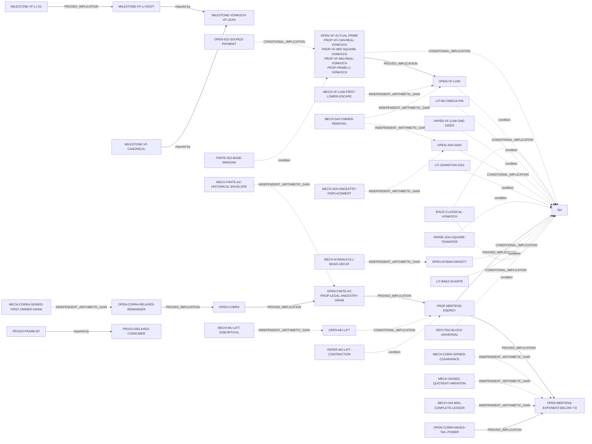
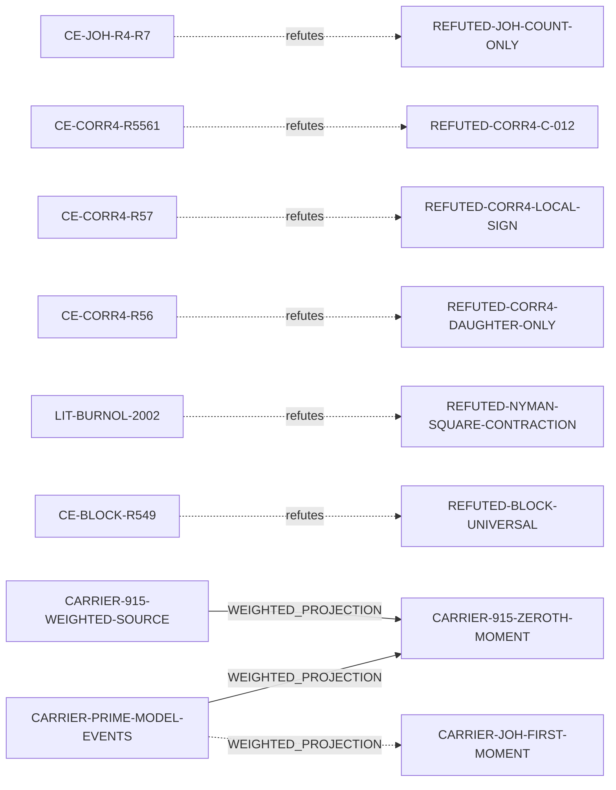

# RH_Lean mathematical proof-dependency DAG

**Status (registry `2026-10-25.2`, main `54564c00e4a5855bc303ad92e38e5e6285031012`, Lean 4.34.1; evidence refreshed 2026-10-26): the Riemann Hypothesis is OPEN in this repository. No route below closes it; every RH path lists exactly what is still unpaid.** This page is generated from, and validated against, the machine-readable registry [proof-obligations.json](proof-obligations.json) by [`scripts/proof_obligation_dag.py`](../scripts/proof_obligation_dag.py). It is a proof map, not a proof: a compiled implication does not prove its premise, an explicit theorem interface is not a Lean construction, and paper or numerical findings are not Lean certificates.

Read with the [coordinate atlas](COORDINATE_ATLAS.md) (which repository objects are the same quantity in other coordinates), [FORMALIZATION_MILESTONES.md](FORMALIZATION_MILESTONES.md) (what is finished), the [ten-route portfolio](RH_PROOF_ATTACK_PORTFOLIO_20261024.md) (task routing) and the [overlap / imported 7/8 audit](RH_PROOF_OVERLAP_AND_SEVEN_EIGHTHS_AUDIT_20261024.md) (why shared coordinates are not equivalences).

## 1. Three graph layers

| Layer | Question | Source of truth | Producer / check |
| --- | --- | --- | --- |
| **A. Mathematical proof obligations** | Which proposition implies, equals, projects to or refutes which; what each RH route still needs | [proof-obligations.json](proof-obligations.json) | `python3 scripts/proof_obligation_dag.py --check` |
| **B. Lean source and declarations** | Which file and declaration states or proves a node; which modules import which | Lean source on `main`, [repository index](REPOSITORY_SEARCH.md), [knowledge graph](KNOWLEDGE_GRAPH.md), [historical import DAG](RESEARCH_FRONTIER_DAG.md) | `--repo-index` cross-check, `scripts/repo_index.py`, `scripts/proofq.py`, `scripts/research_frontier_dag.py` |
| **C. Evidence and implementation** | Which PR, head, CI run, report, script or reference supports a status, and when it was observed | `evidence` records in the registry (dated snapshot) | validator; refresh from GitHub before relying on open-PR rows |

An import edge (Layer B) proves dependency on code, never a proposition. Evidence grade (Layer C) is recorded separately from logical status (Layer A).

**Node status fields.** `logical_status` ∈ PROVED, ESTABLISHED_LITERATURE, OPEN, CLAIMED (paper, review pending), FINITE_EVIDENCE, REFUTED, DEFINITION (carriers). `formal_status` records the Lean side (on main, green unmerged PR, red PR head, explicit interface, statement only, not formalized). `evidence_class` uses the repository's nine categories (`PROVED_IN_LEAN_ON_MAIN` … `UNKNOWN`). `provenance` separates *proved internally*, *imported certified external Lean*, and *literature passed as an explicit interface / not formalized*. `open_obligation` with `obligation_kind` ∈ ARITHMETIC, REVIEW, FORMALIZATION_COMPLETENESS keeps formalization chores apart from open mathematics.

**Edge types.** `EXACT_IDENTITY`, `PROVED_EQUIVALENCE` (both collapse into one class only when certified by a proved node), `PROVED_IMPLICATION`, `CONDITIONAL_IMPLICATION` (explicit `conditions`; an unreviewed certifier must itself be a condition), `WEIGHTED_PROJECTION` (non-invertible; states what it loses), `REQUIRES` (a proved node may only require proved nodes), `REFUTED_BY`, `INDEPENDENT_ARITHMETIC_GAIN` (a mechanism that would pay an open target; never a proof). The validator collapses proved equivalence classes, rejects any remaining directed cycle as an unlabelled equivalence, enforces the recorded non-equivalences, recomputes every route's unpaid inputs from its edges, and fails if any path to RH has nothing left to pay.

## 2. Major formalization milestone: von Koch (1901) and canonical VF

**Classical theorem `HISTORICAL-VONKOCH-1901`.** von Koch, *Sur la distribution des nombres premiers*, Acta Math. **24** (1901) 159–182, doi:10.1007/BF02403071, proved RH ⇒ π(x) = Li(x) + O(√x log x); the converse is the classical Mellin argument, so RH ⇔ π(x) − Li(x) = O(√x log x). Li₂(x) = ∫₂ˣ dt/log t differs from li by li(2) ≈ 1.04516, which the scale absorbs.

**Formalized in Lean on main (PR [#932](https://github.com/OVVO-Financial/RH_Lean/pull/932), merged 2026-10-12 at head `2713d8ef`, 13 workflow runs / 17 jobs green):**

- `MILESTONE-VF-CANONICAL` — [`vfCanonical`](../research/VF_CANONICAL_SQRT_TWO.lean): VF_can(x) = √2 + Σ_{r=2}^{R−1} (2r+1)/log(r²+r+1/2) + (x−R²)/log((R²+x)/2), R = ⌊√x⌋, with the exact actual-prime block recurrence `vfCanonicalSquareDefect_succ`.
- `MILESTONE-VF-LI-O1` — [`abs_vfCanonicalLiError_le_uniform_allReal`](../research/VF_CANONICAL_SQRT_TWO.lean), [`abs_vfMidLiError_le_uniform_allReal`](../research/VF_CANONICAL_ALL_REAL_LI_O_ONE.lean): **VF_can(x) − Li₂(x) = O(1) for every real x ≥ 4**, unconditionally.
- `MILESTONE-VONKOCH-VF-LEAN` (classification `FORMALIZED_CANONICAL_VONKOCH_REDUCTION`) — [`vfCanonicalSquareVonKoch_iff_primeLiVonKoch`](../research/VF_CANONICAL_SQRT_TWO_VON_KOCH.lean) and companions: (∃C ∀R≥2, |π(R²) − VF_can(R²)| ≤ C R log R) ⇔ (∃C′ ∀x≥4, |π(x) − Li₂(x)| ≤ C′ √x log x), with the all-real and legacy forms in the same class.

**What is not proved.** The classical analytic equivalence enters only as the explicit argument [`ClassicalVonKochRHCriterion`](../research/VF_MID_VON_KOCH_BRIDGE.lean) (`IFACE-CLASSICAL-VONKOCH`); constructing it is the formalization-completeness task `CLASSICAL_VONKOCH_CRITERION_FORMAL_IMPORT_OR_PROOF`. The actual-prime bound `OPEN-VF-ACTUAL-PRIME` (`VFCanonicalSquareVonKochStatement`) is open. `#print axioms` lists logical axioms only; it does not discharge these theorem arguments.

Milestone narrative (not the typed graph; the generated graphs in §6 are authoritative):

```text
HISTORICAL-VONKOCH-1901  (literature; Lean: explicit interface IFACE-CLASSICAL-VONKOCH)

MILESTONE-VF-CANONICAL ──REQUIRES── MILESTONE-VONKOCH-VF-LEAN ──REQUIRES── MILESTONE-VF-LI-ROOT
MILESTONE-VF-LI-O1  ──PROVED_IMPLICATION──▶ MILESTONE-VF-LI-ROOT        (O(1) is the stronger result)

OPEN-VF-ACTUAL-PRIME ≡ PROP-VF-CAN-REAL-VONKOCH ≡ PROP-VF-MID-SQUARE-VONKOCH
                     ≡ PROP-VF-MID-REAL-VONKOCH ≡ PROP-PRIME-LI-VONKOCH   (PROVED_EQUIVALENCE, #932)
        │
        └─CONDITIONAL_IMPLICATION [condition: IFACE-CLASSICAL-VONKOCH]
          certified by RH-CONDITIONAL-CONSUMER (riemannHypothesis_of_vfCanonicalSquare)
                     ▼
                    RH   (OPEN)
```

## 3. Answers an agent should not have to reconstruct

**Merged #1021 power milestone:** for each beta >= 1/2, `corr4PowerFirstOwnerGram_iff_mertensPowerBound` proves `(exists A>=0, Corr4PowerFirstOwnerGram A beta) <=> MertensPowerBound beta`. This is a *proved equivalence*, not a proof of either arithmetic statement below the imported 7/8 exponent. The distinct OPEN node `OPEN-CORR4-MIXED-TAIL-POWER` asks for the full signed first-owner inequality `2 Gamma_mixed <= 2 E_R + A R^(7/2-eta)` with some eta>0. The merged *conditional* consumer converts this into beta `7/8 - eta/4`. The old RH-strength relaxed remainder `OPEN-CORR4-RELAXED-REMAINDER` remains OPEN; no RH or strict 7/8 improvement is claimed.


1. **von Koch (1901):** RH ⇒ π(x) − Li(x) = O(√x log x); with the classical converse, an equivalence (§2).
2. **Proved in Lean:** canonical VF, all-real VF_can − Li₂ = O(1), and the equivalence of the canonical square-endpoint, all-real, legacy and prime−Li₂ von Koch bounds; the conditional RH consumer.
3. **External:** the classical prime−Li ⇔ RH theorem, as `ClassicalVonKochRHCriterion`.
4. **Significance of O(1):** π − Li₂ and π − VF_can differ by a bounded deterministic term at every real x, so the von Koch question is exactly the actual-prime VF question; it bounds nothing about primes.
5. **Open actual-prime inequality:** ∃C ∀R ≥ 2, |π(R²) − VF_can(R²)| ≤ C R log R.
6. **Imported 7/8 (#987):** ζ(s) ≠ 0 for Re s > 7/8 and M(x) = O_ε(x^{7/8+ε}) on the original carriers, imported from the pinned OpenAI Lean proof; no strict exponent below 7/8 is verified (`OPEN-MERTENS-EXPONENT-BELOW-7-8`).
7. **Routes:** VF-LOW, SAT, CODIV, BLOCK, OAI-NNS, JOH, FINITE-AC, CORR4, MU-LIFT, NYMAN; BLOCK's universal form is refuted at R = 549.
8. **Independent mechanisms:** (I) prime/composite incidence (VF-LOW, SAT, JOH); (II) genuine Mertens signed pair and historical envelope (CODIV, FINITE-AC) with CORR4's q² recursion as a distinct mechanism; (III) original OAI Hecke/character (OAI-NNS); (IV) higher-order Newton lift (MU-LIFT); (V) Nyman Hilbert (NYMAN).
9. **Exact missing estimate per route:** §4 scoreboard.
10. **Breakthrough theorems:** any unpaid OPEN input in §5 (each closes RH with its listed conditions); short of RH, `OPEN-MERTENS-EXPONENT-BELOW-7-8` on the complete source.
11. **Numerical shortcut-killers:** `CE-BLOCK-R549`, `CE-CORR4-R57`, `CE-CORR4-R56`, `CE-CORR4-R5561`, `CE-JOH-R4-R7`; literature `LIT-BURNOL-2002` kills the q < 1/2 Nyman contraction; `NOGO-FINITE-A-HURST` (paper) bounds finite-A constants below.
12. **Kernel-verified vs conditional vs paper vs numerical:** the `formal_status` and `evidence_class` columns of §7.
13. **Where:** Lean links and PR columns in §7; dated PR heads and checks in §8.
14. **Who:** §5 agents table.
15. **Does any route prove RH?** No. §5 lists every path's unpaid inputs, each typed as arithmetic open, classical theorem not proved in Lean, review pending, finite outside Lean, or refuted premise.

## 4. Route scoreboard

<!-- BEGIN GENERATED: scoreboard -->
| Route | Disposition | Exact missing mathematics | Quantitative target | Best source | Largest unpaid term | Falsifiers | Next proof action |
| --- | --- | --- | --- | --- | --- | --- | --- |
| **VF-LOW** | OPEN | A legitimate original-source lower-wall restriction or first-bad contradiction retaining all original prime occurrences, VF weights, historical anchors, returning cells, restored terms and signed NNS interactions. | pi(R^2) - VF_can(R^2) >= -K R log R for all R >= R0. | Canonical VF + von Koch reduction (#932); #915 toolkit and #939 content audit; research/VF_MID_LOWER_CHANNEL_ALONE_RH_AND_FIRST_BAD_GATE.md. | Large negative first escape: imported 7/8 allows D_can(R) as low as -R^(7/4+eps). | `CE-BLOCK-R549`, `CE-JOH-R4-R7` | State one original-weight first-lower-escape restriction with quantifiers and test it on the exact #915 carrier; do not substitute an unweighted Mobius sum. |
| **SAT** | OPEN | A new uniform signed owner-removal or cofactor/prime-innovation inequality with complete original source coefficients and nonlocal historical contributions; arithmetic restrictions on genuine prime locations and their least-prime-owned composite complements. | T(R^2) > A(R^2) - L(R^2) eventually (JOH form) or the VF-LOW wall. | Merged #1019 birth/transport, least-prime owner and Mobius parity accounting, square-shell telescopes, #931 guardrail. | Nonlocal historical composite-removal mass; PNT-sized density carries no RH-scale sign. | `CE-JOH-R4-R7` | Keep the three S = A - T carriers separate; derive one signed removal law on CARRIER-SAT-PRIME with location data and test it on zero-defect blocks. |
| **CODIV** | OPEN | A nontrivial uniform source estimate for the full genuine signed covariance (diagonal and off-diagonal), not the identity M^2 = D + 2C or an NNS coordinate change. | M(X) = O(X^(7/8 - delta + eps)) for an independent delta > 0; RH strength is exponent 1/2 + eps. | MILESTONE-COVARIANCE-IDENTITY; #987 global covariance output; #923 quotient variation. | Off-diagonal pair sum C(N) at scale N^(7/4+eps). | none recorded | Exhibit one proper signed component whose complete bill is below the 7/4 covariance power after every complement is restored. |
| **BLOCK** | Original universal version REFUTED; weaker replacements not automatically accepted | None for the universal statement: it is false. A weaker multi-block, averaged or one-sided theorem must be new, precise, not refuted, with a verified consumer and explicit arithmetic input. | N/A (refuted). | research/VF_MID_LITERAL_BLOCK_CROSSING.lean (valid conditional consumer); scripts/vf_block_capture_counterexample_549.py. | N/A | `CE-BLOCK-R549` | Keep the R = 549 regression permanent; do not assign the universal statement. |
| **OAI-NNS** | OPEN | Complete source exponent ledger (eight gates) with strictly positive net saving; a local character zero mode or Poisson factor is source-level progress, not a global exponent. | All-scale exponent 7/8 - delta, delta > 0, on the complete source. | Merged #987 (benchmark), #1017 heavy slot; open #1022 zero mode and Z^(-1/64) band. | Low-J, resonant and unit-trivial rows plus outer counts at the 7/8 baseline. | none recorded | Tabulate every Z exponent and multiplicity on the smallest complete admitted source family; reject if one sector stays at 7/8. |
| **JOH** | OPEN | A genuine nonlocal least-prime ancestry restriction controlling signed chronological displacement, together with weighted block defects and historical anchors. | G(R^2) < 0 for all R >= R0 (Johnston scale -N^(3/2)/log N). | research/LI_FAN_ONE_SIDED_WEIGHTED_COMPOSITE_RH_CONTRACT_20261022.md; claim 20261024-owner-1. | sum_r J_r, trivially O(N^(3/2)/log N) with no sign. | `CE-JOH-R4-R7` | Certified displacement census on D_r = 0 blocks, then one stated nonlocal ancestry law. |
| **FINITE-AC** | OPEN | A genuine all-root signed upper estimate with the historical denominator intact. | \|Q_R\| <= C R sqrt(K_R), equivalently (M(R^2-1) - 1)^2 <= A R^2 K_R. | #929 accounting; RHLean/Proof/SquareRootMertensEndpointAmplification.lean; RHLean/Proof/SquareRootAmplificationClosure.lean. | Square-endpoint excursions such as R = 5561 (M = -2544). | `CE-CORR4-R5561` | Seek an independently payable historical-envelope estimate; respect the Hurst restriction A > 0.4357. |
| **CORR4** | FRAME ADVANCED; PHYSICAL REMAINDER OPEN | A source-specific signed first-owner Gram restriction using arithmetic information beyond the sharp scalar frame, particularly on large endpoint excursions. | \|B_R\|^2 <= (9/4) E_R + C R^2 K_R for all R >= 56. | Merged #1021: corr4PowerFirstOwnerGram_iff_mertensPowerBound and conditional mixed-tail gate; merged #1023 odd-prime composite-gap frame; earlier CORR4 and full signed #915 source. | \|B_R\|^2 - (9/4) E_R, observed up to 0.1442 R^2 K at R = 5561; forced finite-A excursion (NOGO-CORR4-FRAME-ONLY). | `CE-CORR4-R57`, `CE-CORR4-R5561`, `CE-CORR4-R56` | Prove or falsify a uniform original-source signed first-owner mixed-tail bill 2 Gamma_mixed <= 2 E_R + A R^(7/2-eta) with some eta>0; check every restored term and endpoint excursion. Independently retain the RH-strength relaxed physical remainder O(R^2 K). Do not mistake a 7/8 exponent gain for RH. |
| **MU-LIFT** | OPEN | A genuinely new full-prefix signed estimate yielding a subcritical exponent r < k. | E(B^k) <= B^(o(1)) E(B)^r, fixed r < k. | #954 signed lift; docs/MERTENS_AMPLIFICATION_BUDGET.md. | Remaining K3 ranges and K1/K2 at full prefix scale. | none recorded | Specify one Type II corner with every complementary range and its exact r; reject r = k or target-defined G. |
| **NYMAN** | OPEN | Full-scale norm decay or density, not finite-dimensional approximation. | d_N -> 0 at a = 1/2 for the full basis. | research/NYMAN_BEURLING_POSITIVE_RESIDUE_ATTACK_2026_10_15.md (#957). | All-scale tail of the basis approximation. | none recorded | Keep as an independent analytic reserve; never revive a q < 1/2 square contraction (Burnol). |
<!-- END GENERATED: scoreboard -->

## 5. RH paths, frontier and agents

Each path is a chain of implication edges ending at `RH`. Unpaid inputs are recomputed by the validator from the first premise and every edge condition, minus proved nodes.

<!-- BEGIN GENERATED: paths -->
| Route path | Edges to RH | Unpaid inputs (kind) | Meaning |
| --- | --- | --- | --- |
| `VF-LOW/one-sided` | `E-VF-LOW-RH` | `OPEN-VF-LOW` (arithmetic open); `LIT-MV-OMEGA-PM` (classical theorem, not proved in Lean); `PAPER-VF-LOW-ONE-SIDED` (review pending) | Lower wall + external Omega+- theorem. |
| `VF-LOW/canonical-two-sided` | `E-VF-CAN-RH` | `OPEN-VF-ACTUAL-PRIME` (arithmetic open); `IFACE-CLASSICAL-VONKOCH` (classical theorem, not proved in Lean) | Public canonical target through the formalized von Koch reduction. |
| `VF-LOW/915-first-bad` | `E-915-VF` → `E-VF-CAN-RH` | `OPEN-915-SOURCE-PAYMENT` (arithmetic open); `FINITE-915-BASE-WINDOW` (finite, outside Lean); `IFACE-CLASSICAL-VONKOCH` (classical theorem, not proved in Lean) | Original #915 source payment (fixed K = 2 envelope) into the canonical target. |
| `SAT/via-JOH` | `E-JOH-RH` | `OPEN-JOH-SIGN` (arithmetic open); `LIT-JOHNSTON-2022` (classical theorem, not proved in Lean); `PAPER-JOH-SQUARE-TRANSFER` (review pending) | SAT pays the JOH weighted composite-removal inequality. |
| `SAT/via-VF-LOW` | `E-VF-LOW-RH` | `OPEN-VF-LOW` (arithmetic open); `LIT-MV-OMEGA-PM` (classical theorem, not proved in Lean); `PAPER-VF-LOW-ONE-SIDED` (review pending) | SAT pays the one-sided canonical wall. |
| `CODIV/mertens-energy` | `E-MERTENS-RH` | `PROP-MERTENS-ENERGY` (arithmetic open) | RH-strength CODIV input is literally the Mertens-energy statement (target-equivalent). |
| `BLOCK/literal` | `E-BLOCK-RH` | `REFUTED-BLOCK-UNIVERSAL` (refuted premise); `IFACE-CLASSICAL-VONKOCH` (classical theorem, not proved in Lean) | Valid consumer with a false premise. |
| `OAI-NNS/mertens-energy` | `E-MERTENS-RH` | `PROP-MERTENS-ENERGY` (arithmetic open) | RH strength needs exponent 1/2 + eps; any delta < 3/8 only improves the zero-free region. |
| `JOH/johnston` | `E-JOH-RH` | `OPEN-JOH-SIGN` (arithmetic open); `LIT-JOHNSTON-2022` (classical theorem, not proved in Lean); `PAPER-JOH-SQUARE-TRANSFER` (review pending) | Johnston's external criterion and the square-endpoint transfer. |
| `FINITE-AC/mertens` | `E-FINITE-A-MERTENS` → `E-MERTENS-RH` | `OPEN-FINITE-AC` (arithmetic open) | Fully Lean-certified consumer chain; only the arithmetic premise is open. |
| `CORR4/coefficient-4` | `E-CORR4-FINITE-A` → `E-FINITE-A-MERTENS` → `E-MERTENS-RH` | `OPEN-CORR4` (arithmetic open) | Merged terminal chain riemannHypothesis_of_canonicalRoughCorrelationFourQ2Energy. |
| `CORR4/relaxed-remainder` | `E-CORR4-RELAXED` → `E-CORR4-FINITE-A` → `E-FINITE-A-MERTENS` → `E-MERTENS-RH` | `OPEN-CORR4-RELAXED-REMAINDER` (arithmetic open) | Merged #1021 conditional relaxed-remainder consumer into certified CORR-4; only the original arithmetic source bound is unpaid. |
| `MU-LIFT/contraction` | `E-MULIFT-MERTENS` → `E-MERTENS-RH` | `OPEN-MU-LIFT` (arithmetic open); `PAPER-MU-LIFT-CONTRACTION` (review pending) | Paper contraction argument into the Lean Mertens-energy consumer. |
| `NYMAN/baez-duarte` | `E-NYMAN-RH` | `OPEN-NYMAN-DENSITY` (arithmetic open); `LIT-BAEZ-DUARTE` (classical theorem, not proved in Lean) | External Baez-Duarte criterion. |
<!-- END GENERATED: paths -->

Ranked frontier (no viable alternative is retired by ranking):

<!-- BEGIN GENERATED: frontier -->
| Rank | Frontier | Routes | Target nodes | Falsification lens | Task |
| --- | --- | --- | --- | --- | --- |
| A | Signed CORR-4 first-owner Gram | CORR4 | `MECH-CORR4-SIGNED-FIRST-OWNER-GRAM`, `OPEN-CORR4-RELAXED-REMAINDER`, `OPEN-CORR4-MIXED-TAIL-POWER` | `NOGO-CORR4-FRAME-ONLY` | Attack the full signed mixed-tail first-owner bill below R^(7/2) with a strict eta > 0, including restored terms and endpoint excursions; separately preserve the RH-strength O(R^2 K) physical remainder route. No frame-only shortcut. |
| B | VF-LOW / JOH genuine-prime chronology | VF-LOW, JOH, SAT | `MECH-JOH-ANCESTRY-DISPLACEMENT`, `MECH-VF-LOW-FIRST-LOWER-ESCAPE`, `MECH-SAT-OWNER-REMOVAL` | `CE-JOH-R4-R7` | Prove a nonlocal ancestry constraint on actual prime locations versus floor-Li demand, retaining first moments, weighted block defects, anchors and the #915 source distinction. |
| C | OAI-NNS complete exponent improvement | OAI-NNS, CODIV | `MECH-OAI-NNS-COMPLETE-LEDGER`, `OPEN-MERTENS-EXPONENT-BELOW-7-8` | `CLAIM-1022-POISSON-SAVING` | Turn #1022's exact local character result into a full original-source exponent ledger with explicit delta > 0. |
| D | FINITE-AC and MU-LIFT | FINITE-AC, MU-LIFT | `MECH-FINITE-AC-HISTORICAL-ENVELOPE`, `MECH-MU-LIFT-SUBCRITICAL` | `NOGO-FINITE-A-HURST` | Seek an independently payable historical-envelope estimate or a genuine fixed-degree r < k recurrence. |
| E | NYMAN | NYMAN | `MECH-NYMAN-FULL-BASIS-DECAY` | `REFUTED-NYMAN-SQUARE-CONTRACTION` | Maintain the full-Hilbert approximation route; require all-scale norm-density information. |
| F | Formalization completeness: classical von Koch criterion | VF-LOW, BLOCK | `CLASSICAL_VONKOCH_CRITERION_FORMAL_IMPORT_OR_PROOF` | `IFACE-CLASSICAL-VONKOCH` | Assess import or formal proof of the classical equivalence; otherwise keep ClassicalVonKochRHCriterion explicit. Does not touch OPEN-VF-ACTUAL-PRIME. |
<!-- END GENERATED: frontier -->

Seven permanent specialists, one distinct next deliverable each (repository templates only; saved Studio configurations and schedules are unchanged):

<!-- BEGIN GENERATED: agents -->
| Agent | Owns | Next distinct deliverable | Target nodes |
| --- | --- | --- | --- |
| 1. RH | Research Coordinator | Proof-obligation DAG (docs/proof-obligations.json) and frontier ranking | Scoreboard refresh from live PR/CI; one prime-side attack (rank B) and one recursive attack (rank A or D), each with a falsifier node. | `MECH-CORR4-SIGNED-FIRST-OWNER-GRAM`, `MECH-JOH-ANCESTRY-DISPLACEMENT` |
| 2. RH | Owner Payment | #915 occurrence preservation and VF/JOH source correspondence | One dyadic least-prime ancestry law for the boundary-padded JOH displacement, with unequal-count correction, anchor and weighted block defects. | `MECH-JOH-ANCESTRY-DISPLACEMENT`, `MECH-VF-LOW-FIRST-LOWER-ESCAPE` |
| 3. RH | Adversarial Referee | Logical strength, interfaces, normalization and counterexample audits | Independent ACCEPT/REVISE/REJECT on claim 20261025-coordinator-1 (sharpness, K > 0, finite-A corollary) and on claim 20261024-owner-1. | `NOGO-CORR4-FRAME-ONLY`, `CLAIM-20261024-OWNER-1` |
| 4. RH | Prime Census Laboratory | Preregistered finite falsifiers | Held-out CORR-4 roots above 6000 measuring H_R, A_R and H_R/A_R against lambda_7; certified D_r = 0 JOH displacement census. | `FINITE-CORR4-CENSUS`, `CE-JOH-R4-R7` |
| 5. RH | Analytic Type II | OAI-NNS complete exponent ledger | Complete #1022 exponent table (high-J, low-J, resonant, principal, Gaussian, outer-count, NNS-cross) with a proved delta > 0 or one unavoidable sector at 7/8. | `MECH-OAI-NNS-COMPLETE-LEDGER`, `CLAIM-1022-POISSON-SAVING` |
| 6. RH | Finite Wheel & Incidence | Least-prime incidence and CORR-4 q^2 daughter structure | A source-specific signed estimate or falsifier for 2 Gamma_mixed <= 2 E_R + A R^(7/2-eta) at eta>0, preserving physical owner incidence, not another unsigned frame improvement. | `MECH-CORR4-SIGNED-FIRST-OWNER-GRAM`, `MECH-SAT-OWNER-REMOVAL`, `OPEN-CORR4-MIXED-TAIL-POWER` |
| 7. RH | Lean Verification | Formalization of independently accepted results | After referee acceptance, formalize the abstract frame-to-endpoint inverse inequality on its carrier with the open premise explicit; separately scope CLASSICAL_VONKOCH_CRITERION_FORMAL_IMPORT_OR_PROOF. Otherwise NO_NEW_THEOREM_TO_FORMALIZE. | `NOGO-CORR4-FRAME-ONLY`, `CLASSICAL_VONKOCH_CRITERION_FORMAL_IMPORT_OR_PROOF` |
<!-- END GENERATED: agents -->

## 6. Graphs (quotient by proved equivalence)

Solid arrows: proved implications and requirements. Dotted: conditional implications, conditions, arithmetic-gain targets and unreviewed projections. Boxes list every member of a proved equivalence class.

<!-- BEGIN GENERATED: mermaid-routes -->

<!-- END GENERATED: mermaid-routes -->

<!-- BEGIN GENERATED: mermaid-carriers -->

<!-- END GENERATED: mermaid-carriers -->

Proved equivalence classes:

<!-- BEGIN GENERATED: classes -->
| Class | Members (proved equivalent) | Status |
| --- | --- | --- |
| `OPEN-VF-ACTUAL-PRIME` | `OPEN-VF-ACTUAL-PRIME`, `PROP-VF-CAN-REAL-VONKOCH`, `PROP-VF-MID-SQUARE-VONKOCH`, `PROP-VF-MID-REAL-VONKOCH`, `PROP-PRIME-LI-VONKOCH` | OPEN |
| `OPEN-FINITE-AC` | `OPEN-FINITE-AC`, `PROP-LEGAL-ANCESTRY-GRAM` | OPEN |
<!-- END GENERATED: classes -->

Recorded non-equivalences (the validator fails if any pair collapses):

<!-- BEGIN GENERATED: non-equivalences -->
| Not equivalent | Reason |
| --- | --- |
| `CARRIER-915-WEIGHTED-SOURCE` ≠ `CARRIER-SAT-MERTENS` | The original #915 weighted, masked, clipped, anchored NNS source is not the unweighted signed Mertens smooth-minus-transport kernel; only an aggregate zeroth-moment identity is proved. |
| `CARRIER-JOH-FIRST-MOMENT` ≠ `CARRIER-915-ZEROTH-MOMENT` | Blocks r = 4, 7 have zero count defect and opposite first-moment displacement (CE-JOH-R4-R7). |
| `OPEN-JOH-SIGN` ≠ `OPEN-VF-ACTUAL-PRIME` | JOH is a Cesaro/weighted projection of the pointwise discrepancy; it is not pointwise-equivalent to the square-endpoint VF error. |
| `OPEN-CORR4` ≠ `OPEN-FINITE-AC` | Only CORR-4 => finite A is proved; shared K_R and a consumer do not give the reverse. |
| `OPEN-FINITE-AC` ≠ `PROP-MERTENS-ENERGY` | Finite A implies the Mertens energy statement; the converse is not proved and finite A can be stronger than RH. |
| `PROP-LEGAL-ANCESTRY-GRAM` ≠ `PROP-MERTENS-ENERGY` | Co/Div and finite A/C are existentially equivalent only on the correctly normalized live-packet carrier, not as global unnormalized covariance statements. |
| `CARRIER-OAI-IDEAL-SOURCE` ≠ `CARRIER-915-WEIGHTED-SOURCE` | Original OAI ideal coefficients are not automatically RH_Lean physical prime-owner coefficients; #987 is an output-level bound. |
| `IMPORTED-OAI-7-8` ≠ `OPEN-MERTENS-EXPONENT-BELOW-7-8` | The imported 7/8 bound is a benchmark; inserting it into identities reproduces exponent 7/8 and is not an exponent-improvement engine. |
| `OPEN-VF-LOW` ≠ `OPEN-VF-ACTUAL-PRIME` | One-sided sufficiency uses an external Omega+- theorem; no Lean equivalence. |
| `OPEN-915-SOURCE-PAYMENT` ≠ `OPEN-VF-ACTUAL-PRIME` | The #915 payment is a fixed-constant K = 2 envelope; the public target is existential in C. |
| `CLASSICAL_VONKOCH_CRITERION_FORMAL_IMPORT_OR_PROOF` ≠ `OPEN-VF-ACTUAL-PRIME` | Formalizing the classical criterion does not touch the open actual-prime estimate. |
<!-- END GENERATED: non-equivalences -->

## 7. Node registry

<!-- BEGIN GENERATED: nodes -->
| ID | Type | Logical | Formal | Evidence | Lean / source | PR | Statement |
| --- | --- | --- | --- | --- | --- | --- | --- |
| `RH` | rh_target | OPEN | LEAN_STATEMENT_ONLY | UNKNOWN | [`VFMidRiemannHypothesisStatement`](../research/VF_MID_VON_KOCH_BRIDGE.lean) |  | Every nontrivial zero of the Riemann zeta function has real part 1/2 (Mathlib `RiemannHypothesis`; repository alias `VFMidRiemannHypothesisStatement`). |
| `HISTORICAL-VONKOCH-1901` | historical_theorem | ESTABLISHED_LITERATURE | EXPLICIT_LEAN_INTERFACE | INDEPENDENTLY_REVIEWED_PAPER_PROOF | [`ClassicalVonKochRHCriterion`](../research/VF_MID_VON_KOCH_BRIDGE.lean) |  | RH <=> pi(x) - Li(x) = O(sqrt(x) log x). von Koch (1901) proved RH => pi(x) = Li(x) + O(sqrt(x) log x); the converse is the classical Mellin/partial-summation argument (an O(x^(1/2+eps)) error continues the relevant Dirichlet series to Re s > 1/2). Li_2(x) = int_2^x dt/log t differs from li(x) by the constant li(2) = 1.04516..., so the criterion is normalization-independent. |
| `IFACE-CLASSICAL-VONKOCH` | explicit_interface | ESTABLISHED_LITERATURE | EXPLICIT_LEAN_INTERFACE | INDEPENDENTLY_REVIEWED_PAPER_PROOF | [`ClassicalVonKochRHCriterion`](../research/VF_MID_VON_KOCH_BRIDGE.lean)<br/>[`PrimeLiVonKochBoundedStatement`](../research/VF_MID_VON_KOCH_BRIDGE.lean) |  | structure ClassicalVonKochRHCriterion where iff_riemannHypothesis : PrimeLiVonKochBoundedStatement <-> VFMidRiemannHypothesisStatement. Supplied as an explicit theorem argument; the repository does not construct it. |
| `CLASSICAL_VONKOCH_CRITERION_FORMAL_IMPORT_OR_PROOF` | formalization_task | ESTABLISHED_LITERATURE | NOT_FORMALIZED | INDEPENDENTLY_REVIEWED_PAPER_PROOF | [`ClassicalVonKochRHCriterion`](../research/VF_MID_VON_KOCH_BRIDGE.lean) |  | Construct a term of ClassicalVonKochRHCriterion, either from an existing certified Lean proof of the classical equivalence or by a new proof in the pinned Lean 4.34.1 / Mathlib toolchain. |
| `MILESTONE-VF-CANONICAL` | formalization_milestone | PROVED | PROVED_IN_LEAN_ON_MAIN | PROVED_IN_LEAN_ON_MAIN | [`vfCanonical`](../research/VF_CANONICAL_SQRT_TWO.lean)<br/>[`vfCanonical_eq_legacy_plus_sqrt_two`](../research/VF_CANONICAL_SQRT_TWO.lean)<br/>[`vfCanonicalSquareDefect_succ`](../research/VF_CANONICAL_SQRT_TWO.lean)<br/>[`vfCanonicalPrimeLiError_eq_primeError_add_quadrature`](../research/VF_CANONICAL_SQRT_TWO.lean) | [#932](https://github.com/OVVO-Financial/RH_Lean/pull/932) | vfCanonical x = vfMid x + sqrt 2; for x >= 4, R = floor(sqrt x): VF_can(x) = sqrt2 + sum_{r=2}^{R-1} (2r+1)/log(r^2+r+1/2) + (x-R^2)/log((R^2+x)/2). The square-endpoint defect obeys the exact actual-prime recurrence D_{R+1} = D_R + (P_R - V_R). |
| `MILESTONE-VF-LI-ROOT` | proved_lemma | PROVED | PROVED_IN_LEAN_ON_MAIN | PROVED_IN_LEAN_ON_MAIN | [`VFMidLiRootBoundedStatement`](../research/VF_MID_VON_KOCH_BRIDGE.lean)<br/>[`vfMidLiRootBounded`](../research/VF_MID_VON_KOCH_BRIDGE.lean) |  | VFMidLiRootBoundedStatement: exists B >= 0, forall x >= 4, \|vfMid(x) - Li_2(x)\| <= B sqrt(x). This is the quadrature input actually used by the von Koch equivalence proofs. |
| `MILESTONE-VF-LI-O1` | formalization_milestone | PROVED | PROVED_IN_LEAN_ON_MAIN | PROVED_IN_LEAN_ON_MAIN | [`abs_vfMidLiError_le_uniform_allReal`](../research/VF_CANONICAL_ALL_REAL_LI_O_ONE.lean)<br/>[`vfMidLiAllRealUniformBounded`](../research/VF_CANONICAL_ALL_REAL_LI_O_ONE.lean)<br/>[`abs_vfCanonicalLiError_le_uniform_allReal`](../research/VF_CANONICAL_SQRT_TWO.lean) | [#932](https://github.com/OVVO-Financial/RH_Lean/pull/932) | exists C, forall real x >= 4: \|VF_can(x) - Li_2(x)\| <= C (and \|vfMid(x) - Li_2(x)\| <= C_square + C_live). Unconditional; elementary uniform midpoint quadrature, no prime-distribution hypothesis. |
| `MILESTONE-VONKOCH-VF-LEAN` | formalization_milestone | PROVED | PROVED_IN_LEAN_ON_MAIN | PROVED_IN_LEAN_ON_MAIN | [`vfCanonicalSquareVonKoch_iff_primeLiVonKoch`](../research/VF_CANONICAL_SQRT_TWO_VON_KOCH.lean)<br/>[`vfCanonicalRealVonKoch_iff_primeLiVonKoch`](../research/VF_CANONICAL_SQRT_TWO_VON_KOCH.lean)<br/>[`vfCanonicalSquareVonKoch_iff_realVonKoch`](../research/VF_CANONICAL_SQRT_TWO_VON_KOCH.lean)<br/>[`vfCanonicalRealVonKoch_iff_legacy`](../research/VF_CANONICAL_SQRT_TWO_VON_KOCH.lean)<br/>[`vfCanonicalSquareVonKoch_iff_legacy`](../research/VF_CANONICAL_SQRT_TWO_VON_KOCH.lean)<br/>[`vfMidVonKochBounded_iff_primeLiVonKochBounded`](../research/VF_MID_VON_KOCH_BRIDGE.lean)<br/>[`vfMidSquareEndpointVonKochBounded_iff_primeLiVonKochBounded`](../research/VF_MID_VON_KOCH_BRIDGE.lean)<br/>[`vfMidVonKochBounded_of_squareEndpoint`](../research/VF_MID_VON_KOCH_BRIDGE.lean) | [#932](https://github.com/OVVO-Financial/RH_Lean/pull/932) | (exists C >= 0, forall R >= 2, \|pi(R^2) - VF_can(R^2)\| <= C R log R) <=> (exists C' >= 0, forall real x >= 4, \|pi(x) - Li_2(x)\| <= C' sqrt(x) log x), and both are equivalent to the all-real canonical and legacy vfMid forms, with renormalized nonnegative constants. |
| `OPEN-VF-ACTUAL-PRIME` | open_obligation | OPEN | LEAN_STATEMENT_ONLY | TARGET_EQUIVALENT | [`VFCanonicalSquareVonKochStatement`](../research/VF_CANONICAL_SQRT_TWO_VON_KOCH.lean) | [#932](https://github.com/OVVO-Financial/RH_Lean/pull/932) | VFCanonicalSquareVonKochStatement: exists C >= 0, forall R >= 2, \|pi(R^2) - VF_can(R^2)\| <= C R log R. |
| `PROP-VF-CAN-REAL-VONKOCH` | open_obligation | OPEN | LEAN_STATEMENT_ONLY | TARGET_EQUIVALENT | [`VFCanonicalRealVonKochStatement`](../research/VF_CANONICAL_SQRT_TWO_VON_KOCH.lean) | [#932](https://github.com/OVVO-Financial/RH_Lean/pull/932) | VFCanonicalRealVonKochStatement: exists C >= 0, forall real x >= 4, \|pi(x) - VF_can(x)\| <= C sqrt(x) log x. |
| `PROP-VF-MID-SQUARE-VONKOCH` | open_obligation | OPEN | LEAN_STATEMENT_ONLY | TARGET_EQUIVALENT | [`VFMidSquareEndpointVonKochBoundedStatement`](../research/VF_MID_VON_KOCH_BRIDGE.lean) |  | VFMidSquareEndpointVonKochBoundedStatement: exists C >= 0, forall R >= 2, \|pi(R^2) - vfMid(R^2)\| <= C R log R (historical statement, not redefined). |
| `PROP-VF-MID-REAL-VONKOCH` | open_obligation | OPEN | LEAN_STATEMENT_ONLY | TARGET_EQUIVALENT | [`VFMidVonKochBoundedStatement`](../research/VF_MID_VON_KOCH_BRIDGE.lean) |  | VFMidVonKochBoundedStatement: exists C >= 0, forall real x >= 4, \|pi(x) - vfMid(x)\| <= C sqrt(x) log x. |
| `PROP-PRIME-LI-VONKOCH` | open_obligation | OPEN | LEAN_STATEMENT_ONLY | TARGET_EQUIVALENT | [`PrimeLiVonKochBoundedStatement`](../research/VF_MID_VON_KOCH_BRIDGE.lean) |  | PrimeLiVonKochBoundedStatement: exists C >= 0, forall real x >= 4, \|pi(x) - Li_2(x)\| <= C sqrt(x) log x, Li_2(x) = int_2^x dt/log t. |
| `RH-CONDITIONAL-CONSUMER` | conditional_consumer | PROVED | PROVED_IN_LEAN_ON_MAIN | CONDITIONAL | [`riemannHypothesis_of_vfCanonicalSquare`](../research/VF_CANONICAL_SQRT_TWO_VON_KOCH.lean)<br/>[`riemannHypothesis_of_vfMidSquareEndpoint`](../research/VF_MID_VON_KOCH_BRIDGE.lean) | [#932](https://github.com/OVVO-Financial/RH_Lean/pull/932) | riemannHypothesis_of_vfCanonicalSquare (criterion : ClassicalVonKochRHCriterion) (h : VFCanonicalSquareVonKochStatement) : RiemannHypothesis; legacy form riemannHypothesis_of_vfMidSquareEndpoint. |
| `OPEN-VF-LOW` | open_obligation | OPEN | NOT_FORMALIZED | UNKNOWN |  |  | exists K >= 0, R0, forall R >= R0: pi(R^2) - VF_can(R^2) >= -K R log R. |
| `PAPER-VF-LOW-ONE-SIDED` | paper_claim | CLAIMED | NOT_FORMALIZED | PAPER_PROOF_NEEDS_REVIEW | [VF_MID_LOWER_CHANNEL_ALONE_RH_AND_FIRST_BAD_GATE.md](../research/VF_MID_LOWER_CHANNEL_ALONE_RH_AND_FIRST_BAD_GATE.md) | [#925](https://github.com/OVVO-Financial/RH_Lean/pull/925) | Lower wall + square-endpoint O(1) quadrature + monotonicity of pi give pi(x) - li(x) >= -O(sqrt(x) log x) for all real x; with LIT-MV-OMEGA-PM this forces RH. |
| `LIT-MV-OMEGA-PM` | literature_theorem | ESTABLISHED_LITERATURE | NOT_FORMALIZED | INDEPENDENTLY_REVIEWED_PAPER_PROOF |  |  | With Theta = sup Re(rho), for every eps > 0: pi(x) - li(x) = Omega_+-(x^(Theta - eps)). |
| `OPEN-915-SOURCE-PAYMENT` | open_obligation | OPEN | LEAN_STATEMENT_ONLY | UNKNOWN | [`VFMid915FirstBadSourcePaymentStatement`](../research/VF_MID_FIRST_BAD_EXACT_BUDGET_CLOSE.lean)<br/>[`vfMid915FirstBadSourcePayment_iff_radialTwoEnvelope_of_base`](../research/VF_MID_915_SOURCE_PAYMENT_CONTENT_AUDIT.lean) | [#915](https://github.com/OVVO-Financial/RH_Lean/pull/915) | VFMid915FirstBadSourcePaymentStatement: forall R >= 8 with first bad successor R+1 at K=2, 2 * Source(R)^2 <= TotalMass(R). Content audit (#939): equivalent to the absence of first-bad successors; with the finite base window, equivalent to \|D_R\| <= 2 R log R for every R >= 2. |
| `FINITE-915-BASE-WINDOW` | finite_evidence | FINITE_EVIDENCE | NOT_FORMALIZED | FINITE_COMPUTATION |  | [#939](https://github.com/OVVO-Financial/RH_Lean/pull/939) | For 2 <= B <= 8, the actual-prime endpoint defect is not bad at K = 2 (hypothesis hbase of the #939 consumers). |
| `CONSUMER-915-CANONICAL` | conditional_consumer | PROVED | PROVED_IN_LEAN_ON_MAIN | CONDITIONAL | [`vfCanonicalSquareVonKoch_of_915SourcePayment_and_base`](../research/VF_MID_915_SOURCE_PAYMENT_CONTENT_AUDIT.lean)<br/>[`vfMid915FirstBadSourcePayment_iff_noFirstBad`](../research/VF_MID_915_SOURCE_PAYMENT_CONTENT_AUDIT.lean)<br/>[`vfMid915FirstBad_closed_of_sourcePayment`](../research/VF_MID_FIRST_BAD_EXACT_BUDGET_CLOSE.lean) | [#939](https://github.com/OVVO-Financial/RH_Lean/pull/939) | vfCanonicalSquareVonKoch_of_915SourcePayment_and_base (hbase) (hpay) : VFCanonicalSquareVonKochStatement; also vfMid915FirstBad_closed_of_sourcePayment (payment forbids every first-bad successor). |
| `MILESTONE-915-MOVING-OWNER` | proved_lemma | PROVED | PROVED_IN_LEAN_ON_MAIN | PROVED_IN_LEAN_ON_MAIN | [`vfMid915HistoricalMovingOwner_eq_signedMismatch`](../research/VF_MID_915_FLOOR_LI_TRANSPORT_BOUNDARY.lean) |  | For 2 <= A <= B: vfMid915HistoricalMovingOwnerCorrection A B = -(signed floor-Li population balance on [A^2, B^2)). Aggregate (zeroth-moment) identity only. |
| `MECH-VF-LOW-FIRST-LOWER-ESCAPE` | arithmetic_mechanism | OPEN | NOT_FORMALIZED | UNKNOWN |  |  | A legitimate original-source lower-wall restriction or first-bad contradiction retaining all original prime occurrences, VF weights, historical anchors, returning cells, restored terms and signed NNS interactions. |
| `MECH-SAT-OWNER-REMOVAL` | arithmetic_mechanism | OPEN | NOT_FORMALIZED | UNKNOWN |  |  | A new uniform signed least-prime owner-removal or cofactor/prime-innovation inequality on the genuine prime/composite incidence S = A - T, with complete original source coefficients and nonlocal historical contributions; must use arithmetic restrictions on genuine prime locations, not population counts. |
| `MILESTONE-1019-BIRTH-TRANSPORT` | formalization_milestone | PROVED | PROVED_IN_LEAN_ON_MAIN | PROVED_IN_LEAN_ON_MAIN | [`closedSquareShell_birthTime_floor_eq_two_mu_sub_mu_sq`](../research/VF_MID_CLOSED_SQUARE_BIRTH_TIME_20261024.lean)<br/>[`closedSquareShellFloor_eq_open_add_rootDivisor`](../research/VF_MID_CLOSED_SQUARE_BIRTH_TIME_20261024.lean)<br/>[`closedSquareShell_actual_moving_transport_telescope`](../research/VF_MID_CLOSED_SQUARE_MOVING_TRANSPORT_20261024.lean) | [#1019](https://github.com/OVVO-Financial/RH_Lean/pull/1019) | Exact closed-square prefix drift, birth bill 2 mu(k) - mu(k)^2, and the physical moving-complement transport telescope. |
| `OPEN-JOH-SIGN` | open_obligation | OPEN | NOT_FORMALIZED | UNKNOWN | [LI_FAN_ONE_SIDED_WEIGHTED_COMPOSITE_RH_CONTRACT_20261022.md](../research/LI_FAN_ONE_SIDED_WEIGHTED_COMPOSITE_RH_CONTRACT_20261022.md) | [#1012](https://github.com/OVVO-Financial/RH_Lean/pull/1012) | exists R0, forall R >= R0: G(R^2) < 0, where Q(n) = floor(Li_2(n)), G(N) = sum_{2<=n<N} (pi(n) - Q(n) - 1) = A(N) - T(N) - L(N); equivalently T(R^2) > A(R^2) - L(R^2). |
| `LIT-JOHNSTON-2022` | literature_theorem | ESTABLISHED_LITERATURE | NOT_FORMALIZED | INDEPENDENTLY_REVIEWED_PAPER_PROOF |  |  | RH <=> int_2^X (pi(t) - li(t)) dt < 0 for all real X > 2, with quantitative forms (Section 3 eqs (3.4)-(3.6); Theorem 1.4, Lemma 2.8). |
| `PAPER-JOH-SQUARE-TRANSFER` | paper_claim | CLAIMED | NOT_FORMALIZED | PAPER_PROOF_NEEDS_REVIEW | [LI_FAN_ONE_SIDED_WEIGHTED_COMPOSITE_RH_CONTRACT_20261022.md](../research/LI_FAN_ONE_SIDED_WEIGHTED_COMPOSITE_RH_CONTRACT_20261022.md) | [#1012](https://github.com/OVVO-Financial/RH_Lean/pull/1012) | Using Johnston's quantitative estimates: RH <=> exists R0 forall R >= R0, G(R^2) < 0. |
| `CLAIM-20261024-OWNER-1` | paper_claim | CLAIMED | NOT_FORMALIZED | PAPER_PROOF_NEEDS_REVIEW |  |  | With eta(k) = 1_prime(k) - (Q(k) - Q(k-1)) and J_r = sum_{r^2<k<(r+1)^2} ((r+1)^2 - k) eta(k): sum_{r^2<=n<(r+1)^2} E(n) = (2r+1)(P_r - 1) + J_r and G(B^2) - G(A^2) = (B^2 - A^2)(P_A - 1) - sum_{j=A}^{B-1} (B^2 - (j+1)^2) D_j + sum_{r=A}^{B-1} J_r. The #915 boundary carries the zeroth moment; JOH needs the first moment. |
| `MECH-JOH-ANCESTRY-DISPLACEMENT` | arithmetic_mechanism | OPEN | NOT_FORMALIZED | UNKNOWN |  |  | A genuine least-prime-ancestry restriction on the boundary-padded displacement pairs J_r, stronger than the trivial total-distance bound, surviving the opposite-sign blocks r = 4, 7, and combining with the anchor and weighted block defects without assuming eventual G < 0. |
| `REFUTED-JOH-COUNT-ONLY` | refuted_claim | REFUTED | NOT_FORMALIZED | REFUTED |  |  | Conjecture (refuted): the JOH first-moment contribution of a square block is determined by its zero-th moment count defect D_r, or J_r has a universal sign. |
| `CE-JOH-R4-R7` | counterexample | PROVED | NOT_FORMALIZED | FINITE_COMPUTATION |  |  | r=4: primes {17,19,23}, floor-Li arrivals {18,21,24}, D_4 = 0, J_4 = +4. r=7: primes {53,59,61}, floor-Li arrivals {53,57,61}, D_7 = 0, J_7 = -2. Every Li_2 value used is >= 0.06 from an integer. |
| `PROP-MERTENS-ENERGY` | open_obligation | OPEN | LEAN_STATEMENT_ONLY | TARGET_EQUIVALENT | [`MertensEnergyBoundedStatement`](../RHLean/Analysis/SquarePrefixMertensBridge.lean) |  | MertensEnergyBoundedStatement: forall eps > 0, exists C >= 0, forall x: \|M(x)\|^2 <= C (x+1)^(1+eps). Via M(N)^2 = D(N) + 2C(N) this is literally the RH-strength CODIV target D + 2C = O(N^(1+eps)). |
| `CONSUMER-MERTENS-ENERGY-RH` | conditional_consumer | PROVED | PROVED_IN_LEAN_ON_MAIN | CONDITIONAL | [`riemannHypothesis_of_mertensEnergy`](../RHLean/Analysis/MertensEnergyRHForward.lean)<br/>[`riemannZeta_ne_zero_of_half_lt_re`](../RHLean/Analysis/MertensEnergyRHForward.lean) |  | riemannHypothesis_of_mertensEnergy (hM : MertensEnergyBoundedStatement) : RiemannHypothesis. No classical interface argument: the zeta/Mertens Mellin continuation is proved in the RHLean library. |
| `MILESTONE-MERTENS-CONVERSE` | formalization_milestone | PROVED | PROVED_IN_LEAN_ON_MAIN | PROVED_IN_LEAN_ON_MAIN | [`growthAtMost_iff_strip`](../research/MERTENS_CONVERSE_IDENTIFICATION.lean)<br/>[`growthExponent_eq_rightmost`](../research/MERTENS_CONVERSE_IDENTIFICATION.lean)<br/>[`logLimsup_eq_rightmost`](../research/MERTENS_CONVERSE_IDENTIFICATION.lean) | [#949](https://github.com/OVVO-Financial/RH_Lean/pull/949) | growthAtMost_iff_strip, growthExponent_eq_rightmost, logLimsup_eq_rightmost: the Mertens growth exponent equals the rightmost real part of nontrivial zeta zeros. |
| `MILESTONE-MERTENS-SIGNED-LIFT` | formalization_milestone | PROVED | PROVED_IN_LEAN_ON_MAIN | PROVED_IN_LEAN_ON_MAIN | [`heathBrownLift_agrees_below_power`](../research/MERTENS_HEATH_BROWN_SIGNED.lean) | [#954](https://github.com/OVVO-Financial/RH_Lean/pull/954) | heathBrownLift_agrees_below_power: a genuine Mobius prefix below B reconstructs coefficients below B^k (every integral k), with exact signed geometric/defect formulas. |
| `MILESTONE-COVARIANCE-IDENTITY` | proved_lemma | PROVED | PROVED_IN_LEAN_ON_MAIN | PROVED_IN_LEAN_ON_MAIN | [`realMertensPositiveLagPairSum_eq_norm_sq_sub_diagonal`](../RHLean/Analysis/MertensCovarianceDescent.lean) |  | realMertensPositiveLagPairSum_eq_norm_sq_sub_diagonal: the genuine positive-lag pair sum equals (\|M\|^2 - sum mu^2)/2, i.e. M(X)^2 = sum mu(n)^2 + 2 sum_{a<b} mu(a) mu(b). |
| `MILESTONE-958-ODD-RESIDUAL` | formalization_milestone | PROVED | PROVED_IN_LEAN_ON_MAIN | PROVED_IN_LEAN_ON_MAIN | [`nine_mul_canonicalLargestPrimeFactor_lt_sq`](../RHLean/Proof/OddResidualCofactorSupport.lean) | [#958](https://github.com/OVVO-Financial/RH_Lean/pull/958) | 1 < m, Odd(canonicalCofactor m), IsOddFactorDepthResidual m, m < R^2 ==> 9 * canonicalLargestPrimeFactor m < R^2. |
| `MILESTONE-961-COMPLETE-FIBRE` | formalization_milestone | PROVED | PROVED_IN_LEAN_ON_MAIN | PROVED_IN_LEAN_ON_MAIN | [`completeFibre_of_root_le`](../RHLean/Proof/RootWallCompleteFibre.lean)<br/>[`largestPrimeFactor_eq_iff_exists_mul_of_root_le`](../RHLean/Proof/RootWallCompleteFibre.lean) | [#961](https://github.com/OVVO-Financial/RH_Lean/pull/961) | For prime q >= R: the greatest-prime fibre below R^2 is complete, with multiplier a < q, non-square property and explicit odd-residual characterization. |
| `IMPORTED-OAI-7-8` | imported_theorem | PROVED | PROVED_IN_LEAN_ON_MAIN | PROVED_IN_LEAN_ON_MAIN | [`openai434_actual_zeta_nonzero`](../research/VF_919_OPENAI_434_UNCONDITIONAL_SQUARE_BLOCK_COVARIANCE_20261019.lean)<br/>[`openai434_actual_global_signed_covariance`](../research/VF_919_OPENAI_434_UNCONDITIONAL_SQUARE_BLOCK_COVARIANCE_20261019.lean)<br/>[`openai434_actual_global_signed_pairs`](../research/VF_919_OPENAI_434_UNCONDITIONAL_SQUARE_BLOCK_COVARIANCE_20261019.lean)<br/>[`openai434_actual_all_square_blocks_seven_eighths`](../research/VF_919_OPENAI_434_UNCONDITIONAL_SQUARE_BLOCK_COVARIANCE_20261019.lean)<br/>[`openai434_actual_all_square_block_covariance`](../research/VF_919_OPENAI_434_UNCONDITIONAL_SQUARE_BLOCK_COVARIANCE_20261019.lean) | [#987](https://github.com/OVVO-Financial/RH_Lean/pull/987) | zeta(s) != 0 for Re s > 7/8, hence M(x) = O_eps(x^(7/8+eps)), the global signed covariance bound and the all-square-block 7/8 bound on the original RH_Lean carriers. |
| `OPEN-MERTENS-EXPONENT-BELOW-7-8` | open_obligation | OPEN | NOT_FORMALIZED | UNKNOWN |  |  | exists delta > 0, forall eps > 0: M(x) = O_eps(x^(7/8 - delta + eps)) on actual arithmetic. Original OAI must control all its source sectors; native CORR4 may instead establish this through a complete signed first-owner bill. |
| `MECH-CODIV-SIGNED-COVARIANCE` | arithmetic_mechanism | OPEN | NOT_FORMALIZED | UNKNOWN |  |  | A nontrivial uniform source estimate for the full signed covariance C(N) = sum_{a<b<=N} mu(a) mu(b), with diagonal and off-diagonal terms retained, giving C(N) <= -D(N)/2 + O(N^(7/4 - 2 delta + eps)). |
| `MECH-SIGNED-QUOTIENT-VARIATION` | arithmetic_mechanism | OPEN | NOT_FORMALIZED | UNKNOWN | [`vfVarSquareMertens_norm_le_four_lowVariation_add_two_shortMass`](../research/VF_QUOTIENT_VARIATION_FIRSTBAD_ATTACK.lean) | [#923](https://github.com/OVVO-Financial/RH_Lean/pull/923) | A uniform bound V_low(X) = sum_{t<=sqrt X} \|D_X(t)\| = O(X^(7/8 - delta + eps)); with the compiled signed Abel theorem \|M(X)\| <= 4(V_low + V_high) and V_high <= 2 sqrt X (paper), this pays an exponent gain. |
| `MECH-OAI-NNS-COMPLETE-LEDGER` | arithmetic_mechanism | OPEN | NOT_FORMALIZED | UNKNOWN |  |  | Gates: (1) source admission of every compensated component; (2) conductor and physical normalization; (3) low-J, resonant and unit-trivial rows; (4) principal and Gaussian-tail costs; (5) true multiplicity and incomplete sextic moments; (6) compensation subsets, collisions and outer sums; (7) full signed cross-energy and NNS Co/Div restoration; (8) a complete exponent budget with strictly positive net saving delta. |
| `MILESTONE-OAI-HEAVY-SLOT` | formalization_milestone | PROVED | PROVED_IN_LEAN_ON_MAIN | PROVED_IN_LEAN_ON_MAIN | [`Fiber.exists_heavy_slot`](../research/oai_434/VF919OriginalFiberHeavySlotSplit.lean)<br/>[`Fiber.exists_heavy_slot_with_two_channel_sum`](../research/oai_434/VF919OriginalFiberHeavySlotSplit.lean) | [#1017](https://github.com/OVVO-Financial/RH_Lean/pull/1017) | Fiber.exists_heavy_slot_with_two_channel_sum: every original fiber has a heavy slot and an exact two-channel powerset decomposition. |
| `PR1022-ZERO-MODE` | proved_lemma | PROVED | PROVED_IN_LEAN_ON_MAIN | PROVED_IN_LEAN_ON_MAIN | [`bareCongruenceCoefficient_zero_mode_of_nontrivial`](../research/oai_434/VF919OriginalLowNonresonantZeroMode.lean)<br/>[`actualCongruenceCoefficient_zero_mode_of_nontrivial`](../research/oai_434/VF919OriginalLowNonresonantZeroMode.lean) | [#1022](https://github.com/OVVO-Financial/RH_Lean/pull/1022) | actualCongruenceCoefficient_zero_mode_of_nontrivial: every source component admitting a coprime multiplier with nontrivial residual sextic phase has an exact zero Fourier mode on the original calibrated numerator. |
| `CLAIM-1022-POISSON-SAVING` | paper_claim | CLAIMED | NOT_FORMALIZED | PAPER_PROOF_NEEDS_REVIEW |  | [#1022](https://github.com/OVVO-Financial/RH_Lean/pull/1022) | In the nonprincipal short-radical band Z^(21/64) <= N(J) <= Z^(1/3), N(I) N(J)^3 <= Z^(1+1/384), X = Z^(17/48), Y = Z^(23/48): F/Q_s <= Z^(-1/128) and, after exact zero-mode elimination, radial Poisson gives a source-local Z^(-1/64) factor before outer costs. |
| `OPEN-FINITE-AC` | open_obligation | OPEN | LEAN_STATEMENT_ONLY | UNKNOWN | [`SquareRootMertensEndpointAmplificationStatement`](../RHLean/Proof/SquareRootMertensEndpointAmplification.lean) | [#929](https://github.com/OVVO-Financial/RH_Lean/pull/929) | SquareRootMertensEndpointAmplificationStatement: exists A >= 0, forall R >= 2, forall K with LowerMertensCriticalEnvelope R K: (M(R^2-1) - 1)^2 <= A R^2 K. Equivalent as an existence claim to finite C: exists C, forall R >= 2, \|Q_R\| <= C R sqrt(K_R), Q_R = 2M(R-1) - M(R^2-1), K_R = max_{0<=y<R} (M(y)-1)^2/(y+1) (elementary: K >= 1 and \|M(R-1) - 1\| <= sqrt(K R)). |
| `PROP-LEGAL-ANCESTRY-GRAM` | open_obligation | OPEN | LEAN_STATEMENT_ONLY | UNKNOWN | [`SquareRootLegalAncestryGramAmplificationStatement`](../RHLean/Proof/SquareRootLegalAncestryGramReduction.lean) |  | SquareRootLegalAncestryGramAmplificationStatement: the genuine legal live-packet Gram Gamma_R satisfies the historical-envelope bound Gamma_R <= B R^2 K_R (with changed constants); existential equivalence with finite A on this normalized carrier only. |
| `THM-FINITE-A-IFF-LEGAL-GRAM` | proved_lemma | PROVED | PROVED_IN_LEAN_ON_MAIN | PROVED_IN_LEAN_ON_MAIN | [`squareRootMertensEndpointAmplification_iff_legalAncestryGram`](../RHLean/Proof/SquareRootMertensEndpointAmplification.lean) |  | squareRootMertensEndpointAmplification_iff_legalAncestryGram. |
| `CONSUMER-FINITE-A-MERTENS` | conditional_consumer | PROVED | PROVED_IN_LEAN_ON_MAIN | CONDITIONAL | [`mertensEnergyBounded_of_squareRootEndpointAmplification`](../RHLean/Proof/SquareRootAmplificationClosure.lean) |  | mertensEnergyBounded_of_squareRootEndpointAmplification (hamp) : MertensEnergyBoundedStatement. |
| `MECH-FINITE-AC-HISTORICAL-ENVELOPE` | arithmetic_mechanism | OPEN | NOT_FORMALIZED | UNKNOWN |  |  | A genuine all-root signed upper estimate for Q_R (or Gamma_R) with the historical denominator R^2 K_R intact. |
| `NOGO-FINITE-A-HURST` | no_go | CLAIMED | NOT_FORMALIZED | PAPER_PROOF_NEEDS_REVIEW | [ABSOLUTE_A_ALL_SCALE_SIGNED_ESTIMATE_AUDIT.md](../research/ABSOLUTE_A_ALL_SCALE_SIGNED_ESTIMATE_AUDIT.md) | [#926](https://github.com/OVVO-Financial/RH_Lean/pull/926) | Using Hurst's unconditional theorem and the actual Mertens state: any uniform A in the finite-A statement satisfies A > 0.4357. |
| `OPEN-CORR4` | open_obligation | OPEN | LEAN_STATEMENT_ONLY | UNKNOWN | [`CanonicalRoughCorrelationFourQ2EnergyStatement`](../research/CORRELATION_FOUR_TERMINAL_BRIDGE.lean)<br/>[`CanonicalRoughCorrelationQ2EnergyStatementWith`](../research/CANONICAL_ROUGH_Q2_TAIL_REDUCTION.lean) |  | CanonicalRoughCorrelationFourQ2EnergyStatement: exists C >= 0 such that for every R >= 56 and every LowerMertensCriticalEnvelope R K: \|\|squareRootCanonicalRoughCorrelation R\|\|^2 <= 4 * farFourOddQ2DaughterEnergy R + C R^2 K. |
| `CONSUMER-CORR4-FINITE-A` | conditional_consumer | PROVED | PROVED_IN_LEAN_ON_MAIN | CONDITIONAL | [`correlationFour_implies_rawQ2_10201_over_2500`](../research/CORRELATION_FOUR_TERMINAL_BRIDGE.lean)<br/>[`riemannHypothesis_of_canonicalRoughCorrelationFourQ2Energy`](../research/CORRELATION_FOUR_TERMINAL_BRIDGE.lean)<br/>[`corrFour_10201_over_2500_is_subcritical`](../research/CORRELATION_FOUR_TERMINAL_BRIDGE.lean)<br/>[`squareEndpointRawOddQ2EnergyStepWith_implies_endpointAmplification`](../RHLean/Proof/PhysicalQ2ExceptionalTerminalSynthesis.lean) |  | correlationFour_implies_rawQ2_10201_over_2500 then squareEndpointRawOddQ2EnergyStepWith_implies_endpointAmplification (subcritical 10201/2500 * 37/36 * 17/72 < 1); composite terminal theorem riemannHypothesis_of_canonicalRoughCorrelationFourQ2Energy. |
| `OPEN-CORR4-RELAXED-REMAINDER` | open_obligation | OPEN | LEAN_STATEMENT_ONLY | UNKNOWN | [`LowOwnerPhysicalRelaxedRemainderBound`](../research/CORR4_OAI_RELAXED_REMAINDER_20261024.lean) | [#1021](https://github.com/OVVO-Financial/RH_Lean/pull/1021) | LowOwnerPhysicalRelaxedRemainderBound: exists C >= 0, forall R >= 56 and every LowerMertensCriticalEnvelope R K: \|B_R\|^2 <= (9/4) E_R + C R^2 K, where X_R = R^2 - 1, C_R = M(R-1) - M(X_R), U_R = sum_{q odd prime, q^2<R} M(floor(X_R/q^2))/q, E_R = sum_{q odd prime, q^2<R} M(floor(X_R/q^2))^2, B_R = C_R - U_R. Equivalently 2 Gamma_R <= (9/4) E_R + C R^2 K - D_R on the first-owner Gram \|B_R\|^2 = D_R + 2 Gamma_R. |
| `PR1021-RELAXED-CONSUMER` | conditional_consumer | PROVED | PROVED_IN_LEAN_ON_MAIN | CONDITIONAL | [`correlationFour_of_relaxedPhysicalRemainder`](../research/CORR4_OAI_RELAXED_REMAINDER_20261024.lean)<br/>[`riemannHypothesis_of_relaxedPhysicalRemainder`](../research/CORR4_OAI_RELAXED_REMAINDER_20261024.lean) | [#1021](https://github.com/OVVO-Financial/RH_Lean/pull/1021) | correlationFour_of_relaxedPhysicalRemainder (hC : 0 <= C) (h : LowOwnerPhysicalRelaxedRemainderBound C) proves the coefficient-4 CORR-4 input; riemannHypothesis_of_relaxedPhysicalRemainder composes it with the established terminal consumer. The 886/225 coefficient uses the proven 211/900 low daughter frame; #1023 separately sharpens the odd-prime reciprocal frame. The h premise remains OPEN. |
| `PR1023-FRAME-B7` | proved_lemma | PROVED | PROVED_IN_LEAN_ON_MAIN | PROVED_IN_LEAN_ON_MAIN | [`oddPrimeOwnerReciprocalSquareBudget_le_compositeGap`](../research/ODD_PRIME_COMPOSITE_GAP_BASEL_20261025.lean)<br/>[`stableFarCriticalQ2OddPrimeSynthesis_energy_le_compositeGap`](../research/ODD_PRIME_COMPOSITE_GAP_BASEL_20261025.lean)<br/>[`compositeGapBudget_lt_twoTermBasel`](../research/ODD_PRIME_COMPOSITE_GAP_BASEL_20261025.lean) | [#1023](https://github.com/OVVO-Financial/RH_Lean/pull/1023) | forall N: sum_{q <= N, q odd prime} 1/q^2 <= 1565172113/7214407200 (= 0.21695...), hence \|U_R\|^2 <= b_7 E_R on the CORR-4 carrier; strictly below 211/900. |
| `NOGO-CORR4-FRAME-ONLY` | no_go | CLAIMED | NOT_FORMALIZED | PAPER_PROOF_NEEDS_REVIEW |  |  | With a = 9/4: \|B_R\|^2 - a E_R <= lambda_7 \|C_R\|^2, lambda_7 = a/(a - b_7) = 16232416200/14667244087 = 1.10671...; sharp for the unsigned frame alone. If H_R = (\|B_R\|^2 - a E_R)/(R^2 K) > 0 then sqrt(A_R) >= sqrt(kappa_7 H_R) - 1/sqrt(R), A_R = (M(X_R) - 1)^2/(R^2 K), kappa_7 = 14667244087/16232416200. |
| `MECH-CORR4-SIGNED-FIRST-OWNER-GRAM` | arithmetic_mechanism | OPEN | NOT_FORMALIZED | UNKNOWN |  |  | An all-root sign-preserving restriction on the complete first-owner Gram Gamma_R showing that genuine incidence excludes near-saturation of the antiparallel parent/daughter frame extremizer on large finite-A endpoint excursions. |
| `FINITE-CORR4-CENSUS` | finite_evidence | FINITE_EVIDENCE | NOT_FORMALIZED | FINITE_COMPUTATION |  | [#1021](https://github.com/OVVO-Financial/RH_Lean/pull/1021) | Exact census 56 <= R <= 6000 (Census 20261025-census-1) and Numba sweep R <= 10000 (#1021): max observed c_R = (\|B_R\|^2 - (9/4)E_R)/(R^2 K_R) is 0.14418310472084428 at R = 5561 (M(X) = -2544, K = 3/2); all 58 roots with c_R > 1/10 (R <= 6000) are square-endpoint excursions with C_R U_R < 0. |
| `REFUTED-CORR4-C-012` | refuted_claim | REFUTED | NOT_FORMALIZED | REFUTED |  |  | Conjecture (refuted): the relaxed remainder bound holds with C <= 0.12 for all R >= 56. |
| `CE-CORR4-R5561` | counterexample | PROVED | NOT_FORMALIZED | FINITE_COMPUTATION |  |  | R = 5561: X = 30924720, M(X) = -2544, C_R = 2549, E_R = 196306, K = 3/2, c_R = 0.14418310472084428 (exact rational certificate in the Census report). |
| `REFUTED-CORR4-LOCAL-SIGN` | refuted_claim | REFUTED | NOT_FORMALIZED | REFUTED |  |  | Conjecture (refuted): every root with positive boundary payment c_R > 0 has anti-aligned parent and daughter synthesis, C_R U_R < 0. |
| `CE-CORR4-R57` | counterexample | PROVED | NOT_FORMALIZED | FINITE_COMPUTATION |  |  | R = 57: X = 3248, C_R = -19, U_R = -71/105, E_R = 3, K = 3/2, c_57 = 14509429/214921350 > 0 and C_R U_R > 0. |
| `REFUTED-CORR4-DAUGHTER-ONLY` | refuted_claim | REFUTED | NOT_FORMALIZED | REFUTED |  |  | Conjecture (refuted): \|B_R\|^2 <= (9/4) E_R for all R >= 56 (the historical R^2 K term can be dropped). |
| `CE-CORR4-R56` | counterexample | PROVED | NOT_FORMALIZED | FINITE_COMPUTATION |  |  | R = 56: \|B_56\|^2 > (9/4) E_56 (c_56 > 0), the first root of the domain; 3,577 of the 5,945 roots 56..6000 have c_R > 0. |
| `OPEN-MU-LIFT` | open_obligation | OPEN | NOT_FORMALIZED | UNKNOWN | [MERTENS_AMPLIFICATION_BUDGET.md](../docs/MERTENS_AMPLIFICATION_BUDGET.md) |  | For a fixed k >= 2 and fixed r < k: E(B^k) <= G(B) E(B)^r with E(B) = max_{1<=n<B} \|M(n)\|/sqrt(n), log G(B)/log B -> 0, on a chain with complete interval coverage. |
| `PAPER-MU-LIFT-CONTRACTION` | paper_claim | CLAIMED | NOT_FORMALIZED | PAPER_PROOF_NEEDS_REVIEW | [MERTENS_AMPLIFICATION_BUDGET.md](../docs/MERTENS_AMPLIFICATION_BUDGET.md) |  | u_{j+1} <= (r/k) u_j + g_j/k with u_j = log E(B_j)/log B_j and g_j -> 0 forces u_j -> 0; full-prefix interpolation gives \|M(n)\| <= n^(1/2+o(1)). |
| `MECH-MU-LIFT-SUBCRITICAL` | arithmetic_mechanism | OPEN | NOT_FORMALIZED | UNKNOWN |  |  | A genuinely new signed estimate on the exact K1/K2/K3 floor kernel (Type II corner plus every complementary range, square/floor boundaries and full-prefix coverage) yielding a fixed subcritical r < k. |
| `OPEN-NYMAN-DENSITY` | open_obligation | OPEN | NOT_FORMALIZED | UNKNOWN | [NYMAN_BEURLING_POSITIVE_RESIDUE_ATTACK_2026_10_15.md](../research/NYMAN_BEURLING_POSITIVE_RESIDUE_ATTACK_2026_10_15.md) | [#957](https://github.com/OVVO-Financial/RH_Lean/pull/957) | d_N -> 0 for the full integer-dilation (Baez-Duarte) basis distance at the critical a = 1/2, or an independently justified weighted a > 1/2 zero-free consequence. |
| `LIT-BAEZ-DUARTE` | literature_theorem | ESTABLISHED_LITERATURE | NOT_FORMALIZED | INDEPENDENTLY_REVIEWED_PAPER_PROOF |  |  | RH <=> the integer-dilation Nyman-Beurling distance d_N tends to 0. |
| `LIT-BURNOL-2002` | literature_theorem | ESTABLISHED_LITERATURE | NOT_FORMALIZED | INDEPENDENTLY_REVIEWED_PAPER_PROOF |  |  | Unconditionally, the Nyman-Beurling distance satisfies a positive lower bound of order 1/log N, which applies to the centered integer-modulus span. |
| `REFUTED-NYMAN-SQUARE-CONTRACTION` | refuted_claim | REFUTED | NOT_FORMALIZED | REFUTED |  |  | Conjecture (refuted): for some fixed q < 1/2, eventually d_{B^2}^2 <= q d_B^2. |
| `MECH-NYMAN-FULL-BASIS-DECAY` | arithmetic_mechanism | OPEN | NOT_FORMALIZED | UNKNOWN |  |  | A proved (possibly slow) all-scale decay of d_(N,a) for the full basis, not monotonicity, finite Gram fits or finite rational certificates. |
| `REFUTED-BLOCK-UNIVERSAL` | refuted_claim | REFUTED | LEAN_STATEMENT_ONLY | REFUTED | [`VFMidIntegerBlockCrossingStatement`](../research/VF_MID_LITERAL_BLOCK_CROSSING.lean) |  | VFMidIntegerBlockCrossingStatement / capture: forall R >= 2, pi(R^2) <= floor(F_R) <= pi((R+1)^2). FALSE. |
| `CE-BLOCK-R549` | counterexample | PROVED | NOT_FORMALIZED | FINITE_COMPUTATION |  |  | pi(549^2) = 26112, floor(F_549) = 26194, pi(550^2) = 26193; canonical floor(F_549 + sqrt2) = 26196 also fails. |
| `CONSUMER-BLOCK-RH` | conditional_consumer | PROVED | PROVED_IN_LEAN_ON_MAIN | CONDITIONAL | [`riemannHypothesis_of_vfMidIntegerBlockCrossing`](../research/VF_MID_LITERAL_BLOCK_CROSSING.lean)<br/>[`vfMidIntegerBlockCrossingStatement_iff_captureStatement`](../research/VF_MID_LITERAL_BLOCK_CROSSING.lean) |  | riemannHypothesis_of_vfMidIntegerBlockCrossing (criterion : ClassicalVonKochRHCriterion) (hcross : VFMidIntegerBlockCrossingStatement) : RiemannHypothesis. |
| `CARRIER-PRIME-MODEL-EVENTS` | carrier | DEFINITION | LEAN_DEFINITION_ON_MAIN | — | [`vfMidFloorLiPrimitiveMismatch`](../research/VF_MID_FLOOR_LI_SIGNED_POPULATION_BALANCE.lean) |  | eta(k) = 1_prime(k) - (Q(k) - Q(k-1)), Q = floor(Li_2), in {-1, 0, 1}. |
| `CARRIER-915-ZEROTH-MOMENT` | carrier | DEFINITION | LEAN_DEFINITION_ON_MAIN | — | [`vfMidFloorLiBlockPrimeDefect`](../research/VF_MID_FLOOR_LI_DISCRETE_BACKLOG.lean) |  | D_r = Q((r+1)^2) - Q(r^2) - (pi((r+1)^2) - pi(r^2)); aggregate history telescopes to endpoints. |
| `CARRIER-JOH-FIRST-MOMENT` | carrier | DEFINITION | NOT_FORMALIZED | — |  |  | G(N) = sum_{2<=n<N} (pi(n) - Q(n) - 1) = sum_k (N - k) eta(k) + boundary; = A(N) - T(N) - L(N). |
| `CARRIER-915-WEIGHTED-SOURCE` | carrier | DEFINITION | LEAN_DEFINITION_ON_MAIN | — | [`VFMid915FirstBadSourcePaymentStatement`](../research/VF_MID_FIRST_BAD_EXACT_BUDGET_CLOSE.lean) |  | Source(R) = D_raw(R+1), TotalMass(R) = (\|D_raw(R)\| + beta_R)^2 with native VF weights m_R, w_R, active/returned masks, clipping, historical anchors, restoration and zero-target NNS denominators. |
| `CARRIER-SAT-MERTENS` | carrier | DEFINITION | NOT_FORMALIZED | — |  |  | M(R^2 - 1) = A_mu(R) - T_mu(R): smooth Mobius mass minus high-prime cofactor transport. |
| `CARRIER-SAT-PRIME` | carrier | DEFINITION | NOT_FORMALIZED | — |  |  | Square-block least-prime candidate count minus least-prime-owned composite removals (P_R = R - C_R). |
| `CARRIER-OAI-IDEAL-SOURCE` | carrier | DEFINITION | NOT_FORMALIZED | — |  |  | Ideal-labelled Gaussian/Hecke source with marked-minus-rescaled compensation and split/inert labels (research/oai_434). |
| `CARRIER-CORR4-PHYSICAL-REMAINDER` | carrier | DEFINITION | NOT_FORMALIZED | — |  |  | B_R = C_R - U_R on X_R = R^2 - 1 with the actual weight omega_R(n) = 1_{R<=n<=X_R} + sum_{q in S_R} (1/q) 1_{n<=Y_q}. |
| `MILESTONE-CORR4-POWER-IFF` | formalization_milestone | PROVED | PROVED_IN_LEAN_ON_MAIN | PROVED_IN_LEAN_ON_MAIN | [`corr4PowerFirstOwnerGram_iff_mertensPowerBound`](../research/CORR4_OAI_POWER_DETERMINISTIC_FRAME_20261025.lean)<br/>[`corr4_low_daughter_energy_of_prefix_power`](../research/CORR4_OAI_POWER_DETERMINISTIC_FRAME_20261025.lean)<br/>[`corr4_power_buffer_for_H`](../research/CORR4_OAI_POWER_DETERMINISTIC_FRAME_20261025.lean) | [#1021](https://github.com/OVVO-Financial/RH_Lean/pull/1021) | forall real beta >= 1/2: (exists A >= 0, Corr4PowerFirstOwnerGram A beta) <=> MertensPowerBound beta. The merged Lean reverse and forward proof uses the original q^2 daughter frame (211/900), all-integer square-shell buffer, and the constant 1000(A+1). This is an unconditional proof OF AN EQUIVALENCE BETWEEN ARITHMETIC ASSERTIONS; neither side is independently established at beta < 7/8. |
| `OPEN-CORR4-MIXED-TAIL-POWER` | open_obligation | OPEN | LEAN_STATEMENT_ONLY | UNKNOWN | [`Corr4PowerMixedTailBill`](../research/CORR4_OAI_POWER_MIXED_TAIL_GATE_20261025.lean) | [#1021](https://github.com/OVVO-Financial/RH_Lean/pull/1021) | exists real eta,A with 0 < eta <= 3/2 and 0 <= A such that for every integer R >= 56: 2 * lowOwnerPrefixTailMixedRawCellMass R <= 2 * canonicalRoughLowQ2DaughterEnergy R + A * R^(7/2 - eta), on the FULL signed original first-owner carrier. Here beta = 7/8 - eta/4 and this is Corr4PowerMixedTailBill A beta. No proof of this estimate exists in #1021. |
| `CONSUMER-CORR4-MIXED-TAIL-POWER-IMPROVEMENT` | conditional_consumer | PROVED | PROVED_IN_LEAN_ON_MAIN | CONDITIONAL | [`mertensSevenEighthsImprovement_of_corr4MixedTailPowerSaving`](../research/CORR4_OAI_POWER_MIXED_TAIL_GATE_20261025.lean)<br/>[`mertensPowerBound_of_corr4MixedTailBill`](../research/CORR4_OAI_POWER_MIXED_TAIL_GATE_20261025.lean)<br/>[`corr4PowerFirstOwnerGram_of_mixedTailBill`](../research/CORR4_OAI_POWER_MIXED_TAIL_GATE_20261025.lean) | [#1021](https://github.com/OVVO-Financial/RH_Lean/pull/1021) | For 0 < eta <= 3/2 and A >= 0, a full signed mixed-tail bill 2 Gamma_mixed <= 2 E_R + A R^(7/2-eta) yields MertensPowerBound (7/8 - eta/4) by mertensSevenEighthsImprovement_of_corr4MixedTailPowerSaving, using the merged Gram/Mertens biconditional. This is a PROVED CONDITIONAL implication, not an unconditional improvement. |
<!-- END GENERATED: nodes -->

### Typed edges

<!-- BEGIN GENERATED: edges -->
| Edge | From | Type | To | Conditions | Certified by | Note |
| --- | --- | --- | --- | --- | --- | --- |
| `E-VK-CAN-SQ-REAL` | `OPEN-VF-ACTUAL-PRIME` | PROVED_EQUIVALENCE | `PROP-VF-CAN-REAL-VONKOCH` |  | `MILESTONE-VONKOCH-VF-LEAN` | vfCanonicalSquareVonKoch_iff_realVonKoch (renormalized constants) |
| `E-VK-CAN-SQ-LEGACY` | `OPEN-VF-ACTUAL-PRIME` | PROVED_EQUIVALENCE | `PROP-VF-MID-SQUARE-VONKOCH` |  | `MILESTONE-VONKOCH-VF-LEAN` | vfCanonicalSquareVonKoch_iff_legacy (fixed sqrt2 phase absorbed) |
| `E-VK-CAN-REAL-LEGACY` | `PROP-VF-CAN-REAL-VONKOCH` | PROVED_EQUIVALENCE | `PROP-VF-MID-REAL-VONKOCH` |  | `MILESTONE-VONKOCH-VF-LEAN` | vfCanonicalRealVonKoch_iff_legacy |
| `E-VK-MID-REAL-PRIMELI` | `PROP-VF-MID-REAL-VONKOCH` | PROVED_EQUIVALENCE | `PROP-PRIME-LI-VONKOCH` |  | `MILESTONE-VONKOCH-VF-LEAN` | vfMidVonKochBounded_iff_primeLiVonKochBounded (uses vfMidLiRootBounded) |
| `E-VK-MID-SQ-PRIMELI` | `PROP-VF-MID-SQUARE-VONKOCH` | PROVED_EQUIVALENCE | `PROP-PRIME-LI-VONKOCH` |  | `MILESTONE-VONKOCH-VF-LEAN` | vfMidSquareEndpointVonKochBounded_iff_primeLiVonKochBounded |
| `E-VK-REQ-QUAD` | `MILESTONE-VONKOCH-VF-LEAN` | REQUIRES | `MILESTONE-VF-LI-ROOT` |  |  | the equivalence consumes the root-scale quadrature |
| `E-VK-REQ-CANON` | `MILESTONE-VONKOCH-VF-LEAN` | REQUIRES | `MILESTONE-VF-CANONICAL` |  |  | canonical definition and sqrt2 phase transport |
| `E-O1-IMPLIES-ROOT` | `MILESTONE-VF-LI-O1` | PROVED_IMPLICATION | `MILESTONE-VF-LI-ROOT` |  |  | elementary: O(1) <= B sqrt(x) for x >= 4 |
| `E-VF-CAN-RH` | `OPEN-VF-ACTUAL-PRIME` | CONDITIONAL_IMPLICATION | `RH` | `IFACE-CLASSICAL-VONKOCH` | `RH-CONDITIONAL-CONSUMER` | riemannHypothesis_of_vfCanonicalSquare |
| `E-VF-TWO-TO-ONE` | `OPEN-VF-ACTUAL-PRIME` | PROVED_IMPLICATION | `OPEN-VF-LOW` |  |  | elementary: \|D\| <= C R log R implies D >= -C R log R |
| `E-VF-LOW-RH` | `OPEN-VF-LOW` | CONDITIONAL_IMPLICATION | `RH` | `LIT-MV-OMEGA-PM`, `PAPER-VF-LOW-ONE-SIDED` | `PAPER-VF-LOW-ONE-SIDED` | uses the Lean square-endpoint quadrature abs_vfMidLiError_sq_le_uniform plus an external Omega+- theorem |
| `E-915-VF` | `OPEN-915-SOURCE-PAYMENT` | CONDITIONAL_IMPLICATION | `OPEN-VF-ACTUAL-PRIME` | `FINITE-915-BASE-WINDOW` | `CONSUMER-915-CANONICAL` |  |
| `E-VFLOW-MECH` | `MECH-VF-LOW-FIRST-LOWER-ESCAPE` | INDEPENDENT_ARITHMETIC_GAIN | `OPEN-VF-LOW` |  |  | would supply the one-sided wall K R log R directly on the original source |
| `E-SAT-MECH-VFLOW` | `MECH-SAT-OWNER-REMOVAL` | INDEPENDENT_ARITHMETIC_GAIN | `OPEN-VF-LOW` |  |  | signed owner-removal bound on genuine prime/composite incidence feeding the lower wall |
| `E-SAT-MECH-JOH` | `MECH-SAT-OWNER-REMOVAL` | INDEPENDENT_ARITHMETIC_GAIN | `OPEN-JOH-SIGN` |  |  | weighted composite-removal inequality T(R^2) > A(R^2) - L(R^2) |
| `E-JOH-MECH` | `MECH-JOH-ANCESTRY-DISPLACEMENT` | INDEPENDENT_ARITHMETIC_GAIN | `OPEN-JOH-SIGN` |  |  | controls the first-moment displacement term sum J_r in the conservation law |
| `E-JOH-RH` | `OPEN-JOH-SIGN` | CONDITIONAL_IMPLICATION | `RH` | `LIT-JOHNSTON-2022`, `PAPER-JOH-SQUARE-TRANSFER` | `PAPER-JOH-SQUARE-TRANSFER` |  |
| `E-ETA-ZEROTH` | `CARRIER-PRIME-MODEL-EVENTS` | WEIGHTED_PROJECTION | `CARRIER-915-ZEROTH-MOMENT` |  | `MILESTONE-915-MOVING-OWNER` | within-block arrival locations (block sums only) |
| `E-ETA-FIRST` | `CARRIER-PRIME-MODEL-EVENTS` | WEIGHTED_PROJECTION | `CARRIER-JOH-FIRST-MOMENT` |  | `CLAIM-20261024-OWNER-1` | pointwise discrepancies (triangular weight N - k) |
| `E-915-SOURCE-ZEROTH` | `CARRIER-915-WEIGHTED-SOURCE` | WEIGHTED_PROJECTION | `CARRIER-915-ZEROTH-MOMENT` |  | `MILESTONE-915-MOVING-OWNER` | native VF weights, masks, clipping, historical anchors, restoration, quadratic NNS terms |
| `E-REF-JOH` | `REFUTED-JOH-COUNT-ONLY` | REFUTED_BY | `CE-JOH-R4-R7` |  |  |  |
| `E-MERTENS-RH` | `PROP-MERTENS-ENERGY` | PROVED_IMPLICATION | `RH` |  | `CONSUMER-MERTENS-ENERGY-RH` |  |
| `E-MERTENS-BELOW-78` | `PROP-MERTENS-ENERGY` | PROVED_IMPLICATION | `OPEN-MERTENS-EXPONENT-BELOW-7-8` |  |  | elementary: exponent 1/2 + eps is below 7/8 - delta for delta < 3/8 |
| `E-CODIV-MECH` | `MECH-CODIV-SIGNED-COVARIANCE` | INDEPENDENT_ARITHMETIC_GAIN | `OPEN-MERTENS-EXPONENT-BELOW-7-8` |  |  | M^2 = D + 2C turns a covariance saving 2 delta into exponent saving delta |
| `E-QUOT-MECH` | `MECH-SIGNED-QUOTIENT-VARIATION` | INDEPENDENT_ARITHMETIC_GAIN | `OPEN-MERTENS-EXPONENT-BELOW-7-8` |  |  | \|M\| <= 4(V_low + V_high) with V_high <= 2 sqrt X |
| `E-OAI-MECH` | `MECH-OAI-NNS-COMPLETE-LEDGER` | INDEPENDENT_ARITHMETIC_GAIN | `OPEN-MERTENS-EXPONENT-BELOW-7-8` |  |  | net delta > 0 after all eight gates |
| `E-FINITE-A-GRAM` | `OPEN-FINITE-AC` | PROVED_EQUIVALENCE | `PROP-LEGAL-ANCESTRY-GRAM` |  | `THM-FINITE-A-IFF-LEGAL-GRAM` |  |
| `E-FINITE-A-MERTENS` | `OPEN-FINITE-AC` | PROVED_IMPLICATION | `PROP-MERTENS-ENERGY` |  | `CONSUMER-FINITE-A-MERTENS` |  |
| `E-FINITE-AC-MECH` | `MECH-FINITE-AC-HISTORICAL-ENVELOPE` | INDEPENDENT_ARITHMETIC_GAIN | `OPEN-FINITE-AC` |  |  | the uniform constant A itself |
| `E-CORR4-FINITE-A` | `OPEN-CORR4` | PROVED_IMPLICATION | `OPEN-FINITE-AC` |  | `CONSUMER-CORR4-FINITE-A` |  |
| `E-CORR4-RELAXED` | `OPEN-CORR4-RELAXED-REMAINDER` | PROVED_IMPLICATION | `OPEN-CORR4` |  | `PR1021-RELAXED-CONSUMER` | Merged Lean consumer; physical remainder estimate stays unproved. |
| `E-CORR4-REQ-FRAME` | `PR1021-RELAXED-CONSUMER` | REQUIRES | `PR1023-FRAME-B7` |  |  | the sharper coefficient 3 + 4 b_7 uses #1023; the 886/225 version uses the merged 211/900 frame |
| `E-CORR4-MECH` | `MECH-CORR4-SIGNED-FIRST-OWNER-GRAM` | INDEPENDENT_ARITHMETIC_GAIN | `OPEN-CORR4-RELAXED-REMAINDER` |  |  | pays \|B_R\|^2 - (9/4) E_R by O(R^2 K) without a prior finite-A bound |
| `E-REF-CORR4-012` | `REFUTED-CORR4-C-012` | REFUTED_BY | `CE-CORR4-R5561` |  |  |  |
| `E-REF-CORR4-SIGN` | `REFUTED-CORR4-LOCAL-SIGN` | REFUTED_BY | `CE-CORR4-R57` |  |  |  |
| `E-REF-CORR4-C0` | `REFUTED-CORR4-DAUGHTER-ONLY` | REFUTED_BY | `CE-CORR4-R56` |  |  |  |
| `E-MULIFT-MERTENS` | `OPEN-MU-LIFT` | CONDITIONAL_IMPLICATION | `PROP-MERTENS-ENERGY` | `PAPER-MU-LIFT-CONTRACTION` | `PAPER-MU-LIFT-CONTRACTION` |  |
| `E-MULIFT-MECH` | `MECH-MU-LIFT-SUBCRITICAL` | INDEPENDENT_ARITHMETIC_GAIN | `OPEN-MU-LIFT` |  |  | fixed r < k |
| `E-NYMAN-RH` | `OPEN-NYMAN-DENSITY` | CONDITIONAL_IMPLICATION | `RH` | `LIT-BAEZ-DUARTE` | `LIT-BAEZ-DUARTE` |  |
| `E-NYMAN-MECH` | `MECH-NYMAN-FULL-BASIS-DECAY` | INDEPENDENT_ARITHMETIC_GAIN | `OPEN-NYMAN-DENSITY` |  |  | all-scale decay of the full-basis distance |
| `E-REF-NYMAN` | `REFUTED-NYMAN-SQUARE-CONTRACTION` | REFUTED_BY | `LIT-BURNOL-2002` |  |  |  |
| `E-BLOCK-RH` | `REFUTED-BLOCK-UNIVERSAL` | CONDITIONAL_IMPLICATION | `RH` | `IFACE-CLASSICAL-VONKOCH` | `CONSUMER-BLOCK-RH` |  |
| `E-REF-BLOCK` | `REFUTED-BLOCK-UNIVERSAL` | REFUTED_BY | `CE-BLOCK-R549` |  |  |  |
| `E-CORR4-MIXED-TAIL-IMPROVES-78` | `OPEN-CORR4-MIXED-TAIL-POWER` | PROVED_IMPLICATION | `OPEN-MERTENS-EXPONENT-BELOW-7-8` |  | `CONSUMER-CORR4-MIXED-TAIL-POWER-IMPROVEMENT` | If the full signed mixed-tail estimate holds for eta>0, the merged Lean theorem yields beta = 7/8 - eta/4. This edge does not assert its open premise. |
<!-- END GENERATED: edges -->

## 8. Dated PR evidence snapshot

<!-- BEGIN GENERATED: evidence -->
Snapshot `2026-10-26T03:00:00Z`, main `54564c00e4a5855bc303ad92e38e5e6285031012`, `leanprover/lean4:v4.34.1`. Refresh from GitHub before relying on any open-PR row.

| PR | State | Head | Observed checks | Grade |
| --- | --- | --- | --- | --- |
| [#915](https://github.com/OVVO-Financial/RH_Lean/pull/915) | merged 2026-10-12 |  | not re-audited | KERNEL_CHECKED_ON_MAIN |
| [#923](https://github.com/OVVO-Financial/RH_Lean/pull/923) | merged 2026-10-12 |  | not re-audited | KERNEL_CHECKED_ON_MAIN |
| [#929](https://github.com/OVVO-Financial/RH_Lean/pull/929) | merged 2026-10-12 |  | not re-audited | REPOSITORY_NOTE |
| [#932](https://github.com/OVVO-Financial/RH_Lean/pull/932) | merged 2026-10-12 | `2713d8ef495e` | 17/17 jobs green | KERNEL_CHECKED_ON_MAIN |
| [#939](https://github.com/OVVO-Financial/RH_Lean/pull/939) | merged 2026-10-14 |  | not re-audited | KERNEL_CHECKED_ON_MAIN |
| [#949](https://github.com/OVVO-Financial/RH_Lean/pull/949) | merged 2026-10-15 |  | not re-audited | KERNEL_CHECKED_ON_MAIN |
| [#954](https://github.com/OVVO-Financial/RH_Lean/pull/954) | merged 2026-10-15 |  | not re-audited | KERNEL_CHECKED_ON_MAIN |
| [#957](https://github.com/OVVO-Financial/RH_Lean/pull/957) | merged 2026-10-16 |  | not re-audited | REPOSITORY_NOTE |
| [#958](https://github.com/OVVO-Financial/RH_Lean/pull/958) | merged 2026-10-16 |  | not re-audited | KERNEL_CHECKED_ON_MAIN |
| [#961](https://github.com/OVVO-Financial/RH_Lean/pull/961) | merged 2026-10-16 |  | not re-audited | KERNEL_CHECKED_ON_MAIN |
| [#983](https://github.com/OVVO-Financial/RH_Lean/pull/983) | merged 2026-10-20 | `ed9bb56e29ea` | not re-audited | KERNEL_CHECKED_ON_MAIN |
| [#987](https://github.com/OVVO-Financial/RH_Lean/pull/987) | merged 2026-10-21 | `a5271548202e` | not re-audited | KERNEL_CHECKED_ON_MAIN |
| [#1012](https://github.com/OVVO-Financial/RH_Lean/pull/1012) | merged 2026-10-24 |  | not re-audited | REPOSITORY_NOTE |
| [#1017](https://github.com/OVVO-Financial/RH_Lean/pull/1017) | merged 2026-10-24 | `b96ac58b656a` | not re-audited | KERNEL_CHECKED_ON_MAIN |
| [#1019](https://github.com/OVVO-Financial/RH_Lean/pull/1019) | merged 2026-10-24 | `0d39cfe586b8` | not re-audited | KERNEL_CHECKED_ON_MAIN |
| [#1020](https://github.com/OVVO-Financial/RH_Lean/pull/1020) | merged 2026-10-24 | `effff7a0462a` | not re-audited | REPOSITORY_NOTE |
| [#1021](https://github.com/OVVO-Financial/RH_Lean/pull/1021) | merged 2026-10-26 | `72d7e508ed13` | 14/14 jobs green | KERNEL_CHECKED_ON_MAIN |
| [#1022](https://github.com/OVVO-Financial/RH_Lean/pull/1022) | merged 2026-10-26 | `03f756a4e495` | 13/13 jobs green | KERNEL_CHECKED_ON_MAIN |
| [#1023](https://github.com/OVVO-Financial/RH_Lean/pull/1023) | merged 2026-10-26 | `44fbcf3f2dca` | 12/12 jobs green | KERNEL_CHECKED_ON_MAIN |
| [#1024](https://github.com/OVVO-Financial/RH_Lean/pull/1024) | merged 2026-10-26 | `b74d47009362` | 8/8 jobs green | REPOSITORY_NOTE |
<!-- END GENERATED: evidence -->

## 9. Maintenance

Edit [proof-obligations.json](proof-obligations.json), then:

```bash
python3 scripts/proof_obligation_dag.py --write          # regenerate the marked blocks
python3 scripts/proof_obligation_dag.py --check --repo-index
python3 -m unittest discover -s scripts -p test_proof_obligation_dag.py -v
python3 scripts/proof_dag_falsifier_regressions.py
python3 scripts/vf_block_capture_counterexample_549.py
```

Before upgrading any status, verify the original carrier, quantifiers, normalization, complete source terms, independence from the conclusion, all-scale validity, the exact passing Lean head, the standard axiom footprint, an actual exponent/coefficient gain, and independent review of any paper argument. Never infer an open PR's state from this page; query GitHub and update the dated snapshot.
