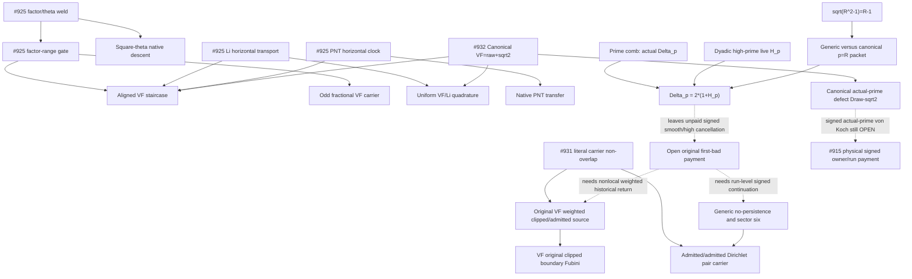

# Current research frontier and import DAG

## Two different DAGs: mathematical obligations vs historical source imports (2026-10-25)

This page and [research-frontier.json](research-frontier.json) are the **historical PR-track source map and import closure** (Layer B navigation): ten cleanup tracks #915, #922, #923, #925–#929, #931, #932 with their modules, sentinels and open inputs. The **mathematical proof-obligation DAG** (Layer A) is separate: [PROOF_DEPENDENCY_DAG.md](PROOF_DEPENDENCY_DAG.md), generated from [proof-obligations.json](proof-obligations.json), whose `historical_tracks` field maps each historical PR below to the proposition nodes it supports. Historical PR numbers are evidence provenance, not independent proof architectures, and the ten historical tracks are not the ten mathematical routes. An import edge here never discharges a proposition there.

**Status correction (2026-10-25):** #1019 merged 2026-10-24T21:57:31Z; the "green, open and unmerged" wording in the next section is the 2026-10-24 observation.


## Current 2026-10-24 portfolio frontier (effective after human merge)

The primary task selector is [RH proof attack portfolio](RH_PROOF_ATTACK_PORTFOLIO_20261024.md). It distinguishes canonical **one-sided VF-LOW**, SAT/JOH **weighted prime/composite** route, CODIV/OAI-NNS **actual signed covariance** exponent improvement, FINITE-AC and **CORR4** critical-energy recurrences, **MU-LIFT** higher-order full-prefix amplification, and independent **NYMAN** positive-norm density. Literal universal per-block VF capture is **REFUTED** by R=549, not an agent's unsolved task.

**Current status after live GitHub inspection on 2026-10-24:** merged #987 imports the original OAI unconditional 7/8 proof; merged #915/#929/#975/#1005/#1006/#1008/#1009/#1013 are sources or conditional consumers (not RH). #1019 is **green, open and unmerged**: physical square-boundary birth `2mu-mu²` and moving-transport telescope are Lean-certified; independent quantitative bound, closed-square root-divisor correction and final shell-to-Mertens integration still require separate work. Check live head on each run; these statuses will become stale.

**Do not count as a new mathematical gap:** a newly named residual already equal to the RH-strength prime/Mertens error. Status accepts a genuinely independent bound, a novel forbidden configuration, a fixed subcritical `r<k` recurrence with proved source, or a source-grounded refutation; otherwise report `TARGET_EQUIVALENT`/no improvement. [Role table and proof gate](RH_PROOF_ATTACK_PORTFOLIO_20261024.md#3-seven-nonduplicate-role-instructions--one-live-portfolio).


## Historical October 18 PNT-first source-to-bound DAG and PR dispositions (retained)

**Historical Oct 18 selected mechanism (not current priority):** [PNT-first signed Euler/Moebius cofactor compensation](PNT_FIRST_SIGNED_COFACTOR_SEAM_2026_10_18.md). Ordinary PNT is already proved. For `X=R^2-1`, `M(X)=S_R-L_R-E_R` where `L` is genuine cofactor-weighted Li prime availability and `E` the **signed actual-prime minus Li** transport. The remaining independent theorem is a quantitative bound on the joint signed smooth/model/error/historical source; identities do not constitute a saving. Keep `p=R` endpoint, top-half prime terminal cells, original #915 once-only active/returned masks, and original quadratic normalized denominator.

- [PR #975](https://github.com/OVVO-Financial/RH_Lean/pull/975) (OPEN/DRAFT at October 18 inventory): source-legal historical cofactor parent no-go and original first-bad `E=G+2U-6L`; a hypothetical large first bad forces `G>0` (stronger scalar corollary `G>R^2` has not yet been named as Lean theorem). This forbids assuming local boundary alone pays the historical anchor. Not an RH proof.
- [PR #976](https://github.com/OVVO-Financial/RH_Lean/pull/976) (OPEN at October 18 inventory): genuine two-prime same-base strict-square-shell Mobius signs agree, giving **positive**, not negative, covariance in that orbit. It is structural and does not provide shell-energy cancellation or RH.
- Prior #915, #919, #922, #925, #931 and other historical entries in this file remain source **navigation**, not evidence that any listed PR is still open. Always query GitHub for live merge state.

**Operational rule:** The role-by-role protocol in the new contract overrides Oct 17 primary assignments only **after merge into main**; updating a branch does not reconfigure saved Studio Agent Instructions. No changes to schedules, permissions or human merge policy.


Updated 2026-10-12 UTC. The direct `pi - VF_canonical` square-run route is canonical, where VF_canonical = raw vfMid + sqrt(2).
Finite A/C and CORR-4 remain sufficient alternatives with unproved quantitative
inputs. The [proof contract](../CURRENT_PROOF_CONTRACT.md) governs all routes.

The [frontier registry](research-frontier.json) preserves the ten PR tracks
from the cleanup batch. It records source entry points, evidence scope and
the input each track still needs. PR state is read from GitHub; this registry
is a source map rather than a live merge-status database.

| Track | Retained result | Open input |
| --- | --- | --- |
| #915 | Original-weight historical/current identities, exact cofactor Abel transport and conditional payment consumers. | `VFMid915FirstBadSourcePaymentStatement`; [payment status](../research/VF_MID_915_SOURCE_PAYMENT_STATUS.md). |
| #922 | Actual centered physical row and correctly directed signed-moment inlet. | Uniform physical moment and genuine source/ideal identification. |
| #923 | Strict square-hyperbola gap and signed low-quotient Abel reduction. | Uniform low-quotient control and original historical payment. |
| #925 | Reversible-packet theorem, factor-range survivors, chosen sqrt-two phase and conditional theta/spectral transport. | Actual-prime representation and lower-channel/run inequality. |
| #926 | Corrected exact census and paper later-root restriction `A > 0.4357`. | Independent uniform upper estimate for A. |
| #927 | Signed finite-prime double telescope and complete-period certificates. | Growing high-owner physical remainder; the full Mobius field is not periodic. |
| #928 | Euler parity asymptotics and floor-Li frequency synthesis. | Pointwise original-carrier finite-C estimate. |
| #929 | Exact finite-A/C equivalence, prime-comb, density and ancestry accounting. | Uniform signed finite-A/C estimate; [route alignment](../research/FINITE_A_C_VF_ALIGNMENT_2026_10_11.md). |
| #931 | Exact prime-comb chronological/dyadic high-prime occurrence weld, p=R root-prime correction, seven actual Möbius censuses, and physical VF clipped/admitted versus Dirichlet admitted/admitted guardrail. | **Quantitative signed smooth/high-prime cancellation** or original-weight nonlocal historical-return child-run payment; [audit](../research/FINITE_AC_CROSS_COORDINATE_DAG_CLOSURE_AUDIT_2026_10_12.md). |
| #932 | Complete public VF supersession: **raw midpoint + sqrt(2)**, new **all-real O(1)** VF-Li_2 bound, exact prime defect, cross-energy and von-Koch equivalence, 719-definition inventory. | Actual-prime signed canonical von-Koch bound remains OPEN; [full VF autopsy](../research/VF_CANONICAL_SQRT_TWO_AUTOPSY_2026_10_12.md). |

## Actual import relationships

Arrows point from an importing source to its dependency. This selected diagram
is navigation only; an import does not discharge an open mathematical input.
The independent #925 reversible-packet kernel imports Mathlib only and has no
native actual-prime representation edge.
The #931 subdiagram highlights literal imports and the mathematical distinction
between clipped/admitted VF-active source and admitted/admitted Dirichlet
sector six. Even when a transitive import exists, it does not imply that their
original physical pair carriers or VF weights are equal. Dotted lines denote
unproved quantitative/representation obligations, NOT actual imports.



## Regenerate and validate

```bash
python3 scripts/repo_index.py build --dot repo-imports.dot --report repo-map.md --require-acyclic
python3 scripts/research_frontier_dag.py
python3 scripts/proofq.py repo-search 'FirstBadSourcePayment' --scope research
python3 scripts/repo_index.py module research/VF_MID_FIRST_BAD_EXACT_BUDGET_CLOSE.lean --transitive
```

The frontier extractor checks registered files and declaration sentinels,
then emits `research-frontier.dot` with the union of their actual transitive
local imports and `research-frontier.md` with current commit provenance.
It reuses the full repository index's project isolation and freshness checks.
The [proof-inventory workflow](../.github/workflows/proof-inventory.yml)
regenerates and uploads both graphs and the research report on source changes.

The exact elaborated library declaration graph, source assumption audits,
root/export checks, owned-warning gates and terminal axiom audit remain
separate requirements. A green navigation check or a merged conditional
toolkit does not prove first-bad payment, finite A/C, or RH.
