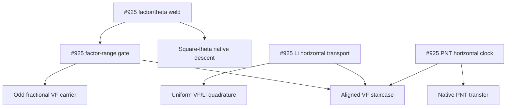

# Current research frontier and import DAG

Updated 2026-10-12 UTC. The direct `pi - VF_mid` square-run route is canonical.
Finite A/C and CORR-4 remain sufficient alternatives with unproved quantitative
inputs. The [proof contract](../CURRENT_PROOF_CONTRACT.md) governs all routes.

The [frontier registry](research-frontier.json) preserves the eight PR tracks
from the cleanup batch. It records source entry points, evidence scope and
the input each track still needs. PR state is read from GitHub; this registry
is a source map rather than a live merge-status database.

| Track | Retained result | Open input |
| --- | --- | --- |
| #915 | Original-weight historical/current identities, exact cofactor Abel transport and conditional payment consumers. | `VFMid915FirstBadSourcePaymentStatement`; [payment status](../research/VF_MID_915_SOURCE_PAYMENT_STATUS.md). |
| #922 | Actual centered physical row and correctly directed signed-moment inlet. | Uniform physical moment and genuine source/ideal identification. |
| #923 | Strict square-hyperbola gap and signed low-quotient Abel reduction. | Uniform low-quotient control and original historical payment. |
| #925 | Reversible-packet theorem, factor-range survivors, chosen sqrt-two phase and conditional theta/spectral transport. | Actual-prime representation and lower-channel/run inequality. |
| #926 | Corrected exact census and paper later-root restriction `A > 0.4357`. | Independent uniform upper estimate for A. |
| #927 | Signed finite-prime double telescope and complete-period certificates. | Growing high-owner physical remainder; the full Mobius field is not periodic. |
| #928 | Euler parity asymptotics and floor-Li frequency synthesis. | Pointwise original-carrier finite-C estimate. |
| #929 | Exact finite-A/C equivalence, prime-comb, density and ancestry accounting. | Uniform signed finite-A/C estimate; [route alignment](../research/FINITE_A_C_VF_ALIGNMENT_2026_10_11.md). |

## Actual import relationships

Arrows point from an importing source to its dependency. This selected diagram
is navigation only; an import does not discharge an open mathematical input.
The independent #925 reversible-packet kernel imports Mathlib only and has no
native actual-prime representation edge.



## Regenerate and validate

```bash
python3 scripts/repo_index.py build --dot repo-imports.dot --report repo-map.md --require-acyclic
python3 scripts/research_frontier_dag.py
python3 scripts/proofq.py repo-search 'FirstBadSourcePayment' --scope research
python3 scripts/repo_index.py module research/VF_MID_FIRST_BAD_EXACT_BUDGET_CLOSE.lean --transitive
```

The frontier extractor checks registered files and declaration sentinels,
then emits `research-frontier.dot` with the union of their actual transitive
local imports and `research-frontier.md` with current commit provenance.
It reuses the full repository index's project isolation and freshness checks.
The [proof-inventory workflow](../.github/workflows/proof-inventory.yml)
regenerates and uploads both graphs and the research report on source changes.

The exact elaborated library declaration graph, source assumption audits,
root/export checks, owned-warning gates and terminal axiom audit remain
separate requirements. A green navigation check or a merged conditional
toolkit does not prove first-bad payment, finite A/C, or RH.
