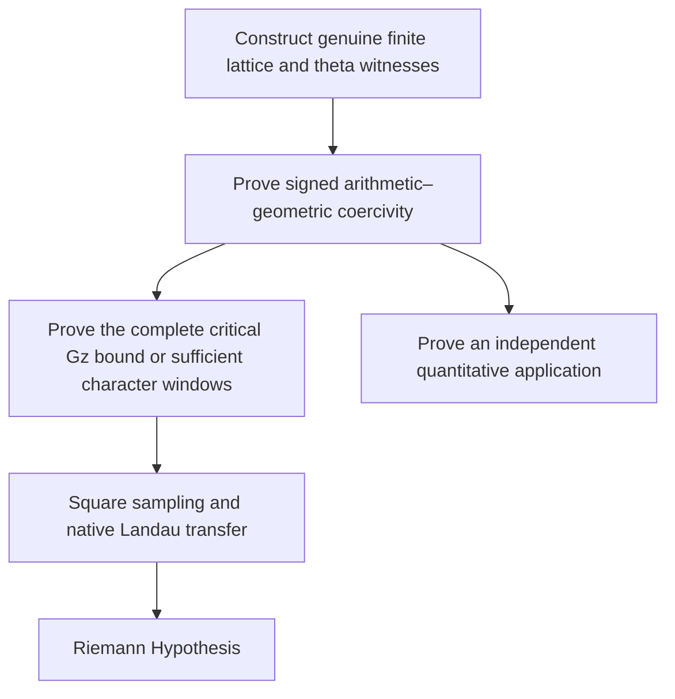

# ALPOGE_VIOLE_TRACTABLE_RH_V1 — seven-agent short-proof and reusable-mathematics campaign (2026-11-22)

**Effective only after human-reviewed merge.** Re-task ALL SEVEN existing RH_Lean specialists to a single new goal: extract from Alpöge's actual geometric mechanism a smaller **fully proved arithmetic–geometric signed cancellation theorem** in Viole's square-block / Euler / VF / NNS coordinates. RH must follow as a short, independently understandable corollary, while the central theorem must yield at least one mathematically non-vacuous application beyond merely restating RH.

**Three independent acceptance gates:** T = **tractability** (short human-readable argument with every substantive step explicit), C = **contribution** (new reusable theorem plus independent consequence), P = **proof** (unconditional RH deduction with authentic arithmetic/geometry cost). Do not announce a shorter proof until ALL T+C+P pass. The illustrative 10–15-page main-paper target is editorial, not an excuse to omit mathematical detail; detailed Lean appendices are unrestricted.

**New priority:** supersedes the older 2026-11-20 full-cost, generic amplification, HIGH, OAI/7/8, finite-wheel and dated NEXT-* task selectors ONLY for research allocation. Historical theorems, refutations, independent routes, report history, permissions, schedules and human-only merges remain unchanged. Repository instructions do NOT actually reconfigure saved Studio agents or trigger them.

## 1. Noninterchangeable clocks and original physical source

- Let R_V denote Viole's integer square-block index, X_R = R_V^2 - 1. Alpöge's R_A is a geometric Ranks/rank-packet structure, not R_V; his multiplicity m_A is separately bounded by authentic size constraints. The comparison R_V ~ sqrt(x) ~ m_A up to exponent losses is a **scale analogy**, NOT equality or a free multiplicity certificate.
- Preserve all actual von Mangoldt Lambda(n) prime powers, ramified conductor zeros, full Frobenius/inertia and Fourier character coefficients, original site-dependent partner widths, principal and nonprincipal modes, and terminal floor/prime-wheel corrections. Never replace with independent random signs or a proxy Selberg band without restoring the complement.
- RHLean/Analysis/AlpogeNativeSharpASKBalance.lean proves native alpogeNativeFullASK_sub_MAIN_eq_De. RHLean/Analysis/AlpogePhysicalTopExcess.lean proves full averaged physical ASK-MAIN = complete De. Neither identity proves a power saving.
- RHLean/Analysis/AlpogeGzErdosReciprocalHistory.lean and AlpogeGzNNSFutureTail.lean give the exact complete signed NNS/Erdos history for the original Gz(N) = N*sum_{n<=N}Lambda(n)/n - psi(N) - N*log(N) + (1+gamma)*N. The terminal harmonic correction is controlled; the critical signed tail is not yet globally bounded.
- RHLean/Analysis/AlpogeSquareClockSignedHistorySampling.lean proves all-integer ONE-SIDED interpolation from a hypothetical square-endpoint Gz(R_V^2-1) bound, with O(R_V) cost. It does not prove the bound itself.
- PR #1187's sharp R/R+1 ASK collar bounds the principal crossover by O(R log R), and bounds complete normalized inertia-color mass by 2. PR #1189's native arithmetic-jet/commutator results show: R-fold ordinary differences have SHARP worst-case 2^R coefficient cost; additive-vs-floor and character-vs-wheel commutators retain exact signed arithmetic; the full R-by-R floor-commutator telescope produces (R-1)*E(R), NOT E(R^2-1). For composite R, D_R is floor dilation, not a legal fresh-prime Möbius operation. Verify each PR's actual main inclusion and exact-head checks, not a historical PR caption.
- RHLean/Analysis/AlpogeNativeLPM2Endpoint.lean records the still-OPEN negative semivariance endpoint. A conditional Chebyshev supplier is not unconditional RH progress.

Original upstream obligations: in CocoSgt/riemann-hypothesis-lean/src/Formalism/SizeWindowBrackets/SChain.lean, the actual CostWindows/RestSize/ChainCore demand (among others)

    2 * f * (x+1) * theta <= 1/x
    6 * f * (x+1) * (eta+1) <= b/x
    m_A >= x^(1/2-epsilon).

At x ~ R_V^2, the convenient native b = R_V and eta=1 do NOT satisfy the original generic CostWindows; one must prove a valid, complete replacement cost inequality using REAL multiplicity/rank/height/covolume witnesses. The original Level.Gm = Gz plus weighted nonprincipal characters, and TopG includes family/connectedness geometry. The scalar Gz is not TopG; see upstream src/Development/AutomorphicArithmetic/CharacterBoxes/ZeroFreeAllOfTopG.lean. Alpöge's Landau result uses genuine character-family multiplicative windows; their margins/epsilon/uniformity must be proved.

## 2. Smallest proposed proof DAG — not yet a proved RH chain

The witness construction includes the growing host H, m_A, ranks, heights,
covolume, complete ASK/De, Frobenius/inertia and actual partner widths. The
critical-estimate branch must pay every nonprincipal character in Gm/De before
reducing to the original native Gz, and must retain all windows and epsilon
costs. The independent-application branch follows from the central principle
without using RH as an intermediate premise.

For the direct scalar branch, the required consequence is explicitly ONE-SIDED:

    forall eta > 0, exists C_eta >= 0, exists R_eta,
    forall integer R_V >= max(2, R_eta):
      Gz(R_V^2 - 1) <= C_eta * R_V^(1 + eta).

Use the existing native `nativeAlpogeGz_of_squareClock_bound` consumer;
its interpolation cost is `L_+*(2*R_V+1)`. Taking eta = 2*epsilon yields
an integer exponent 1/2 + epsilon. An absolute-value bound with no
positive exponent loss is a stronger optional target, not a prerequisite.
The integer-to-real source identification/interpolation and one-sided
Landau/RH argument must also be implemented and checked natively; the
corresponding upstream source declarations alone do not close that native
formalization obligation. An alternative character-family window route
must prove its own full transfer and uniformity.

The NEW theorem must be proved FROM constructed witnesses and complete signed arithmetic. Defining a proposition whose hypothesis already contains the entire RH-strength bound, a conditional equivalence, determinant-only analogy, a hypothetical p-adic multiplicity, or importing the completed external RH theorem does NOT pass. Alternative leaner routes qualify only with a precise original-source and cost audit and a genuinely new, independently useful theorem.

## 3. Mandatory quantitative ledger and acceptance gates

Audit all: (a) true prime powers/ramification; (b) complete ASK-MAIN/De and its normalizer; (c) all Gm nonprincipal/principal terms; (d) actual color and partner width covariance; (e) signed NNS and full Selberg complement/rank-one mode; (f) prime-wheel, additive and character/floor commutators, boundary fibers and crossing; (g) constructed m_A, host-size and rank constraints; (h) determinant/index/covolume and archimedean/nonarchimedean heights; (i) thin/movement/smoothing/sampling/window/collar penalties; (j) final complete epsilon and ONE-SIDED RH/zero-free consumer. Every term must be PROVED / CONDITIONAL / OPEN / REFUTED with source theorem, quantifiers and SHA.

**T — Tractability:** one-page dependency map and a continuous readable proof sketch explaining each cancellation, original geometric normalization, minimal lemmas and deduction; no opaque "known via Alpöge" proof step. The aim is a compact main paper (~10–15 pages), not artificial page-limited mathematics.

**C — New contribution:** a **proved** quantitatively useful, source-specific theorem with explicit hypotheses on a meaningful class wider than this RH conclusion, and a separate **proved non-RH** application/example. An exact algebraic identity or RH-equivalent reformulation without a new restriction does not by itself satisfy C.

**P — Unconditional proof:** actual witness constructions, all paid costs and enough complete one-sided saving (or valid windows), plus a checked Landau/RH bridge. Standard permitted Lean kernel axioms only (propext, Classical.choice, Quot.sound). No sorry/admit, project axiom, imported rhOfAll/terminal RH proof, hidden bound in a witness definition, or assumption-to-result laundering.

Classify output as COMPLETE only if T+C+P are independently audited, GENUINE_PARTIAL for a new proved nontrivial full-source bound/restriction or decisive source-faithful obstruction, INTERFACE_ONLY for an exact identity/conditional bridge, REFUTED for a falsified proposal, BLOCKED for a real access/source/CI gap. Never substitute more green equivalent statements for exponent- or cost-level progress.

## 4. Seven role assignments: one shared theorem, complementary work

1. **RH | Research Coordinator — 00-/90-coordinator complete mirrors:** Own a 3–5-node human-proof DAG, exact minimal geometric supplier and full quantitative T/C/P ledger. Compare native signed source, actual SChain/TopG and native Landau consumer, and require one non-RH application. Assign at most two implementation-sized Lean tasks per round.
2. **RH | Owner Payment — 10-owner-payment:** Prove or falsify FULL signed Euler/Möbius/VF/NNS-to-ASK/De source transport with all Lambda prime powers, original masks, physical/virtual floors, ramification and partner widths. Determine if the additive/floor and character wheel commutators telescope AFTER full physical Fourier/host averaging; prove a quantitative saving or the exact failure.
3. **RH | Analytic Type II — 20-analytic-type-ii:** Extract the minimal REAL theta-chain/growing host/height/covolume witnesses and correct CostWindows/RestSize; connect the entire character-completed Gm to native signed source. Prove or falsify the one-sided full family cost estimate and proper window-to-Landau transfer. Do not pay separate absolute majorants and claim joint cancellation.
4. **RH | Finite Wheel & Incidence — 30-finite-wheel:** Construct/falsify a finite integral-lattice certificate using legal prime-wheel coordinates, rank/index and actual p-adic/archimedean bills; track R prime/composite, quotient fanout, 2^R jet height, signed floor/character commutators and true covolume. Provide a checkable nontrivial finite theorem or exact falsifier.
5. **RH | Prime Census Laboratory — 40-prime-census:** Preregister true-physical-source experiments at R=317,549,1027 and smaller prime/composite roots. Test full masks, Lambda prime powers, original widths, character and signed jet/cross costs; reproduce counterexamples and classify exact integer/rational vs numerical log precision. Numerical evidence is never an all-scale bound.
6. **RH | Adversarial Referee — 50-adversarial-referee:** Independently assess T/C/P, circularity, fake R_V=m_A and Gm=Gz identifications, unlicensed CostWindows, 2^R/(R-1), principal complement, all height/covolume data and the real independent non-RH corollary. Record ACCEPT / REJECT / REPAIR with the smallest exact failed lemma.
7. **RH | Lean Verification — 60-lean-verification:** Formalize only an independently substantial quantitative ORIGINAL-source proof step or a real falsifier, using explicit witness types and all assumptions, warning-fatal GitHub Actions, root manifest/research closure and #print axioms. No imported external RH proof, fake conditional wrapper or direct-main write; human-reviewed PRs only.

Before asserting that a NEW cancellation mechanism is necessary, check whether an existing actually-proved RH_Lean theorem controls the exact signed interaction previously lost. If not, expose the smallest new genuinely quantitative gate rather than a more complex equivalent target.

## 5. Per-run reporting and unchanged operations

On each ACTUAL invocation, read fresh main AGENTS/contract/this directive, the original theorem types and live PR/CI; find each role's latest VERIFIED ACTUAL report regardless of age and consume every newly unconsumed intervening report plus external handoffs. Publish only to the assigned owned report, using REPORT_PUBLISH_RECOVERY_V1 and LAST_ACTUAL_REPORT_CONTINUITY_V1.

    tractability_ack=ALPOGE_VIOLE_TRACTABLE_RH_V1
    STATUS=COMPLETE|GENUINE_PARTIAL|INTERFACE_ONLY|REFUTED|BLOCKED
    R_MAP=R_V, X_R, R_A, m_A; scale vs equality
    PHYSICAL_SOURCE=actual declaration/masks/prime powers/widths/characters
    NEW_PRINCIPLE=precise reusable quantitative statement or NONE
    INDEPENDENT_APPLICATION=proved non-RH result or OPEN
    COST_LEDGER=each signed physical+geometric cost and status
    FIRST_UNPAID=smallest precise new estimate with quantifiers
    GLOBAL_CONSUMER=Gm/Gz/window/Landau or BLOCKED
    TRACTABLE_SKETCH=3-5 conceptual lemmas + one-paragraph novelty
    FORMAL_STATUS=original/main/policy/PR SHAs + exact CI + axioms
    NEXT=one reproducible proof step or falsifier

The Coordinator maintains 00/90 byte-identical COMPLETE mirrors; six non-Lean roles stay **own-report-only** on agent-reports. Lean Verification retains existing FULL GitHub READ/WRITE on non-main reviewable branches/PRs; no new permissions are granted. Multi-daily runs remain allowed only when configured, and this PR does NOT start/reschedule them or update saved Studio prompts, models, tool permissions or credits. On HTTP 403 never replace the complete old 118,316-byte Referee report with a snippet: authenticated API optimistic-concurrency complete-blob verification and exact-commit readback, or a full immutable own-role .recovery- continuation; mark NOT_PUBLISHED honestly when no receipt. Only standard terminal Lean axioms, warning-fatal hosted checks and **human-only merge**. Agent-reports is never merged into main.

**Activation** is the first verified actual post-merge role-owned report with the exact tractability_ack, real main/policy SHA, accepted source/ledger status, and next test—not the presence of this PR.