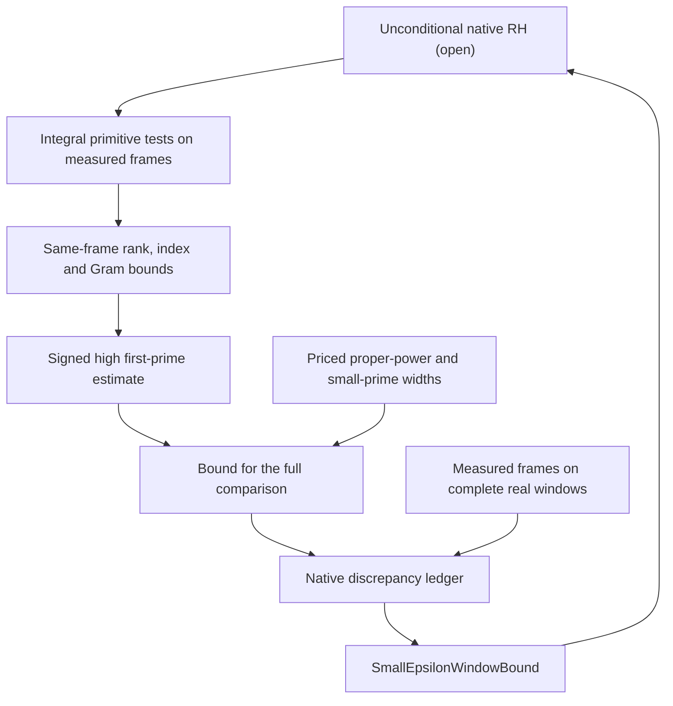

# Quantitative discrepancy ledger for #1201

The three transfer errors below have a uniform bound with exponent coefficient 1. The independent bound derived below for the comparison source is weaker than the critical estimate. Existence of a measured geometric frame with the required signed gain at every anchor on cofinal windows remains open.

Hosted Lean verified the assembled inequality, its normalized price and the independent physical mass bound at commit `393cb5c`. The same job verified the refinement that freezes only the thick widths. [Proof and axiom audit](https://github.com/OVVO-Financial/RH_Lean/actions/runs/45780078438/job/139773341050).

## The two sources

Fix $0<\varepsilon<1/52$ and a window exponent $A\ge1$. Take $e(x)$ and the pair $(q,d)$ for the window $[Y,Y^A]$ from `nativeConstructedDyadicGzPayment`. The pair stays fixed throughout that window. On its actual reciprocity host $H$, use a nonempty physical top set $TT$, nonempty thick set $T_2$, $m>0$, positive $b$, heights $a_t$, positive widths $w_{uj\rho}$, and the density, cutoff and width conditions of that theorem. Write

$$
\Delta=|T_2|/|H|,\qquad Q=|TT|mb\Delta/2,\qquad N=\lceil A_{\max}/\beta\rceil .
$$

Here $a_t\le A_{\max}$ and $\beta$ is the original lower width bound. Require $x\ge1$ and the original height localization $x\le a_t/b\le x+1$ for every top. The upper endpoint follows from $A_{\max}/b\le x+1$. The original height window $xb\le a_t\le xb+xb/(k\sigma)$ gives both endpoints when $k\ge x$ and $\sigma\ge1$.

Let $S(v)$ be the **sum over tops and rows** of the physical $\operatorname{Re}(\mathrm{ASK}-\mathrm{MAIN})$, averaged over the whole host subgroup. Define

$$
\begin{aligned}
G_{\rm native}(x)&=\sum_{n\le x}\Lambda(n)(x/n-1)-x\log x+(1+\gamma)x,\\
\eta&=\frac{b\Delta\sqrt{x}}{2A_{\max}},\qquad
v_{uj\rho}=\exp\!\left(\eta\left\lfloor\frac{\log w_{uj\rho}}{\eta}\right\rfloor\right),\\
G_{\rm comparison}(x)&=S(v)/Q .
\end{aligned}
$$

The widths $v$ are computed from the measured widths. Both sources of physical excess, $S(w)$ and $S(v)$, use the same heights, top and thick sets, rows, inertia, Frobenius, canonical character term and cutoff $N$. A lower grid endpoint may fall below $\beta$. Keeping $N$ fixed is part of the comparison. The comparison does not require the grid endpoints to be integral sections.

## The ledger

Use $C_d=4+\log 4$ and $r=x^{1/2+\varepsilon}$. Each row gives an upper allowance in the indicated direction.

| Transfer on this frame | Allowance before dividing by $Q$ | Normalized allowance | Independent supplier |
|---|---:|---:|---|
| $G_{\rm native}(x)$ to the mean of $G_{\rm native}(a_t/b)$ | $Q C_d$ | $C_d$ | Global arithmetic Lipschitz estimate with constant $C_d$ and mean absolute height displacement at most 1 |
| Mean of $G_{\rm native}(a_t/b)$ to $S(w)/Q$ | $Qr$ | $r$ | Selected dyadic analytic payment with the complete prime-power source and its original cutoff |
| $S(w)/Q$ to $S(v)/Q$ | $\lvert TT\rvert mA_{\max}\eta$ | $2A_{\max}\eta/(b\Delta)=\sqrt{x}$ | Monotonicity of each real ASK cut and the change in the signed MAIN logarithm |

Let $E_{\rm total}$ be the sum of the three raw allowances. The resulting statement is

$$
G_{\rm native}(x)\le G_{\rm comparison}(x)+\frac{E_{\rm total}}{Q},
\qquad
\frac{E_{\rm total}}Q=C_d+r+\sqrt{x}\le (6+\log4)x^{1/2+\varepsilon}.
$$

For $x\ge (4+\log4)^2$ the coefficient can be reduced to 3. All constants in this price are independent of the frame, the selected pair, and the window. The signed width comparison uses $v\le w$ and $0\le\log w-\log v\le\eta$. The real ASK decreases as the width increases. The remaining positive change in $S(w)-S(v)$ is at most $a_t\eta$ per row. Paying that charge before division accounts for the factor $2/\Delta$.

## Independent bound for the comparison source

Write $L_N=\sum_{1\le n\le N}\Lambda(n)/n$, and let $M_{utj}=\operatorname{Re}\mathrm{MAIN}(\ell,a_t,v_{uj})$. The complete kernel on this host gives

$$
G_{\rm comparison}(x)\le
\frac{1}{Q|H|}\sum_{u\in H}\sum_{t\in TT}\sum_{j=1}^m
\bigl[2a_t L_N-M_{utj}\bigr].
$$

Indeed the real ASK weights $K_{ng}$ are nonnegative with $\sum_{g\notin\Phi}K_{ng}\le2\Lambda(n)$, including at ramified prime powers. Each cut is at most $a_t/n$. Subtracting the exact MAIN preserves its character and logarithmic terms. For $N\ge1$, the existing unconditional estimate gives $L_N\le\log N+\log4+2$. These bounds use quantities defined independently of $G_{\rm native}$. They do not give a square-root bound for $G_{\rm comparison}$.

There is a concrete way to measure what the coarse upper bound discarded. For each row set $z_n=a_t/n$, $c_{t,g}=v_{uj,\operatorname{partner}(t,g)}$, and $k_n=\sum_{g\notin\Phi}K_{ng}$. Its exact saving against the upper bound $2a_t L_N$ for ASK is

$$
\sum_{n=1}^N(2\Lambda(n)-k_n)z_n
+\sum_{n=1}^N\sum_{g\notin\Phi}K_{ng}\min(z_n,c_{t,g}).
$$

This follows from $z-(z-c)_+=\min(z,c)$. Both terms are nonnegative and can be computed from inertia, Frobenius and the measured widths. A lower estimate for these savings must be compared with the signed MAIN on the **same** frame. The identity itself gives no lower estimate of the required size.

The physical thick mask gives an independent lower bound for part of the second saving. Define
$\beta_0=\beta e^{-\eta}$, $b_0=b e^{-\eta}$ and $k^{10}_n=\sum_{h\in H}K_{n,((1,0),h)}$.
For $z_{tn}=a_t/n$ put $P_c(z)=(z-c)_+$ and
$D_{tn}=P_{\beta_0}(z_{tn})-P_{b_0}(z_{tn})\ge0$.
All grid widths are at least $\beta_0$. A selected thick partner has grid width at least $b_0$ because $v\ge e^{-\eta}w$. For fixed $t$ and $g=((1,0),h)$ there are exactly $|T_2|$ translates $u$ which select $g$. Indeed $s+u-t=h$ gives the distinct solutions $u=h+t-s$ for $s\in T_2$. The other first-bit-one colour occurs zero times in the thick mask. This calculation uses the full subgroup supplied by the selected payment.

Writing $\mathcal M=|H|^{-1}\sum_{u,t,j} M_{utj}$, the resulting stronger comparison estimate is

$$
G_{\rm comparison}(x)\le
 \frac{2}{|TT|b\Delta}\sum_{t\in TT}\sum_{n=1}^N k_n P_{\beta_0}(z_{tn})
 -\frac{2}{|TT|b}\sum_{t\in TT}\sum_{n=1}^N k^{10}_n D_{tn}
 -\frac{\mathcal M}{Q}.
$$

To verify the bound, each cut is at most $P_{\beta_0}(z_{tn})-\mathbf1_{g\text{ selected}}D_{tn}$. Multiply by the native nonnegative weight, average in $u$, and sum the $m$ rows. The factor $\Delta$ in the thick saving cancels **exactly** against the original divisor. This yields an explicit negative contribution, calculated from the actual thick translates with coefficient $2/(|TT|b)$. The cutoff and signed MAIN still contain the complete original thin and ramified data. The two positive-part functions coincide below $\beta_0$, differ by $z-\beta_0$ between the two thresholds, and differ by $b_0-\beta_0$ above $b_0$. These facts specify the contribution of each prime power. The bound for the sum over all translates of a fixed physical colour is formalized in `alpogeNativeLowerLogWidth_thick_translate_cuts_le`. The displayed aggregation multiplies those inequalities by the native weights and sums over colours, prime powers and rows. This last aggregation is a paper derivation.

### A finite signed bound using the native height, mask and kernel data

The full signed comparison also has an upper bound that preserves the interaction between the logarithm and the prime-power cuts. It can be evaluated without knowing the individual widths. Set $a_*=\sum_t a_t/|\Phi|$, $M_0=\sum_t a_t(\log a_t-1-\gamma+\operatorname{Re}\ell(\chi_C))$, with the sums over $TT$. For each positive site $\rho$, take the unique nonpositive-mask colour $g(t,\rho)$ whose partner is $\rho$. It exists because the partner is translation by $((1,1),t)$. Define the following function on $v>0$:

$$
F_\rho(v)=\sum_{t\in TT}\sum_{n=1}^N K_{n,g(t,\rho)}(a_t/n-v)_+ + a_*\log v .
$$

The same $v$ occurs for **all** tops and all prime powers at a site in a given row. Directly summing the complete signed source gives
$S(v)=|H|^{-1}\sum_{u,j}[\sum_{\rho\in\Phi} F_\rho(v_{uj\rho})-M_0]$.

Let $L(c)=\exp(\eta\lfloor\log c/\eta\rfloor)$, $X'=\exp(x^{\varepsilon/3})$ and $a_{\min}=\min_{t\in TT}a_t$. The native thick and thin conditions put the rounded widths in the respective intervals

$$
I_B=[L(b),L(b+h)],\qquad I_T=[L(\beta),L(3a_{\min}/X')].
$$

For the thin interval, apply the thin inequality to the inverse partner of $\rho$ for each top. The equivalence between a thick partner and a thick colour is `alpogeNativeFreezing_partner_mem_iff`. The logarithmic rounding function is increasing in the weak sense. Both intervals used by the physical profile are compact and strictly positive.

For either interval $I$, compute an upper bound $U_\rho(I)$ as follows. Split $I$ at the finitely many interior thresholds $a_t/n$. On each resulting open interval the active weight $k=\sum_{t,n:\ a_t/n>v}K_{n,g(t,\rho)}$ is constant and $F'_\rho(v)=a_*/v-k$. Evaluate $F_\rho$ at the two endpoints and, when $k>0$, at $v=a_*/k$ if it lies in the interval. Take the largest value, including the value at a singleton interval. This computes the continuous maximum exactly. Rounding each candidate on both sides to grid points in $I$ and retaining the endpoints also gives the exact maximum over allowable grid values, by monotonicity on either side of a stationary point. The continuous maximum already suffices.

Define $d_\rho=\Delta$ on sites with bits $(0,1)$ and $d_\rho=0$ on sites with bits $(0,0)$. The same translate count now yields an explicit signed upper bound independent of the individual widths,

$$
G_{\rm comparison}(x)\le
\frac{2}{|TT|b\Delta}
\left[\sum_{\rho\in\Phi}\left(
 d_\rho U_\rho(I_B)+(1-d_\rho)U_\rho(I_T)\right)-M_0\right].
$$

Indeed each $F_\rho(v_{uj\rho})$ is bounded on its own interval, precisely $d_\rho|H|$ translates use the thick interval, and the native divisor cancels the row count. This is a paper bound for the same comparison source in the ledger. Its inputs are the selected kernel, heights, scalar width ranges and original mask. A square-root estimate for this explicit expression would suffice. A large value of the expression alone would only rule out this uniform relaxation because maximizing independently over sites discards restrictions on jointly realizable widths. No critical bound for the maximum is established here.

## Outstanding supplier

The missing bound is $S(v)\le K_\varepsilon Qx^{1/2+C_0\varepsilon}$ on an admissible measured family for **every** anchor on arbitrarily distant complete windows $[Y,Y^{3/2}]$, with $C_0$ fixed before $\varepsilon$ and $K_\varepsilon$ independent of the window. The selected pair and host already exist; the theorem quantifies over physical profiles satisfying its explicit hypotheses. It does not establish cofinal existence of the required profiles with this signed payment. A local index contributes only through an estimate for the signed same-frame source or an independently priced one-sided comparison. The primitive evaluations and the joint finite-index, Gram and signed-slope payment are still open. No error row silently pays them.

## Lean declarations

- [nativeConstructedDyadicDiscrepancyLedger and nativeDiscrepancyPrice_le](../RHLean/Analysis/AlpogeThin/NativeExistingRecoveryPayment.lean) assemble the pointwise inequality from the selected host, price its errors, and retain the original height-window lemma.
- [nativeConstructedDyadicGzPayment](../RHLean/Analysis/AlpogeThin/NativeConstructedDyadicGzPayment.lean) supplies the analytic row. [alpogeNativeGzArithmetic_le_mean_add_move](../RHLean/Analysis/AlpogeThin/NativeScalarSupplierPayment.lean) supplies arithmetic movement.
- [alpogeNativePhysicalSubgroupTopExcess_logGrid_le and alpogeNativePhysicalSubgroupTopExcess_mass_bound](../RHLean/Analysis/AlpogeNativeThickFreezing.lean) give the physical width comparison and independent mass estimate. [nativeLambdaRecip_sub_log_abs_le](../RHLean/Analysis/NativePNTSelberg.lean) gives the numerical estimate for $L_N$.
- [Research audit roots](ALPOGE_EXISTING_RECOVERY_APPLICATION_AUDIT_20261124.lean) include the assembled ledger, normalized price and mass bound.

## Refining the width entry by freezing only the thick sites

Source: Alpöge's original `Compl3Record.lean` (lines 15–44, 217–287) and `AbsPhFSubLeOfLe.lean` (lines 52–153), pinned at [a6ac91a](https://github.com/TomasOrtega/RH/tree/a6ac91a412dcbaab31801355ec5707024a71bf65/extracted/lean/src/Formalism/SharpRestriction/Divisibility/HookProducts). This is an inequality transport, not a claim that Harish-Chandra coordinates equal native widths. The actual native signed row difference is the ASK difference plus the mean log-width difference multiplied by its height; all common character and height terms cancel. The ASK difference is nonpositive when the comparison is a lower width profile.

Use the same selected pair, host, rows, top heights, inertia/Frobenius, canonical character, cutoff and original divisor Q as above. Instead of rounding every width, let v = freezeThick(T2,u,b,w). The thin widths remain identical. The thick support has cardinal |T2|, exactly half the thick density among the 2|H| positive sites. At changed coordinates 0 <= log(w/b) <= h/b by log z <= z-1. Thus the mean log distortion is at most (Delta/2)(h/b). The existing one-sided signed-width theorem then gives

$$
S(w)/Q \le S(v)/Q + (A_{\max}/b)(h/b).
$$

The density cancels rather than being paid by an arbitrary grid tolerance. The comparison uses no manufactured geometric witnesses and no new assumptions. In the original size regime, the established numerical cost-window theorem (specialized at e=0, K=0 solely for its numerical inequality) gives (x+1)h/b <= 1/x eventually, uniformly in b,h. Since Amax/b <= x+1, the full native ledger becomes

$$
G_{\rm native}(x) \le S(v)/Q + C_d + x^{1/2+\varepsilon} + (A_{\max}/b)(h/b),
$$

with the last charge at most $1/x$ eventually. The guarded audit verified the signed row difference, thick-support count, normalized comparison and eventual price. All thin and ramified contributions remain in $S(v)$. The outstanding supplier above applies to this choice of $v$ as well.

Native declaration names: `alpogeNativeSignedWidthSource_sub_eq`, `alpogeNativeThickPositiveSites_card`, `alpogeNativeFreezeThick_logMean_le`, `alpogeNativePhysicalSubgroupTopExcess_freezeThick_upper_le`, `nativeConstructedDyadicFrozenDiscrepancyLedger`, `nativeFrozenWidthPrice_eventually`.

## Native signed compensation after the freeze of #1201

Foundation commit `52fbe6b` and merge commit `5eeebbd` have Git tree `1fd6e929252f786ff89ecd0abd749f0f6308288e`. The hosted build and guarded audits passed. After the first job deleted its restored full cache, rerunning the hosted build alone saved the exact key again. Cache ID `11157389789` was present after cleanup. [Hosted verification](https://github.com/OVVO-Financial/RH_Lean/actions/runs/45821573180) · [Main push](https://github.com/OVVO-Financial/RH_Lean/actions/runs/45835391297).

The frozen elaborated inventory has 42,159 project records, 36 declarations returning RH and no closed literal RH theorem. Its general graph exporter recorded zero body references for all 32,830 theorems because `ConstantInfo.value?` defaults to excluding theorem and opaque values. The dedicated axiom check and the strict principal dependency check are separate. The successor explicitly includes opaque bodies in the existing graph exporter. [Kernel graph exporter](../scripts/lean/DeclGraph.lean) · [Pinned Lean implementation](https://github.com/leanprover/lean4/blob/v4.34.1/src/Lean/Declaration.lean#L483-L488).

### Which first-prime cuts can still decide the sign

Keep the selected pair, host, actual rounded widths $v$, cutoff $N$, heights, signed MAIN and divisor $Q$ of the ledger. Write $K_{ng}$ for the nonnegative Fourier-inverted weight including $\Lambda(n)$, $k_n=\sum_{g\notin\Phi}K_{ng}$, and $\rho(t,g)$ for the positive partner. Brackets denote the full-host average of the sum over the original tops and rows. For $z=\lfloor\sqrt x\rfloor$, compute two finite quantities from this frame.

$$
\begin{aligned}
L&=\left\langle\sum_{n=1}^N k_n\frac{a_t}{n}
             -\operatorname{Re}\mathrm{MAIN}(\ell,a_t,v_{uj})\right\rangle,\\
P_{>z}&=\left\langle
  \sum_{\substack{z<p\le N\\p\ {\rm prime}}}\ \sum_{g\notin\Phi}K_{pg}
      \min\!\left(\frac{a_t}{p},v_{uj,\rho(t,g)}\right)
\right\rangle .
\end{aligned}
$$

Put $S_z=L-P_{>z}$. Every proper prime power and every small first prime keeps its linear term and exact inertia mass. The identity $y-(y-w)_+=\min(y,w)$ gives $S(v)\le S_z$. For every sufficiently large $x$, on every frame meeting the ledger's scalar conditions,

$$
0\le\frac{S_z-S(v)}Q
 \le 8(2K+\log 4+2)x^{1/2+\varepsilon}.
$$

Here $K$ is one absolute Chebyshev constant. Take $B=2b$ and $M=\lceil x+1\rceil$. The thick conditions give $v\le b+h\le 2b$ eventually. At a thin partner the original bound gives $w\le3a_t/\exp(x^{\varepsilon/3})\le b$ eventually. Rounding can only lower the width. Each replaced cut costs at most $B\min(M/n,1)$. At the proper powers the sum of $\Lambda(n)\min(M/n,1)$ is at most $K\sqrt M$ independently of $N$, by applying the finite Abel bound at $\max(M,N)$. At first primes through $z$ the sum is at most $\psi(z)\le(\log4+2)z$. The kernel satisfies $k_n\le2\Lambda(n)$, including at ramified primes. Dividing by the original $Q$ gives $4B(K\sqrt M+(\log4+2)z)/(b\Delta)$. Finally $\sqrt M\le2\sqrt x$ and $1/\Delta\le x^\varepsilon$.

The forward comparison therefore needs **one concrete lower estimate** on the jointly measured frame,

$$P_{>z}\ \ge\ L-K_\varepsilon Qx^{1/2+C\varepsilon}.$$

Both sides retain the same widths. The linear terms $a_t k_n/n$ in $L$ can be large. The estimate for $S_z-S(v)$ pays only the replaced cuts. [Physical comparison and normalization](../RHLean/Analysis/AlpogeThin/NativeExistingRecoveryPayment.lean) · [Scalar proper-power bound](../RHLean/Analysis/AlpogeNativeProperPowerCentering.lean).

The exact row decomposition is `alpogeNativeFirstPrimeWidthASK_eq_linear_sub_saving`.

`nativeLedger_firstPrimeWidth_on_dyadicFrame` specializes this price to the actual reciprocity map, canonical character term, original thick and thin masks, and full subgroup. Its constant precedes $\varepsilon$, the dyadic exponent, both primes and every frame parameter. The cutoff $N$ and the signed MAIN agree exactly in the two sources. Combining this one-sided estimate with the frozen ledger gives $G_{\rm native}(x)\le S_z/Q+(6+\log4)x^{1/2+\varepsilon}$ on those measured frames.

The measured thin width can be removed over a much longer first-prime interval. Set $X'=\exp(x^{\varepsilon/3})$ and $T=\lfloor X'/(x+1)^2\rfloor$. On every thin colour, rounding and the original thin-return inequality give $v\le w\le 3a_t/X'\le 3(x+1)b/X'$. Total kernel mass through $T$ is at most $2\psi(T)$. Consequently the contribution $P_{\mathrm{thin},(z,T]}$ of these sites to $P_{>z}$ satisfies

$$
0\le \frac{P_{\mathrm{thin},(z,T]}}{Q}
\le \frac{12(\log4+2)(x+1)T}{\Delta X'}
\le \frac{12(\log4+2)}{(x+1)\Delta}.
$$

The finite proof uses $p\le\min(T,N)$ on each row and the coefficient $2/(b\Delta)$ before averaging. For fixed $\varepsilon>0$, $T$ eventually exceeds every fixed power of $x$. Thus all thin-site savings through this threshold can be omitted from the lower-bound attack with the displayed error. The savings above $T$, the thick-site savings and the complete signed MAIN remain on their original frame. The Lean declaration is `alpogeNativeThinFirstPrime_saving_le`.

The selected pair also prices the ramified first prime $d$. At its original involution-shifted Frobenius site, $\log d\,\min(a_t/d,v)$ is bounded by $\log d\,a_t/d$. This last quantity is exactly the $d$-prime ASK at exponent cutoff one and zero width. Applying `nativeDyadicDPrimeASK_normalized_le_of_winPair` to this independent positive majorant yields $P_d/Q\le16x^{\varepsilon-1}$ on the same window, including when the actual rounded cut is inactive. The primes dividing $2^{e+2}q$ have zero source mass by `nativeDyadicHostPrimePowerWeight_typeI`. All unramified first primes with positive mass are inert. Hence the unresolved savings can be restricted to the thick sites of unramified inert primes above $z$ and their thin sites above $T$. The original linear terms and signed MAIN remain in $L$. [Discriminant price](../RHLean/Analysis/AlpogeThin/NativeExistingRecoveryPayment.lean) · [Actual prime weights](../RHLean/Analysis/AlpogeThin/NativeDyadicHostPrimePowerWeights.lean).

An Euler sign reversal at a mixed product $mp$ with $m>1$ and $p\nmid m$ has $\Lambda(mp)=0$. On every unramified inert prime tower the signed binomial ancestry has a single common sign across all surviving powers. Thus a pointwise cancellation between opposite signs in that tower cannot supply the needed payment. [Native mixed sites and signed ancestry](../RHLean/Analysis/AlpogeThin/NativeSignedPrimeExponentAncestor.lean).

Writing $P_*$ for the unramified inert savings at thick sites with $p>z$ and thin sites with $p>\max(z,T)$, these independent charges give

$$0\le (L-P_*-S(v))/Q \le Cx^{1/2+\varepsilon}+
\bigl(16+12(\log4+2)\bigr)x^{\varepsilon-1}.$$

To obtain the requested upper bound on $S(v)$ it suffices to prove $P_*\ge L-K_\varepsilon Qx^{1/2+C_0\varepsilon}$. The displayed two-sided price also quantifies exactly how much the restricted target can exceed the original signed source. The cutoff $N$ bounds all sums in $P_*$.

There is a further cancellation at every thick site with prime index $p\ge x$. Remove both its linear term from $L$ and its saving from $P_*$. Their difference is precisely its positive ASK cut. With $R=\sqrt{x}$ the ledger's own spacing satisfies $\eta=b\Delta R/(2A_{\max})\le1/(2R)$. Thus $v\ge b e^{-\eta}\ge b(1-1/(2R))$. For any integer $n\ge x$, the cut is at most $b(1/x+1/(2R))\le 3b/(2R)$. At $n\ge x+1+2R$ it vanishes. The support claim follows from $(x+1+2R)(1-1/(2R))-(x+1)=(3R+1)(R-1)/(2R)\ge0$. The interval has at most $2+2R\le4R$ integers. Its upper endpoint is at most $4x$, and the sum of all colour weights at each index is at most $2\Lambda(n)\le 2\log(4x)$. On one row this gives $12b\log(4x)$, even including proper powers. After the actual averaging and division the additional price is at most $24\log(4x)/\Delta$. The submitted declarations are `nativeLedger_thickTail_cut` and `nativeLedger_thickTail_mass`.

Write $L'$ and $P'$ for these simultaneous deletions, restricted to the affected unramified inert first primes already in $P_*$. Then

$$-24\log(4x)/\Delta\ \le (L'-P'-S(v))/Q\ \le C x^{1/2+\varepsilon}+(16+12(\log 4+2))x^{\varepsilon-1}.$$

The thick primes in $P'$ now lie strictly between $\sqrt{x}$ and $x$. Thin primes above $\max(z,T)$ and the exact signed MAIN still enter the same-family lower bound. The additional price fits the square-root budget uniformly by $1/\Delta\le x^\varepsilon$ and $\log(4x)\ll\sqrt{x}$ for $x\ge1$.

The remaining thick savings have a direct evaluation. Let $B_{q,d}(x)$ be the sum of $\log p$ over the actual unramified inert primes $\sqrt x<p<x$ whose Frobenius has the binary colour of $\operatorname{E1}$. Primes of the other binary colour have no thick translate. At each such prime $a_t/p\ge b$. Every thick translate therefore has
$$b e^{-\eta}\le\min(a_t/p,v)\le b+h.$$
For every top $t$ and host coordinate of the Frobenius there are exactly $|T_2|$ thick translates. Since $N\ge x$, none of these indices are lost. Sum the inequalities over the same tops, rows and translates. The native weight $2\log p$, the $1/|H|$ average and $Q=|TT|mb\Delta/2$ give
$$4 e^{-\eta} B_{q,d}(x)\le P'_{\rm thick}/Q\le4(1+h/b) B_{q,d}(x).$$
Set $C_\psi=\log4+2$. Since $B_{q,d}(x)\le\psi(\lfloor x\rfloor)\le C_\psi x$, $\eta\le1/(2\sqrt{x})$, and $(A_{\max}/b)(h/b)\le1/x$ eventually with $A_{\max}/b\ge x$, this becomes
$$-2C_\psi\sqrt x\le P'_{\rm thick}/Q-4 B_{q,d}(x)\le 4 C_\psi/x.$$
The error is independent of the thick density. The submitted row result is `nativeLedger_thickFirst_saving_census`; the aggregate follows by the displayed finite summation. This extracts the actual gain from the widths at the required scale. Its signed comparison with the linear and MAIN terms still requires an independent estimate of the arithmetic class sums on the selected pair.

### Signed thin contribution on the actual rounded family

When the original MAIN is assigned to the colours by the complete Fourier identity, the entire centered thin contribution admits an independent upper price, including its large first primes. To apply that identity with rounded widths, keep the original $N$ on the left and use $N'=\max(N,\max_\rho\lceil a_t/v_\rho\rceil)$ only on the right. Each additional Fourier-inverted ASK weight and cut is nonnegative. MAIN is identical on both sides. At $N'$ the established exact identity gives the sum of the actual thick and thin responses evaluated at the same rounded widths.

For any pair already selected by the ledger, `principalPair_uniform_noExc` and `QH.thin` give the uniform bound $|F_\psi(y)|\le y\theta$, $\theta=\exp(-x^{\varepsilon/8})$, at all $y\ge\exp(x^{\varepsilon/3})/3$, with the native conductor bound. On a thin site $v\le w$, so $y=a_t/v$ meets that threshold. Each product $vF_\psi(a_t/v)$ costs at most $a_t\theta$. There are $4|H|$ characters, $2|H|-|T_2|$ thin colours and the divisor per colour is $2|H|$. Applying the original row and translate sums gives

$$S_N(v)/Q\le \frac{1}{Q|H|}\sum_{u,t,j}\operatorname{Re}\operatorname{ActualThick}(F,T_2,a_t,u,t,v_{uj})+\frac{(8|H|-4|T_2|)\theta\,\overline a}{b\Delta}.$$

The final term is at most $2/(x\Delta)\le2x^{\varepsilon-1}$ eventually because $\overline a/b\le x+1$ and the verified native host cost gives $4|H|(x+1)\theta\le 1/x$. The original conductor estimate follows from `nativeDyadicHost_windows` on this same pair. The branch submits `nativeLedger_anyCutoff_le_thick_add_thin` and `nativeLedger_pairGood_roundedASK_le_thick` for the row inequality. Summation uses the frozen normalization `nativeDyadicThinBill_div_projectionDivisor`. This directly reduces an upper bound on the comparison to the centered, signed thick response. That response includes its own share of MAIN and still requires the quantitative physical gain. The small error for the centered thin response cannot be used as a bound on the uncentered thin saving in $P'$ alone. [Complete source identity](../RHLean/Analysis/AlpogeNativeSubgroupProjection.lean) · [Independent thin estimate](../RHLean/Analysis/AlpogeThin/NativeCftThin.lean) · [Size and normalization](../RHLean/Analysis/AlpogeThin/NativeDyadicCostWindows.lean).

### Paying the reverse comparison to physically measured widths

The frozen ledger prices $S_N(w)-S_N(v)$ from above. The reverse direction allows a signed recovery proof at the actual geometric widths $w$ to feed the rounded comparison. On each lift and row use the mixed profile $w_1=w$ on the actual thick mask and $w_1=v$ elsewhere. For large anchors $h\le b$ and $0<\eta\le1/(2\sqrt x)\le1/2$. Every changed width obeys $v\ge e^{-\eta}w\ge b/2$ and $0\le w_1-v\le(1-e^{-\eta})(b+h)\le2b\eta$. The signed upward width movement bound at baseline $b/2$ therefore gives, for each top, a price of at most $4b\eta\,\psi(\lfloor2a_t/b\rfloor)\le8(\log4+2)a_t\eta$. After summation and division the charge is at most $16(\log4+2)A_{\max}\eta/(b\Delta)=8(\log4+2)\sqrt x$.

For $w_1$, enlarge the cutoff only on the majorizing side to cover every ratio $a_t/w_{1,\rho}$. For $w$ the **original** $N$ already covers every ratio. In their complete Fourier decompositions the signed thick responses agree term by term because their widths coincide on the same thick colours. Each signed thin average has absolute value at most $2Q/(x\Delta)$ by the preceding character estimate on the *same* pair. Subtract the two complete responses, using the upper cutoff comparison for $w_1$. Together these calculations yield the paper inequality

$$-\sqrt x\ \le \frac{S_N(v)-S_N(w)}{Q}\ \le 8(\log4+2)\sqrt x+\frac{4}{x\Delta}.$$

This addresses the rounded comparison on measured frames without requiring a separate geometric realization of $v$ or $w_1$. Only $w$ must come from a physically realized family with sufficient signed gain. The two-sided aggregate is a paper derivation. The submitted row estimate `nativeLedger_restoreMeasuredThick_le` proves the thick-width movement price using `alpogeNativeSignedWidthSource_lower_width_le`. Freezing the thick signal at a common width evaluates to `alpogeNativeProjectedSignal` by `alpogeNativeFrozenThick_average_eq_signal`. On this pair it still contains the original principal term, since `nativePairGood_dyadicGsig_sub_Gz_norm_le` pays just the three nonprincipal twists. An independent upper bound on the physical signed source thus remains essential. [Signed width movement](../RHLean/Analysis/AlpogeNativeThickFreezing.lean) · [Thick characters on the selected pair](../RHLean/Analysis/AlpogeThin/NativeDyadicThickCharacters.lean).

### Aggregate effect at one shared width

Fix an unramified inert prime $p$, one lift and translate, and a destination reached from $s$ with odd exponent $i$. For exponent $i+2j$ the partner equality forces the top to be $s-2j\,\mathrm{Frob}_p$ in its host coordinate. The two binary coordinates are unchanged. This is an exhaustive address at that exponent even after a return modulo the host order. For any top retained by the cutoff and the original top set, $a_t/a_s\le(x+1)/x\le2$. Write $A=(a_s/p^i-v)_+$. The later cut is at most $2p^{-2j}A$ for $j\ge1$, since $2p^{-2j}\le1$ and the width is common and nonnegative. Hence

$$\sum_{\mathrm{later\ reads\ at\ this\ site}}(a_t/p^{i+2j}-v)_+
 \le \frac{2}{p^2-1}A.$$

The source factor $2\log p$ multiplies both sides. On the historical 43 example, the reads $(1849,43)$ and $(1,43^3)$ are both positive at width 16. Their later-to-leading ratio is exactly $3571428568589/6603571428568523$. This falsifies a zero allowance for later reads and is below $1/924$. That example measures arithmetic cuts and fails the upstream physical top quota. [Native shared-width argument](../RHLean/Analysis/AlpogeThin/NativeDyadicShiftedWidthRows.lean) · [Original benchmark](../scripts/native_economical_recovery_widths.py).

### Simultaneous physical height readings for a single prime

Fix the actual dyadic Frobenius and write $\sigma_p(t)=t+2\mathrm{Frob}_{p,H}$. At an unramified inert prime the first and third powers have the same nonzero coefficient before the cut. Their partners agree for the respective tops $\sigma_p(t)$ and $t$. Whenever $2p^3\le x$, $a_t\ge xb$, and this common width is at most $2b$, both cuts are active. In the original cutoff both are present when both tops are selected and $p^3\le N$. In the ledger $N=\lceil A_{\max}/\beta\rceil\ge x$. Writing $U_{t,i}$ for the actual unweighted local ASK atom, one obtains the integral reading
$$p^3(U_{t,3}-U_{\sigma_p(t),1})=a_t-p^2a_{\sigma_p(t)}.$$

Every vector of residues $y_t\bmod p^k$ can be prescribed in these readings at once. On the whole native host put $Tz(t)=z(\sigma_p(t))$ and choose $r=\sum_{j=0}^{k-1}p^{2j}T^jy\pmod{p^k}$. Then $(I-p^2T)r=y$ since $p^{2k}=0\bmod p^k$. This includes every cyclic return. For an incomplete top set, extend the desired residues to all tops and use only edges whose two tops are retained. If the allowed height interval begins at $L$ and has length at least $p^k$, choose the least height $a_t\ge\lceil L\rceil$ of residue $r_t$. Thus $L\le a_t<L+p^k$ simultaneously for all tops. A primitive coordinate vector, or any other requested residue vector, needs the same interval. The submitted Lean declaration `nativeDyadic_activeShift_residues_in_window` includes the integer heights, the simultaneous residues, and the identity for the measured active cuts. [Native shift and atom](../RHLean/Analysis/AlpogeThin/NativeDyadicShiftedWidthRows.lean) · [Prime-power coefficients](../RHLean/Analysis/AlpogeThin/NativeDyadicHostPrimePowerWeights.lean).

For several distinct primes, the Chinese remainder theorem on each top realizes all the residue vectors on one height profile. The interval length required by this construction is $M=\prod_p p^{k_p}$ independent of the number of downstream tops. The original exponential collar gives length $b/(Rx^{13})\ge b/x^{14}$ for $1\le R\le x$. For $b=\exp(x^\varepsilon)$ it suffices that $\sum_p k_p\log p\le x^\varepsilon-14\log x$. For example, all $p\le x^{\varepsilon/2}$ with $k_p\le x^{\varepsilon/4}$ cost at most $(\log4+2)x^{3\varepsilon/4}$ by the native Chebyshev bound. That fits eventually, and $2p^3\le x$ also holds for $\varepsilon<1/52$. The formula realizes the selected height residues even for primes with zero source coefficient. Only unramified inert primes enter the physical gain, and the original pair forces odd primes up to $Y^{\varepsilon/5}$ to split. With distinct integral heights required on the whole host, assign the top of index $j$ its own consecutive interval of length $M$ and solve the same congruences there. The resulting room requirement is $|H|M$, adding just $\log |H|\le(2+8.01\varepsilon)\log x$ to the logarithmic budget. The submitted theorem `nativeDyadic_activeShift_joint_injective_heights` constructs this injective height profile for every residue vector at every selected prime on the same host.

This gives full residue rank on the **height-difference coordinates** available at those actual pairs of tops. It does not identify that coordinate lattice with Alpöge's section or dual lattice. Multiplying the difference by $p^3$ extracts an integer and contributes a scale which must be accounted for when comparing valuations. The same heights must still support the competing-edge divisibilities, global index, norm and archimedean signed payment. No lower bound for the signed prime gain follows by summing prescribed residues.

### Closure obligations and dependency status

There is a numerical obstruction to instantiating the compact global comparison on the native moving discriminant. In the compact source, `le_constantBound` and `scale_inequalities` imply

$$10^{14}d_{\mathrm{compact}}\le 100\log\log b_{\mathrm{compact}}\le\log X_{\mathrm{compact}}.$$

On the native pair, for every fixed $A\ge0$, every $Y\ge\exp(\max(1,4A))$ and every $0<x\le Y^2$, `nativeLedger_winPair_discriminant_growth` gives $A\log x<\log d_{\mathrm{native}}$. Indeed $2A\log Y\le(\log Y)^2/2<\log d_{\mathrm{native}}$ by `WinPair.d_lo`. Taking $d_{\mathrm{compact}}=d_{\mathrm{native}}$ and $X_{\mathrm{compact}}\le x^A$ would require $10^{14}d_{\mathrm{native}}<\log d_{\mathrm{native}}$. No choice of the width or fixed power of the anchor cures this incompatibility. Direct transport therefore has to use the local index and signed-norm inequalities before this global scale restriction. Choosing a different discriminant would require its own measured source discrepancy. [Compact scale inequalities](https://github.com/leanprover-community/riemann-hypothesis/blob/61d870d08d5f6f5cc12f31fe40f5689024ea15ab/src/New/Reduction/Data/Magnitudes.lean#L58-L86) · [Native prime selection](../RHLean/Analysis/AlpogeThin/Development/AutomorphicArithmetic/CharacterBoxes/ExistsPageN.lean).

At a fixed prime, `exists_colengthDvd_gaugeLe_compositeLift` chooses **one** exponent $j$ and submodule $S$ before quantifying over every twist, chain datum and ramified form in $S$. For ordinary small nonsplit primes $j=0$ and the collision sum fits the loss on the entire integral module. For exceptional small nonsplit primes it chooses a full mark, forms its scaled Hecke product $U$, and takes $S=U^mM+p^{j_p}M$. The same full mark bounds the colength and the valuation on that very $S$. Then `indexLe_of_mem_image_normalizedPoincare` transports both bounds along the same restricted linear map. A native replacement has to bound the index of the actual image and prove the valuation gain on its elements for every required twist. The global signed comparison also uses archimedean norms and the lower covolume of that image. A collection of separately optimal recovery and gain witnesses does not imply these two conclusions. [Local four-case proof](https://github.com/leanprover-community/riemann-hypothesis/blob/61d870d08d5f6f5cc12f31fe40f5689024ea15ab/src/New/UpperBound/Divisibility/LocalDivisibility.lean#L417-L481) · [Use of the same submodule](https://github.com/leanprover-community/riemann-hypothesis/blob/61d870d08d5f6f5cc12f31fe40f5689024ea15ab/src/New/Reduction/ShortAndEnough.lean#L290-L319).

The community main advanced to `61d870d` during this audit. Its elementary-divisor edge file, geometric collision sum, signed prime-gain comparison, final covolume inequality and one-sided prime-remainder theorem are byte-identical to `3ad0b4b`. Its admissible-evaluation update removes a redundant rational-primality hypothesis in two lift lemmas. Their local uniformizer, unit, scaling and lifting conditions still require witnesses. At the subsequent revision `884e2d0`, the local colength statement and its four-case proof retain their mathematical content. The scalar-norm step in `ShortAndEnough` now invokes `normSqAt_smul`. Two further evaluation lemmas omit the ambient rational-primality instance. Their split level, uniformizer, integrality and matching assumptions persist. [Latest local colength proof](https://github.com/leanprover-community/riemann-hypothesis/blob/884e2d0174803658e0acfbf795410576892d140f/src/New/UpperBound/Divisibility/LocalDivisibility.lean) · [Latest admissible evaluation](https://github.com/leanprover-community/riemann-hypothesis/blob/884e2d0174803658e0acfbf795410576892d140f/src/New/UpperBound/Seesaw/AdmissibleEvaluation.lean).

| Obligation and required inequality | Alpöge mechanism | Native declaration and established estimate | Remaining gap |
|---|---|---|---|
| For each primitive $c$ find one integral $v$ with $C(v)\in K_{\rm comp}$ and $\langle c,E(v)\rangle\mid p^D$. | `SrcTests`, `goodRank_of_prim` and `s7` combine the selected test with the competing divisibilities. The compact edge restriction applies a translated matrix and a depth scaling. | `NativeTheta.adaptedEdge_pairing` evaluates an adapted basis pair. `NativeJointEvaluationRecovery.recovery_of_congruent_primitive_tests` consumes congruence modulo $p^D\varpi$ on the same lift. `nativeDyadic_activeShift_residues_in_window` realizes every integral height-difference residue vector at once in an original collar of length at least $p^k$. | Produce the restricted section, admissible dual and all competing lattice memberships on the actual measured family. |
| Retain the required rank with affordable finite-index and Gram costs on one frame. | `indexLe_normalizedPoincare` and `enough_forms` use the same translates. `integral_forms_long` compares their independent images with a lower covolume bound including twice the index cost. | `alpogeNativePartner_even_offset_iff` and `nativeDyadic_sharedWidth_laterReads_le` price later arithmetic reads by $2A/(p^2-1)$. `NativeServedPrimeLength.lengthFromAllBut_of_sandwich` consumes actual exceptional generators and inclusions. | Extend the simultaneous height-coordinate rank to the actual localized sections and price the quotient length and Gram norms. The geometric series controls the arithmetic source mass. |
| $P_{>z}\ge L-K_\varepsilon Qx^{1/2+C\varepsilon}$. | `log_invGainFactor_le` subtracts the sum of the measured prime gains in the norm estimate. `span_short_integralRamified_eq_top` and `star_inequality` cancel the gain and the main amount on the same independent family. | `alpogeNativeFirstPrimeWidthASK_error`, `alpogeNativeFirstPrimeWidth_normalized_error`, `nativeLedger_roundedWidth_cap_eventually` and `nativeLedger_firstPrimeWidth_price_le` give the priced comparison above. | The thick saving is determined by the explicit $4B_{q,d}(x)$ within $2(\log4+2)\sqrt x$ below and $4(\log4+2)/x$ above. Bound the remaining same-pair arithmetic combination against the linear and signed MAIN terms. The native Perron cosine kernel is $+1/(qr)$ at frequency zero. A negative cross contribution requires control of the actual weighted frequencies and their attachment to this frame. |
| Bound every error after division by $Q$. | Preserve the original thick density and signed height/width comparison. | `nativeConstructedDyadicDiscrepancyLedger` and `nativeDiscrepancyPrice_le` give $(6+\log4)x^{1/2+\varepsilon}$ on admissible frames. `nativeProperPower_clippedMass_le` supplies the separate proper-power price from Chebyshev and finite summation. | Realize the same measured frames at all required anchors. Their scalar conditions suffice for the prices. |
| Cover the full real window and deliver the bound with fixed exponent coefficient. | One selected pair precedes the anchor choice, followed by the one-sided analytic handoff. The compact `eventually_primeRemainder_natCast_le` bounds a congruence-restricted prime remainder. | `nativeLedger_realHeight_mem_pairWindow` puts every $[x,x+1]$, $x\in[Y,Y^{3/2}]$, inside one $[Y,Y^2]$ for $Y\ge4$. `AlpogeNativeBoundHandoff.SmallEpsilonWindowBound` requires fixed $C_0$ and $\varepsilon_1>0$, then $\forall\,0<\varepsilon<\varepsilon_1\ \exists K_\varepsilon\ \forall Y_0\ \exists Y\ge Y_0$, and a bound for every real anchor. | Supply the signed family with $K_\varepsilon$ independent of $Y_0,Y,x$. For a requested loss $\eta>0$, take $0<\varepsilon<\min(\varepsilon_1,\eta/(1+\lvert C_0\rvert))$. |
| `native_riemannHypothesis : RiemannHypothesis`. | One-sided zero exclusion. | `AlpogeNativeBoundHandoff.riemannHypothesis_of_smallEpsilonWindowBound` is the verified conditional consumer from #1205. | The unconditional declaration and its terminal semantic audit are open. |

[Original primitive tests and Smith step](https://github.com/leanprover-community/riemann-hypothesis/blob/8e5cefeeaffe7e4c12153385b7bb33fb7223c41a/src/Formalism/SharpRestriction/GrowthBounds/ScaleEdges/GoodRankOfPrim.lean) · [Compact edge restrictions](https://github.com/leanprover-community/riemann-hypothesis/blob/61d870d08d5f6f5cc12f31fe40f5689024ea15ab/src/New/UpperBound/ElementaryDivisors/Edges.lean) · [Prime collision budget](https://github.com/leanprover-community/riemann-hypothesis/blob/61d870d08d5f6f5cc12f31fe40f5689024ea15ab/src/New/UpperBound/Divisibility/JetExponent.lean) · [Signed prime gains](https://github.com/leanprover-community/riemann-hypothesis/blob/61d870d08d5f6f5cc12f31fe40f5689024ea15ab/src/New/Reduction/ShortAndEnough.lean) · [Same-family covolume comparison](https://github.com/leanprover-community/riemann-hypothesis/blob/61d870d08d5f6f5cc12f31fe40f5689024ea15ab/src/New/Reduction/MainInequality.lean) · [Proof map](https://riemann.verifytask.cn/?lang=en) · [Guarded native roots](ALPOGE_EXISTING_RECOVERY_APPLICATION_AUDIT_20261124.lean) · [Native Perron alignment](STABLE_FAR_PERRON_REAL_GRAM_COSINE.lean).
