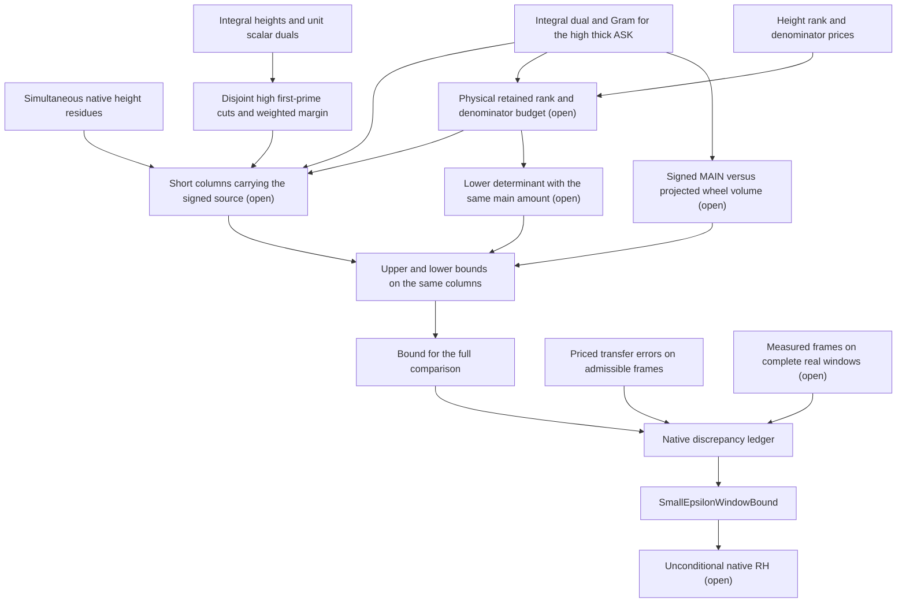

# Quantitative discrepancy ledger for #1201

The three transfer errors below have a uniform bound with exponent coefficient 1. The independent bound derived below for the comparison source is weaker than the critical estimate. Existence of a measured geometric frame with the required signed gain at every anchor on cofinal windows remains open.

Hosted Lean verified the assembled inequality, its normalized price and the independent physical mass bound at commit `393cb5c`. The same job verified the refinement that freezes only the thick widths. [Proof and axiom audit](https://github.com/OVVO-Financial/RH_Lean/actions/runs/45780078438/job/139773341050).

## Measured translated high first-prime frame on #1214

For the actual top set $TT$, write $g_p$ for the host component of Frobenius and $P$ for the unramified thick first primes with $\sqrt x\le p\le x-1$. At partner site $s$ the prime $p$ has just one possible top, $s-g_p$. Set $P_s=\{p\in P:s-g_p\in TT\}$ and $V=\{s:P_s\ne\varnothing\}$. The measured star columns give $r_s=|P_s|-1$ directions at each occupied site. Counting each prime with its original top gives
$$
d=\sum_{s\in V}r_s=|TT|\,|P|-|V|.
$$
A site occurs in $k=n|T_2|$ translated rows, where $n$ is the number of lifts. Each row embeds its integral columns $B$ into the same physical coordinates $(s,\text{integer slot})$. With the induced domain Gram $B^{\mathsf T}B$, its adjoint is $B^\dagger=(B^{\mathsf T}B)^{-1}B^{\mathsf T}$. Thus $B^\dagger B=I$, and the Hilbert–Schmidt error in this metric is zero. The sum of the orthogonal projections over all active rows satisfies
$$
\operatorname{tr}F=kd,\qquad \operatorname{tr}(F^2)\le k^2d,\qquad
r_{\mathrm{eff}}(F)\ge d\quad(kd>0).
$$
The factor $k$ cancels in the rank estimate. A comparison with the required $D+D_1$ for sections carrying the signed source is still needed. [Measured physical frame](NativeTranslatedSlotFrame.lean)

Set $c=\lfloor\sqrt x\rfloor$ and $D_p=p^{\lfloor\lfloor cx\rfloor/p\rfloor-c}$ on $P$. Let $\mathcal V$ be the sum, over these same sites and active rows, of half the log ratio of the Gram determinants with and without these admitted powers. The Gram expansion loses at most one wheel factor on each occupied site and row. Hence
$$
0\le k|TT|\sum_{p\in P}\log D_p-\mathcal V
\le |V|\,k\,c\sqrt{x}\log x .
$$
For $0<\varepsilon\le1$ and all sufficiently large $x$, take the original rounded grid $0<\eta\le1/\sqrt x$, admissible high widths and heights, and $|TT|\ge |H|x^{-\varepsilon/8}/2$. The independent high first-prime comparison then gives
$$
\left|A_{\mathrm{high}}-\frac{4\mathcal V}{c\,k\,|TT|}\right|
\le20\log(4)\sqrt{x}+\frac8{\varepsilon}x^{1/2+9\varepsilon/8}.
$$
$A_{\mathrm{high}}$ uses the original translated, normalized first-prime reads through $x$. A prime in $x-1<p\le x$ has wheel depth zero and retains its rounded arithmetic read in the $20\log(4)\sqrt x$ error. The finite price per eligible measured fibre is at most $x^4$. The anchored prefix estimate uses the common MAIN. At the original cutoff, the full Fourier split reserves each thin MAIN for its thin ASK. The remaining signed comparison uses the centered thick response. [Source normalization](../RHLean/Analysis/AlpogeThin/NativeExistingRecoveryPayment.lean) · [Same-family estimate](NativeTranslatedSlotFrame.lean)

### What repeated operations at one admitted prime recover

The fixed-prime consumer for Proposition 12.16 is already present as `lengthFromAllBut_of_sandwich`. It takes the lattice inclusions and the exceptional generators. At the original scale the bound is $m^{\beta+1}\sum_{\#B=\beta+1}\#G_B$. The full residue fibre below has a single exceptional constant vector. Identifying its surviving directions with the simultaneous served tests on the original restricted section lattice is additional work. Theorem 12.21 uses the resulting colength in the slope of this same lattice. Proposition 12.26 subtracts the restriction charge $\tau(p)$ from the sum of corrected divisibility gains and retains the low and floor terms on the arithmetic side. The local index calculation below measures a concrete restriction charge. Identifying the arithmetic side of that proposition, including its exceptional primes and proper powers, is essential before this charge can enter the signed ledger. [Existing colength consumer](../RHLean/Geometry/NativeServedPrimeApplication.lean)

On a complete residue fibre for one prime $p$, let $T_a f(j)=f(j+a)$. These displacements commute on the actual $p$ seats. At a nonzero Fourier mode, their product of differences has multiplier $\prod_{a=1}^{p-1}(1-\zeta^{ka})=p$. The constant mode has multiplier zero. Fourier inversion gives the integral identity
$$
\left(\prod_{a=1}^{p-1}(I-T_a)f\right)(j)
=p f(j)-\sum_{u\bmod p}f(u).
$$
On the full integral fibre $\Lambda=\mathbb Z^p$, the single restriction $K=\{f:\sum f\equiv0\bmod p\}$ has index $p$. On $K$, all output seats are divisible by $p$ simultaneously and the image is exactly $pL$, where $L$ is the mean-zero lattice of rank $p-1$. Writing $B$ for the product of differences gives $p\Lambda\subseteq B\Lambda+\mathbb Z\mathbf 1$, with one exceptional generator. The input restriction costs $\log p$. The output index in $L$ is $p^{p-1}$, and on $L$ the same operator expands every real length by $p$. Thus the gross finite gain $(p-1)\log p$ also occurs in the real volume comparison. On a fibre of original slots $a+Wj$ contained in one measured layer, every star column is constant and its image is zero. If a cut occupies $h$ of those seats with $0<h<p$, every output coordinate of its indicator is congruent to $-h\bmod p$. Such a boundary cut fails divisibility by $p$ at every seat. For two adjacent integral readings $A,B$ the same calculation gives divisibility at all seats precisely when $A\equiv B\bmod p$. This locates the cost on the actual cut endpoints. In a partition into consecutive blocks $(jp,(j+1)p]$, an endpoint at an integer multiple of $p$ incurs no internal jump. If successive endpoints are separated by at least $p$, each other endpoint produces its own adjacent-value congruence. On the unrestricted integer lattice of layer amplitudes these interior congruences are independent, since consecutive amplitude differences and the first amplitude are integral coordinates. For $b_0$ such internal edges, the index is $p^{b_0}$. The same price holds on the original star coefficient lattice whenever the admitted prime has positive depth at its own layer $a$. Modulo $p$, its weight $D_a$ vanishes and every other $D_i$ is a unit. For arbitrary desired layer readings $t_i$, set $v_i=(t_i-t_a)/D_i$ for $i\ne a$ and choose $v_a$ to make $\sum_i v_i=0$. The star coefficient vector $(v_1,\ldots,v_r)$ has physical amplitudes $D_i v_i=t_i-t_a$ at every layer, including the pivot. Taking $t_i$ to be successive partial sums makes every prescribed vector of jumps possible on any selected internal edges. The joint index is exactly $p^{b_0}$. For distinct admitted primes of positive depth with specified boundary sets $E_p$, coefficientwise CRT realizes all requested boundary residues on a single vector of integral star coefficients. The simultaneous index is exactly $\prod_p p^{|E_p|}$, hence its log cost is $\sum_p|E_p|\log p$. Each coefficient has a representative in $[0,\prod_p p)$. Fitting those representatives into an original height collar would require paying their actual size. Thus the positions of the actual integer cut endpoints modulo $p$ determine which of these local charges a block alignment can save. [Same-prime calculation](NativePrimeWheelResidueLayers.lean)

There is a separate exact charge on the lattice of the original measured star readings. With independent depths $e_i$ prescribed at a fixed prime, the simultaneous integral left inverse makes the reduction onto $\prod_i\mathbb Z/p^{e_i}\mathbb Z$ surjective. Restriction to the kernel costs $(\sum_i e_i)\log p$. To earn positive net recovery, further arithmetic operators must retain the original signed readings through the cross-layer boundary and pay less than this restriction cost on the common lattice. [Joint index](NativeTranslatedSlotFrame.lean)

### How much a choice of block origins can save

The following finite calculation bounds additional aligned boundaries even if each prime can choose its own block origin. Let $E$ consist of $r$ distinct physical integer cut endpoints in $[0,A]$, with $A\ge1$. For each prime $p$ in a finite set $P$, let $h_p$ count the endpoints in its chosen residue class. If two distinct endpoints qualify at $p$, then $p$ divides their nonzero difference. For each ordered pair the product of its distinct qualifying primes divides the absolute difference and is at most $A$. Summing logarithms over all ordered pairs gives
$$
\sum_{p\in P}h_p(h_p-1)\log p\le r(r-1)\log A .
$$
Since $(h_p-1)_+^2\le h_p(h_p-1)$, weighted Cauchy–Schwarz bounds the savings beyond the first possible aligned endpoint at each prime by
$$
\sum_{p\in P}(h_p-1)_+\log p
\le \sqrt{r(r-1)\log A\sum_{p\in P}\log p}.
$$
For the high-prime physical endpoints one can take $A\le (x+1)\exp(x^\varepsilon)$ and $\sum_{p\in P}\log p\le x\log4$. For $r>0$ the extra saving per endpoint is therefore $O_\varepsilon(x^{1/2+\varepsilon/2})$. The initial allowance per endpoint is $\sum_{p\in P}\log p/r$. This bounds the benefit that ordinary residue alignment can provide on these columns. The homomorphism in the preceding calculation determines its sign in the index accounting. This pair count is a paper derivation.

### The $x/m$ cost on the actual high-prime cuts

Fix a positive integer block length $m$. In the increasing list of $N_s=|P_s|$ prime admissions at each occupied site, partition the existing physical layers into consecutive blocks of at most $m$ layers. Keep the final partial block. Within each block take differences with its first layer as pivot. These sections are integral differences of the original star columns. Different blocks have disjoint slot supports at the same row, so their volumes multiply on that row. The total rank at $s$ becomes $N_s-\lceil N_s/m\rceil$.

The Gram expansion loses at most the largest $\log D_p$ in each block. If $p_0$ is the first prime of its block, this is at most $cx\log(x)/p_0$. At the first block on a site that quantity is at most $c\sqrt x\log x$. Each later $1/p_0$ is bounded by the mean of the $m$ reciprocals in the preceding full block, and each such preceding block is used once. Every prime occurs at exactly $|TT|$ sites. Summing over sites and the $k$ translated rows yields the normalized bound
$$
\frac{4\,(\text{total lost log volume})}{c k |TT|}
\le 4\frac{|V|}{|TT|}\sqrt{x}\log x+
\frac{4x\log x}{m}\sum_{p\in P}\frac1p
\le 4\frac{|V|}{|TT|}\sqrt{x}\log x+
\frac{4x}{m}\log x(1+\log x).
$$
This gives an $x/m$ cost up to logarithms while preserving the actual high arithmetic source. The decomposition into smaller blocks does not by itself supply a length-$m$ divisibility gain on the signed sections. This bound is a paper consequence of the measured Gram and site-count identities above.

There is an explicit price for trying to supply stages by ordinary polynomial interpolation on all the endpoint blocks. On a block of $s$ distinct integer cut endpoints $z_i$, the evaluation lattice of the monomials $1,z,\ldots,z^{s-1}$ has index $\prod_{i<j}|z_i-z_j|$. The original spacing gives $|z_i-z_j|\ge G=b/x^2-2$ for each distinct pair, while all differences are at most $(x+1)b$. Thus for $G>1$ a full block costs between $\binom m2\log G$ and $\binom m2\log((x+1)b)$ in ordinary log index. The full blocks contain at least $|TT|\,|P|-(m-1)|V|$ endpoints. If that entire index is charged on the same $4/(c k|TT|)$ volume scale, the normalized charge is bounded below by
$$
\frac{2(m-1)}c\log G\,\left(|P|-(m-1)\frac{|V|}{|TT|}\right).
$$
For $m\asymp c\asymp\sqrt x$ this is too large on the selected-pair high-prime scale $|P|\gg x/\log x$, with $\varepsilon$ sufficiently small. Each block on its own gives only $O(m\log((x+1)b))$ per direction; the complete sum explains the extra cost. Any use of interpolation here must price only the required local valuations or independently compensate that ordinary index. The slot multiplier below accounts for an $m x^{O(\varepsilon)}$ maximum norm. The remaining $xm/k$ and $k x^{O(\varepsilon)}/(nN_T)$ terms, and conversion of that maximum norm to the complete normalized signed budget, still require a common construction. Here $k$ denotes Proposition 4.3’s scale parameter, distinct from the translated-row count used in the preceding display. The determinant and normalization calculation in this paragraph is on paper. [Original slot spacing](NativeMeasuredSlotProjector.lean) · [Pinned Vandermonde determinant](https://github.com/leanprover-community/mathlib4/blob/d13f23b723b8a846827a245b89c10fc7d3f11612/Mathlib/LinearAlgebra/Vandermonde.lean)

### Local interpolation with one common translation of the actual heights

Choose distinct integral starting heights $\lceil xb\rceil+\operatorname{index}(t)$ in the first half of the original height collar. Translate every one by the same $h\in\{0,\ldots,N-1\}$, leaving the pair, rows, masks and incidence sets fixed. The collar length $W=b/(R x^{13})$, with $R\le x$ and $|H|\le x^3$ eventually, permits $N=\lfloor W/2\rfloor$ for all sufficiently large $x$. All these profiles are injective and meet the original scalar height window. Additional geometric conditions on a profile still have to be proved.

For distinct admitted primes $p,q$ served on a common physical block, write their actual integer endpoints as $z_p(h)=\lfloor(a+h)/p\rfloor$, $z_q(h)=\lfloor(a'+h)/q\rfloor$. The starting heights may coincide. Their difference $d(h)=z_p(h)-z_q(h)$ satisfies
$$
d(h+pqj)=d(h)+(q-p)j .
$$
Since $q-p$ is a unit at $p$, each residue line modulo $pq$ hits every value modulo $p^t$ exactly once per period. Over any interval of $N$ translates, the number with $p^t\mid d(h)$ is at most $\lfloor N/p^t\rfloor+pq$. For $1\le |d(h)|\le A$, sum over the valuation levels and divide by $N$ to obtain
$$
\frac1N\sum_h v_p(|d(h)|)\log p
\le \frac{\log p}{p-1}+\frac{pq}{N}\log A.
$$
The original separation gives $d(h)\ne0$ on each of the selected high blocks. The estimate charges collisions through all powers of the owner prime. [Quotient endpoints under simultaneous translation](NativeSharedHeightRecovery.lean)

For the integral polynomial selector of an owner $p$ in its block, take $\prod_{q\ne p}(X-z_q(h))$ on the integer endpoints. It vanishes on every competing endpoint there and evaluates to $\prod_{q\ne p}(z_p(h)-z_q(h))$ at its owner. Summing the preceding price over the at most $m-1$ factors per owner and over all sites and active rows, there is one translate $h$ for which the total owner-prime log valuation on the $4/(c k |TT|)$ scale is at most
$$
\frac{4(m-1)}c\left(\sum_{p\in P}\frac{\log p}{p-1}
       +\frac{|P|\,x^2\log A}{N}\right).
$$
Linearity of the finite average uses a single height profile for every term. Each prime occurs at exactly $|TT|$ sites, including when different incidences share their starting height. The first sum is at most $2\log(x)(1+\log x)$, and the second term in parentheses tends to zero for fixed $\varepsilon>0$ at the original collar. Thus $m\asymp c$ is affordable for these owner-prime valuations. The finite averaging over all labelled incidences is the statement of `sharedHeight_total`. The final high-family normalization and asymptotic simplification displayed here are paper consequences. The same integral polynomial acts by pointwise multiplication on the entire original slot space. For every $k,z_q\in[0,A]$ its absolute value is at most $A^{m-1}$. The maximum log operator norm costs at most $(m-1)\log A=O_\varepsilon(mx^\varepsilon)$, measured with the original counting scalar product. Its zeros enforce the competing endpoint readings. Divisibility of the complete competing sections, the aggregate cost for their archimedean determinants and the comparison of their volumes with signed MAIN remain open.

### Integral transport back from the endpoints

Cheap interpolation at an owner's prime leaves a specific integral obstruction. On a whole $p$-cycle inside a competing layer, a product of fewer than $p$ linear factors has at most that many residue roots. If the layer amplitude is a unit at $p$, at least one original slot still gives a unit output. Zeros at the endpoint alone cannot establish divisibility on this section.

Taking successive differences of layer amplitudes moves the readings to the physical cut boundaries. Write $A_i$ for the integer amplitudes and $D_i$ for the original, pairwise coprime wheel powers, with $0\le i\le r$. Put $w_i=\prod_{j\ne i}D_j$ and $\delta=\sum_i w_i$. The integer lattice of measured star amplitudes is exactly
$$
H_*=\{A\in\mathbb Z^{r+1}:\ \sum_i w_iA_i=0\}.
$$
Indeed the equation modulo $D_i$ forces $D_i\mid A_i$, since $w_i$ is a unit there. Dividing through by $\prod_iD_i$ gives $\sum_i A_i/D_i=0$, precisely the star relation. For interior jumps $y_j=A_{j+1}-A_j$, let $W_j=\sum_{i>j}w_i$. Recovering $A_i=A_0+\sum_{j<i}y_j$ reduces the one relation to $\delta A_0=-\sum_jW_jy_j$. Hence the actual integral jump lattice is
$$
J(H_*)=\{y\in\mathbb Z^r:\ \sum_j W_jy_j\equiv0\bmod\delta\}.
$$
For every prime dividing some $D_i$, the reduction $\delta\equiv w_i\bmod p$ is a unit. In particular $W_{r-1}=w_r$ is a unit modulo $\delta$ for $r\ge1$. The displayed congruence is surjective, so the full ordinary index is exactly $\delta$ and all its prime factors lie outside the admitted wheel powers.

For $r\ge2$, both end coefficients $W_0=\delta-w_0$ and $W_{r-1}=w_r$ are units modulo $\delta$. At either end $j$ there exists $y\in J(H_*)$ with $y_j=1$, since the other end can pay its residue. Consequently a diagonal selector isolating this end, $y\mapsto s\,y_j e_j$, preserves the integral jump lattice only when $\delta\mid s$. This price has
$$
\log\delta\ \ge\ \sum_i\log D_i-\min_i\log D_i .
$$
Thus a selector can have tiny valuation at its owner prime and still require almost the entire wheel gain for an exact integral end projection. This is a paper calculation for the specified jump lattice. An enlarged lattice with the available unimodular complementary column can avoid this particular transport. The next calculation compares its negative projected volume with the canonical signed MAIN and with the actual signed prefix on that enlarged family. [Measured integer columns](NativeMeasuredSlotProjector.lean) · [Same-prime boundary recovery](NativePrimeWheelResidueLayers.lean)

### Retaining the physical anchor and paying the original MAIN

On the original nonempty layer blocks, take integer amplitudes $A_i$, the pivot $a=A_0$, and the adjacent jumps $y_j=A_{j+1}-A_j$. The inverse is $A_i=a+\sum_{j<i}y_j$. The operator $T_d$ keeps $a$ and replaces $y_j$ by $d_jy_j$ on the same integer slots. Directions at the same prime commute by $T_dT_e=T_{de}$. For positive $d_j$ the physical image has rank $r+1$ and consists precisely of the amplitudes whose respective jumps are divisible by $d_j$. Choosing $d_j=\prod_p p^{e_{pj}}$ gives exact joint log index $\sum_p\sum_j e_{pj}\log p$. The pivot adds zero to this index. Multiplication itself pays the full output index. [Integral operators and prime weights](NativeAnchoredSlotRecovery.lean)

Let $\lambda_i$ count the actual slots in layer $i$, and let $L=\sum_i\lambda_i$. The integral anchor projection $A\mapsto A_0\mathbf1$ has a unit matrix entry and all its entries are integers. Its real squared operator norm is exactly $L/\lambda_0$, attained on the zeroth layer indicator. On the actual height and width collars this is at most $4x^3$. Summing half its logarithm over all $k=n|T_2|$ rows at every occupied site, with multiplier $4/(ck|TT|)$, costs at most $2|V|\log(4x^3)/(c|TT|)$. The physical layer projectors at the actual translated sites have effective rank at least $|TT|\,|P|$ for nonzero total rank and nonempty rows. This counts each prime/top incidence once across overlapping translates. The comparison with the dimension of the original section family still requires an identification of those sections. [Counting norm and prime cut bounds](NativeAnchoredSlotMetric.lean) · [Translated rank](NativeTranslatedSlotFrame.lean)

The full incremental cost of those anchors on the high thick family is at most $32(\log4)\sqrt{x}$ after the same normalization. Indeed every occupied block contains its zeroth admitted prime $p\ge\sqrt{x}$. For $x\ge10$, $\log(4x^3)\le8\log p$. Charging this once per block and per actual row, the incidence identity bounds the sum by $8k|TT|\sum_{p\in P}\log p$. Chebyshev gives $\sum_{p\in P}\log p\le x\log4$, and $\sqrt{x}\le2c$. This calculation prices the restored direction across all occupied blocks without a density hypothesis on the top set. [Normalized anchor cost](NativeAnchoredSlotMetric.lean)

For the original star lattice, set $z_i=\prod_{j\ne i}D_j$, $\delta=\sum_i z_i$ and $N_D=\sum_i z_i^2/\lambda_i$. The star image is exactly $\ker(z\cdot A)$. The existing short Bézout column has normal reading one. The lattice generated by the stars and the *constant* column has ordinary index $\delta$. In the counting metric the least squared energy of a real vector with reading $t$ is $t^2/N_D$, attained at $A_i=t z_i/(\lambda_i N_D)$. Thus the squared complementary length is $1/N_D$ for the primitive column and $\delta^2/N_D$ for the constant column. Relative to the unit wheel the constant column contributes the additional log index $\log(\delta/(r+1))$. This is the exact cost of keeping the original stars as integral generators while adding the literal constant. Free integral recovery of the physical pivot uses the saturated layer lattice. [Normal equation, index and independent minimum](NativeAnchoredSlotMetric.lean)

Forgetting the anchor maps the constant-extended star lattice onto the jumps of the original star columns. All constants lie in the kernel of the jump map, which surjects onto the free jump lattice. Thus those jumps also have ordinary index $\delta$. Moreover $z_i\le\delta$ gives $N_D\le\delta^2 N_1$, so $\operatorname{logVolume}(S,D)\le\log\delta$ for each actual row. For a single amplitude profile on each distinct physical site, shared across all its translated rows, the exact global jump index is $I=\prod_{s\in V}\delta_s$. The actual rows satisfy $\sum_{s,j}\operatorname{logVolume}(S_{sj},D_s)\le k\log I$, $k=n|T_2|$. Thus even paying the congruence once per physical site costs at least the entire row-averaged positive wheel volume. This comparison uses the independent amplitudes at distinct physical sites and counts overlapping translates only through their row average. [Jump index and volume comparison](NativePrimitiveSlotSplitting.lean)

There is a concrete strict saving whenever $\delta>\sqrt{L/\lambda_0}$. For example, suppose the block has at least two primes and contains $\sqrt{x}\le p\le x/2$, with $c\ge4$. Then $\lfloor cx\rfloor\ge 2cp$, so $D_p\ge p^c\ge x^2$. A cofactor omitting a different layer is divisible by $D_p$. Hence $\delta\ge x^2>2x^{3/2}$ for $x>4$. At a singleton block the star lattice has no nonzero column, $\delta=1$, and $L/\lambda_0=1$.

The integral projection back onto a primitive completing column $b$ along the old stars is $P_b(A)=(z\cdot A)b$. The equality $z\cdot b=1$ supplies a unit entry at every finite prime. Its exact squared real operator norm is $N_D\sum_i\lambda_i b_i^2$. Some $b_i$ is a nonzero integer, and Cauchy–Schwarz gives $\delta^2\le L N_D$. Hence $\|P_b\|^2\ge\delta^2\lambda_i/L$ for that layer. The same prime-cut estimates give $L/\lambda_i\le4x^3$ for every layer. Thus $\|P_b\|\ge\delta/(2x^{3/2})$. The inexpensive pivot reading and a projection back along the wheel stars have different kernels. Returning along the old stars can recover nearly the whole congruence price in the real norm. [Primitive splitting](NativePrimitiveSlotSplitting.lean)

Write $U=x^{\varepsilon/3}$, let $v$ be the original lower-log-rounded widths, and put $C_{\perp}=4\sum_{s,j}\operatorname{complementaryLog}(S_{sj},D_s)/(ck|TT|)$. The minimum computation gives $C_{\perp}=-4\mathcal V/(ck|TT|)$. On the same selected pair, at least half of the positive width sites are thin. Their logarithms $\log(a_t/w_\rho)$ are at least $U-\log 3$, and the thick sites have nonnegative logarithms. The original class character is the actual two-bit twist $(0,1)$. The pair bounds its primitive logarithmic derivative in absolute value by $4\log x$. Lower rounding only increases MAIN. At sufficiently large $x$ these give
$$
\operatorname{Re}\operatorname{MAIN}(a_t,v_{uj})\ \ge\ a_t\bigl(4\log x+U/4\bigr).
$$
Independently, if $J=\lfloor cx\rfloor$, the product of all $p^{\lfloor J/p\rfloor-c}$ (with natural subtraction) divides $J!$. Its logarithm is at most $J\log J\le 2cx\log x$. This bounds the sum of the measured positive volumes with its actual multiplicities. The normalized original negative MAIN is consequently at most $-8x\log x\le C_{\perp}$. Every comparison uses the same width family and the original divisor $Q$. [Arithmetic comparison](NativeAnchoredMain.lean)

There is room in this estimate for all original ASK coefficients through $M\le\exp(U/16)$. At each integer $n$ the sum of the nonnegative colour weights is at most $2\Lambda(n)$ and the clipped reading is at most $a_t/n$. The native reciprocal Mangoldt bound makes this prefix at most $2a_t(\log M+\log4+2)\le a_tU/4$ for $M\ge1$ and sufficiently large $x$. Thus $S_M(v)/Q\le C_{\perp}$ for every such cutoff, with all prime powers and ramified colours included. For the original cutoff $N$, take $M=\min(N,\lfloor\exp(U/16)\rfloor)$. For $0<\eta\le1$, every thick reading vanishes above the paid cutoff. Indeed $b\le w\le e v$, $a_t\le(x+1)b$, and $(x+1)e\le\exp(U/16)$ eventually. This prefix calculation uses the common MAIN and stands on its own. The complete-window proof assigns the thin part of MAIN to the thin arithmetic response through the exact Fourier identity. The geometric target at the original cutoff is the centered thick compensation below. [Original normalized signed prefix](NativeAnchoredMain.lean)

### Centered thick compensation on the measured frame

Write $H(v)=A_H-M_H$ for the actual thick Fourier response, summed over the original translates, tops and lifts, and $h_{\rm high}$ for `roundedHighASK`, which already includes its divisor. At the original cutoff the existing row bound gives $S_N(v)/Q\le H(v)/Q+E_{\rm thin}$ with $E_{\rm thin}\le2x^{\varepsilon-1}$ eventually at the original density and conductor windows. `original_cutoff_centered_thick` establishes this directly, uniformly in the original integer cutoff, using the selected pair and PageN on the same host. The completed Fourier sum allocates MAIN separately to thick and thin. Adriazola's Theorem 4.2 uses its centered estimate at $a/w\ge X'/3$. In the pinned compact edition the same bookkeeping appears in `Data.remainder_eq`, followed by the independent covolume estimate `star_inequality`. [Original finite-cutoff and thin supplier](../RHLean/Analysis/AlpogeThin/NativeExistingRecoveryPayment.lean) · [Compact remainder](https://github.com/lsernau/grh-lean/blob/72fead102f663d5c7a407964a13dc0cf9d977207/grh-compact/src/New/Endgame/ShortAndEnough.lean#L86) · [Compact covolume estimate](https://github.com/lsernau/grh-lean/blob/72fead102f663d5c7a407964a13dc0cf9d977207/grh-compact/src/New/Main.lean#L121)

For $l\le b\le R$ and true thick widths in $[l,R]$, compare the centered thick response to its value at $b$. In this width comparison both auxiliary profiles have identical outside widths. Their centered thin Fourier terms cancel exactly. Across host translates every swept thick colour has multiplicity $|T_2|$. With $A\ge\max a_t$, the absolute change after division by the original $Q$ is at most
$$\frac{4(R-l)(\log4+2)(A/l+1)+A\log(R/l)}{b}.$$
The first term counts the full signed width displacement through the moving prime-power cuts by Chebyshev. The second is the actual thick MAIN log change. Taking $l=b(1-\eta)$, $R=b(1+1/x)$, $A=(x+1)b$, and $0<\eta\le1/\sqrt{x}$ gives at most $32(\log4+3)\sqrt x$ for $x\ge4$. The mask density cancels before the bound is taken.

The selected pair pays the three nonprincipal characters at each genuine $a_t/b$ in its window. The principal response changes by at most $\log4+4$ over $[x,x+1]$. Combining this calculation with the independently measured $C_\perp$ gives
$$\left|\frac{H(v)}{Q}-h_{\rm high}-C_\perp-G_z(x)\right|\le E,$$
where $E=32(\log4+3)\sqrt x+3(x+1)^{1/2+\varepsilon/2}+\log4+4+20\log4\sqrt x+(8/\varepsilon)x^{1/2+9\varepsilon/8}$. This error is at most $(53\log4+106+8/\varepsilon)x^{1/2+9\varepsilon/8}$ for $0<\varepsilon\le1$. It controls both signs on the very same family. The classical zero-free region gives a uniform one-sided price $H(v)/Q-h_{\rm high}\le C_\perp+E+Kx\exp(-\kappa\sqrt{\log x})$. The remaining square-root comparison requires independent signed gain on the surviving principal arithmetic component. [Centered widths, projected principal and measured compensation](NativeCenteredThickCompensation.lean)

### Perron readings of integer slots

For an integer slot $k\ge2$, use the log interval $J_k=(\log(k-1),\log k]$. The critical-line reading of its weighted indicator $g_k(u)=e^{u/2}\mathbf1_{J_k}(u)$ is
$$
\int_{\mathbb R}g_k(u)e^{i\tau u}\,du
=\frac{k^{1/2+i\tau}-(k-1)^{1/2+i\tau}}{1/2+i\tau}.
$$
The $J_k$ are disjoint and each has $\int_{J_k}e^u\,du=1$. Plancherel with measure $d\tau/(2\pi)$ therefore gives the counting Gram exactly for every finite signed combination of slots, including every entry between two different integral star columns. Applying this independently at each physical partner site realizes the preceding frame metric in the full frequency space. Its dimension remains the dimension of the actual measured images. To apply this calculation to the signed arithmetic source one still needs a comparison of the original Perron weights, MAIN and ASK on those images. This Plancherel calculation is on paper. The existing endpoint-phase identity uses the project's actual multiplier at $a/p$. [Endpoint phases](NativeSignedWidthSweep.lean)

### Seven comparisons that must hold on the same signed family

Adriazola’s Proposition 3.1 on page 12 uses $A=\sum_t a_t$, $\operatorname{ph}(a)=a\log a-a$, $\log\Omega=\gamma+\log(\pi/v)-\lambda_1$ and $\langle X\rangle_d=\sum_u d_u X_u/\sum_u d_u$. In this table $S$ denotes the proposition’s arithmetic input, $\Gamma$ its earned finite divisibility gain and $h_u$ the independently measured height of the period map.

| Paper | Required inequality | What the native calculation supplies |
|---|---|---|
| (3.1) | $S\le\Gamma+e_1$ | The measured volume controls the high first-prime ASK. A gain covering the complete arithmetic input on that family is still required. |
| (3.2) | $\mu_u^M+\Gamma+L-E_u-e_2\le\mu_u^N$ | The boundary restriction and the common-height selector give genuine local indices. A lower slope comparison for the complete restricted section lattice still has to incorporate its real norm and every finite place. |
| (3.3) | $\langle\mu^N-h\rangle_d-e_3\le\mu_C$ | The translated slot frame bounds its own effective rank. It remains to obtain the target slope with sufficient aggregate rank on the complete maps that carry $S$. |
| (3.4) | $\mu_C+h_u-L\le\sum_t[m\,\operatorname{ph}(a_t)-m a_t\log\Omega-a_t\log T_u]+e_4$ | The selector has an independently measured upper norm on slots. An upper comparison with this specific factorial and period expression on the same map remains open. |
| (3.5) | $E_u\le mAg+e_5$ | The existing discrepancy ledger prices its transfer errors on admissible data. The complete local error in the common slope comparison must also include transport back from endpoint readings. |
| (3.6) | $\log T_u\ge\sum_j f^{-1}\sum_\rho\log(w_{j\rho}v/\pi)+mg-e_6$ | The actual measured widths and their rounding costs are available. Their inclusion in an independently measured global local-factor product still needs proof. |
| (3.7) | $\mu_u^M\ge-e_7$ | A counting metric gives a base slope on the measured slot lattice. Its use here requires the very same base lattice in (3.2). |

Taking weighted means cancels $h_u$ only after (3.3) and (3.4) have been proved for the same maps. The total error is $e_1+e_2+e_3+e_4+e_5+A e_6+e_7$. Section 18.7 requires identifying the height used in that accounting with its independently defined period. The measurements in this branch are slot Gram determinants, integral indices and operator norms. The comparison above bounds negative MAIN and a finite ASK prefix on the enlarged layer lattice. Identifying the same heights in both full section slope inequalities remains open. [Native signed consumer](../RHLean/Analysis/AlpogeThin/NativeConstructedDyadicSignedSlopePayment.lean) · [Pinned compact accounting](https://github.com/lsernau/grh-lean/blob/72fead102f663d5c7a407964a13dc0cf9d977207/grh-compact/src/New/Endgame/ShortAndEnough.lean)

## Same-family cancellation in the pinned Sernau editions

The primary reference for #1214 is `lsernau/grh-lean@72fead102f663d5c7a407964a13dc0cf9d977207`. The original proof map and the community port remain available for the local valuations. [Readable guide](https://github.com/lsernau/grh-lean/blob/72fead102f663d5c7a407964a13dc0cf9d977207/grh/GUIDE.md) · [Original proof map](https://riemann.verifytask.cn/?lang=en) · [Independent verification of both editions](https://math.mit.edu/~drew/shortgrh/).

### One budget for the retained space and its rank-one tests

For each prime $\ell$ and embedding $\iota$, the compact proof chooses one $m$-fold twist on the union of the two lists of rows. The level is prime to $\ell$. Its powers $1\le j\le m$ work for every eligible rank-one pair and every required eigenpart of the good lifts. The construction supplies the same local allowance $\gamma_\ell$ for all these tests. The definition of a fit family would allow that allowance to depend on $j$. [Fit family](https://github.com/lsernau/grh-lean/blob/72fead102f663d5c7a407964a13dc0cf9d977207/grh-compact/src/New/Selmer/FitTwists.lean#L248-L264) · [Simultaneous selection](https://github.com/lsernau/grh-lean/blob/72fead102f663d5c7a407964a13dc0cf9d977207/grh-compact/src/New/Selmer/FitTwistsExist.lean#L24-L65)

| Compact supplier | What it supplies on the chosen family |
|---|---|
| `exists_isFitFamily` | At truncation $M_\ell=\lfloor D.r\,b_\ell\rfloor+1$, one inverse anticyclotomic avatar makes the normalized Selmer length of each row of rank $s$ at most $(10fs+1)c_\ell$, simultaneously at all required powers. The construction gives $\gamma_\ell=b_\ell\log\ell$ with $\sum_{\ell\in T}\gamma_\ell\le B_{\rm dir}=fa(\log b)^3/(mk)$ for every finite set of primes $T$. Ramified inverse ratios have the separate bound $\sum_{\ell\in T}9c_\ell\log\ell\le x^{999}$. [Twisting](https://github.com/lsernau/grh-lean/blob/72fead102f663d5c7a407964a13dc0cf9d977207/grh-compact/src/New/Selmer/TwistForRows.lean#L14-L28) · [Normalized length](https://github.com/lsernau/grh-lean/blob/72fead102f663d5c7a407964a13dc0cf9d977207/grh-compact/src/New/Selmer/AptTupleDefs.lean#L26-L42) |
| `denominatorLe_rowBudget` | For a cut $Z$ spanned by appropriately labelled lifts with the short rows, take $n=\dim Z$ and $r_O$ the auxiliary rank. The first table is integral at every embedding at $\ell$. The second is integral at $\iota$ and passes the Hecke orthogonality tests for $Z^\perp$. A separating operator for each nonzero spanning vector gives $\lvert\iota\det(\langle y_a,\mathrm{pr}_Z y'_b\rangle)\rvert_\ell\le e^{nr_O\gamma_\ell}$. The same theorem is applied to the good lift range and to each rank-one cut. [Spanning hypothesis](https://github.com/lsernau/grh-lean/blob/72fead102f663d5c7a407964a13dc0cf9d977207/grh-compact/src/New/Selmer/DenominatorBound.lean#L47-L58) · [Operator criterion](https://github.com/lsernau/grh-lean/blob/72fead102f663d5c7a407964a13dc0cf9d977207/grh-compact/src/New/Selmer/DeterminantBound.lean#L108-L134) |
| `DenominatorLe.rank_one_bound` | With trivial stabilizers, take two integral test forms satisfying the labelled orthogonality conditions. Sum the second test over representatives of **all** $h=\#\mathrm{StdClasses}$ global classes. The class operators fix the lift. The result is $\lvert\iota(h\langle\Xi,\mathrm{pr}\,\Xi'\rangle)\rvert_\ell\le e^{\gamma_\ell}$. The opposite test and conjugate place in `heightLe_inv_ratio` retain both jet readings. Only the line pairing carries $h$. [Class sum](https://github.com/lsernau/grh-lean/blob/72fead102f663d5c7a407964a13dc0cf9d977207/grh-compact/src/New/Selmer/RankOneDenominator.lean#L39-L66) · [Use with both tests](https://github.com/lsernau/grh-lean/blob/72fead102f663d5c7a407964a13dc0cf9d977207/grh-compact/src/New/Rows/HeckeValueHeight.lean#L168-L191) |

The constants matter for the native comparison. Write $g=D.\mathrm{gProd}$ and $X_{\rm odd}$ for the integer from `exists_length_shaOdd_le`. With natural subtraction at the lower endpoint,
$$
\begin{aligned}
c_\ell&=v_\ell(D.\mathrm{chosenGroupOrder})+2^{-\ell},\\
\lambda_\ell&=v_\ell\!\left((2b_1)!\left[\prod_{\max(b_1-30h_2^3,0)<u\le b_1+30h_2^3}u\right]^{h_2^3}\right),\\
b_\ell&=h_2^{27}(c_\ell+v_\ell(X_{\rm odd}))
 +4f\cdot 10^6(m/k)\bigl(b_1v_\ell(g)+\lambda_\ell\bigr).
\end{aligned}
$$
The factorial loss carries $m/k$. Applying that discount to a native factorial requires an independent estimate. [Row budget](https://github.com/lsernau/grh-lean/blob/72fead102f663d5c7a407964a13dc0cf9d977207/grh-compact/src/New/Selmer/RibetElement.lean#L34-L38) · [Factorial loss](https://github.com/lsernau/grh-lean/blob/72fead102f663d5c7a407964a13dc0cf9d977207/grh-compact/src/New/Selmer/DeterminantBound.lean#L72-L81)

**Exact native comparison.** Fix the actual dyadic reciprocity host, its Frobenius and inertia, the common cutoff and the measured directions. For direction $i$ put $A_i=\prod_{p\in P}\mathrm{chartRead}_i(p,0)$. At every admitted prime its valuation is the sum of the actual Euler admissions on that chart and satisfies $v_p(A_i)\le F_i(p)$. At an unramified place the inertia group is trivial. At primes dividing $2^{e+2}q$ all reads are one. At $d$ the two reads are $1,d^k$ and $(1+d^k)/2$ is a $d$-adic unit. Thus the normalized trivial-character test attains the largest local norm **for every direction and every power at once**, including outside $P$ and at the conjugate embedding. Other character reads have a place-integral coordinate in this same line. The choice covers the finite wheel tests on the native host. The fit twist on the retained section lattice also has global arithmetic requirements. [Native comparison](NativeWheelFitProjector.lean)

For distinct measured monomials $X^{\alpha_i}$ with positive rational squared scales $r_i$, the line entry and the full row determinant are controlled by
$$
 Q_i=\frac{r_i A_i^2}{\alpha_i!},\qquad L_i=h_iQ_i,\qquad V=\prod_i Q_i .
$$
The price of the worst rank-one pairing at $p$ is exactly $|L_i|_p$. The price of the worst full determinant is exactly $|V|_p$. Independent changes of the two row tables are allowed, with coordinates integral at $\iota$ and $\iota\circ\mathrm{conj}$ respectively. In `character_coordinates` the coefficient at every row, direction and character can be chosen independently. The trivial character and identity tables attain equality. When the thick and thin ceiling orders differ, two directions coincide exactly when their translated thick masks coincide. Thus one can compute rank on the prescribed mask by counting distinct translates. Singleton masks realize the full translate count. The density and retained-rank requirements of the window theorem apply to its selected family.

For $E=nr_O>0$, reduce all rational entries before forming the integer
$$
 M=\operatorname{lcm}\!\left(\mathrm{den}(V),\{\mathrm{den}(L_i^{E}):i=1,\ldots,n\}\right).
$$
The least nonnegative common allowance is $\gamma_p=v_p(M)\log p/E$. Its total is exactly $\log M/E$, attained on the finite set of prime divisors of $M$. Thus the economic test on this lattice at one anchor is precisely $\log M\le E B_{\rm dir}$. There is no choice of local tests left to optimize. The determinant uses net valuations across the directions, and the two wheel readings remain in the numerator when each rational is reduced. For the single row with $q=11$, $d=7$, orders $180,30$, the measured dyadic scale below and $h=r_O=1$, the reduced denominator has 264 digits and log price $607.6606266878$. Of that price $7\log 29$ is forced by a split prime. The example specifies the local parameters required by the comparison. A cofinal bound uses the scale and budget of each admissible anchor. [Local and total price](NativeWheelFitProjector.lean)

The same rational $Q_i$ has an archimedean bound at every embedding. With the original full nominal cutoff,
$$
 \log Q_i\le -\log(\alpha_i!)+\log r_i+
 \sum_\sigma\Re\operatorname{ASK}_N(v_{i,\sigma},0,\rho\mapsto v_{i,\sigma+\rho}).
$$
Indeed $2\log A_i=2\sum_p v_p(A_i)\log p\le2\sum_p F_i(p)\log p$. The last sum equals the nominal ASK. This gives an inverse-height witness $Q_i$ for $Q_i^{-1}$ on the wheel, with finite product one. It keeps the independently measured $\log r_i$ in full. Identifying the inverse of the section's twist ratio with this reading, or pricing their difference, is the remaining normalization step. [Measured signed witness](NativeWheelFitProjector.lean)

At primes where all $h_i$ are units, the rank-one inequalities imply the full determinant inequality for $r_O\ge1$ and nonnegative allowance. At class primes the determinant can impose an additional cost. For example, $Q_1=1/9$, $Q_2=3$, $h_1=9$, $h_2=1$ makes the two class-scaled lines integral at $3$, while the determinant requires $(\log 3)/2$ at $n=2,r_O=1$. For a dyadic squared metric there is also an unavoidable cost outside the wheel. At each odd $p\notin P$, $|Q_i|_p=p^{v_p(\alpha_i!)}$ and $|L_i|_p=|h_i|_p p^{v_p(\alpha_i!)}$. Thus a class multiplier $h_i>0$ and a total per-direction allowance $B$ must satisfy
$$
 \sum_{p>N}v_p(\alpha_i!)\log p\le B+\log h_i\qquad(N\ge2,\ P\subseteq[2,N]).
$$
For example, multiplying $a=A_{\max}$ by ten in the $q=11,d=7$ calculation leaves $N=180$, gives orders $1800,300$ and $A=3^{300}5^{60}$. With $h=1$ the primes above $180$ alone cost $\sum_{p>180} v_p(1800!300!)\log p=3491.432052\ldots$. The prime gain inside the cutoff is positive throughout. [Outside-wheel comparison](NativeWheelFitProjector.lean)

**Physical obligation.** On the retained section family one must identify the integral tested columns, their adjoint and the class normalization, or bound the cost of carrying those columns and their duals to the measured wheel lattice. A change of lattice or metric also changes the denominator and the archimedean comparison. That transport, its rank and index, and a uniform bound on its combined price with $\log M/E$ remain open. A direct measured construction meeting these inequalities would replace the upstream Selmer rows and auxiliary primes. It would supply the projection estimate used by the opposite test in the inverse ratio and by the determinant of comparison forms. The existing frozen ledger and principal-character handoff require the resulting signed inequality on the original family and normalization.

### Joint projector cost on the integer quotient slots of a thick fibre

Fix one translated partner with width $v$. List its distinct first primes in increasing order, writing $p_i$ for the prime and $a_i$ for its actual top height. Set $u_i=a_i/p_i-v$ and $\lambda_i=u_i-u_{i+1}$, with $\lambda_n=u_n$ on a fibre of $n+1$ primes. If $\sqrt{x}\le p_i\le x-1$, $xb\le a_i\le(x+1)b$, and $0\le v\le b(1+1/x)$, then $\lambda_i\ge b/x^2$. For $b\ge4x^2$, partition the native quotient slots at the consecutive endpoints $\lfloor a_i/p_i\rfloor$, using the native last endpoint $\lceil v\rceil$. Each band $S_i$ is nonempty and belongs to its original quotient test. Forgetting the band label gives a bijection onto the original outer interval of integers, preserving every slot coordinate. Its cardinality satisfies $\lambda_i-2\le |S_i|\le\lambda_i+1$. Before and after admission, replacing the real lengths by these counts changes the squared Gram determinant by a factor between $(1-2x^2/b)^n$ and $(1+x^2/b)^n$. [Slot construction and change of metric](NativeMeasuredSlotProjector.lean)

Put $c=\lfloor\sqrt{x}\rfloor$, $D_i=p_i^{\lfloor\lfloor cx\rfloor/p_i\rfloor-c}$ with natural subtraction, and $s_i=|S_i|D_i^2$. The columns are $D_{j+1}\mathbf{1}_{S_{j+1}}-D_0\mathbf{1}_{S_0}$ in the integral lattice of the slot addresses. Counting these slots supplies the scalar product independently of the target inequality. CRT gives an integral left inverse supported at one slot in each band. Each coordinate dual has squared norm at most $(n+1)(1+\prod_i D_i)^2$. The index in the saturation is one. On these same columns, the gained squared covolume divided by its untwisted value is between $(\prod_i D_i)^2/\exp(2c\sqrt{x}\log x)$ and $(\prod_i D_i)^2$. [Integral dual, measured Gram and admission](NativeMeasuredSlotProjector.lean)

For this matrix $B$, let $P=B(B^tB)^{-1}B^t$. Its full and line clearing factors are
$$
g=\det(B^tB)=\sum_i\prod_{j\ne i}s_j,\qquad g_j=s_0+s_{j+1}.
$$
For integral test matrices $U,V$, one has $g\det(UPV^t)=\det(UB)\det(VB)$. The integral left inverse attains $1/g$. At every finite place the same clearing works for arbitrary locally integral rows and a conjugate-integral second table. Applying this to a single column clears its line projector. Multiplication by an integral class count preserves clearing. For $E=n r_O>0$ a sufficient common integer is $C=g(\prod_j g_j)^E$. If $s_i\le L$, then for every finite set $T$ of primes,
$$
\frac{1}{E}\sum_{p\in T}v_p(C)\log p
\le \frac{\log(n+1)+n\log L}{E}+n\log(2L).
$$
This includes primes outside the wheel. With $b=\exp(x^\varepsilon)$ and $0<\varepsilon\le1$, the price is at most $x^4$ for every eligible fibre at every sufficiently large real anchor. For fixed polynomial bounds $x^J$ on the number of such prices and $x^K$ on $mk$, their total satisfies $x^Jx^4\le fa(\log b)^3/(mk)$ eventually for $f\ge1$ and $a\ge b$. [Projector and square-clock estimates](NativeMeasuredSlotProjector.lean)

The original dyadic nominal jet also imposes a lower bound on the price of transport. Take one row with positive class multiplier $h_i$. Let $u$ count the selected sites with order at least $z$, and let $H$ bound the admitted primes. At every odd prime in $(H,z]$, each such site contributes a factorial pole and both wheel readings are units. The sharp joint denominator $M$ for the nominal family satisfies
$$
u\bigl(\vartheta(z)-\vartheta(H)\bigr)\le \log h_i+\frac{\log M}{E},\qquad 2\le H\le z.
$$
Here $\vartheta$ is the sum of the logarithms of the primes. With $16H\le z$ and $z$ sufficiently large, the left side is at least $uz/4$. At the native cutoff $N=\lceil A_{\max}/\beta\rceil$, the existing scalar cost windows imply $16\max(2,N)\le\lceil b\rceil$ eventually. The $|T_2|$ actual translated thick sites each have order $\lceil b\rceil$. Consequently the measured dyadic nominal family obeys
$$
\frac{|T_2|b}{4}\le \log h_i+\frac{\log M}{E}
$$
for every selected row with $h_i>0$. Increasing the auxiliary rank leaves this lower bound in force. A dyadic transport with $\log h_i+B_{\rm dir}<|T_2|b/4$ fails the economic test. [Nominal price at the original cutoff](NativeWheelFitProjector.lean)

For a finite comparison take $x=65$, $b=100000$, $\beta=50000$, and $a=A_{\max}=6500000$. The cuts at $31,47,59$ give slot counts $71380,28128,10169$ and prime weights $31^8,47^3,1$. Modulo $131$, the full Gram determinant is $17$ and the two line determinants are $109$ and $33$. At this same prime the four nominal orders $100000,50000,50000,50000$ contribute valuation $768+3\cdot383=1917$. The original cutoff is $130$. With $h_i=1$ and a dyadic scale, the nominal line has a pole of order $1917$ at a place where all slot projectors preserve integrality. If $d_L,d_R$ clear the transported left and right test rows, the tested determinant in dimension $n$ clears with $g(d_Ld_R)^n$. For a line this forces $v_{131}(d_L)+v_{131}(d_R)\ge1917$ on this example. A common transport denominator must contain $131^{959}$. These parameters illustrate the comparison at a finite anchor. [Arithmetic certificate](NativeMeasuredSlotProjector.lean)

The retained rank here is $n$ in the $n+1$ dimensional span of the band indicators. The nominal jet in the compact inverse-ratio proof uses every prescribed site order, its factorial normalization and the actual twisted and untwisted section norms. The comparison from those sections to the slot columns still needs a map with a paid rank deficit, index and archimedean distortion. The slot Gram alone gives no identification with the factorial term in the common main amount. The complete signed comparison in #1201 and the small-epsilon window supplier for #1205 remain open.

### What supplies one inverse ratio

Use the compact `Data.heightLe_inv_ratio` as the starting point for the lower comparison. In this subsection write $B_{\rm dir}=fa(\log b)^3/(mk)$ for the compact `Data.B₀`. The $B_0$ of the endgame table below is the **global** budget $mk B_{\rm dir}$. Let $n_\sigma=w(0,\sigma)$ be the integral base order and $v_\sigma$ the nominal width ($a/x$ thick and $a/x_1$ thin). Then
$$
 \mathcal U=\sum_\sigma\left[\log(n_\sigma!)-n_\sigma\log(\Omega/g)-\operatorname{primeSum}(v_\sigma,\sigma)\right],\qquad
 F(p)=\sum_\sigma\operatorname{localAsk}(p,v_\sigma,\sigma).
$$
The compact rank-one pair also has the required lift rank, $m<z\le r$, $1\le j\le m$, tame character $\omega^j$, and $c\le w_j$, $w_j+r\le c+t$ at every site. The numerator of the top-row ASK uses $a_t$ separately. Replacing $v_\sigma$ with $a_t$ here changes the common main amount. [Admissible data](https://github.com/lsernau/grh-lean/blob/72fead102f663d5c7a407964a13dc0cf9d977207/grh-compact/src/New/Data/AdmissibleData.lean#L126-L151) · [Forced part](https://github.com/lsernau/grh-lean/blob/72fead102f663d5c7a407964a13dc0cf9d977207/grh-compact/src/New/Curve/LiveSum.lean#L17-L29)

| Supplying step at the pinned commit | Quantity and order of the witnesses |
|---|---|
| [Indicator jet](https://github.com/lsernau/grh-lean/blob/72fead102f663d5c7a407964a13dc0cf9d977207/grh-compact/src/New/Rows/GluedFormTheta.lean#L26-L40) | For given integral orders $v_\sigma\le m_\sigma\le v_\sigma+x^{42}$, choose one nonzero $t$ with all conjugates bounded by $\exp(fmb/k)$. For every eligible ideal, prime and place choose a grid point and jet of those degrees with $\lvert\kappa_0^{12}(\prod m_\sigma!)\,\mathrm{coeff}/t\rvert_p\ge p^{-F(p)}$. This is an **upper** valuation bound. |
| [Untwisted norm](https://github.com/lsernau/grh-lean/blob/72fead102f663d5c7a407964a13dc0cf9d977207/grh-compact/src/New/Rows/Separation.lean#L80-L95) | An independent flat auxiliary pair $q$ supplies the global height witness $q.\mathrm{intAlgPart}(1)/\lVert T_1\rVert^2$. An all-embedding comparison and a finite integrality theorem yield $\operatorname{HeightLe}(B_{\rm dir}-\sum_\sigma\mathrm{jetSize}(n_\sigma),\lVert T_1\rVert^2)$. |
| [Rank-one repayment](https://github.com/lsernau/grh-lean/blob/72fead102f663d5c7a407964a13dc0cf9d977207/grh-compact/src/New/Rows/HeckeValueHeight.lean#L154-L216) | For each fit family, lift index $j$ and rank-one pair, form a common nonzero $V$ of conjugate size at most $e^{B_{\rm dir}}$. At each place the jet, finite character inversion, character factorization and a kernel pairing supply an actual test $\Xi$ with $\lvert V\rvert_p p^{-F(p)}\le \lvert N^2\langle\Xi,T_{\vartheta^j}\rangle/\rho_{q_2}\rvert_p$, where $N$ is the class number. Apply this at the identity and conjugation. The tested rank-one projector bounds $N\langle\Xi,\operatorname{pr}_T\Xi'\rangle$ by $e^{\gamma_p}$. The witness $V\bar V$ has local allowance $\gamma_p+2F(p)\log p$ and the auxiliary squared ratio has divisor $N^3$. |
| [Prime sum](https://github.com/lsernau/grh-lean/blob/72fead102f663d5c7a407964a13dc0cf9d977207/grh-compact/src/New/Columns/SizeEstimates.lean#L29-L45) and [fit](https://github.com/lsernau/grh-lean/blob/72fead102f663d5c7a407964a13dc0cf9d977207/grh-compact/src/New/Selmer/FitTwists.lean#L243-L263) | $\sum_{p<U}2F(p)\log p=\sum_\sigma\mathrm{primeSum}(v_\sigma,\sigma)$ for $U\ge\lceil x_1\rceil$. Every finite prime sum of $\gamma_p$ is at most $B_{\rm dir}$. The independent norm and the squared ramified-ratio allowance $2x^{999}$ complete $\operatorname{HeightLe}(6B_{\rm dir}-\mathcal U,\rho_p(\vartheta^j)^{-1})$. Height requires one nonzero global scalar, **all** archimedean embeddings, **each** prime-place map, and all sufficiently large prime cutoffs. [Height definition](https://github.com/lsernau/grh-lean/blob/72fead102f663d5c7a407964a13dc0cf9d977207/grh-compact/src/New/Heights/Heights.lean#L18-L24) |
| [Product](https://github.com/lsernau/grh-lean/blob/72fead102f663d5c7a407964a13dc0cf9d977207/grh-compact/src/New/Rows/HeckeValueHeight.lean#L218-L237), [comparison forms](https://github.com/lsernau/grh-lean/blob/72fead102f663d5c7a407964a13dc0cf9d977207/grh-compact/src/New/Rows/ComparisonForms.lean#L194-L227) and [volume](https://github.com/lsernau/grh-lean/blob/72fead102f663d5c7a407964a13dc0cf9d977207/grh-compact/src/New/Rows/LiftVolumeHeight.lean#L103-L127) | The specified pairs with their multiplicities give $10mx^{999}+k(6B_{\rm dir}-\mathcal U)$. The one surjection $A$ satisfies $T_\vartheta^*\mathrm{gl}_\vartheta=\gamma_\vartheta A$, $\lvert\gamma_\vartheta/\gamma_1\rvert^2=\Gamma(\vartheta)/\Gamma(1)$. Its testedness, integrality and hook-weighted untwisted squared norm bound $e^{2r B_{\rm dir}}$ times the input Weyl norm feed the compressed determinant. The volume-ratio height cost is $d k((\log b) B_{\rm dir}-\mathcal U)$ with $d=\mathrm{rowDim}$. |

#### Native valuation and norm on the wheel jet

For each prime $p$, a single $u_p\in I(p)$ works simultaneously for all nominal sites and powers. At exponent $e$ let $g=eF_p+u_p$ and $\sigma'=\sigma+\mathrm{partner}(0,g)$. At eligible colours use the actual multiples $kp^e$ with $\lceil v_{\sigma'}\rceil<k\le\lfloor v_\sigma/p^e\rfloor$. Each gcd grows by exactly $p$ when $p$ is admitted to an earlier coprime wheel. The count is bounded above by $(v_\sigma/p^e-v_{\sigma'})_+$. Minimizing the **sum** over the single inertia chart bounds its total integer depth by the inertia average $F_p$. The exact native identity `forced_sum_eq_nominal_ask` identifies $\sum_{p\le N}2F_p\log p$ with the original full kernel ASK summed at the nominal widths with the same finite cutoff $N$ once it covers all positive width ratios. It includes the actual inertia weights and proper powers. This statement holds for each such $N$ independently.

Write $A$ for the product of the measured gcd readings, $\alpha!=\prod_\sigma\alpha_\sigma!$ and $J=A X^\alpha/\alpha!$. The integral test $\alpha![X^\alpha]J=A$ has $v_p(A)\le F_p$ for every admitted prime. Independently, the Fock metric gives $\lVert sJ\rVert^2=s^2 A^2/\alpha!$ on that very polynomial. For interval indicator lengths $v_\sigma>0$, $s=\prod_\sigma v_\sigma^{\alpha_\sigma/2}$, so
$$
 \log\lVert sJ\rVert^2\le -\log(\alpha!)+2\log s
   +\sum_{\sigma\in\Phi}\Re\operatorname{ASK}_{N}(v_\sigma,0,\rho\mapsto v_{\sigma+\rho}).
$$
The metric term $2\log s$ remains in full. In a single interval of width $w\ge1$ at the first allowed order $m=\lceil w\rceil$, the untwisted squared norm $w^m/m!$ is at least $1/2$. In the unit-coordinate metric take the primitive test $E=X^\alpha/\alpha!$. Every nonzero Euler scalar spans the same line, whose projector fixes $E$. For a class multiplier $h$ the tested diagonal $dh\lVert E\rVert^2$ is integral exactly when $\alpha!\mid dh$. Thus the smallest positive clearing is $\alpha!/\gcd(\alpha!,h)$. At $h=1$ its log cost uses the entire factorial gain. This identifies the first unpaid comparison for this candidate. [Native wheel jet and denominator](NativeRankOneEulerRepayment.lean)

The physical specialization `dyadic_nominal_jet` uses the rec-map Frobenius and inertia of `alpogeNativeHostData e q d`. Its sites are the translated `alpogeNativeThickPositiveSites T2 t`, with widths $a/x$ and $\beta=a/x_1$. It takes $\alpha_\sigma=\lceil v_\sigma\rceil$ on $\Phi$ and zero elsewhere. The original cutoff $N=\lceil A_{\max}/\beta\rceil$ suffices from $0<a\le A_{\max}$ and $1\le x\le x_1$. The statement applies to any selected prime pair, arbitrary translate and thick set, with all width and height parameters shared.

**The derivative has the height orientation in Separation.** For $y>0$ rational, the witness $W=1/y$ gives $Wy=1$ at every finite place and $\log|\sigma W|=-\log y$ at every archimedean embedding. Multiplying by the corresponding witness for $1/y$ and applying `HeightLe.nonneg` shows that this budget is sharp. In the compact proof, `log_norm_map_norm_sq_trivialLift` has $+\sum\mathrm{jetSize}$ on the squared **lift** norm side, with an embedding-dependent common constant and remainder $r\ge-4f$ ($r\le4f$ for the flat comparison). The negative sign appears on taking the reciprocal in the height witness. [All-place product formula](https://github.com/lsernau/grh-lean/blob/72fead102f663d5c7a407964a13dc0cf9d977207/grh-compact/src/New/Heights/Heights.lean#L52-L83) · [Untwisted lift comparison](https://github.com/lsernau/grh-lean/blob/72fead102f663d5c7a407964a13dc0cf9d977207/grh-compact/src/New/Exchange/AlgebraicPartConjugates.lean#L48-L63)

In the native Fock pairing the measured top derivative has Riesz vector $T=X^\alpha/s$. For any complex read $z$, put $J(z)=szX^\alpha/\alpha!$. Then $\langle J(z),T\rangle=z$ and $\lVert T\rVert^2=\alpha!/s^2$. The choice of $T$ precedes the prime, embedding and character. When $r=s^2$ is positive rational, `rational_derivative_height` constructs $W=r/\alpha!$, proves $W\lVert T\rVert^2=1$ and computes its log size at **every** embedding as $\log r-\log(\alpha!)$. For general positive real interval widths the real norm identity still holds. At every positive real scale, take $k=\lfloor\log_2(s^2)\rfloor$ and the rational comparison $r=2^k$. Then $r\le s^2<2r$, the archimedean log discrepancy is less than $\log 2$, and all local character pairings still read the same $z$. The finite norm of the metric multiplier is $1$ at every odd prime and $2^{-k}$ at $2$. This replaces a rationality requirement on the real anchor by an explicit comparison. Its 2-adic cost and its fit on the physical section family still require payment.

For $p$ in the finite prime set keep every other chart fixed. The derivative reads the fixed global integer $A$ at $u_p$. Translate the chart function $a_p(v)=(\prod_{q\ne p} A_q)\operatorname{chartRead}_p(v)$ on the actual subgroup $I(p)$. Complete character inversion and the ultrametric triangle inequality select a character $\chi$ **after** the place. The sum $z=\sum_{v\in I(p)}\chi(v)a_p(u_p+v)$ is an algebraic integer, and
$$
 |\iota A|\le |\iota(\langle J(z),T\rangle/|I(p)|)|,\qquad
 |\sigma\langle J(z),T\rangle|\le\sum_{v\in I(p)}a_p(u_p+v)
$$
for every archimedean embedding $\sigma$. This is `common_jet_twisted_read`. The divisor is the cardinality of the **native inertia group**. Upstream $N$ counts global level classes. Identifying these normalizations or pricing their quotient is a further physical comparison.

On this candidate the tested projection has an exact finite cost. The Fock-orthogonal projection is $P\mapsto [X^\alpha]P\,X^\alpha$. In particular, $\langle J(z),\operatorname{pr}_T J(z')\rangle=s^2 z\overline{z'}/\alpha!$ for the two actual character readings. Both primitive and wheel tests lie in this line. With $s^2=B/C$, $C>0$, the wheel reading gives $\lVert J(A)\rVert^2=BA^2/(C\alpha!)$. For a class factor $h$ the positive clearings are exactly the multiples of
$$
 d_{\min}=\frac{C\alpha!}{\gcd(C\alpha!,hBA^2)}.
$$
The theorem `measured_line_denominator` proves the equivalent divisibility $C\alpha!\mid d h B A^2$. The primitive unit-metric case above is $A=B=C=1$. For positive $h,B$, this also forces $\log d_{\min}+\log h+2\log A\ge\log(\alpha!)-\log(s^2)$. There is a sharper local test on the actual dyadic host. At an unramified split prime $p$ with Jacobi symbol $(-d/p)=1$, its inertia is trivial and every Frobenius power has first bit zero. The entire wheel reading $A$ is a $p$-unit. If $p$ is also prime to $hB$, every clearing has $p^{v_p(\alpha!)}\mid d$. This applies at odd split primes of a dyadic metric prime to the class multiplier. It isolates a factorial cost untouched by the nominal ASK at that prime. The physical upstream fit bound applies to its specified test forms; transferring that tested lattice remains essential.

For a finite arithmetic check, take $e=0,q=11,d=7$ of conductor $308$, the singleton thick set, $a=A_{\max}=5400$, $x=30$ and $x_1=180$. The thick and thin orders are $180,30$ and the original cutoff is $180$. The primes $3,5$ are nonsquares modulo $7$ and squares modulo $11$. Their first powers send the thick site to the thin one and admit exactly $60-30=30$ and $36-30=6$ quotients. The prime $2$ has trivial first bit and every prime at least $7$ has zero nominal cut. Thus $A=3^{30}5^6$, and the positive ASK is exactly $60\log 3+12\log 5$. The dyadic squared dilation is $2^{1495}$. At the unramified split prime $29$, $v_{29}(180!30!)=6+1=7$. A class multiplier prime to $29$ forces $29^7=17{,}249{,}876{,}309$ into the projector clearing even on this nonzero wheel test. This finite check uses the local host hypotheses. The cofinal window theorem has additional size hypotheses. [Local host specification](../RHLean/Analysis/AlpogeThin/Formalism/FrobeniusOrbits/Statement.lean)

A physical inverse ratio still requires a tested lift of these evaluations into the retained signed family. Its normalization must match the twist/untwisted ratio, and the fit projector for two such integral tests must have a common summable allowance. The metric comparison from $s^2$ to the required period and the actual integral base orders remains open. The existing high thick-cut Gram and its integral duals apply to a different stage. Attaching the tests by a measured surjection, or giving a one-sided transport with its full index cost, remains necessary before their determinant can carry $-\mathcal U$ into C. [Lean declarations](NativeRankOneEulerRepayment.lean)

### The common amount in the endgame

Write $D$ for the target dimension, $n$ for the retained dimension, $H$ for the main amount, $B_0=fa(\log b)^3$, $L=(\log b)B_0$, and $R$ for the signed remainder in Sernau's data. On one selected independent family $y$, $V$ bounds its logarithmic squared covolume at every complex embedding. The index allowance $\delta$ is the sum of the local denominator-clearing determinant valuations weighted by $\log p$.

| Source input | Quantitative contribution on $y$ | What the native proof needs |
|---|---|---|
| A, short integral forms | A single integral spanning set gives $V\le n(H-mR+L)$ for the selected images. The readable index bound before choosing the translates is $2\lvert t\rvert\dim(\mathrm{source})B_0$. At an exceptional prime a common submodule supplies its gain and its colength before the twists are selected. | Bound the Gram volume of the **actual** retained columns with the signed $S(v)$ in it. Local primitive tests are one way to construct these columns. A direct same-family norm or Gram inequality could replace them. |
| B, enough forms | $n\ge(1-4/b^2)D$ and $\lvert t\rvert\dim(\mathrm{source})\le5D\log(1+2b^2)$ in the readable edition. The compact family has $\delta\le5D\log(1+b^2)B_0$. | Realize independent rows with a uniform missing-rank and denominator budget. An arbitrary number of downstream changes at one prime is allowed. The budget covers their common images. |
| C, long integral forms | $D(H-3L)\le V+2\delta$ on those same columns. Its proof extends to a basis, pays for the complement, and uses a ratio of twisted volumes. It uses the near-full rank from B. | `NativeIntegralCompletion` pays the auxiliary columns given a metric and integral basis. `NativeNumberFieldIntegralDescent.prod_gram_transport` accounts for the change of integral basis over the embeddings. Still needed is the lower bound with **the same** $H$ as in A. |
| Normalization | The readable argument divides by $ma\lvert\Phi_b\rvert$, controls two remainders at $x_1$, and at integer anchors obtains $(64\varphi(q_0)+3)x^{-1/2+6\varepsilon}$ for fixed admissible $(q_0,d)$. The compact argument gives an eventual $x^{-1/2+8\varepsilon}$ at its corresponding step. | Compare the native signed source with its own original $Q=\lvert TT\rvert mb\Delta/2$ on the moving pair and every real anchor. The fixed-discriminant upstream prime remainder has a different normalization. |

With $I=10\log(1+2b^2)B_0$, the readable inequalities imply $nmR\le D(4L+2I)$ since $H+L\ge0$ and $n\le D$. Only **after** using C does $D\le2n$ suffice. The compact calculation uses $h=H-mR+L$, $D-n\le4D/b^2$ and $-h\le b^2 x^{99}$ to obtain $mR\le4L+4x^{99}+10\log(1+b^2)B_0$. Both absorb the errors in $fa(\log b)^5$. Each permits a native calculation with a different metric if the discrepancy between its two main amounts is independently priced. [Readable A and B](https://github.com/lsernau/grh-lean/blob/72fead102f663d5c7a407964a13dc0cf9d977207/grh/src/New/Reduction/ShortAndEnough.lean#L254-L286) · [Readable C](https://github.com/lsernau/grh-lean/blob/72fead102f663d5c7a407964a13dc0cf9d977207/grh/src/New/Determinant/Twist/LongForms.lean#L209-L260) · [Readable cancellation](https://github.com/lsernau/grh-lean/blob/72fead102f663d5c7a407964a13dc0cf9d977207/grh/src/New/Reduction/MainInequality.lean#L87-L155) · [Compact family](https://github.com/lsernau/grh-lean/blob/72fead102f663d5c7a407964a13dc0cf9d977207/grh-compact/src/New/Endgame/LongForms.lean#L73-L96) · [Compact cancellation](https://github.com/lsernau/grh-lean/blob/72fead102f663d5c7a407964a13dc0cf9d977207/grh-compact/src/New/Main.lean#L121-L151) · [Analytic normalization](https://github.com/lsernau/grh-lean/blob/72fead102f663d5c7a407964a13dc0cf9d977207/grh/src/New/Reduction/OneSidedBound.lean).

In compact A, $H=mk\,\mathrm{dirCost}$ and $R=\sum_{\tau\in\mathrm{tops}}(\mathrm{primeSum}(a,\tau)-\mathrm{mainAsk})$. For the fixed set $P$ of nonsplit primes and the level prime $N$, the proof actually scales every translated form by the single positive rational
$$
 q_* = \prod_{p\in P\cup\{N\}}p^{e_p},\qquad
 e_p=\left\lfloor\mathrm{allowedLoss}(p)-\mathbf1_{p\in P}\,\mathrm{gain}(p)\right\rfloor .
$$
Its squared archimedean norm contributes $2\log q_*=2\sum e_p\log p$. The same exponents enter its $p$-adic absolute values, $|q_*|_p=p^{-e_p}$. Thus the subtraction of the aggregate gain in A must survive the finite-index calculation on the scaled forms. The native Euler factors give an arithmetic product and the measured layered Gram below determines its squared-volume change. To deduct that gain in the full physical source still requires the signed comparison with that source’s MAIN. [Compact common height and remainder](https://github.com/lsernau/grh-lean/blob/72fead102f663d5c7a407964a13dc0cf9d977207/grh-compact/src/New/Endgame/ShortAndEnough.lean#L30-L70) · [Scaling and index on the same family](https://github.com/lsernau/grh-lean/blob/72fead102f663d5c7a407964a13dc0cf9d977207/grh-compact/src/New/Endgame/ShortAndEnough.lean#L139-L171).

**A finite-index requirement that the compact proof removes.** In the readable `TwistedLattice.IndexLe`, one matrix at each $\iota$ clears every eligible twist. In the compact `Data.IndexLe`, the budget $e_\ell$ is fixed with $\sum_{\ell\in U}e_\ell\le\delta$ for every finite $U$, and the quantifiers on a retained family $y$ are
$$
 \forall\ell,\iota,\vartheta\ (\ell\nmid\mathrm{levelNorm}(\vartheta)),\quad
 \exists U_{\ell,\iota,\vartheta}:\quad |\det U_{\ell,\iota,\vartheta}|_\iota\ge e^{-e_\ell},
 \qquad \Theta_\vartheta(U_{\ell,\iota,\vartheta}y)_i\text{ integral for every }i.
$$
Here $\ell$ is prime. The log weight is already included in the compact $e_\ell$. A single clearing matrix valid for all twists is therefore dispensable. For example, the two lattices $p\mathbb Z\oplus\mathbb Z$ and $\mathbb Z\oplus p\mathbb Z$ each cost $\log p$ on the standard two-column family. Clearing both with one matrix costs $2\log p$. In compact C, `heightLe_volume_rows` uses the index witness at the one fit twist $\vartheta_\iota$ selected for each $\iota$. A direct adaptation of that proof can specialize the local work to this chosen fit family, provided it still proves its fit properties and the opposite volume-ratio height. The retained columns, all-column integrality at the chosen twist, common summable budget and archimedean comparison at every embedding remain necessary for that argument. [Readable index](https://github.com/lsernau/grh-lean/blob/72fead102f663d5c7a407964a13dc0cf9d977207/grh/src/New/Reduction/Lattices/TwistedLattice.lean#L155-L164) · [Compact index](https://github.com/lsernau/grh-lean/blob/72fead102f663d5c7a407964a13dc0cf9d977207/grh-compact/src/New/Endgame/ShortAndEnough.lean#L128-L141) · [Use of the chosen twist](https://github.com/lsernau/grh-lean/blob/72fead102f663d5c7a407964a13dc0cf9d977207/grh-compact/src/New/Endgame/LongForms.lean#L39-L71).

### Recovery in native height coordinates and its exact denominator cost

On the full native dyadic host let $T_pu(t)=u(t+2\operatorname{Frob}_{p,H})$, $D_p=I-p^2 T_p$, and $B_p=p^{-2}D_p$. The two active reads at powers one and three give exactly $p^{-3}D_pa(t)$ at their common width. Since translation permutes the host coordinates, $(1-p^{-2})\lVert u\rVert_2\le\lVert B_pu\rVert_2\le(1+p^{-2})\lVert u\rVert_2$. For any ordered list of distinct primes the product $B$ obeys

$$\tfrac12\lVert u\rVert_2\le\lVert Bu\rVert_2\le2\lVert u\rVert_2.$$

Indeed $1+p^{-2}\le(1-p^{-2})^{-1}$, and the product over all integers from 2 to $N$ of $1-j^{-2}$ equals $(N+1)/(2N)$. Thus $B$ preserves the rank of every input frame. For any independent $n$-column height matrix $Y$, the quadratic forms satisfy $Y^*Y/4\le (BY)^*(BY)\le4Y^*Y$. Conjugating by $(Y^*Y)^{-1/2}$ shows that the logarithmic Gram determinant changes by at most $2n\log 2$. The norm estimate is `nativeDyadic_normalizedHeightShift_chain_norm`. The Gram consequence is a paper deduction for the ordinary Euclidean metric on the height coordinates.

For a single prime, $D_pU\equiv U\pmod{p^2}$ entry by entry. If $p^{-2}D_pU$ is integral, every entry of $U$ is divisible by $p^2$. Every retained $n$-row minor is therefore divisible by $p^{2n}$, as stated in `nativeDyadic_normalizedHeightShift_clearing_minor`. On the standard coordinate frame $p^2 I_n$ attains the bound. For the full host of dimension $D$, scalar normalization lowers the log Gram by $4D\log p$ and charges $2D\log p$ in $\delta$. The combination $V+2\delta$ is exactly invariant. For example, on a four-element cyclic host with shift by two and $p=3$, $|\det D_p|=6400$ and $|\det B_p|=6400/6561$. Both corrected log volumes equal $2\log 6400$.

For any list $P$ of distinct primes up to $Z$, the single scalar $M=\prod_{p\in P}p^2$ clears the images of **every** integral height column simultaneously. Its logarithm is $2\sum_{p\in P}\log p\le2(\log4)Z$. The retained frame therefore has a common denominator allowance $\delta/n\le2(\log4)Z$ in the standard height lattice. This is an upper allowance for the composite. A later factor can have valuation at an earlier prime. For the universally active range $2p^3\le x$, take $Z=\lfloor(x/2)^{1/3}\rfloor$. The doubled finite price per retained column is at most $4(\log4)(x/2)^{1/3}$. The declaration `nativeDyadic_normalizedHeightShift_chain_denominator` proves integrality and the logarithmic allowance.

**The direct same-prime payment fails on the outstanding thick first primes.** For $x\ge4$ and an integer $p>\sqrt{x}$, one has $p\ge3$ and $p^3\ge3x\ge x+1+2\sqrt x$. The frozen rounded-width cut vanishes beyond this last threshold. Thus at every thick site in the outstanding first-prime range the third cut is exactly zero. The two-active-read identity cannot recover that first cut there. The declaration is `nativeLedger_highPrime_thick_thirdCut_zero`. A cross-prime transport would need a signed inequality attaching the accessible small-prime gain to these different large-prime cuts and the exact MAIN on the same frame. A Euclidean rank certificate alone contributes no such signed term. [Native height operator and prices](../RHLean/Analysis/AlpogeThin/NativeDyadicShiftedWidthRows.lean) · [Original rounded thick cuts](../RHLean/Analysis/AlpogeThin/NativeExistingRecoveryPayment.lean).

### Two different first primes at one measured thick site

Take the actual unramified primes $\sqrt x<p\le x-1$ of the thick binary Frobenius colour. The finite set of addresses is $(t,p)\in TT\times P$. Assign an address to $y=t+\operatorname{Frob}_{p,H}$. Addresses at one $y$ have exactly the same full positive partner. For a fixed translate $u$ they are all thick precisely when $y\in u+T_2$. This alignment uses the original measured width at that $u$ and row $j$.

Reverse increasing prime order among the addresses with each $y$. This defines one involution on all addresses. Its two-cycles have disjoint endpoints. A fibre has at most one fixed point, since a reversed index $i$ is fixed exactly when $2i+1$ is the fibre size. Two different addresses in a fibre necessarily have different primes. Consequently the unmatched addresses $J$ satisfy
$$\lvert J\rvert\le\lvert H\rvert,\qquad \sum_{(t,p)\in J}\log p\le\lvert H\rvert\log x.$$
The proof constructs the matching without a prime-distribution hypothesis or an extra supply of tops. Its declaration is `nativeDyadic_firstPrime_sameWidth_matching`.

For every unpaired address the sum of the **thick saving** over translates has exactly $\lvert T_2\rvert$ terms per measured row. The original kernel weight is $2\log p$ and $\min(a_t/p,v)\le2b$. After summing the $m$ rows, averaging on $H$ and dividing by $Q$, the exceptional saving is at most $8(\lvert H\rvert/\lvert TT\rvert)\log x$. For the whole thick ASK cut the corresponding allowance is $8(\lvert H\rvert/\lvert TT\rvert)\sqrt{x}\log x$, since $a_t/p\le(x+1)b/\sqrt{x}\le2b\sqrt{x}$. The physical top-density hypothesis gives $\lvert H\rvert/\lvert TT\rvert\le2x^{\varepsilon/8}$. Both prices therefore fit $O_\varepsilon(x^{1/2+9\varepsilon/8})$. The omitted endpoint band $x-1<p<x$ contains at most one integer per top and has normalized saving $\le8\log x$. These allowances follow by finite summation of the matching bound and `alpogeNativeThickColour_translate_count`.

On a two-cycle order the primes $p<r$ and write $U_p=(a_t/p-v)_+$ and $U_r=(a_s/r-v)_+$. The original bound $v\le b+h\le b(1+1/x)$ eventually ensures that both first cuts are active for $r\le x-1$. Thus
$$pr(U_p-U_r)=r a_t-p a_s\ge b\{x(r-p)-p\}>0.$$
For integral heights its reductions modulo $p$ and $r$ read $r a_t$ and $-p a_s$, respectively, each with an invertible coefficient. The two reductions belong to the same measured pair. Even the actual logarithmic weights preserve a uniform signed margin. For $r-p\ge2$ and $\log p\ge3$,
$$pr(\log p\,U_p-\log r\,U_r)\ge b(x-2).$$
Indeed $\log(r/p)\le(r-p)/p$, $U_r\le(x+1)b/r$ and the preceding bound gives a lower numerator of $b[(x(r-p)-p)\log p-(x+1)(r-p)]$. This is at least $b(x-2)$. The two declarations are `nativeDyadic_sameWidth_firstPrime_signed` and `nativeDyadic_sameWidth_firstPrime_weighted_gain`.

The measured ASK sums both endpoints with positive kernel weights. Using the certified difference as a payment for the signed MAIN requires an independent bound for the sum of the remaining endpoints or an integral short-form realization giving them the subtractive sign. The arithmetic matching and its positive margin alone do not assert that connection. On these same-prime-power sites the completed estimates now price the unmatched part and remove endpoint multiplicity from the paired difference. In Sernau the corresponding link has two steps: `mainAmount_sub_add_two_mul_sum_gain` evaluates the unnormalized archimedean exponent with $+2\sum_p g_p\log p$, then `log_invGainFactor_le` and integrality of the very same forms justify subtracting that amount. A scalar chosen to cancel the gain may increase the finite denominator in C. [Archimedean gain identity](https://github.com/lsernau/grh-lean/blob/72fead102f663d5c7a407964a13dc0cf9d977207/grh/src/New/UpperBound/Size/ArchimedeanSize.lean#L139-L184) · [Normalization of the same forms](https://github.com/lsernau/grh-lean/blob/72fead102f663d5c7a407964a13dc0cf9d977207/grh/src/New/Reduction/ShortAndEnough.lean#L265-L286).

Ordering each fibre by its prime before reversal gives a stronger aggregate estimate. This is possible because the prime determines the top within its fibre. Let $m_y$ denote the number of addresses over $y$, and let $\mathcal G$ be the sum over matched thick endpoints of the original smaller-prime weighted cut minus the larger-prime weighted cut, including the kernel factor 2, the $m$ rows and the full-host translate average. If $\log p\ge8$, $r\le x-1$, and $g=r-p\ge2$, the explicit lower numerator above is at least $bxg\log(p)/4$. Indeed $xg-p\ge xg/2$ and $1+1/x\le\log(p)/4$. Hence each pair contributes at least $bg\log(x)/(8x)$ before the common kernel factor. Its site is thick on exactly $\lvert T_2\rvert$ translates.

The increasing list of primes over $y$ has spacings of at least two. Pairing its $i$th prime with its $(m_y-1-i)$th prime gives
$\sum_{\mathrm{pairs}\text{ over }y}(r-p)\ge2\lfloor m_y^2/4\rfloor\ge(m_y^2-1)/2$. Cauchy–Schwarz and $\sum_y m_y=\lvert TT\rvert\lvert P\rvert$ now give the following paper consequence of the ordered matching and weighted margin:
$$
\boxed{\frac{\mathcal G}{Q}\ \ge\ \frac{\log x}{4x}
\left(\frac{\lvert TT\rvert}{\lvert H\rvert}\lvert P\rvert^2-
\frac{\lvert H\rvert}{\lvert TT\rvert}\right).}
$$
The signed difference enters the actual thick sum with a negative coefficient if the two endpoint contributions are written as twice the smaller-prime contribution minus their difference. Both sides of that identity use the same observed endpoints. In the selected-pair window, the sharp estimate for the three twists and the unconditional prime number theorem give $\sum_{p\in P}\log p=(1/4+o(1))x$, hence $\lvert P\rvert\gg x/\log x$. The displayed lower bound and the original top density therefore give $\mathcal G/Q\gg_\varepsilon x^{1-\varepsilon/8}/\log x$ for large anchors. The term twice the smaller-prime sum and the exact signed MAIN still have to be compared. In particular a power saving in their leading mismatch would be needed to turn this lower allowance alone into a square-root remainder.

### Primitive scalar evaluations on a single integral height profile

At the square clock take $b=\exp(x^\varepsilon)$, $1\le R\le x$ and the original collar length $W=xb/(xR x^{13})$. The selected dyadic host has $\lvert H\rvert\le x^3$ eventually. Since $x^{17}\le b$ eventually, $\lvert H\rvert\le W\le b$. Index $H$ from 0 and set $a_t=\lceil xb\rceil+\operatorname{index}(t)$. These are distinct positive integers in $[xb,xb+W)$ on every large anchor, and
$$\log a_t\le x^\varepsilon+\log(x+1).$$
This is `nativeSquareClock_injectiveHeights_log_eventually`. The construction has no product of the selected primes in its collar requirement.

For every matched address use its actual difference $D=r a_t-p a_s$ from the common first-prime cuts. At any depth $k$ it is a unit modulo $p^k$ whenever $p\nmid a_t$. Its inverse gives an admissible scalar dual with evaluation 1 in that residue ring. The exceptional primes at top $t$ satisfy the simultaneous bound $\sum_{p\mid D}\log p\le\log a_t$, since they divide the single integer $a_t$. Both conclusions are supplied by `nativeDyadic_firstPrime_paired_unit_price` and apply to the same height profile for every matched prime. No invertibility or per-prime height choice is a premise.

Drop an entire pair whenever either endpoint fails this unit test. Throughout the band $\sqrt x<p,r\le x$, the other prime's logarithm is at most twice the failing endpoint's logarithm. Disjointness makes the total discarded log weight at most $3\sum_t\log a_t$. The exact translates and original divisor used above then price the discarded thick saving by $24\max_t\log a_t$, and its entire thick ASK by $24\sqrt x\max_t\log a_t$. At the square clock this is $O_\varepsilon(x^{1/2+\varepsilon})$. Thus the aggregate signed margin survives deletion of nonunit pairs with an independently bounded square-root error. The remaining integral-section test is stronger: it must realize the scalar dual on the physical family while satisfying all competing edge conditions in the native lattice. Its simultaneous physical embedding and its denominator in Sernau C are open.

The cost of imposing **all** the associated vanishing conditions can also be calculated exactly. Let $P_t$ be the primes served at $t$ by the retained disjoint pairs. For each served address use the actual matched prime $r$ and top $s$. On an integral variation $u$ its row is $r u_t-pu_s$. Modulo $p$ this is $r u_t$ with $r$ a unit. Thus at each prime the rows for distinct served tops have independent reductions, and the simultaneous kernel is
$$\bigoplus_{t\in TT}M_t\mathbb Z e_t,\qquad M_t=\prod_{p\in P_t}p.$$
Every integral clearing matrix has determinant divisible by $\prod_t M_t$. The single diagonal matrix with entries $M_t$ attains the index. The exact Lean declaration is `nativeDyadic_firstPrime_matching_kernel_det`. This determinant measures the index of the height-coordinate vanishing lattice. Sernau's $\delta$ measures denominators on the chosen forms. Equating the two needs a map between those lattices.

On the square clock discard the fixed points and the pairs with a nonunit endpoint as above. The logarithm of the exact index per height coordinate then lies between
$$\sum_{p\in P}\log p-\frac{\lvert H\rvert}{\lvert TT\rvert}\log x-
3\max_t\log a_t\qquad\text{and}\qquad\sum_{p\in P}\log p.$$
At the selected-pair anchors both are $(1/4+o(1))x$. In particular, treating this whole logarithmic index directly as an error per height dimension costs order $x$. Increasing the number of primes in the matching does not give a square-root price that way. A signed upper norm estimate must recover this term with the correct coefficient on the same columns, or an actual section map must realize the valuations at a smaller denominator cost. The determinant calculation leaves that precise comparison open.

For arbitrary required depths the row map still has full simultaneous image. Fix $p$ and write $F_p u(t)=r_tu_t-pu_{s(t)}$ with $p$ coprime to every $r_t$. Unserved coordinates can be filled with $r_t=1$. Over $\mathbb Z/p^K$ the iteration $u_{j+1}(t)=r_t^{-1}(y_t+pu_j(s(t)))$ makes every residual divisible by $p^j$ after $j$ steps. This proves simultaneous surjectivity at depth $K$ for every target vector and any pattern of repeated second tops. Its declaration is `nativeDyadic_firstPrime_depth_surjective`.

A finite-index consequence attaches the measured thick cuts directly to a native height lattice. Fix a single measured translate and row. At each served thick address prescribe $k_{p,t}=\lfloor (a_t/p-v)_+\rfloor$ and prescribe zero at the other addresses. Reduce the surjective map at $K_p=\max_t k_{p,t}$ to the separate depths. Integral coordinatewise CRT now gives a surjection from $\mathbb Z^{TT}$ onto $\prod_{p,t}\mathbb Z/p^{k_{p,t}}$. The kernel $L_{u,j}$ is the intersection of these actual two-top congruences. As a result
$$\log[\mathbb Z^{TT}:L_{u,j}]=\sum_{p,t} k_{p,t}\log p.$$
Averaging $2\log[\mathbb Z^{TT}:L_{u,j}]$ over the same $u$ and summing the rows approximates the served high thick ASK with an independently bounded nonnegative normalized error at most $4\vartheta(x)/b\le4(\log4)x/b$. Each address loses less than a single $\log p$ before weighting by 2, and occurs on exactly $\lvert T_2\rvert$ translates. The submitted declaration `nativeDyadic_matchedRead_joint_index` computes this joint kernel index for arbitrary separate depths on the actual top coordinates. The declaration `nativeDyadic_firstPrime_measured_logIndex_price` bounds the row-level rounding error by one log weight per served address on exactly that mask. The normalized bound follows by the stated translate count. The admissible base heights above stay fixed. The computation bounds the rounding discrepancy; the signed difference between the measured log indices and the common archimedean MAIN still needs an independent estimate on the chosen sections.

An explicit integer supplies the high first-prime depths without reading the individual widths. For $x\ge4$, $b\ge1$, put $A=\lceil xb\rceil$, $B=\lfloor b\rfloor$. Let $P$ be the unramified thick-colour first primes $\sqrt{x}<p<x$ in the native cutoff. Define
$$J_p=(v_p(A!)-B)_+,\qquad D_P=\prod_{p\in P}p^{J_p}\mid A!.$$
This one integer is independent of the top, row, translate and measured widths. On every actual thick read at width $v$ the Legendre bounds $A/p-1\le v_p(A!)\le A/(p-1)$ and the Lipschitz constant one of the positive part give
$$\left|J_p-(a_t/p-v)_+\right|\le\frac{A}{p(p-1)}+\frac{|A-a_t|}{p}+|v-b|+2.$$
The pointwise declaration is `nativeDyadic_firstPrime_factorial_depth`. In the frozen ledger $|A-a_t|\le b$ and $|v-b|\le b\eta+h$. For these first primes the real kernel weight is $2\log p$ and the thick row occurs on exactly $|T_2|$ translates. For the sum $S_{P,\mathrm{thick}}$ of their ASK contributions, dividing by the original $Q$ gives
$$\left|\frac{S_{P,\mathrm{thick}}}{Q}-\frac4b\log D_P\right|\le
\frac{8(x+1)\log x}{\sqrt{x}}+4(\log4)\left(\sqrt{x}+x(\eta+h/b+2/b)\right).$$
Indeed $A/b\le x+1$, $\sum_{p\in P}\log(p)/(p(p-1))\le\log(x)/\lfloor\sqrt{x}\rfloor$, $\sum_{p\in P}\log(p)/p\le\vartheta(x)/\sqrt{x}$ and $\vartheta(x)\le (\log4)x$. At the square clock $b=\exp(x^\varepsilon)$ and on the frozen spacing $\eta\le1/(2\sqrt{x})$, $h/b\le1/x$ eventually, so the price is $O(\sqrt{x}\log x)$ uniformly in the measured family. This aggregate estimate is a paper consequence. The pointwise result supplies the arithmetic depth for each prime; the unresolved signed estimate must pay $4\log D_P/b$ together with the remaining ASK terms against the common MAIN on the same family.

The squarefree wheel removes the higher prime powers in that approximation and permits a polynomial cutoff. For the **same** $P$ and physical widths take $c=\lfloor\sqrt{x}\rfloor$, $N_w=\lfloor cx\rfloor$ and $W_P=\prod_{p\in P}p$. Form the integer
$$D_w=\frac{\prod_{n=1}^{N_w}\gcd(n,W_P)}{W_P^c}.$$
When a prime $p$ is admitted, every multiple of $p$ in the prefix contributes its single new factor $p$. This counts all downstream occurrences, including integers shared with another admitted prime. Since $p<x$, there are at least $c$ multiples. Thus $D_w=\prod_{p\in P}p^{\lfloor N_w/p\rfloor-c}$ exactly. Moreover $N_w\le x^{3/2}$, so no integer in this prefix has three distinct prime divisors greater than $\sqrt{x}$. Unlike two-cuts-at-one-prime, this accounts for the entire first-prime band. The product identity is `nativeDyadic_firstPrime_wheel_product`.

Let $k_p=\lfloor N_w/p\rfloor-c$. The identity $\lfloor N_w/p\rfloor=\lfloor cx/p\rfloor$, $x\le a_t/b\le x+1$, and the Lipschitz constant one of the positive part give on every original thick read
$$\left|\frac{(a_t/p-v)_+}{b}-\frac{k_p}c\right|\le\frac1p+|v/b-1|+\frac1c.$$
This is `nativeDyadic_firstPrime_wheel_depth`. The auxiliary $c$ counts integer multiples. All measured contributions still use the original $b,Q$. The declaration `nativeLedger_high_wheel_normalized_price` sums the rounded discrepancies over the actual thick mask, all original tops and rows with the exact normalized multiplier. The Chebyshev estimate $\vartheta(x)\le(\log4)x$ gives the following bound
$$\left|S_{P,\mathrm{thick}}/Q-(4/c)\log D_w\right|
\le 4(\log4)\left(\sqrt{x}+x(\eta+h/b+1/c)\right).$$
For $x\ge4$, $c\ge\sqrt{x}/2$. The frozen spacing and collars give $\eta\le1/(2\sqrt{x})$ and $h/b\le1/x$ eventually. The error is then at most $4(\log4)((7/2)\sqrt{x}+1)$. In particular the whole high thick first-prime price is $O(\sqrt{x})$ and the common arithmetic prefix has length at most $x^{3/2}$, independently of the exponential height scale. At this point the signed problem is to bound $(4/c)\log D_w+(S(v)-S_{P,\mathrm{thick}})/Q$ by $K_\varepsilon x^{1/2+C\varepsilon}$ through an independent upper norm and lower determinant comparison. The positive quotient supplies the first term. Its construction alone gives no sign for the second.

The same wheel yields primitive integral columns and their real Gram determinant together. At each downstream integer $1\le n\le N_w$ take
$$C_n=\prod_{p\in P:\;p\mid n,\;cp<n}p.$$
Their product is $D_w$ and $1\le C_n\le n$. Partition the actual prefix into consecutive blocks of length $c$, allowing a shorter last block. The $C_n$ in each block are pairwise coprime because a shared prime would divide a positive difference smaller than $p$. This arithmetic supplier is `nativeDyadic_firstPrime_wheel_block_coprime`. Choose the first integer $n_0$ of each block as pivot. For each other integer $n_i$ take the column $C_{n_i}e_i-C_{n_0}e_0$. Its two entries lie in the measured wheel's integral coordinate lattice. Prescribing arbitrary integral pairings $y_i$ with these columns is possible simultaneously: choose $v$ with $C_{n_0}v\equiv-y_i\pmod{C_{n_i}}$ by CRT, then take $u_i=(y_i+C_{n_0}v)/C_{n_i}$. This is `nativeDyadic_firstPrime_wheel_block_dual`. In particular the columns are independent and primitive. The direct sum loses exactly $J=\lceil N_w/c\rceil\le x+1$ dimensions across the full prefix, including blocks of length one. Each prime can affect many blocks while the rank loss is charged only once per block.

Let $B_j$ be these very columns in the ordinary real coordinate metric on block $j$. The rank-one determinant formula gives
$$\det(B_j^{\mathsf T}B_j)=\left(\prod_{n\in j} C_n\right)^2\sum_{n\in j}C_n^{-2}.$$
The factored Gram declaration is `nativeDyadic_firstPrime_wheel_block_gram`. The final sum lies between $N_w^{-2}$ and $c$. Thus, with $V_w=\sum_j\log\det(B_j^{\mathsf T}B_j)$,
$$\left|\frac{2V_w}c-\frac4c\log D_w\right|\le\frac{4J}{c}\log N_w
=O(\sqrt{x}\log x).$$
Together with the measured wheel price, this attaches the **positive high thick ASK** to the Gram volume of one explicit primitive family at a permitted loss. Dual existence uses the same columns. The simultaneous integer duals can have large archimedean entries. This calculation supplies no shortness estimate for those duals in the physical metric of #1201. The unpaid one-sided comparison on the original data is $2V_w/c+(S(v)-S_{P,\mathrm{thick}})/Q\le K_\varepsilon x^{1/2+C\varepsilon}$. It requires an independent relation with the signed MAIN and the other terms. The finite sum and normalization in this paragraph are paper consequences of the three submitted block theorems.

The missing column of each block admits a **short integral unimodular completion**. Write $M=\prod C_i$ and $z_i=M/C_i$ on a block of length $\ell$. These $z_i$ are the entries of its primitive normal, up to a common orientation. Select $0\le u_i<C_i$ with $z_i u_i\equiv1\pmod{C_i}$. The sum $T=\sum_i z_i u_i$ equals $1+rM$, since its residue is one modulo every pairwise coprime $C_i$. Also $0\le T\le\ell M$ gives $-1\le r\le\ell$. At one pivot replace $u_0$ by $w_0=u_0-r C_0$ and keep $w_i=u_i$ elsewhere. Then $z\cdot w=1$ and $|w_i|\le(\ell+1)C_i$. This simultaneous, polynomial-size integral witness is `nativeDyadic_firstPrime_wheel_short_completion`. Its actual consecutive-wheel specialization `nativeDyadic_firstPrime_wheel_block_supplied` constructs the simultaneous dual and the completing column together, proves the coprimality premises from prime admissions, and bounds each coefficient by $(\ell+1)n_i$ at the actual downstream integer.

The determinant after adjoining $w$ has absolute value one by cofactor expansion. Its ordinary norm is at most $\sqrt{\ell}(\ell+1)N_w$. Across all blocks, even charging this norm once per completing column costs $O(\sqrt{x}\log x)$ after division by $c$. Moreover the distance from $w$ to the span of the other columns is exactly $1/\lVert z\rVert$, and $\lVert z\rVert^2=\det(B_j^{\mathsf T}B_j)$. The sum of log squared distances therefore equals $-V_w$. This supplies a simultaneously realized opposite volume term in the native wheel metric. The missing signed comparison is whether the **original** remaining source $(S(v)-S_{P,\mathrm{thick}})/Q$ is at most that projected log volume times $2/c$, up to the permitted loss. No comparison between the original signed MAIN and this orthogonal projection has been assumed.

There is also an aggregate bound for the **integral duals** on these same blocks. Let $U=[B_j\;w]$ and write its integral inverse transpose as $U^{-\mathsf T}=[Y\;z]$. Then $B_j^{\mathsf T}Y=I$ and $w^{\mathsf T}Y=0$. The maximal minor of $Y$ omitting row $i$ is $\pm w_i$, by the complementary-minor identity and $|\det U|=1$. Cauchy–Binet gives
$$\det(Y^{\mathsf T}Y)=\sum_i w_i^2\le\ell(\ell+1)^2 N_w^2.$$
Thus the total *ordinary* dual log Gram divided by $c$ is $O(\sqrt{x}\log x)$ for an integral dual simultaneously realizing every retained column. The submitted exact integral Gram declaration is `nativeDyadic_firstPrime_wheel_dual_gram`. Its normalized paper consequence prices joint covolume even when an individual dual vector is long. Moving that bound to the native signed height metric, or paying its distortion against the common MAIN, remains necessary.

### Measured thick cuts, prime admission and the remaining signed count

Fix a real anchor on the selected pair and keep the original divisor, heights, Frobenius, inertia and cutoff. At one thick site of a fixed translate and row, order its interior unramified first-prime addresses by increasing prime. Each prime occurs at most once there, because the prime and partner determine the top. Write $U_i=(a_{t_i}/p_i-v)_+$, where $v$ is the site's common measured or rounded width. For $0<b$, $xb\le a_t\le(x+1)b$, $v\le b(1+1/x)$ and $\sqrt{x}<p_i\le x-1$, the previous two-prime comparison gives $U_0>\cdots>U_{\ell-1}>0$. The disjoint layers of these actual intervals have lengths $\lambda_i=U_i-U_{i+1}$, with $U_\ell=0$. The integral layer coordinates are obtained from the nested interval indicators by consecutive differences.

At the native square-block endpoint $x=X_R=R^2-1$, $R\ge2$, the inequalities $(R-1)^2\le X_R<R^2$ give $c=R-1$ exactly. The wheel prefix ends at $(R-1)(R^2-1)$ and the interior first primes are $R\le p\le R^2-2$. Away from the endpoints use $c=\lfloor\sqrt x\rfloor$ at each real anchor required by #1205. [Native square multiplicity](../RHLean/Analysis/AlpogeNativeSquareMultiplicity.lean)

Take the wheel factors $D_i=p_i^{\lfloor\lfloor cx\rfloor/p_i\rfloor-c}$, $c=\lfloor\sqrt{x}\rfloor$. They count the downstream multiples on the earlier wheel and are pairwise coprime. On the layer coordinates take $D_i e_i-D_0e_0$ for $i>0$. These columns realize arbitrary integral dual readings simultaneously, with one missing dimension per nonempty fibre. In this lattice the image of the integral readout map has index one. Give the layers their observed lengths as the diagonal metric. With squared covolume $V_D$ and baseline $V_1$ (all factors one), the exact determinants satisfy

$$
 V_D=\Big(\prod_i\lambda_iD_i^2\Big)\sum_i(\lambda_iD_i^2)^{-1},\qquad
 0\le 2\sum_i\log D_i-\log(V_D/V_1)\le 2c\sqrt{x}\log x .
$$

The ratio after division by $\prod_iD_i^2$ is a weighted average of the $D_i^{-2}$ with positive weights $\lambda_i^{-1}$. The common product of the measured lengths cancels, however small the shortest layer. Each $\log D_i\le c\sqrt{x}\log x$. These statements include $\ell=1$, with squared covolume one in dimension zero. With $K=|TT|m|T_2|$, the multiplier on the sum of the log ratios is $2/(cK)$, because one physical first-prime read carries $2\log p$ and the divisor includes $1/2$. There are at most $|H|m|T_2|$ nonempty thick fibres. The total one-column loss is therefore at most $4(|H|/|TT|)\sqrt{x}\log x$, in addition to the independently priced wheel rounding. The dyadic top-density condition bounds $|H|/|TT|$ by $2x^{\varepsilon/8}$. The finite fibre statements are in [NativeMeasuredCutGram.lean](NativeMeasuredCutGram.lean). The summation here uses the original translate multiplicity.

The earlier unimodular completion also applies to these pairwise coprime $D_i$ in the **measured** metric. Let $B_D$ be the difference columns and $w_D$ the integral completing column. Cofactor expansion with the proved Bézout identity gives $|\det[B_D,w_D]|=1$. Thus the completed squared Gram determinant for $\Lambda=\operatorname{diag}(\lambda_i)$ is $\det([B_D,w_D]^\mathsf{T}\Lambda[B_D,w_D])=\prod_i\lambda_i$. If $d_D$ is the distance of $w_D$ to the span of $B_D$ in this metric, the Schur complement gives $V_Dd_D^2=\prod_i\lambda_i$. Completing the unit-factor columns in the same metric yields the exact opposite comparison
$$
 \log(d_D^2/d_1^2)=-\log(V_D/V_1).
$$
The existing coefficient estimate $|(w_D)_i|\le(\ell+1)D_i$ also gives $\lVert w_D\rVert_\Lambda^2\le(\ell+1)^2(\max_i D_i)^2 U_0$. The anchored calculation above proves the level-one minimum directly and compares the rounded original signed MAIN and a full ASK prefix with the negative volume. The original cutoff can extend beyond this prefix. [Integral completion](../RHLean/Analysis/AlpogeThin/NativeDyadicShiftedWidthRows.lean) · [Measured Gram](NativeMeasuredCutGram.lean).

There is a precise limit to a direct application of Sernau B and C. On a fibre with $\ell<b^2/4$, the retained $\ell-1$ columns fall strictly below $(1-4/b^2)\ell$. Patching together these fibres preserves that deficit. An integral completion restores the dimension. Proving the required norm of the completed family with the arithmetic MAIN, or pricing the missing direction by an independent signed estimate, is still necessary. The readout index above belongs to the layer lattice. Sernau's index quantifies over all required prime-adic embeddings and twists of his sections.

The complete signed row admits a separate comparison on these same physical data. Write $X'=\exp(x^{\varepsilon/3})$, choose $s=3\min_{t\in TT}a_t/X'$, and cap the raw widths by $s$ before applying the original lower log grid. Denote the resulting widths by $l_\rho$ and the original rounded widths by $r_\rho$. The cap leaves the physical thin sites fixed and puts every reference site in the all-thin range for every top. Each height and canonical character term in MAIN cancels exactly between these two rows. At the original cutoff $N$, their signed difference is

$$
 \frac{a_t}{|\Phi|}\sum_{\rho\in\Phi}\log(r_\rho/l_\rho)
 -
 \sum_{n=1}^{N}\sum_{g\notin\Phi} K_{ng}
 \min\!\left((a_t/n-l_{\rho(t,g)})_+,\ r_{\rho(t,g)}-l_{\rho(t,g)}\right).
$$

Here $K_{ng}$ includes $\Lambda(n)$, the inertia multiplicity and the real Frobenius weight. The selected pair bounds the reference row above by $4|H|a_t\exp(-x^{\varepsilon/8})$ at every sufficiently large anchor, uniformly in $N$. After summing and dividing by $Q$ its allowance is $8|H|(\bar a/b)\exp(-x^{\varepsilon/8})/\Delta\le 2/(x\Delta)$ under the frozen host cost. At each layer the logarithm is its length in log-width coordinates. Its swept prime mass is the integral of $e^u$ over the part of that same interval below $\log(a_t/n)$. [NativeSignedWidthSweep.lean](NativeSignedWidthSweep.lean)

This gives an explicit comparison for the two frozen thick levels $0<l\le r$ with unchanged positive thin widths. Use, for example, $l=L_\eta(s)$ and $r=L_\eta(b)$ at large anchors. Put $k_n^{10}=\sum_{h\in H}K_{n,((1,0),h)}$ and $\Psi_{10,N}(y)=\sum_{1\le n\le\min(N,\lfloor y\rfloor)}k_n^{10}$. Exactly $|T_2|$ translates serve each such colour and none serve the other binary colour. The same $|T_2|$ occurs in the logarithmic term since $|\Phi|=2|H|$. Finite summation and the substitution $y=a_t/e^u$ give the following **signed difference divided by the original $Q$**:

$$
 \frac{1}{|TT|b}\sum_{t\in TT} a_t
 \int_{a_t/r}^{a_t/l}\!\left(1-\frac{2\Psi_{10,N}(y)}{y}\right)\frac{dy}{y}.
$$

Here $r,l$ are physical units of width. They do not replace $b$ in $Q$. Thin terms cancel in the difference, while the all-thin reference price covers their original signed contribution. A one-sided upper bound for this displayed integral average on every real anchor would pay the remaining signed comparison on frames with these levels. The signed comparison between the actual and frozen thick widths is priced elsewhere in this ledger. The finite layer identity and row bound are formalized; the integral average above is their analytic and finite-sum consequence.

Equivalently, define $R_N(y)=2\sum_{n=1}^N k_n^{10}(1/n-1/y)_+-\log y$. The numerator for each top is exactly $a_t[R_N(a_t/r)-R_N(a_t/l)]$. The declaration `two_cutoff_eq` keeps the identical $N$ at both arguments. The theorem `frozen_top_excess_eq` performs the full translate, top and row summation with the original $Q$. On every selected `PairGood` pair, `pairGood_frozen_top_le` bounds the full frozen $S(r)/Q$ above by this same top average plus $8|H|A_{\max}e^{-x^{\varepsilon/8}}/(b\Delta)$. Its hypotheses give the far reference widths and the conductor bound directly; it assumes no signed estimate. This is the same orientation as Sernau's small-cutoff remainder minus its far-cutoff remainder. His count uses $\Lambda(n)(1-(n/d))\mathbf1_{n\equiv1\pmod{q_0}}$ and drift $y/\varphi(q_0)$. The native count uses $2k_n^{10}$ and drift $y$. Matching the kernel shape leaves the comparison of these counts to be proved. [Upstream count-error integral](https://github.com/lsernau/grh-lean/blob/72fead102f663d5c7a407964a13dc0cf9d977207/grh/src/New/Reduction/Zeros/PrimeNumberTheorem.lean#L74-L115) · [Upstream two-cutoff reduction](https://github.com/lsernau/grh-lean/blob/72fead102f663d5c7a407964a13dc0cf9d977207/grh/src/New/Reduction/OneSidedBound.lean#L27-L69).

The Fourier representation uses these same intervals. With $L=\log l$, $B=\max(L,\log\min(r,a_t/n))$ for $a_t/n>0$, the squared norm of $e^{u/2}\mathbf1_{[L,B]}(u)$ is its swept mass. For transform convention $\widehat f(\xi)=\int f(u)e^{i\xi u}du$, its transform is $(e^{(1/2+i\xi)B}-e^{(1/2+i\xi)L})/(1/2+i\xi)$. At a first-prime endpoint and $\xi=2\tau$, the phase is the native critical Perron multiplier times $p$ and the height phase $e^{2i\tau\log a_t}$. Plancherel uses $d\xi/(2\pi)$. This identifies the measured energy and its frequency weight. Positivity gives a nonnegative mass. To obtain the required lower bound for that mass one must compare it with the displayed logarithmic main term, with a uniform error at the square-root scale.

## The two sources

Fix $0<\varepsilon<1/52$ and a window exponent $A\ge1$. Take $e(x)$ and the pair $(q,d)$ for the window $[Y,Y^A]$ from `nativeConstructedDyadicGzPayment`. The pair stays fixed throughout that window. On its actual reciprocity host $H$, use a nonempty physical top set $TT$, nonempty thick set $T_2$, $m>0$, positive $b$, heights $a_t$, positive widths $w_{uj\rho}$, and the density, cutoff and width conditions of that theorem. Write

$$
\Delta=|T_2|/|H|,\qquad Q=|TT|mb\Delta/2,\qquad N=\lceil A_{\max}/\beta\rceil .
$$

Here $a_t\le A_{\max}$ and $\beta$ is the original lower width bound. Require $x\ge1$ and the original height localization $x\le a_t/b\le x+1$ for every top. The upper endpoint follows from $A_{\max}/b\le x+1$. The original height window $xb\le a_t\le xb+xb/(k\sigma)$ gives both endpoints when $k\ge x$ and $\sigma\ge1$.

Let $S(v)$ be the **sum over tops and rows** of the physical $\operatorname{Re}(\mathrm{ASK}-\mathrm{MAIN})$, averaged over the whole host subgroup. Define

$$
\begin{aligned}
G_{\rm native}(x)&=\sum_{n\le x}\Lambda(n)(x/n-1)-x\log x+(1+\gamma)x,\\
\eta&=\frac{b\Delta\sqrt{x}}{2A_{\max}},\qquad
v_{uj\rho}=\exp\!\left(\eta\left\lfloor\frac{\log w_{uj\rho}}{\eta}\right\rfloor\right),\\
G_{\rm comparison}(x)&=S(v)/Q .
\end{aligned}
$$

The widths $v$ are computed from the measured widths. Both sources of physical excess, $S(w)$ and $S(v)$, use the same heights, top and thick sets, rows, inertia, Frobenius, canonical character term and cutoff $N$. A lower grid endpoint may fall below $\beta$. Keeping $N$ fixed is part of the comparison. The comparison does not require the grid endpoints to be integral sections.

## The ledger

Use $C_d=4+\log 4$ and $r=x^{1/2+\varepsilon}$. Each row gives an upper allowance in the indicated direction.

| Transfer on this frame | Allowance before dividing by $Q$ | Normalized allowance | Independent supplier |
|---|---:|---:|---|
| $G_{\rm native}(x)$ to the mean of $G_{\rm native}(a_t/b)$ | $Q C_d$ | $C_d$ | Global arithmetic Lipschitz estimate with constant $C_d$ and mean absolute height displacement at most 1 |
| Mean of $G_{\rm native}(a_t/b)$ to $S(w)/Q$ | $Qr$ | $r$ | Selected dyadic analytic payment with the complete prime-power source and its original cutoff |
| $S(w)/Q$ to $S(v)/Q$ | $\lvert TT\rvert mA_{\max}\eta$ | $2A_{\max}\eta/(b\Delta)=\sqrt{x}$ | Monotonicity of each real ASK cut and the change in the signed MAIN logarithm |

Let $E_{\rm total}$ be the sum of the three raw allowances. The resulting statement is

$$
G_{\rm native}(x)\le G_{\rm comparison}(x)+\frac{E_{\rm total}}{Q},
\qquad
\frac{E_{\rm total}}Q=C_d+r+\sqrt{x}\le (6+\log4)x^{1/2+\varepsilon}.
$$

For $x\ge (4+\log4)^2$ the coefficient can be reduced to 3. All constants in this price are independent of the frame, the selected pair, and the window. The signed width comparison uses $v\le w$ and $0\le\log w-\log v\le\eta$. The real ASK decreases as the width increases. The remaining positive change in $S(w)-S(v)$ is at most $a_t\eta$ per row. Paying that charge before division accounts for the factor $2/\Delta$.

## Independent bound for the comparison source

Write $L_N=\sum_{1\le n\le N}\Lambda(n)/n$, and let $M_{utj}=\operatorname{Re}\mathrm{MAIN}(\ell,a_t,v_{uj})$. The complete kernel on this host gives

$$
G_{\rm comparison}(x)\le
\frac{1}{Q|H|}\sum_{u\in H}\sum_{t\in TT}\sum_{j=1}^m
\bigl[2a_t L_N-M_{utj}\bigr].
$$

Indeed the real ASK weights $K_{ng}$ are nonnegative with $\sum_{g\notin\Phi}K_{ng}\le2\Lambda(n)$, including at ramified prime powers. Each cut is at most $a_t/n$. Subtracting the exact MAIN preserves its character and logarithmic terms. For $N\ge1$, the existing unconditional estimate gives $L_N\le\log N+\log4+2$. These bounds use quantities defined independently of $G_{\rm native}$. They do not give a square-root bound for $G_{\rm comparison}$.

There is a concrete way to measure what the coarse upper bound discarded. For each row set $z_n=a_t/n$, $c_{t,g}=v_{uj,\operatorname{partner}(t,g)}$, and $k_n=\sum_{g\notin\Phi}K_{ng}$. Its exact saving against the upper bound $2a_t L_N$ for ASK is

$$
\sum_{n=1}^N(2\Lambda(n)-k_n)z_n
+\sum_{n=1}^N\sum_{g\notin\Phi}K_{ng}\min(z_n,c_{t,g}).
$$

This follows from $z-(z-c)_+=\min(z,c)$. Both terms are nonnegative and can be computed from inertia, Frobenius and the measured widths. A lower estimate for these savings must be compared with the signed MAIN on the **same** frame. The identity itself gives no lower estimate of the required size.

The physical thick mask gives an independent lower bound for part of the second saving. Define
$\beta_0=\beta e^{-\eta}$, $b_0=b e^{-\eta}$ and $k^{10}_n=\sum_{h\in H}K_{n,((1,0),h)}$.
For $z_{tn}=a_t/n$ put $P_c(z)=(z-c)_+$ and
$D_{tn}=P_{\beta_0}(z_{tn})-P_{b_0}(z_{tn})\ge0$.
All grid widths are at least $\beta_0$. A selected thick partner has grid width at least $b_0$ because $v\ge e^{-\eta}w$. For fixed $t$ and $g=((1,0),h)$ there are exactly $|T_2|$ translates $u$ which select $g$. Indeed $s+u-t=h$ gives the distinct solutions $u=h+t-s$ for $s\in T_2$. The other first-bit-one colour occurs zero times in the thick mask. This calculation uses the full subgroup supplied by the selected payment.

Writing $\mathcal M=|H|^{-1}\sum_{u,t,j} M_{utj}$, the resulting stronger comparison estimate is

$$
G_{\rm comparison}(x)\le
 \frac{2}{|TT|b\Delta}\sum_{t\in TT}\sum_{n=1}^N k_n P_{\beta_0}(z_{tn})
 -\frac{2}{|TT|b}\sum_{t\in TT}\sum_{n=1}^N k^{10}_n D_{tn}
 -\frac{\mathcal M}{Q}.
$$

To verify the bound, each cut is at most $P_{\beta_0}(z_{tn})-\mathbf1_{g\text{ selected}}D_{tn}$. Multiply by the native nonnegative weight, average in $u$, and sum the $m$ rows. The factor $\Delta$ in the thick saving cancels **exactly** against the original divisor. This yields an explicit negative contribution, calculated from the actual thick translates with coefficient $2/(|TT|b)$. The cutoff and signed MAIN still contain the complete original thin and ramified data. The two positive-part functions coincide below $\beta_0$, differ by $z-\beta_0$ between the two thresholds, and differ by $b_0-\beta_0$ above $b_0$. These facts specify the contribution of each prime power. The bound for the sum over all translates of a fixed physical colour is formalized in `alpogeNativeLowerLogWidth_thick_translate_cuts_le`. The displayed aggregation multiplies those inequalities by the native weights and sums over colours, prime powers and rows. This last aggregation is a paper derivation.

### A finite signed bound using the native height, mask and kernel data

The full signed comparison also has an upper bound that preserves the interaction between the logarithm and the prime-power cuts. It can be evaluated without knowing the individual widths. Set $a_*=\sum_t a_t/|\Phi|$, $M_0=\sum_t a_t(\log a_t-1-\gamma+\operatorname{Re}\ell(\chi_C))$, with the sums over $TT$. For each positive site $\rho$, take the unique nonpositive-mask colour $g(t,\rho)$ whose partner is $\rho$. It exists because the partner is translation by $((1,1),t)$. Define the following function on $v>0$:

$$
F_\rho(v)=\sum_{t\in TT}\sum_{n=1}^N K_{n,g(t,\rho)}(a_t/n-v)_+ + a_*\log v .
$$

The same $v$ occurs for **all** tops and all prime powers at a site in a given row. Directly summing the complete signed source gives
$S(v)=|H|^{-1}\sum_{u,j}[\sum_{\rho\in\Phi} F_\rho(v_{uj\rho})-M_0]$.

Let $L(c)=\exp(\eta\lfloor\log c/\eta\rfloor)$, $X'=\exp(x^{\varepsilon/3})$ and $a_{\min}=\min_{t\in TT}a_t$. The native thick and thin conditions put the rounded widths in the respective intervals

$$
I_B=[L(b),L(b+h)],\qquad I_T=[L(\beta),L(3a_{\min}/X')].
$$

For the thin interval, apply the thin inequality to the inverse partner of $\rho$ for each top. The equivalence between a thick partner and a thick colour is `alpogeNativeFreezing_partner_mem_iff`. The logarithmic rounding function is increasing in the weak sense. Both intervals used by the physical profile are compact and strictly positive.

For either interval $I$, compute an upper bound $U_\rho(I)$ as follows. Split $I$ at the finitely many interior thresholds $a_t/n$. On each resulting open interval the active weight $k=\sum_{t,n:\ a_t/n>v}K_{n,g(t,\rho)}$ is constant and $F'_\rho(v)=a_*/v-k$. Evaluate $F_\rho$ at the two endpoints and, when $k>0$, at $v=a_*/k$ if it lies in the interval. Take the largest value, including the value at a singleton interval. This computes the continuous maximum exactly. Rounding each candidate on both sides to grid points in $I$ and retaining the endpoints also gives the exact maximum over allowable grid values, by monotonicity on either side of a stationary point. The continuous maximum already suffices.

Define $d_\rho=\Delta$ on sites with bits $(0,1)$ and $d_\rho=0$ on sites with bits $(0,0)$. The same translate count now yields an explicit signed upper bound independent of the individual widths,

$$
G_{\rm comparison}(x)\le
\frac{2}{|TT|b\Delta}
\left[\sum_{\rho\in\Phi}\left(
 d_\rho U_\rho(I_B)+(1-d_\rho)U_\rho(I_T)\right)-M_0\right].
$$

Indeed each $F_\rho(v_{uj\rho})$ is bounded on its own interval, precisely $d_\rho|H|$ translates use the thick interval, and the native divisor cancels the row count. This is a paper bound for the same comparison source in the ledger. Its inputs are the selected kernel, heights, scalar width ranges and original mask. A square-root estimate for this explicit expression would suffice. A large value of the expression alone would only rule out this uniform relaxation because maximizing independently over sites discards restrictions on jointly realizable widths. No critical bound for the maximum is established here.

## Outstanding supplier

The missing bound is $S(v)\le K_\varepsilon Qx^{1/2+C_0\varepsilon}$ on an admissible measured family for **every** anchor on arbitrarily distant complete windows $[Y,Y^{3/2}]$, with $C_0$ fixed before $\varepsilon$ and $K_\varepsilon$ independent of the window. The selected pair and host already exist; the theorem quantifies over physical profiles satisfying its explicit hypotheses. It does not establish cofinal existence of the required profiles with this signed payment. A local index contributes only through an estimate for the signed same-frame source or an independently priced one-sided comparison. The primitive evaluations and the joint finite-index, Gram and signed-slope payment are still open. No error row silently pays them.

## Lean declarations

- [nativeConstructedDyadicDiscrepancyLedger and nativeDiscrepancyPrice_le](../RHLean/Analysis/AlpogeThin/NativeExistingRecoveryPayment.lean) assemble the pointwise inequality from the selected host, price its errors, and retain the original height-window lemma.
- [nativeConstructedDyadicGzPayment](../RHLean/Analysis/AlpogeThin/NativeConstructedDyadicGzPayment.lean) supplies the analytic row. [alpogeNativeGzArithmetic_le_mean_add_move](../RHLean/Analysis/AlpogeThin/NativeScalarSupplierPayment.lean) supplies arithmetic movement.
- [alpogeNativePhysicalSubgroupTopExcess_logGrid_le and alpogeNativePhysicalSubgroupTopExcess_mass_bound](../RHLean/Analysis/AlpogeNativeThickFreezing.lean) give the physical width comparison and independent mass estimate. [nativeLambdaRecip_sub_log_abs_le](../RHLean/Analysis/NativePNTSelberg.lean) gives the numerical estimate for $L_N$.
- [Research audit roots](ALPOGE_EXISTING_RECOVERY_APPLICATION_AUDIT_20261124.lean) include the assembled ledger, normalized price and mass bound.

## Refining the width entry by freezing only the thick sites

Source: Alpöge's original `Compl3Record.lean` (lines 15–44, 217–287) and `AbsPhFSubLeOfLe.lean` (lines 52–153), pinned at [a6ac91a](https://github.com/TomasOrtega/RH/tree/a6ac91a412dcbaab31801355ec5707024a71bf65/extracted/lean/src/Formalism/SharpRestriction/Divisibility/HookProducts). This is an inequality transport, not a claim that Harish-Chandra coordinates equal native widths. The actual native signed row difference is the ASK difference plus the mean log-width difference multiplied by its height; all common character and height terms cancel. The ASK difference is nonpositive when the comparison is a lower width profile.

Use the same selected pair, host, rows, top heights, inertia/Frobenius, canonical character, cutoff and original divisor Q as above. Instead of rounding every width, let v = freezeThick(T2,u,b,w). The thin widths remain identical. The thick support has cardinal |T2|, exactly half the thick density among the 2|H| positive sites. At changed coordinates 0 <= log(w/b) <= h/b by log z <= z-1. Thus the mean log distortion is at most (Delta/2)(h/b). The existing one-sided signed-width theorem then gives

$$
S(w)/Q \le S(v)/Q + (A_{\max}/b)(h/b).
$$

The density cancels rather than being paid by an arbitrary grid tolerance. The comparison uses no manufactured geometric witnesses and no new assumptions. In the original size regime, the established numerical cost-window theorem (specialized at e=0, K=0 solely for its numerical inequality) gives (x+1)h/b <= 1/x eventually, uniformly in b,h. Since Amax/b <= x+1, the full native ledger becomes

$$
G_{\rm native}(x) \le S(v)/Q + C_d + x^{1/2+\varepsilon} + (A_{\max}/b)(h/b),
$$

with the last charge at most $1/x$ eventually. The guarded audit verified the signed row difference, thick-support count, normalized comparison and eventual price. All thin and ramified contributions remain in $S(v)$. The outstanding supplier above applies to this choice of $v$ as well.

Native declaration names: `alpogeNativeSignedWidthSource_sub_eq`, `alpogeNativeThickPositiveSites_card`, `alpogeNativeFreezeThick_logMean_le`, `alpogeNativePhysicalSubgroupTopExcess_freezeThick_upper_le`, `nativeConstructedDyadicFrozenDiscrepancyLedger`, `nativeFrozenWidthPrice_eventually`.

## Native signed compensation after the freeze of #1201

Foundation commit `52fbe6b` and merge commit `5eeebbd` have Git tree `1fd6e929252f786ff89ecd0abd749f0f6308288e`. The hosted build and guarded audits passed. After the first job deleted its restored full cache, rerunning the hosted build alone saved the exact key again. Cache ID `11157389789` was present after cleanup. [Hosted verification](https://github.com/OVVO-Financial/RH_Lean/actions/runs/45821573180) · [Main push](https://github.com/OVVO-Financial/RH_Lean/actions/runs/45835391297).

The frozen elaborated inventory has 42,159 project records, 36 declarations returning RH and no closed literal RH theorem. Its general graph exporter recorded zero body references for all 32,830 theorems because `ConstantInfo.value?` defaults to excluding theorem and opaque values. The dedicated axiom check and the strict principal dependency check are separate. The successor explicitly includes opaque bodies in the existing graph exporter. [Kernel graph exporter](../scripts/lean/DeclGraph.lean) · [Pinned Lean implementation](https://github.com/leanprover/lean4/blob/v4.34.1/src/Lean/Declaration.lean#L483-L488).

### Which first-prime cuts can still decide the sign

Keep the selected pair, host, actual rounded widths $v$, cutoff $N$, heights, signed MAIN and divisor $Q$ of the ledger. Write $K_{ng}$ for the nonnegative Fourier-inverted weight including $\Lambda(n)$, $k_n=\sum_{g\notin\Phi}K_{ng}$, and $\rho(t,g)$ for the positive partner. Brackets denote the full-host average of the sum over the original tops and rows. For $z=\lfloor\sqrt x\rfloor$, compute two finite quantities from this frame.

$$
\begin{aligned}
L&=\left\langle\sum_{n=1}^N k_n\frac{a_t}{n}
             -\operatorname{Re}\mathrm{MAIN}(\ell,a_t,v_{uj})\right\rangle,\\
P_{>z}&=\left\langle
  \sum_{\substack{z<p\le N\\p\ {\rm prime}}}\ \sum_{g\notin\Phi}K_{pg}
      \min\!\left(\frac{a_t}{p},v_{uj,\rho(t,g)}\right)
\right\rangle .
\end{aligned}
$$

Put $S_z=L-P_{>z}$. Every proper prime power and every small first prime keeps its linear term and exact inertia mass. The identity $y-(y-w)_+=\min(y,w)$ gives $S(v)\le S_z$. For every sufficiently large $x$, on every frame meeting the ledger's scalar conditions,

$$
0\le\frac{S_z-S(v)}Q
 \le 8(2K+\log 4+2)x^{1/2+\varepsilon}.
$$

Here $K$ is one absolute Chebyshev constant. Take $B=2b$ and $M=\lceil x+1\rceil$. The thick conditions give $v\le b+h\le 2b$ eventually. At a thin partner the original bound gives $w\le3a_t/\exp(x^{\varepsilon/3})\le b$ eventually. Rounding can only lower the width. Each replaced cut costs at most $B\min(M/n,1)$. At the proper powers the sum of $\Lambda(n)\min(M/n,1)$ is at most $K\sqrt M$ independently of $N$, by applying the finite Abel bound at $\max(M,N)$. At first primes through $z$ the sum is at most $\psi(z)\le(\log4+2)z$. The kernel satisfies $k_n\le2\Lambda(n)$, including at ramified primes. Dividing by the original $Q$ gives $4B(K\sqrt M+(\log4+2)z)/(b\Delta)$. Finally $\sqrt M\le2\sqrt x$ and $1/\Delta\le x^\varepsilon$.

The forward comparison therefore needs **one concrete lower estimate** on the jointly measured frame,

$$P_{>z}\ \ge\ L-K_\varepsilon Qx^{1/2+C\varepsilon}.$$

Both sides retain the same widths. The linear terms $a_t k_n/n$ in $L$ can be large. The estimate for $S_z-S(v)$ pays only the replaced cuts. [Physical comparison and normalization](../RHLean/Analysis/AlpogeThin/NativeExistingRecoveryPayment.lean) · [Scalar proper-power bound](../RHLean/Analysis/AlpogeNativeProperPowerCentering.lean).

The exact row decomposition is `alpogeNativeFirstPrimeWidthASK_eq_linear_sub_saving`.

`nativeLedger_firstPrimeWidth_on_dyadicFrame` specializes this price to the actual reciprocity map, canonical character term, original thick and thin masks, and full subgroup. Its constant precedes $\varepsilon$, the dyadic exponent, both primes and every frame parameter. The cutoff $N$ and the signed MAIN agree exactly in the two sources. Combining this one-sided estimate with the frozen ledger gives $G_{\rm native}(x)\le S_z/Q+(6+\log4)x^{1/2+\varepsilon}$ on those measured frames.

The measured thin width can be removed over a much longer first-prime interval. Set $X'=\exp(x^{\varepsilon/3})$ and $T=\lfloor X'/(x+1)^2\rfloor$. On every thin colour, rounding and the original thin-return inequality give $v\le w\le 3a_t/X'\le 3(x+1)b/X'$. Total kernel mass through $T$ is at most $2\psi(T)$. Consequently the contribution $P_{\mathrm{thin},(z,T]}$ of these sites to $P_{>z}$ satisfies

$$
0\le \frac{P_{\mathrm{thin},(z,T]}}{Q}
\le \frac{12(\log4+2)(x+1)T}{\Delta X'}
\le \frac{12(\log4+2)}{(x+1)\Delta}.
$$

The finite proof uses $p\le\min(T,N)$ on each row and the coefficient $2/(b\Delta)$ before averaging. For fixed $\varepsilon>0$, $T$ eventually exceeds every fixed power of $x$. Thus all thin-site savings through this threshold can be omitted from the lower-bound attack with the displayed error. The savings above $T$, the thick-site savings and the complete signed MAIN remain on their original frame. The Lean declaration is `alpogeNativeThinFirstPrime_saving_le`.

The selected pair also prices the ramified first prime $d$. At its original involution-shifted Frobenius site, $\log d\,\min(a_t/d,v)$ is bounded by $\log d\,a_t/d$. This last quantity is exactly the $d$-prime ASK at exponent cutoff one and zero width. Applying `nativeDyadicDPrimeASK_normalized_le_of_winPair` to this independent positive majorant yields $P_d/Q\le16x^{\varepsilon-1}$ on the same window, including when the actual rounded cut is inactive. The primes dividing $2^{e+2}q$ have zero source mass by `nativeDyadicHostPrimePowerWeight_typeI`. All unramified first primes with positive mass are inert. Hence the unresolved savings can be restricted to the thick sites of unramified inert primes above $z$ and their thin sites above $T$. The original linear terms and signed MAIN remain in $L$. [Discriminant price](../RHLean/Analysis/AlpogeThin/NativeExistingRecoveryPayment.lean) · [Actual prime weights](../RHLean/Analysis/AlpogeThin/NativeDyadicHostPrimePowerWeights.lean).

An Euler sign reversal at a mixed product $mp$ with $m>1$ and $p\nmid m$ has $\Lambda(mp)=0$. On every unramified inert prime tower the signed binomial ancestry has a single common sign across all surviving powers. Thus a pointwise cancellation between opposite signs in that tower cannot supply the needed payment. [Native mixed sites and signed ancestry](../RHLean/Analysis/AlpogeThin/NativeSignedPrimeExponentAncestor.lean).

Writing $P_*$ for the unramified inert savings at thick sites with $p>z$ and thin sites with $p>\max(z,T)$, these independent charges give

$$0\le (L-P_*-S(v))/Q \le Cx^{1/2+\varepsilon}+
\bigl(16+12(\log4+2)\bigr)x^{\varepsilon-1}.$$

To obtain the requested upper bound on $S(v)$ it suffices to prove $P_*\ge L-K_\varepsilon Qx^{1/2+C_0\varepsilon}$. The displayed two-sided price also quantifies exactly how much the restricted target can exceed the original signed source. The cutoff $N$ bounds all sums in $P_*$.

There is a further cancellation at every thick site with prime index $p\ge x$. Remove both its linear term from $L$ and its saving from $P_*$. Their difference is precisely its positive ASK cut. With $R=\sqrt{x}$ the ledger's own spacing satisfies $\eta=b\Delta R/(2A_{\max})\le1/(2R)$. Thus $v\ge b e^{-\eta}\ge b(1-1/(2R))$. For any integer $n\ge x$, the cut is at most $b(1/x+1/(2R))\le 3b/(2R)$. At $n\ge x+1+2R$ it vanishes. The support claim follows from $(x+1+2R)(1-1/(2R))-(x+1)=(3R+1)(R-1)/(2R)\ge0$. The interval has at most $2+2R\le4R$ integers. Its upper endpoint is at most $4x$, and the sum of all colour weights at each index is at most $2\Lambda(n)\le 2\log(4x)$. On one row this gives $12b\log(4x)$, even including proper powers. After the actual averaging and division the additional price is at most $24\log(4x)/\Delta$. The submitted declarations are `nativeLedger_thickTail_cut` and `nativeLedger_thickTail_mass`.

Write $L'$ and $P'$ for these simultaneous deletions, restricted to the affected unramified inert first primes already in $P_*$. Then

$$-24\log(4x)/\Delta\ \le (L'-P'-S(v))/Q\ \le C x^{1/2+\varepsilon}+(16+12(\log 4+2))x^{\varepsilon-1}.$$

The thick primes in $P'$ now lie strictly between $\sqrt{x}$ and $x$. Thin primes above $\max(z,T)$ and the exact signed MAIN still enter the same-family lower bound. The additional price fits the square-root budget uniformly by $1/\Delta\le x^\varepsilon$ and $\log(4x)\ll\sqrt{x}$ for $x\ge1$.

The remaining thick savings have a direct evaluation. Let $B_{q,d}(x)$ be the sum of $\log p$ over the actual unramified inert primes $\sqrt x<p<x$ whose Frobenius has the binary colour of $\operatorname{E1}$. Primes of the other binary colour have no thick translate. At each such prime $a_t/p\ge b$. Every thick translate therefore has
$$b e^{-\eta}\le\min(a_t/p,v)\le b+h.$$
For every top $t$ and host coordinate of the Frobenius there are exactly $|T_2|$ thick translates. Since $N\ge x$, none of these indices are lost. Sum the inequalities over the same tops, rows and translates. The native weight $2\log p$, the $1/|H|$ average and $Q=|TT|mb\Delta/2$ give
$$4 e^{-\eta} B_{q,d}(x)\le P'_{\rm thick}/Q\le4(1+h/b) B_{q,d}(x).$$
Set $C_\psi=\log4+2$. Since $B_{q,d}(x)\le\psi(\lfloor x\rfloor)\le C_\psi x$, $\eta\le1/(2\sqrt{x})$, and $(A_{\max}/b)(h/b)\le1/x$ eventually with $A_{\max}/b\ge x$, this becomes
$$-2C_\psi\sqrt x\le P'_{\rm thick}/Q-4 B_{q,d}(x)\le 4 C_\psi/x.$$
The error is independent of the thick density. The submitted row result is `nativeLedger_thickFirst_saving_census`. The aggregate follows by the displayed finite summation. This extracts the actual gain from the widths at the required scale. Its signed comparison with the linear and MAIN terms still requires an independent estimate of the arithmetic class sums on the selected pair.

The magnitude of this census has an independent quantitative estimate on the original pair. Write $F_\chi(y)=\sum_{n\le y}\Lambda(n)\chi(n)(y/n-1)+y\ell_\chi$ for any one of its three nonprincipal primitive two-bit twists. For $0<h\le x$, take $D_hF_\chi(x)=(x/h)(F_\chi(x+h)-F_\chi(x))-F_\chi(x)$. The $y\ell_\chi$ term cancels exactly. Every $n\le x$ has coefficient one. The coefficient for $x<n\le x+h$ is $x(x+h-n)/(hn)\in[0,1]$. Consequently
$$\Big|\sum_{n\le x}\Lambda(n)\chi(n)\Big|\le (x/h)(|F_\chi(x+h)|+|F_\chi(x)|)+|F_\chi(x)|+(h+1)\log(x+h).$$
This uses $|\chi(n)|\le1$ and at most $h+1$ integers in the boundary interval. The conductor and its logarithmic derivative introduce no constants. Set $h=x^{3/4+\varepsilon/4}$ with $0<\varepsilon<1/52$. For $Y\ge4$, $Y\le x\le Y^{3/2}$ gives $Y\le x\le x+h\le 2Y^{3/2}\le Y^2$. At both points `nativePairGood_dyadicTwist_bound` gives $|F_\chi(y)|\le y^{1/2+\varepsilon/2}$ for every one of the three twists on the same pair. The submitted Lean declarations `alpogeNativeTwistedSharp_le_forward` and `nativeLedger_pairGood_sharp_twist` give the finite, two-point estimate. The sharp twisted sums are therefore $O(x^{3/4+\varepsilon/4}\log(2x))$ uniformly over the whole real window.

At every first prime $p\nmid 2qd$ the two quadratic signs are $A(p),B(p)\in\{-1,1\}$. The value $1+B(p)-A(p)-A(p)B(p)$ is four on the actual thick binary class and zero on the others. Switching all three primitive sums to first primes costs $O(\sqrt x)$ by the native Chebyshev bound for proper powers. The exceptional first primes dividing $2qd$ cost $O(\log(2x))$, with three possible primes regardless of the modulus. Removing first primes $p\le\sqrt x$ costs $O(\sqrt x)$ and the possible first prime equal to $x$ costs $O(\log(2x))$. With $\vartheta(x)=\sum_{p\le x}\log p$, the resulting signed comparison is
$$\left|P'_{\rm thick}/Q-\vartheta(x)\right|\ll x^{3/4+\varepsilon/4}\log(2x).$$
In particular, the native thick savings have leading magnitude $x$ by the prime number theorem. The forward-difference argument costs both $x^{3/2+\varepsilon/2}/h$ and $h\log(2x)$. Balancing them leaves a power gap of one quarter before subpower losses. It preserves the sign and magnitude of the leading term but cannot alone give the required signed bound for the complete linear and MAIN combination. [Selected two-bit estimates and induction to primitive characters](../RHLean/Analysis/AlpogeThin/NativeDyadicThickCharacters.lean) · [Actual four-character kernel](../RHLean/Analysis/AlpogeNativeFourCharacterArithmetic.lean).

### Signed thin contribution on the actual rounded family

When the original MAIN is assigned to the colours by the complete Fourier identity, the entire centered thin contribution admits an independent upper price, including its large first primes. To apply that identity with rounded widths, keep the original $N$ on the left and use $N'=\max(N,\max_\rho\lceil a_t/v_\rho\rceil)$ only on the right. Each additional Fourier-inverted ASK weight and cut is nonnegative. MAIN is identical on both sides. At $N'$ the established exact identity gives the sum of the actual thick and thin responses evaluated at the same rounded widths.

For any pair already selected by the ledger, `principalPair_uniform_noExc` and `QH.thin` give the uniform bound $|F_\psi(y)|\le y\theta$, $\theta=\exp(-x^{\varepsilon/8})$, at all $y\ge\exp(x^{\varepsilon/3})/3$, with the native conductor bound. On a thin site $v\le w$, so $y=a_t/v$ meets that threshold. Each product $vF_\psi(a_t/v)$ costs at most $a_t\theta$. There are $4|H|$ characters, $2|H|-|T_2|$ thin colours and the divisor per colour is $2|H|$. Applying the original row and translate sums gives

$$S_N(v)/Q\le \frac{1}{Q|H|}\sum_{u,t,j}\operatorname{Re}\operatorname{ActualThick}(F,T_2,a_t,u,t,v_{uj})+\frac{(8|H|-4|T_2|)\theta\,\overline a}{b\Delta}.$$

The final term is at most $2/(x\Delta)\le2x^{\varepsilon-1}$ eventually because $\overline a/b\le x+1$ and the verified native host cost gives $4|H|(x+1)\theta\le 1/x$. The original conductor estimate follows from `nativeDyadicHost_windows` on this same pair. The branch submits `nativeLedger_anyCutoff_le_thick_add_thin` and `nativeLedger_pairGood_roundedASK_le_thick` for the row inequality. Summation uses the frozen normalization `nativeDyadicThinBill_div_projectionDivisor`. This directly reduces an upper bound on the comparison to the centered, signed thick response. That response includes its own share of MAIN and still requires the quantitative physical gain. The small error for the centered thin response cannot be used as a bound on the uncentered thin saving in $P'$ alone. [Complete source identity](../RHLean/Analysis/AlpogeNativeSubgroupProjection.lean) · [Independent thin estimate](../RHLean/Analysis/AlpogeThin/NativeCftThin.lean) · [Size and normalization](../RHLean/Analysis/AlpogeThin/NativeDyadicCostWindows.lean).

### Paying the reverse comparison to physically measured widths

The frozen ledger prices $S_N(w)-S_N(v)$ from above. The reverse direction allows a signed recovery proof at the actual geometric widths $w$ to feed the rounded comparison. On each lift and row use the mixed profile $w_1=w$ on the actual thick mask and $w_1=v$ elsewhere. For large anchors $h\le b$ and $0<\eta\le1/(2\sqrt x)\le1/2$. Every changed width obeys $v\ge e^{-\eta}w\ge b/2$ and $0\le w_1-v\le(1-e^{-\eta})(b+h)\le2b\eta$. The signed upward width movement bound at baseline $b/2$ therefore gives, for each top, a price of at most $4b\eta\,\psi(\lfloor2a_t/b\rfloor)\le8(\log4+2)a_t\eta$. After summation and division the charge is at most $16(\log4+2)A_{\max}\eta/(b\Delta)=8(\log4+2)\sqrt x$.

For $w_1$, enlarge the cutoff only on the majorizing side to cover every ratio $a_t/w_{1,\rho}$. For $w$ the **original** $N$ already covers every ratio. In their complete Fourier decompositions the signed thick responses agree term by term because their widths coincide on the same thick colours. Each signed thin average has absolute value at most $2Q/(x\Delta)$ by the preceding character estimate on the *same* pair. Subtract the two complete responses, using the upper cutoff comparison for $w_1$. Together these calculations yield the paper inequality

$$-\sqrt x\ \le \frac{S_N(v)-S_N(w)}{Q}\ \le 8(\log4+2)\sqrt x+\frac{4}{x\Delta}.$$

This addresses the rounded comparison on measured frames without requiring a separate geometric realization of $v$ or $w_1$. Only $w$ must come from a physically realized family with sufficient signed gain. The two-sided aggregate is a paper derivation. The submitted row estimate `nativeLedger_restoreMeasuredThick_le` proves the thick-width movement price using `alpogeNativeSignedWidthSource_lower_width_le`. Freezing the thick signal at a common width evaluates to `alpogeNativeProjectedSignal` by `alpogeNativeFrozenThick_average_eq_signal`. On this pair it still contains the original principal term, since `nativePairGood_dyadicGsig_sub_Gz_norm_le` pays just the three nonprincipal twists. An independent upper bound on the physical signed source thus remains essential. [Signed width movement](../RHLean/Analysis/AlpogeNativeThickFreezing.lean) · [Thick characters on the selected pair](../RHLean/Analysis/AlpogeThin/NativeDyadicThickCharacters.lean).

### Aggregate effect at one shared width

Fix an unramified inert prime $p$, one lift and translate, and a destination reached from $s$ with odd exponent $i$. For exponent $i+2j$ the partner equality forces the top to be $s-2j\,\mathrm{Frob}_p$ in its host coordinate. The two binary coordinates are unchanged. This is an exhaustive address at that exponent even after a return modulo the host order. For any top retained by the cutoff and the original top set, $a_t/a_s\le(x+1)/x\le2$. Write $A=(a_s/p^i-v)_+$. The later cut is at most $2p^{-2j}A$ for $j\ge1$, since $2p^{-2j}\le1$ and the width is common and nonnegative. Hence

$$\sum_{\mathrm{later\ reads\ at\ this\ site}}(a_t/p^{i+2j}-v)_+
 \le \frac{2}{p^2-1}A.$$

The source factor $2\log p$ multiplies both sides. On the historical 43 example, the reads $(1849,43)$ and $(1,43^3)$ are both positive at width 16. Their later-to-leading ratio is exactly $3571428568589/6603571428568523$. This falsifies a zero allowance for later reads and is below $1/924$. That example measures arithmetic cuts and fails the upstream physical top quota. [Native shared-width argument](../RHLean/Analysis/AlpogeThin/NativeDyadicShiftedWidthRows.lean) · [Original benchmark](../scripts/native_economical_recovery_widths.py).

### Simultaneous physical height readings for a single prime

Fix the actual dyadic Frobenius and write $\sigma_p(t)=t+2\mathrm{Frob}_{p,H}$. At an unramified inert prime the first and third powers have the same nonzero coefficient before the cut. Their partners agree for the respective tops $\sigma_p(t)$ and $t$. Whenever $2p^3\le x$, $a_t\ge xb$, and this common width is at most $2b$, both cuts are active. In the original cutoff both are present when both tops are selected and $p^3\le N$. In the ledger $N=\lceil A_{\max}/\beta\rceil\ge x$. Writing $U_{t,i}$ for the actual unweighted local ASK atom, one obtains the integral reading
$$p^3(U_{t,3}-U_{\sigma_p(t),1})=a_t-p^2a_{\sigma_p(t)}.$$

Every vector of residues $y_t\bmod p^k$ can be prescribed in these readings at once. On the whole native host put $Tz(t)=z(\sigma_p(t))$ and choose $r=\sum_{j=0}^{k-1}p^{2j}T^jy\pmod{p^k}$. Then $(I-p^2T)r=y$ since $p^{2k}=0\bmod p^k$. This includes every cyclic return. For an incomplete top set, extend the desired residues to all tops and use only edges whose two tops are retained. If the allowed height interval begins at $L$ and has length at least $p^k$, choose the least height $a_t\ge\lceil L\rceil$ of residue $r_t$. Thus $L\le a_t<L+p^k$ simultaneously for all tops. A primitive coordinate vector, or any other requested residue vector, needs the same interval. The submitted Lean declaration `nativeDyadic_activeShift_residues_in_window` includes the integer heights, the simultaneous residues, and the identity for the measured active cuts. [Native shift and atom](../RHLean/Analysis/AlpogeThin/NativeDyadicShiftedWidthRows.lean) · [Prime-power coefficients](../RHLean/Analysis/AlpogeThin/NativeDyadicHostPrimePowerWeights.lean).

For several distinct primes, the Chinese remainder theorem on each top realizes all the residue vectors on one height profile. The interval length required by this construction is $M=\prod_p p^{k_p}$ independent of the number of downstream tops. The original exponential collar gives length $b/(Rx^{13})\ge b/x^{14}$ for $1\le R\le x$. For $b=\exp(x^\varepsilon)$ it suffices that $\sum_p k_p\log p\le x^\varepsilon-14\log x$. For example, all $p\le x^{\varepsilon/2}$ with $k_p\le x^{\varepsilon/4}$ cost at most $(\log4+2)x^{3\varepsilon/4}$ by the native Chebyshev bound. That fits eventually, and $2p^3\le x$ also holds for $\varepsilon<1/52$. The formula realizes the selected height residues even for primes with zero source coefficient. Only unramified inert primes enter the physical gain, and the original pair forces odd primes up to $Y^{\varepsilon/5}$ to split. With distinct integral heights required on the whole host, assign the top of index $j$ its own consecutive interval of length $M$ and solve the same congruences there. The resulting room requirement is $|H|M$, adding just $\log |H|\le(2+8.01\varepsilon)\log x$ to the logarithmic budget. The submitted theorem `nativeDyadic_activeShift_joint_injective_heights` constructs this injective height profile for every residue vector at every selected prime on the same host.

This gives full residue rank on the **height-difference coordinates** available at those actual pairs of tops. It does not identify that coordinate lattice with Alpöge's section or dual lattice. Multiplying the difference by $p^3$ extracts an integer and contributes a scale which must be accounted for when comparing valuations. The same heights must still support the competing-edge divisibilities, global index, norm and archimedean signed payment. No lower bound for the signed prime gain follows by summing prescribed residues.

The cubic activity range and the unpaid interior prime range are disjoint on the thick sites. If $p>\sqrt{x}$, then $a_t/p^3\le b(x+1)/x^{3/2}<b e^{-\eta}$ for all sufficiently large $x$, whereas every rounded thick width is at least $b e^{-\eta}$. There is no third-power thick reading to deduct from the same high first prime. Alpöge's index and global norm comparison is precisely where a gain produced by small-prime recovery could influence a different range of primes.

Two first primes of the same thick binary colour admit a different local comparison. At $p\ne r$ choose $s=t+\mathrm{Frob}_{p,H}-\mathrm{Frob}_{r,H}$. The partners coincide. When both tops belong to the original set and both cuts are active, their actual widths cancel and $pr(U_{t,p}-U_{s,r})=r a_t-p a_s$. Since $r$ is a unit at $p$, on a complete orbit the operator $rI-pT$ is invertible modulo every $p^k$ by the same finite geometric sum after multiplication by $r^{-1}$. This observation does not price repeated use of the $r$ row or the omitted tops.

There is an exact counting limit on independently prescribing high-prime residues by choosing heights. For any nonempty finite set of $n$ tops in a common interval of length $W$, there are at most $(\lfloor W\rfloor+1)^n$ possible integral height profiles. There are $\prod_{p\in P}p^{k_p n}$ possible independent residue vectors. A surjection from profiles to all these vectors would force $\sum_{p\in P} k_p\log p\le\log(\lfloor W\rfloor+1)$. At the original collar this is at most $x^\varepsilon+O(1)$. Hence for $k_p\ge1$ an independently programmable subset of the upper thick primes accounts for at most $4(1+h/b)(x^\varepsilon+O(1))$ in the normalized positive savings, by the exact thick census. This rules out paying an order-$x$ budget by summing independently prescribed scalar residues on every high prime. A common constrained section or an independently quantified aggregate signed comparison could still supply the gain.

### Closure obligations and dependency status

There is a numerical obstruction to instantiating the compact global comparison on the native moving discriminant. In Sernau’s pinned compact source, `c_ge` gives $d\le P.c$ and `Data.scale` gives $10^{12}P.c\le\log\log b$ and $100\log\log b\le\log X$. Consequently

$$10^{14}d_{\mathrm{compact}}\le 100\log\log b_{\mathrm{compact}}\le\log X_{\mathrm{compact}}.$$

On the native pair, for every fixed $A\ge0$, every $Y\ge\exp(\max(1,4A))$ and every $0<x\le Y^2$, `nativeLedger_winPair_discriminant_growth` gives $A\log x<\log d_{\mathrm{native}}$. Indeed $2A\log Y\le(\log Y)^2/2<\log d_{\mathrm{native}}$ by `WinPair.d_lo`. Taking $d_{\mathrm{compact}}=d_{\mathrm{native}}$ and $X_{\mathrm{compact}}\le x^A$ would require $10^{14}d_{\mathrm{native}}<\log d_{\mathrm{native}}$. No choice of the width or fixed power of the anchor cures this incompatibility. Direct transport therefore has to use the local index and signed-norm inequalities before this global scale restriction. Choosing a different discriminant would require its own measured source discrepancy. [Compact admissibility](https://github.com/lsernau/grh-lean/blob/72fead102f663d5c7a407964a13dc0cf9d977207/grh-compact/src/New/Data/AdmissibleData.lean#L15-L30) · [Parameter bound](https://github.com/lsernau/grh-lean/blob/72fead102f663d5c7a407964a13dc0cf9d977207/grh-compact/src/New/Data/Magnitudes.lean#L21-L22) · [Native prime selection](../RHLean/Analysis/AlpogeThin/Development/AutomorphicArithmetic/CharacterBoxes/ExistsPageN.lean).

At a fixed prime, `exists_colengthDvd_gaugeLe_compositeLift` chooses **one** exponent $j$ and submodule $S$ before quantifying over every twist, chain datum and ramified form in $S$. For ordinary small nonsplit primes $j=0$ and the collision sum fits the loss on the entire integral module. For exceptional small nonsplit primes it chooses a full mark, forms its scaled Hecke product $U$, and takes $S=U^mM+p^{j_p}M$. The same full mark bounds the colength and the valuation on that very $S$. Then `indexLe_of_mem_image_normalizedPoincare` transports both bounds along the same restricted linear map. A native replacement has to bound the index of the actual image and prove the valuation gain on its elements for every required twist. The global signed comparison also uses archimedean norms and the lower covolume of that image. A collection of separately optimal recovery and gain witnesses does not imply these two conclusions. [Local four-case proof](https://github.com/leanprover-community/riemann-hypothesis/blob/61d870d08d5f6f5cc12f31fe40f5689024ea15ab/src/New/UpperBound/Divisibility/LocalDivisibility.lean#L417-L481) · [Use of the same submodule](https://github.com/leanprover-community/riemann-hypothesis/blob/61d870d08d5f6f5cc12f31fe40f5689024ea15ab/src/New/Reduction/ShortAndEnough.lean#L290-L319).

The community main advanced to `61d870d` during this audit. Its elementary-divisor edge file, geometric collision sum, signed prime-gain comparison, final covolume inequality and one-sided prime-remainder theorem are byte-identical to `3ad0b4b`. Its admissible-evaluation update removes a redundant rational-primality hypothesis in two lift lemmas. Their local uniformizer, unit, scaling and lifting conditions still require witnesses. At the subsequent revision `884e2d0`, the local colength statement and its four-case proof retain their mathematical content. The scalar-norm step in `ShortAndEnough` now invokes `normSqAt_smul`. Two further evaluation lemmas omit the ambient rational-primality instance. Their split level, uniformizer, integrality and matching assumptions persist. [Latest local colength proof](https://github.com/leanprover-community/riemann-hypothesis/blob/884e2d0174803658e0acfbf795410576892d140f/src/New/UpperBound/Divisibility/LocalDivisibility.lean) · [Latest admissible evaluation](https://github.com/leanprover-community/riemann-hypothesis/blob/884e2d0174803658e0acfbf795410576892d140f/src/New/UpperBound/Seesaw/AdmissibleEvaluation.lean).

| Obligation and required inequality | Alpöge mechanism | Native declaration and established estimate | Remaining gap |
|---|---|---|---|
| For each primitive $c$ find one integral $v$ with $C(v)\in K_{\rm comp}$ and $\langle c,E(v)\rangle\mid p^D$. | `SrcTests`, `goodRank_of_prim` and `s7` combine the selected test with the competing divisibilities. The compact edge restriction applies a translated matrix and a depth scaling. | `NativeTheta.adaptedEdge_pairing` evaluates an adapted basis pair. `NativeJointEvaluationRecovery.recovery_of_congruent_primitive_tests` consumes congruence modulo $p^D\varpi$ on the same lift. `nativeDyadic_activeShift_residues_in_window` realizes every integral height-difference residue vector in room $p^k$. `nativeDyadic_activeShift_joint_injective_heights` realizes all selected primes on one injective height profile in room $|H|\prod p^{k_p}$. | On the injective square-clock profile the paired first cuts have scalar duals at every prime-power depth outside an explicitly paid exceptional set. For the primitive-test route, produce the actual restricted sections and competing lattice memberships. Direct production of the short independent family in Sernau A/B could replace this input. |
| Retain the required rank with affordable finite-index and Gram costs on one frame. | `indexLe_normalizedPoincare` and `enough_forms` use the same translates. `integral_forms_long` compares their independent images with a lower covolume bound including twice the index cost. | `alpogeNativePartner_even_offset_iff` and `nativeDyadic_sharedWidth_laterReads_le` price later arithmetic reads by $2A/(p^2-1)$. `NativeServedPrimeLength.lengthFromAllBut_of_sandwich` consumes actual exceptional generators and inclusions. | In standard height coordinates the normalized prime chain has length distortion at most 2 and denominator price per column at most $2(\log4)Z$. Extend these bounds to the actual localized sections, with their measured metric, retained rank and signed term. |
| $P_{>z}\ge L-K_\varepsilon Qx^{1/2+C\varepsilon}$. | `log_invGainFactor_le` subtracts the sum of the measured prime gains in the norm estimate. `span_short_integralRamified_eq_top` and `star_inequality` cancel the gain and the main amount on the same independent family. | `alpogeNativeFirstPrimeWidthASK_error`, `alpogeNativeFirstPrimeWidth_normalized_error`, `nativeLedger_roundedWidth_cap_eventually` and `nativeLedger_firstPrimeWidth_price_le` give the priced comparison above. | The selected-pair sharp estimate `nativeLedger_pairGood_sharp_twist` gives a paper comparison of the normalized thick saving with $\vartheta(x)$ of order $x^{3/4+\varepsilon/4}\log(2x)$. The thick saving is determined by the explicit $4B_{q,d}(x)$ within $2(\log4+2)\sqrt x$ below and $4(\log4+2)/x$ above. Bound the remaining same-pair arithmetic combination against the linear and signed MAIN terms. The native Perron cosine kernel is $+1/(qr)$ at frequency zero. A negative cross contribution requires control of the actual weighted frequencies and their attachment to this frame. |
| On the original family, $(S(v)-S_{P,\mathrm{thick}})/Q\le -2V_w/c+K_\varepsilon x^{1/2+C\varepsilon}$. | In `star_inequality`, A and C price the same corrected covolume, and B prices completion. | `nativeLedger_high_wheel_normalized_price` prices the measured high thick discrepancy. The wheel block dual, Gram and short-completion declarations above give $J$ missing columns, a unimodular completion and $O(\sqrt{x}\log x)$ cost for the joint ordinary dual Gram. The sum of log squared projection distances equals $-V_w$. | Identify or bound the original signed MAIN and remaining ASK by this projected wheel volume on every real anchor. The native Perron kernel at one frequency is the sum of its cosine and sine outer products, so a single frequency can have rank at most two on a block. A proof using those alignments must control the actual combined metric. |
| Bound every error after division by $Q$. | Preserve the original thick density and signed height/width comparison. | `nativeConstructedDyadicDiscrepancyLedger` and `nativeDiscrepancyPrice_le` give $(6+\log4)x^{1/2+\varepsilon}$ on admissible frames. `nativeProperPower_clippedMass_le` supplies the separate proper-power price from Chebyshev and finite summation. | Realize the same measured frames at all required anchors. Their scalar conditions suffice for the prices. |
| Cover the full real window and deliver the bound with fixed exponent coefficient. | One selected pair precedes the anchor choice, followed by the one-sided analytic handoff. The compact `eventually_primeRemainder_natCast_le` bounds a congruence-restricted prime remainder. | `nativeLedger_realHeight_mem_pairWindow` puts every $[x,x+1]$, $x\in[Y,Y^{3/2}]$, inside one $[Y,Y^2]$ for $Y\ge4$. `AlpogeNativeBoundHandoff.SmallEpsilonWindowBound` requires fixed $C_0$ and $\varepsilon_1>0$, then $\forall\,0<\varepsilon<\varepsilon_1\ \exists K_\varepsilon\ \forall Y_0\ \exists Y\ge Y_0$, and a bound for every real anchor. | Supply the signed family with $K_\varepsilon$ independent of $Y_0,Y,x$. For a requested loss $\eta>0$, take $0<\varepsilon<\min(\varepsilon_1,\eta/(1+\lvert C_0\rvert))$. |
| `native_riemannHypothesis : RiemannHypothesis`. | One-sided zero exclusion. | `AlpogeNativeBoundHandoff.riemannHypothesis_of_smallEpsilonWindowBound` is the verified conditional consumer from #1205. | The unconditional declaration and its terminal semantic audit are open. |

[Original primitive tests and Smith step](https://github.com/leanprover-community/riemann-hypothesis/blob/8e5cefeeaffe7e4c12153385b7bb33fb7223c41a/src/Formalism/SharpRestriction/GrowthBounds/ScaleEdges/GoodRankOfPrim.lean) · [Compact edge restrictions](https://github.com/leanprover-community/riemann-hypothesis/blob/61d870d08d5f6f5cc12f31fe40f5689024ea15ab/src/New/UpperBound/ElementaryDivisors/Edges.lean) · [Prime collision budget](https://github.com/leanprover-community/riemann-hypothesis/blob/61d870d08d5f6f5cc12f31fe40f5689024ea15ab/src/New/UpperBound/Divisibility/JetExponent.lean) · [Signed prime gains](https://github.com/leanprover-community/riemann-hypothesis/blob/61d870d08d5f6f5cc12f31fe40f5689024ea15ab/src/New/Reduction/ShortAndEnough.lean) · [Same-family covolume comparison](https://github.com/leanprover-community/riemann-hypothesis/blob/61d870d08d5f6f5cc12f31fe40f5689024ea15ab/src/New/Reduction/MainInequality.lean) · [Proof map](https://riemann.verifytask.cn/?lang=en) · [Guarded native roots](ALPOGE_EXISTING_RECOVERY_APPLICATION_AUDIT_20261124.lean) · [Native Perron alignment](STABLE_FAR_PERRON_REAL_GRAM_COSINE.lean).
